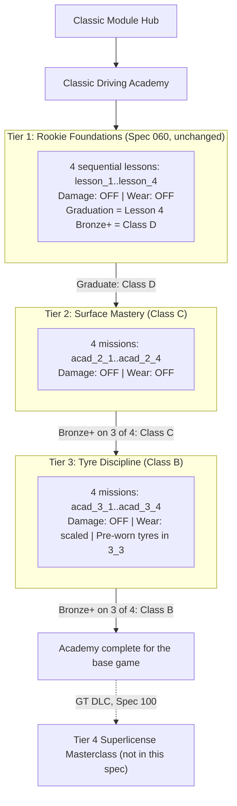

# Feature Spec: Classic Module Multi-Tier Academy Missions and Degradation Curriculum 🎓🏎️🏁

Extends the **Classic Academy** ([Spec 060](060_classic_academy_and_grassroots_career_onboarding.md), implemented) into a progressive curriculum on the 18 fictional Classic circuits ([Spec 055](055_classic_circuits_revamp.md)) and the dual-currency economy ([Spec 053](053_dual_currency_economy_and_branching_career_progression_architecture.md)). The Academy stays a **driving school** and a **risk-free credit engine**. Tier 1 is the course that Spec 060 already ships. This spec adds **Tier 2 (surface mastery, Class C)** and **Tier 3 (tyre discipline, Class B)**, and the engine switches those missions need: per-mission damage, per-mission tyre wear scale, and pre-worn tyres.

> **Revision note (2026-10-11).** This draft was written on 2026-09-29, before Spec 060 was built. It is aligned to the code on `main` and to [Spec 100](100_dlc_architecture_and_modular_base_game_content_packaging.md). Changes from the original text: (1) Tier 1 is the four Spec 060 lessons, unchanged, not a new set of `acad_1_*` missions; (2) Tier 4 (pit stops, full damage) is out of scope and moves to the GT DLC, as Spec 100 section 3.B already says, because no Classic circuit has a pit lane; (3) the placeholder circuit names are replaced by real track slugs; (4) Spec 063 is superseded by [Spec 078](078_directional_impact_masking_engine_placement_damage_and_archetype_suspension_failure.md), so damage uses Spec 078; (5) the profile model is extended in place instead of replaced.

---

## 🎯 Executive Summary & Problem Statement

### 1.1 The Need for Progressive Driver Training
1. **The Skill Cliff**: after the Class D course, players go straight to career championships on dirt and tarmac. The Academy gives them a safe place to learn loose-surface control (Class C) and tyre care (Class B) before the career asks for it.
2. **Underused Circuit Variety**: [Spec 055](055_classic_circuits_revamp.md) ships 18 circuits in 6 groups. Spec 060 uses 4 of them. Tiers 2 and 3 use 8 more.
3. **The Credit Drought Safety Net**: a player who spends everything on a car needs a reliable place to earn Credits by driving well.

### 1.2 Core Design Principles
- **Progressive Degradation Gating** (Classic module, Academy sessions only):
  - *Tiers 1 and 2*: **damage off, tyre wear off.** The player learns lines, braking points and loose-surface control.
  - *Tier 3*: **damage off, tyre wear scaled up** (`wear_rate_scale`, default 3.0 for the tier, tuned in the calibration task). The player learns that sliding and over-driving ruin the tyres. Tier 3 does not use "cosmetic-only" damage: the engine has no cosmetic-only mode, and Spec 078 damage changes handling.
  - *Tier 4 is not in this spec* (see section "Out of Scope").
- **Academy sessions own their rules.** An Academy session sets damage and wear itself, whatever the player's `gameplay.car_damage` setting is, and restores the player's setting when the session ends.
- **Tiered Earning Engine**: Bronze, Silver and Gold medals pay one-time bounties (Bronze 50%, Silver 25%, Gold 25% of the mission purse, the same split Spec 060 uses). Cleared missions can be re-run for a Test Driver Stipend.
- **Stipend**: Tier 1 keeps the Spec 060 stipend of 1,500 Cr. Tier 2 pays 2,000 Cr and Tier 3 pays 3,000 Cr. At most **5 stipends per local calendar day** are paid, across all tiers.

---

## 🗺️ User Flow & Interface Design

### 1. Academy Tier Progression

### 2. Academy Menu
The Academy screen (`ui/academy_ui.rs`) shows one tier at a time with tab selection (gamepad and keyboard parity through the existing nav). Each mission card shows the circuit, car, medal, best time and purse. Locked tiers show the unlock rule.

### 3. HUD Coaching in Tier 3
The cockpit HUD already shows per-wheel temperature and wear ([Spec 079](079_tactical_hologram_cockpit_telemetry_hud.md), [Spec 089](089_tactical_cockpit_hud_tire_compound_borders_and_inrace_wheel_decoupling.md)) and a "BOX THIS LAP" alert above 60% wear ([Spec 062](062_circuit_pit_lanes_and_interactive_pit_stop_procedures.md)). Tier 3 adds only a mission banner line with the live **worst-wheel wear against the mission cap** (for example `WEAR 31% / 40%`). It reuses the existing thermal colours: blue cold, green optimal, red overheated. The original "pit entry delta" overlay is out of scope with Tier 4.

---

## 🏎️ Curriculum Structure & Mission Matrix

Circuit slugs and car ids are the real ones from Spec 055 and `module/classic.rs`. **All target times, drift scores and wear caps below are initial values.** The calibration task sets the final numbers from a headless reference run on each circuit (Gold about 3% over the reference lap, Silver about 12%, Bronze about 25%). A mission whose Bronze target cannot be met cleanly by the reference run does not ship.

### Tier 1: Rookie Foundations (Class D) — Spec 060, unchanged
`lesson_1_apex_line` (`gt_velocity_park`), `lesson_2_braking_chicane` (`gt_ridge_ring`), `lesson_3_surface_transition` (`rx_quarry_sprint`), `lesson_4_graduation_sprint` (`ax_meadow_sprint`). Lesson ids, targets, bounties (14,500 Cr in total) and the sequential unlock stay as in Spec 060. The Spec 060 car price calibration depends on that total, so Tier 1 does not change. The unlock gate inside Tier 1 stays sequential. Credits and XP for Tier 1 do not change.

### Tier 2: Surface Mastery (Class C) — *Damage: OFF | Wear: OFF*
| Mission | Name | Circuit and car | Objective | Medal basis | Purse |
| :--- | :--- | :--- | :--- | :--- | :---: |
| `acad_2_1` | **Dirt Drift Angle** | `ax_clay_bowl`, `classic_ax_brawler` | 1 clean lap, scoring drift points on the dirt. | Best `drift_score` banked in the lap: 1200 / 900 / 600 | 5,000 |
| `acad_2_2` | **The Scandinavian Flick** | `rx_hilltop_leap`, `classic_rally` | 1 clean lap across tarmac-to-gravel transitions. | Lap time | 5,500 |
| `acad_2_3` | **Ramp Takeoff and Balance** | `at_dune_sea`, `classic_offroad` (Vortex Dune Crusher) | 1 lap with a clean landing off the big ramps. | Lap time, and every landing in the lap under the landing impulse limit | 6,500 |
| `acad_2_4` | **Mixed-Surface Qualifier** | `rx_canyon_flyer`, `classic_rally` | 2-lap sprint with the mandatory joker lap rule on ([Spec 082](082_mandatory_rallycross_joker_lap_tracking_and_penalty_enforcement.md)). | Total time including joker penalty | 8,000 |

Tier 2 purse total: 25,000 Cr.

### Tier 3: Tyre Discipline (Class B) — *Damage: OFF | Wear: scaled*
| Mission | Name | Circuit and car | Objective | Medal basis | Purse |
| :--- | :--- | :--- | :--- | :--- | :---: |
| `acad_3_1` | **Thermal Throttle Care** | `gt_ridge_ring`, `classic_gt` | 3-lap pace run. Worst-wheel wear at the flag stays under the cap (initial 40%). | Total time. A wear over the cap gives no medal. | 10,000 |
| `acad_3_2` | **Oval Stint Management** | `stock_tri_oval_speedway`, `classic_nascar` (Thunderbolt Stock V8) | 5-lap oval stint. Average speed over 180 km/h with worst-wheel wear under the cap. | Total time. A wear over the cap gives no medal. | 12,000 |
| `acad_3_3` | **Nursing Worn Rubber** | `gt_coastal_grand_prix`, `classic_gt` | Start with all four tyres at 65% wear. 2 clean laps. | Total time | 13,000 |
| `acad_3_4` | **Tyre Conservation Sprint** | `stock_roval`, `classic_nascar` | 4-lap sprint against 3 AI cars. Finish in the top 2 with worst-wheel wear under the cap. | Finishing position (1st Gold, 2nd Silver, 3rd or lower with the wear rule met Bronze) | 15,000 |

Tier 3 purse total: 50,000 Cr. Missions with a time basis use the Spec 060 clean-attempt rule (no heavy collision, off-track under 2 s). Car ids are the ones in `module/classic.rs`.

### Out of Scope: Tier 4
Tier 4 (pit lane entry, pit box stop, traffic with full damage, undercut, 8-lap finale with a mandatory stop) needs circuits with a pit lane. The Classic circuits have none (`pit_box_area: null`, [Spec 100](100_dlc_architecture_and_modular_base_game_content_packaging.md) section 3.B), and Spec 100 already assigns Tier 4 to the GT DLC with two new endurance circuits. A follow-up spec amends this one for Tier 4 after Spec 100 is built. It also owns the Class A grant, the mandatory-pit-stop rule, and the damage-on mode. The `Class S all-Gold finale` in Spec 053 is not part of this spec.

---

## ⚙️ Backend Models & API Endpoints

The profile model lives in `crates/arcade-race-core/src/profile.rs` (re-exported by `tdrace-core` and `tdrace-app`) and is stored as one JSON text column (`player_profiles.academy_progress`). **No SQL schema change.** Every new field uses `#[serde(default)]`, so existing saves load unchanged.

1. **Lesson ids.** `AcademyLessonId` gains 8 variants (`Acad2DirtDrift` ... `Acad3TyreConservation`) with slugs `acad_2_1` ... `acad_3_4` and a `tier()` accessor. Existing variant names, slugs, `index()` and `ALL` order stay for Tier 1 (a new `ALL_BY_TIER` or `tier_lessons(tier)` is added instead). Existing JSON keys keep working.
2. **Lesson definition.** `AcademyLessonDef` gains `tier: u8`, `rules: AcademySessionRules` (`damage_enabled: bool`, `wear_rate_scale: f32`, `start_wear: f32`, `laps: u32`, `bots: usize`, `joker_required: bool`) and `objective: AcademyObjective` (`BestTime`, `DriftScore`, `CleanLanding`, `WearCap { max_wear }`, `Podium { max_position, max_wear }`). The curriculum stays an in-code list in `default_curriculum()`.
3. **Progress.** `ClassicAcademyProgress` gains `stipend_day: Option<String>` (local date) and `stipends_today: u8`. `is_tier_unlocked(tier)` is added: Tier 1 always, Tier 2 when `is_graduated()`, Tier 3 and later when 3 of the 4 missions of the previous tier have Bronze or better. `is_lesson_unlocked` stays sequential for Tier 1 and becomes "tier unlocked" for Tiers 2 and 3.
4. **Licenses.** Passing Tier 2 grants `LicenseGrade::ClassC`. Passing Tier 3 grants `LicenseGrade::ClassB`. "Passing" means Bronze or better on 3 of 4 missions. A grade is never lowered. Class A and Class S are not granted here.
5. **Engine switches.**
   - `wear_rate_scale: f32` (default 1.0) multiplies the tread wear step. It is applied where `Car::step` calls `step_thermal_and_wear` (`wheelbase`), carried by the car config next to the existing `damage_enabled`. Changing a `wheelbase` config field is an engine API change and is covered by this spec.
   - `damage_enabled` already exists in `RaceRules` and `CarConfig`; the Academy session sets it through `apply_car_damage_setting`-style code and restores it at session end.
   - `start_wear` writes `wheel_assemblies[i].wear` for the player car at grid time.
6. **Evaluation.** `evaluate_academy_attempt` takes the lesson's `objective`. The one-time bounty logic (`record_attempt`) stays idempotent. The stipend runs for a cleared mission on re-run and respects the daily cap and the per-tier amount.
7. **UI.** `ui/academy_ui.rs` gets tier tabs. The 4-card layout stays; the tier tab picks which 4 cards show.
8. **HUD.** One banner line in `ui/hud.rs` for the wear-against-cap readout in `WearCap` and `Podium` missions.

---

## 🛡️ Security & Role-Based Access Controls (RBAC)

1. **Tier Gating**: Tier 2 needs Class D graduation. Tier N (N at least 3) needs Bronze or better on 3 of 4 missions in Tier N-1. Locked missions cannot start.
2. **One-Time Medal Bounty**: a first clear pays the bounty for the medal reached. A later better medal pays only the difference. A repeat or worse result pays no bounty, only the stipend.
3. **Stipend Rate Limit**: at most 5 stipends per local calendar day, per profile, across all tiers.
4. **Rules Isolation**: Academy rules (damage, wear scale, start wear) apply only inside an Academy session. After the session, the player's damage setting is back and every car in the next race has `wear_rate_scale = 1.0` and fresh tyres.
5. **License Portability**: licenses are recorded in `PlayerProfile.license_grade` and gate career modules through `LicenseGrade::required_for_category`. This spec does not change that table.
6. **Save Compatibility**: a profile saved before this spec loads with its Tier 1 medals, bounties and license intact.

---

## 🧪 Verification & Acceptance Criteria

### Automated Tests
- `cargo test -p arcade-race-core --test profile_tests` (tier unlock, license grants, stipend cap, save compatibility)
- `cargo test -p tdrace-app --test career_onboarding_tests` (Tier 1 behaviour unchanged, Academy session set-up, rules isolation)
- `cargo test -p wheelbase --test decoupled_tire_physics_tests` (wear scale ratio)
- Calibration test: a headless reference run per mission meets its own Bronze target (mission list ships only when it passes).

### Manual Acceptance Criteria (Pseudo-Gherkin)

- **Scenario: Tier 2 missions run with damage and wear off**
  - [ ] **Given** the player setting `gameplay.car_damage` is on and Tier 2 is unlocked
  - [ ] **When** the player starts `acad_2_1` and hits a wall at 100 km/h
  - [ ] **Then** the car rebounds with the normal collision response
  - [ ] **And** car health stays at 100% and no repair bill is created
  - [ ] **And** after a sustained drift all four wheels still show wear 0.0

- **Scenario: Tier 3 scales tyre wear**
  - [ ] **Given** the same car, circuit and sustained-slide input run twice, once with `wear_rate_scale` 1.0 and once with the Tier 3 value
  - [ ] **When** both runs reach the same distance
  - [ ] **Then** the worst-wheel wear of the Tier 3 run is the scale times the other run, within 5%
  - [ ] **And** the cockpit HUD wheel borders show the overheat colour in the Tier 3 run

- **Scenario: A worn-out finish in a wear-capped mission gives no medal**
  - [ ] **Given** a player driving `acad_3_1`
  - [ ] **When** the player finishes 3 laps faster than the Gold time with worst-wheel wear above the cap
  - [ ] **Then** the result screen shows `TYRES WORN OUT` and no medal
  - [ ] **And** no bounty is paid and the attempt counter rises by 1

- **Scenario: Nursing Worn Rubber starts on worn tyres**
  - [ ] **Given** a player starting `acad_3_3`
  - [ ] **When** the race starts at the grid
  - [ ] **Then** all four player wheels have wear 0.65
  - [ ] **And** the first following race outside the Academy starts with wear 0.0 on all wheels

- **Scenario: Tier unlock rules**
  - [ ] **Given** a profile graduated from Tier 1 with Bronze on 2 of 4 Tier 2 missions
  - [ ] **When** the player opens the Tier 3 tab
  - [ ] **Then** every Tier 3 mission is locked and shows the unlock rule
  - [ ] **And** after Bronze on a third Tier 2 mission, Tier 3 is unlocked

- **Scenario: Licenses follow tier passes and never go down**
  - [ ] **Given** a Class D profile
  - [ ] **When** the player earns Bronze on 3 of 4 Tier 2 missions
  - [ ] **Then** `license_grade` is `ClassC`
  - [ ] **And** after Bronze on 3 of 4 Tier 3 missions it is `ClassB`
  - [ ] **And** a profile that already holds Class A keeps Class A after passing Tier 2

- **Scenario: Medal bounties pay once, as deltas**
  - [ ] **Given** a profile with 5,000 Cr and no medal on `acad_2_1`
  - [ ] **When** the player earns Silver, then Gold, then Gold again
  - [ ] **Then** the balance is 5,000 + 3,750 after Silver and 5,000 + 5,000 after Gold
  - [ ] **And** the second Gold pays the stipend only, not a bounty

- **Scenario: Stipends are capped per day**
  - [ ] **Given** a profile with all Tier 2 missions cleared
  - [ ] **When** the player re-runs a Tier 2 mission 6 times on the same local day
  - [ ] **Then** the first 5 runs each pay 2,000 Cr
  - [ ] **And** the 6th pays 0 Cr and the result screen says the daily stipend limit is reached
  - [ ] **And** on the next local day the stipend pays again

- **Scenario: Old saves keep their Tier 1 progress**
  - [ ] **Given** a profile saved by the Spec 060 build with Gold on lesson 1 and a Class D license
  - [ ] **When** the profile loads in the new build
  - [ ] **Then** lesson 1 still shows Gold and its bounties are not paid again
  - [ ] **And** Tier 2 is unlocked only if Lesson 4 was cleared at Bronze or better

- **Scenario: Clean landing mission**
  - [ ] **Given** a player driving `acad_2_3`
  - [ ] **When** the car lands off a ramp with an impulse above the landing limit
  - [ ] **Then** the attempt is invalidated with the reason `Rough Landing`
  - [ ] **And** a lap with every landing under the limit and a time under the Bronze target earns a medal

---

## 🔗 Traceability & Codebase Mapping

### Modified Files
- `[ ]` `crates/arcade-race-core/src/profile.rs` -> lesson ids, `tier`, `AcademySessionRules`, `AcademyObjective`, tier unlock, license grants, stipend fields.
- `[ ]` `crates/tdrace-app/src/game/academy.rs` -> objective validators, stipend rule, session set-up with per-mission rules.
- `[ ]` `crates/tdrace-app/src/game/mod.rs` -> Academy session rules applied and restored (damage, wear scale, start wear), landing and wear checks in the race loop.
- `[ ]` `crates/tdrace-app/src/ui/academy_ui.rs` -> tier tabs and mission cards.
- `[ ]` `crates/tdrace-app/src/ui/hud.rs` -> wear-against-cap banner line.
- `[ ]` `crates/wheelbase/src/car.rs`, `crates/wheelbase/src/tire.rs`, `crates/wheelbase/src/config.rs` -> `wear_rate_scale` in the wear step.
- `[ ]` `crates/race-kit/src/world.rs` -> only if the wear scale is carried by `RaceRules` instead of the car config (decided in task 3).
- `[ ]` `crates/tdrace-app/tests/career_onboarding_tests.rs`, `crates/arcade-race-core/tests/profile_tests.rs` -> new and extended tests.
- `[ ]` `specs/constitution/ROADMAP.md` -> entry text matches the 3-tier scope.
