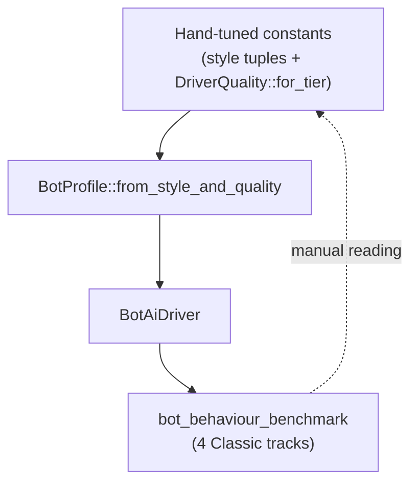
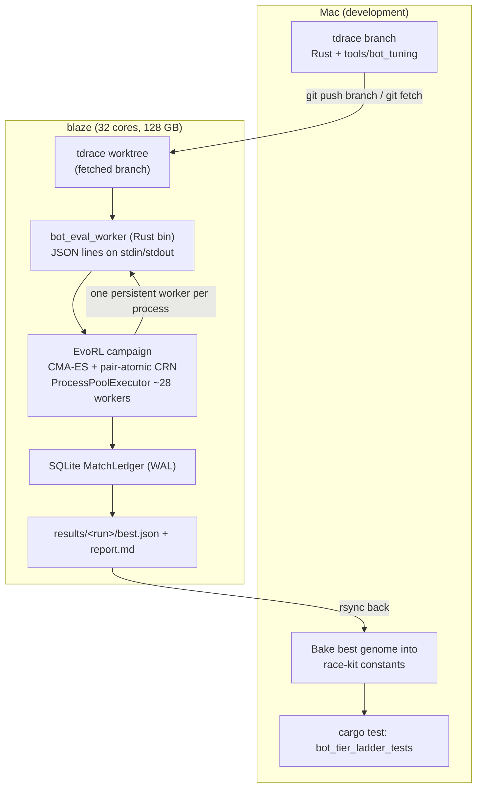

# Architecture Spec 083: EvoRL Bot Performance Calibration on the Launch Circuits 🧬🏁

Spec 083 builds an **offline** tuning pipeline. The pipeline uses the sibling **EvoRL** framework
([github.com/magomar/evorl](https://github.com/magomar/evorl)) on the **blaze** compute box to tune
the bot settings that exist today. The results are baked back into Rust constants. Nothing in the shipped
game depends on Python or EvoRL.

> **Scope note (rewrite of 2026-10-11).** The first draft of this spec bundled six jobs. This version keeps
> only the evaluation bridge, the throughput measurement and the calibration of existing settings. The rest
> moved to follow-up specs:
> - **Spec 107** — tactical racecraft (defend and draft states) and style-specific objectives.
> - **Spec 108** — data validation of the 72 `DriverPersonalityOffsets`.
>
> The review that caused the rewrite found: wrong track and car ids, a false throughput figure
> (4 M steps/s), 5 of 24 tuned parameters that do nothing in code, GT-only evaluation (GT is a post-launch
> DLC), and dependencies that `TECH_STACK.md` does not approve.

---

## 🔍 Context & Motivation

### 1. What exists today (verified 2026-10-11)
- **Controller**: `race_kit::ai::BotProfile` ([`crates/race-kit/src/ai/mod.rs`](../crates/race-kit/src/ai/mod.rs))
  has 7 continuous fields: `lookahead_time`, `speed_factor`, `steering_kp`, `steering_kd`, `brake_margin`,
  `aggression`, `avoidance_distance`, plus `traits: HumanTraits`.
- **Style x tier composition**: `BotProfile::from_style_and_quality` combines a per-style base tuple
  `(lookahead, kp, kd, brake, aggression, avoidance, speed_mult)` with `DriverQuality::for_tier`
  (`pace_limit`, `brake_padding`, `avoidance_padding`, `consistency`, `composure`).
- **Human layer**: `HumanTraits::for_style_and_quality` derives line wander, line choice, brake-point
  shift, corner-speed variance, mistake rate and mistake weights from `consistency` and `composure`
  ([`humanize.rs`](../crates/race-kit/src/ai/humanize.rs)). `reaction_tau_s` is computed but **not
  applied**: `shape_steer` dropped the steering lag on purpose to stop straight-line oscillation.
- **Harness**: `tdrace_app::ai::bot_harness::run_harness_race` runs a headless grid through
  `race_kit::RaceWorld` at `HARNESS_DT = 1/120 s`. It returns lap times, spins, offs, mistakes,
  `longest_no_progress_s`, `finished` and an FNV `controls_hash`.
- **Benchmark**: `bot_behaviour_benchmark` runs 6 styles x 5 tiers on 4 Classic tracks
  (`gt_coastal_grand_prix`, `stock_tri_oval_speedway`, `gt_ridge_ring`, `kart_pine_grove`).
- **Measured throughput**: 1.86 M steps/s for one car and 120 k steps/s for the 8-car collision solver
  ([`docs/receipts/spec-084-receipt.md`](../docs/receipts/spec-084-receipt.md)). Nobody has measured
  full-race throughput with AI.

### 2. The problem
1. **Tuned on 4 tracks, all in the Classic module.** The 2026-09-29 report
   ([`reports/bot_behaviour_report.md`](../reports/bot_behaviour_report.md)) shows a good tier ladder on
   those 4 tracks. Nothing measures the other launch circuits: 20 Karting, 17 Autocross and
   20 Rallycross circuits, plus 14 more Classic circuits.
2. **Signs of trouble even on the sample.** On `kart_pine_grove`, T4 and T5 bots go 5.6–6.5 s without
   progress, and the T1–T2 lap spread is 8.7–9.4 %. On `stock_tri_oval_speedway`, T1 and T2 go
   15–16 s without progress.
3. **Hand tuning does not scale.** Each physics, tyre or circuit change needs a manual re-check of all
   tiers on all circuits.

### 3. Goal
1. Measure the bots on every closed-loop launch circuit with its own-category car.
2. Tune the shared controller and the 5 tier quality rows so that bots drive cleanly and hold the tier
   pace bands everywhere.
3. Keep a fast regression test in `cargo test` that guards the ladder.

---

## 🗺️ Current vs. Proposed System Architecture

### 1. Current architecture


### 2. Proposed architecture


### 3. Evaluation bridge: a Rust worker binary, not a PyO3 function
The first draft added `run_bot_evaluation_race` to `crates/tdrace-py`. That needs the harness and the car
catalog, which live in `tdrace-app` with `macroquad`, `kira` and `rusqlite`. `TECH_STACK.md` requires
`tdrace-py` to stay free of display and audio dependencies. Moving the harness and the catalog out of
`tdrace-app` is a large refactor.

**Decision:** add a new binary `crates/tdrace-app/src/bin/bot_eval_worker.rs`.
- It reads one JSON request per line on stdin and writes one JSON result per line on stdout.
- It reuses `run_harness_race`, the catalog and `official_track` unchanged.
- Each EvoRL worker process starts one `bot_eval_worker` child and keeps it for its whole life. The pipe
  cost (< 1 ms) is small against a race (expected 0.1–0.5 s).
- No new Rust crate and no `tdrace-py` change.

**Request** (one line):
```json
{"circuit": "kart/lonato", "car": "<car id>", "laps": 3, "seed": 17,
 "subject": {"style": "balanced", "tier": 4, "genome": {"lookahead_time": 0.38, "...": 0.0}},
 "opponents": [{"style": "balanced", "tier": 4}], "subject_slot": 0, "max_time_s": 400.0}
```

**Result** (one line): `subject_rank`, `finished`, `dnf`, `lap_times`, `mean_flying_lap`,
`best_lap`, `spins`, `offs`, `mistakes`, `longest_no_progress_s`, `controls_hash`, `steps`,
`wall_time_ms`, and `error` (null on success). The worker never panics on bad input. It returns
`error` and keeps reading.

**Genome clamping:** the worker clamps every genome value to the search box in §4 before use. A NaN or
infinite value, in the input or in any result field, makes the result an `error`. EvoRL scores an error
as `Outcome.ERROR`.

---

## 📐 What gets tuned

### 1. Parameters that exist in code (the only ones in scope)
| Stage | Parameter | Code location | Search box |
| :--- | :--- | :--- | :--- |
| **A: shared controller** | `lookahead_time` (Balanced base) | style tuple in `from_style_and_quality` | 0.25 – 0.55 s |
| | `steering_kp` (Balanced base) | same | 1.50 – 3.50 |
| | `steering_kd` (Balanced base) | same | 0.03 – 0.12 |
| | `brake_margin` (Balanced base) | same | 0.85 – 1.30 |
| | `speed_mult` (Balanced base) | same | 0.94 – 1.06 |
| **B: tier ladder** (x 5 tiers) | `pace_limit` | `DriverQuality::for_tier` | 0.70 – 1.10 |
| | `brake_padding` | same | -0.08 – 0.30 |
| | `consistency` | same | 0.40 – 1.00 |
| | `composure` | same | 0.30 – 1.00 |

- **Stage A** tunes the Balanced style tuple. The other 5 style tuples keep their current offsets from
  Balanced, so styles move with the shared controller and stay distinct. Tuning the style offsets
  themselves is spec 107.
- **Stage B** tunes 4 values per tier (20 values, run tier by tier from T4 outward). `avoidance_padding`
  stays fixed: it shapes pack behaviour, which is spec 107.
- **Out of scope:** `reaction_tau_s` (not applied in code), the 4 parameters with no code
  (`wake_align_gain`, `defend_threshold_ttc`, `defend_corridor_bias`, `scan_lookahead_gain`), and the
  per-style `aggression` and `avoidance` values.

### 2. Circuits and cars
- **Launch modules only:** `classic`, `kart`, `autocross`, `rally` (Rallycross). Each circuit runs with
  its own-category car from that module (same rule as `classic_circuits_bot_tests.rs`). One table,
  `launch_circuit_cars()`, holds the pairs.
- **Closed-loop circuits only.** A circuit that the harness cannot run as a lap race is excluded. The
  report lists each exclusion and the reason.
- **Training set (13):**
  - classic: `gt_coastal_grand_prix`, `stock_tri_oval_speedway`, `gt_ridge_ring`, `kart_pine_grove`
  - kart: `lonato`, `genk`, `whilton_mill`
  - autocross: `maggiora_ax`, `nova_paka_ax`, `st_junien_ax`
  - rally: `holjes_rx`, `mettet_rx`, `montalegre_rx`
- **Held-out set:** every other closed-loop launch circuit (about 60). The campaign never sees them.
- **Circuits with a known circuit bug** are left out of the held-out checks while that bug is open.
  These are the Rallycross circuits listed in `tdrace-699t6`, `tdrace-xg1x`, `tdrace-bppc` and
  `tdrace-4nmh3` (13 circuits at the baseline audit). Their bots fail to finish, stall for minutes, or
  set impossible laps, so they cannot measure the bot. The report still shows them. They are
  re-checked after spec 105 (Rallycross joker redraw) lands.

> **Amendment (2026-10-11).** The baseline audit found these circuit bugs after approval.
> `lydden_hill` (24 DNFs) was replaced in training by `mettet_rx` (no stalls, no DNFs).

### 3. Fitness
**Stage A (shared controller).** This stage uses T4 Balanced head-to-head against the current baseline
profile in 2-car races. Seats are swapped with the same seed (EvoRL pair-atomic common random numbers).
- The outcome is WIN, DRAW or LOSS by finish order. A DNF, or more than 3 wall contacts, is a LOSS.
  A wall contact is a wall impact after at least 0.25 s without one, so one scrape counts once.
- The ranking uses the Wilson 95 % lower bound on the win rate (EvoRL default).
- A match is *disqualified* if the subject spins or goes more than 10 s without progress (the
  `classic_circuits_bot_tests` limit). The score is the Wilson bound minus the share of disqualified
  matches. A hard reject is not used, because the T4 baseline already spins on Karting circuits
  (`tdrace-4dyav`): every candidate would be rejected.
- The baked candidate must not spin more, or stall more, than the baseline on the training circuits.

**Stage B (tier ladder).** The fitness is the pace-band error, from the result metrics:

$$E_k = \max\left(0,\ |\Delta_k - c_k| - h_k\right)^2,\qquad \Delta_k = \frac{\bar T_{k}}{\bar T_{\text{T4}}} - 1$$

| Tier | Target centre $c_k$ | Half-width $h_k$ |
| :--- | :--- | :--- |
| T1 Rookie | +13.0 % | 3.0 % |
| T2 Amateur | +7.0 % | 2.0 % |
| T3 Contender | +2.5 % | 1.0 % |
| T4 Pro | 0 % (reference) | — |
| T5 Legend | −2.25 % | 0.75 % |

- The penalty for a DNF and for no-progress is the same as in Stage A.
- **Tier composure ladder:** mistakes per lap must not rise from tier $k$ to tier $k+1$.
- If EvoRL's emitters cannot rank by a scalar score, Stage B calls the `cma` package directly in the
  same campaign script.

### 4. Statistical acceptance (replaces "strict" ordering on single runs)
Races are noisy. A tier order counts as *held* on a circuit when the mean flying lap of tier $k+1$ is
below tier $k$ by more than 2 standard errors. The standard error comes from **8 seeds x 3 laps**.

---

## ⚡ Compute plan: blaze

### 1. Where things run
| Work | Machine | Why |
| :--- | :--- | :--- |
| Rust code, unit tests, `bot_tier_ladder_tests` | Mac | Fast edit loop. |
| Throughput benchmark | blaze (and Mac for comparison) | Sets the campaign budget. |
| Baseline audit on all launch circuits | blaze | About 60 circuits x 5 tiers x 8 seeds. |
| Stage A and Stage B campaigns | blaze | Many CPU hours. EvoRL and its `.venv` live only on blaze. |
| Held-out validation | blaze | Full sweep. |
| Baking constants, final benchmark report | Mac | Reviewed commit. |

### 2. blaze workflow
1. On the Mac, commit and push the feature branch. The user's git policy pre-authorizes pushing working
   branches.
2. On blaze, use a **separate worktree**: `git -C /home/mario/workspace/games/tdrace worktree add
   ../tdrace-083 <branch>`. The main blaze checkout stays on `main`.
3. Initialize the `tracks` submodule in that worktree. It must match the pinned commit, because
   `build.rs` embeds circuits.
4. Build: `cargo build --release -p tdrace-app --bin bot_eval_worker`.
5. Run the campaign from the EvoRL venv: `source ~/.local/bin/env` first (blaze puts `uv` on PATH only in
   login shells). Start it with `setsid nohup ... & disown`. Logs and the pid go to
   `.driver_jobs/<run>/`. Use the `run-blaze` helper with `BLAZE_DIR` set to the tdrace worktree.
6. Pull back `results/<run>/best.json`, `results/<run>/report.md` and `results/<run>/campaign.json`
   (the seed, the EvoRL commit and the tdrace commit). The SQLite ledger stays on blaze unless a
   follow-up question needs it.

### 3. Budget
The budget is set from the measured throughput (task 2), not guessed. Planning estimate: 0.1–0.5 s per
3-lap 2-car race per core, so about 60–280 races/s on 28 workers. One Stage A generation is
(population 14) x (13 circuits) x (4 seed pairs) x 2 seats = 1,456 races, about 5–25 s. A full
Stage A + B campaign fits in an overnight run.

---

## 🧰 Tech Stack Amendment (part of this spec)
`TECH_STACK.md` gets a new row group, **"Offline bot tuning (not shipped)"**:
- **EvoRL**: git dependency `magomar/evorl`, pinned commit, installed only in the blaze tuning venv.
- **`cma` >= 3.2.2**: an EvoRL dependency.
- **Python >= 3.11**: only in the tuning venv (EvoRL needs 3.11). The game's `python/tdrace` package stays
  at >= 3.10.
- **SQLite via Python `sqlite3` (stdlib)**: EvoRL `MatchLedger`, a tuning artefact only.

No new Rust crates. `pyproject.toml` runtime dependencies do not change.

---

## 🔑 Security, Compliance, & IAM Roles
- No secrets, keys or new network services. blaze is reached over the existing Tailscale SSH setup.
- The tuning tools run offline. Nothing in the shipped game reads their output at runtime.

---

## 🗄️ Database & Storage Migration Plan
- **Ledger**: EvoRL `SQLiteMatchLedger` in WAL mode on blaze, under `results/<run>/ledger.sqlite`.
  It is not committed.
- **Committed artefacts**: the new constants in `crates/race-kit/src/ai/mod.rs`,
  `reports/bot_calibration_report.md` (before/after tables for training and held-out circuits), and
  `tools/bot_tuning/runs/<run>.json` (the seed, the commits and the best genome).
- **No runtime override file.** The first draft's `assets/ai/calibrated_profiles.toml` and its checksum
  fallback are dropped. The constants are plain Rust, and git keeps the history.

---

## 🛡️ Disaster Recovery, Monitoring, & Fallbacks
- **No bot-only rescue.** A stuck bot means a real bug in the bot, the circuit or the physics. The fix
  goes there, not into a teleport or a reset. The existing driving recovery (`stuck_timer`,
  `no_progress_timer`, `ThreePointTurn`) is not changed by this spec.
- **A circuit that blocks a car of its own category** is reported as a circuit or physics bug in Beads.
  The campaign does not tune around it.
- **The per-tick bot loop** keeps the same allocation behaviour. This spec changes constants only, not
  `compute_controls`.
- **Rollback:** revert the bake commit. The old constants come back unchanged.

---

## 🧪 Verification & Acceptance Criteria

### Automated tests
```bash
cargo test -p race-kit ai
cargo test -p tdrace-app --test bot_eval_worker_tests
cargo test -p tdrace-app --release --test bot_tier_ladder_tests
cargo test -p tdrace-app --test bot_humanlike_driving_tests
cargo test -p tdrace-app --test classic_circuits_bot_tests
cargo run -p tdrace-app --release --bin bot_behaviour_benchmark
```

### Manual Acceptance Criteria (Pseudo-Gherkin)

#### Scenario: Worker returns the same result as the Rust harness
- [x] **Given** a `bot_eval_worker` request for `gt_coastal_grand_prix`, 3 laps, seed 17, T4 Balanced against T4 Balanced
- [x] **When** the same race runs through `run_harness_race` directly in a Rust test
- [x] **Then** both give the same `controls_hash` and the same lap times
- [x] **And** two worker runs with the same request give the same `controls_hash`.

#### Scenario: Worker survives bad input
- [x] **Given** a running `bot_eval_worker`
- [x] **When** it receives malformed JSON, an unknown circuit, an unknown car, and a genome with a NaN value
- [x] **Then** it answers each line with a result whose `error` is set
- [x] **And** it answers the next valid request correctly.

#### Scenario: Throughput is measured and recorded
- [x] **Given** the release `bot_eval_worker` on blaze and on the Mac
- [x] **When** the throughput benchmark runs 3-lap 2-car races on the 13 training circuits
- [x] **Then** `reports/bot_calibration_report.md` records races/s and car-steps/s for 1 worker and for 28 workers on blaze, and for 1 worker on the Mac.

#### Scenario: Baseline audit covers every launch circuit
- [x] **Given** the current (pre-tuning) constants
- [x] **When** the audit runs all 5 tiers x 8 seeds on every closed-loop circuit of the classic, kart, autocross and rally modules
- [x] **Then** the report lists, per circuit, the tier pace deltas against T4, DNFs, spins and the longest no-progress time
- [x] **And** every excluded circuit is listed with a reason
- [x] **And** every circuit where an own-category car is stuck has a Beads issue.

#### Scenario: Calibrated tiers hold the pace ladder on training circuits
- [x] **Given** the baked Stage A and Stage B constants
- [x] **When** 8 seeds x 3 laps run per tier on each of the 13 training circuits
- [x] **Then** the tier order T5 < T4 < T3 < T2 < T1 holds (by the 2-standard-error rule) on all 13 circuits
- [x] **And** each tier's mean delta against T4 is inside its band in the Stage B table on at least 11 of 13 circuits
- [x] **And** no T3–T5 bot goes more than 10 s without progress.

#### Scenario: Calibration generalizes to held-out circuits
- [x] **Given** the baked constants
- [x] **When** the same sweep runs on every held-out launch circuit without an open circuit bug (see "Circuits and cars")
- [x] **Then** the tier order holds on at least 90 % of those circuits
- [x] **And** the T4 DNF count is no higher than the baseline audit on every circuit
- [x] **And** the T4 Stage A win rate against the old baseline, over all held-out circuits, is at least 50 %.

#### Scenario: Regression gate in cargo test
- [x] **Given** `bot_tier_ladder_tests` on the 4 `SAMPLE_TRACKS`
- [x] **When** `cargo test -p tdrace-app --release --test bot_tier_ladder_tests` runs
- [x] **Then** it fails if the tier order breaks, or if T5 is slower than T4, on any sample track
- [x] **And** it finishes in under 120 s on the Mac.

#### Scenario: Existing bot behaviour stays intact
- [x] **Given** the baked constants
- [x] **When** `bot_humanlike_driving_tests`, `classic_circuits_bot_tests` and `bot_curb_cutting_tests` run
- [x] **Then** they all pass
- [x] **And** the 6 styles still show distinct mistake mixes in `bot_behaviour_benchmark` (each style's top mistake kind is unchanged).

---

## 🔗 Traceability & Codebase Mapping

### Created/Modified Files
- [x] `crates/tdrace-app/src/bin/bot_eval_worker.rs` -> JSON-lines evaluation worker over `run_harness_race`.
- [x] `crates/tdrace-app/src/ai/bot_harness.rs` -> `launch_circuit_cars()` table and a genome-to-`BotProfile` helper with clamping.
- [x] `crates/tdrace-app/tests/bot_eval_worker_tests.rs` -> Determinism, parity and bad-input tests.
- [x] `crates/tdrace-app/tests/bot_tier_ladder_tests.rs` -> Fast tier-ladder regression gate.
- [x] `crates/race-kit/src/ai/mod.rs` -> Baked Stage A style tuple and Stage B `DriverQuality::for_tier` rows.
- [x] `tools/bot_tuning/harness.py` -> EvoRL `PlayFn` that drives a persistent `bot_eval_worker`.
- [x] `tools/bot_tuning/run_campaign.py` -> Throughput benchmark, baseline audit, Stage A, Stage B, held-out sweep.
- [x] `tools/bot_tuning/export.py` -> Prints the Rust constant table from `best.json` for review.
- [x] `tools/bot_tuning/runs/<run>.json` -> Seeds, commits and best genome of the baked run.
- [x] `reports/bot_calibration_report.md` -> Throughput, baseline audit, before/after and held-out results.
- [x] `specs/constitution/TECH_STACK.md` -> "Offline bot tuning (not shipped)" rows.
- [x] `specs/constitution/ROADMAP.md` -> Updated 083 entry; 107 and 108 entries.

### Verification Assertions
- `bot_eval_worker.rs`, `bot_tier_ladder_tests.rs` and `tools/bot_tuning/*.py` reference
  `specs/083_evorl_bot_driving_style_and_performance_optimization.md` in their header comments.
