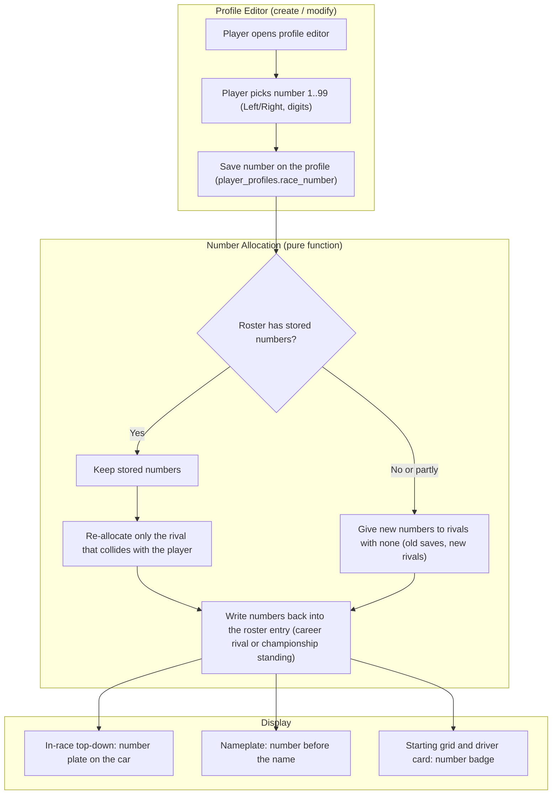

# Feature Spec: Player Preferred Racing Number Customization and Persistent Non-Conflicting Bot Grids 🏎️🔢

In motorsport a racing number identifies the driver. In **TdRace** today no car shows a number: the vehicle sprites (`assets/textures/vehicles/{laterals,topdown}/**`) that were sampled in a contact sheet (GT, NASCAR, Rallycross) show no baked numbers, the player cannot choose one, and AI rivals have no number at all. Starting grids, nameplates and results identify rivals by name only.

> **Review note (2026-10-11).** The first draft assumed a sprite clean-up, a new livery editor, a new RNG dependency and a per-grid bot pool. A check against the code on `main` showed that: sprite and logo clean-up belongs to [Spec 047](047_fictional_branding_and_realworld_ip_removal_for_steam_release.md); the player livery picker and the bot colour de-duplication already exist; `rand` is not a `tdrace-app` dependency; and rosters now reach 32 drivers ([Spec 104](104_autocross_and_rallycross_tournament_sprint_weekend_format.md)). This text is the reduced scope. Out of scope is listed at the end.

This specification establishes:
1. **Player racing number:** a number from `1` to `99`, chosen in the profile editor and saved on the player profile.
2. **Roster-wide unique bot numbers:** every AI rival in a roster (career rivals, championship or tournament standings, or a casual grid) gets one number. No two drivers in the roster share a number, and none shares the player's number.
3. **Persistence:** a rival keeps its number across heats, rounds and championship races. Only a rival that collides with a new player number is given a new number.
4. **Procedural number plate:** the number is drawn at run time on the car (top-down view), on the in-race nameplate and on the starting grid and driver card. Vehicle sprites are not edited.

---

## 🗺️ User Flow & Interface Design



### 1. Number selection (profile editor)
- A new field in the profile create and modify screens (`GameState::ProfileCreate`, drawn in `profile_ui.rs`) lets the player step through `1..=99` with Left/Right and type digits. The garage (`ui/garage.rs`) is a car showroom and shop, so it is not used.
- The number is stored on the profile as `PlayerProfile.race_number: u8`. New and existing profiles default to `PlayerProfile::DEFAULT_RACE_NUMBER` (`7`).
- Livery colours are **not** changed by this spec. The existing `PlayerProfile.color_scheme` picker stays as it is.

### 2. Display
- **Top-down in-race:** the number is drawn on the car by the car renderer at an anchor derived from the existing `ChassisSkeleton` (roof or cabin centre), rotated with the car heading. Open-wheel and kart bodies use the cabin centre (driver seat). `ChassisSkeleton` in `wheelbase` is not changed.
- **Nameplate:** `VehicleNameplateItem` gets the number; the plate shows `#NN NAME`.
- **Starting grid and driver card:** the participant row and card show a number badge. `GridParticipant` gets `race_number: u8`.
- **Lateral (showroom) sprites:** no number is drawn. Door anchors would need data for every sprite. See Out of Scope.
- The player's own number is shown in the same way as rivals.

---

## 🧭 Visual Standards & Technical Conventions

### 1. Sprites are not edited
- No sprite is repainted by this spec. Removal of real logos and sponsor marks, and the audit for baked text, stay in Spec 047. The number plate is drawn over the existing sprite or procedural body.
- Sprite bodies and procedural bodies (Classic cars without a sprite) get the same plate.

### 2. Number font and plate
- Digits use the bold display typeface ([`Rajdhani-Bold`](../crates/cabinet/src/ui/font.rs)).
- Contrast rule (pure function, unit tested): white glyphs with a black outline when the body colour luminance is below 0.5, black glyphs with a white outline otherwise. The colour used is the car's effective primary colour.
- Rotation follows vehicle heading. In top-down view the digits read along the +X heading.
- The plate size is bounded by the cabin length and body width from the skeleton, so it stays legible on karts and is never larger than the roof.

---

## ⚙️ Backend Models & API Endpoints

### 1. Persistence (no new table)
New data goes into columns and JSON blobs that already exist, so only one SQLite change is needed.

| Data | Where | Change |
| :--- | :--- | :--- |
| Player number | `player_profiles` | New column `race_number INTEGER NOT NULL DEFAULT 7` (`ALTER TABLE` migration in `db/mod.rs`, same pattern as `license_grade`). `PlayerProfile.race_number: u8`, `#[serde(default = ...)]`. |
| Career rival number | `profile_module_progress.career_rivals` (JSON) | `CareerRivalEntry.race_number: Option<u8>` with `#[serde(default)]`. |
| Championship and tournament rival number | `profile_module_progress.active_championship` (JSON) | `SeriesStandingEntry.race_number: Option<u8>` with `#[serde(default)]`. |
| Casual race (Quick, Custom, split screen) | not stored | Numbers come from the allocator with the grid seed. Casual rosters are re-sampled for every race today, so they are not persistent either. |

`None` means "no number yet". Old saves load with `None` and get numbers on first use. No migration of the JSON is needed.

### 2. Allocator (`crates/tdrace-app/src/ai/`, new file `racing_number.rs`)
```rust
/// Fills in missing numbers and fixes collisions. Returns one number per rival, in order.
/// `stored[i]` is the number already saved for rival i, if any.
pub fn allocate_rival_numbers(
    player: u8,
    stored: &[Option<u8>],
    seed: u64,
) -> Result<Vec<u8>, RosterTooLarge>
```
Rules:
1. Valid numbers are `1..=99`. A stored number outside this range counts as missing.
2. A stored number that equals `player`, or that appeared earlier in `stored`, counts as missing. Earlier entries win, so only the colliding rival changes.
3. Each rival with a missing number takes the next number from a pool of the unused numbers, shuffled with `LcgRng::new(seed)` (the existing `race-kit` RNG; no new dependency).
4. A roster of more than 98 rivals cannot be numbered. The function does not panic and does not return duplicates: it returns `RosterTooLarge`. The caller logs it and shows no numbers for that roster. Real rosters are 8 to 64 (Spec 104).
5. The function is pure and deterministic: same inputs, same output.

Call site: `Game::rebuild_roster_participants`, the one place that builds every grid, after the opponent list is resolved and before the participants are built. For career and championship rosters the result is written back to the `CareerRivalEntry` or `SeriesStandingEntry` and saved through the existing save path. The pool is the whole roster (up to 32 or 64 drivers), not the 8 cars of one heat, so a rival has the same number in the heat, the semifinal and the final.

### 3. Persistence rules
- **Stable:** a stored, valid, non-colliding rival number is never changed.
- **Player number change:** the profile is saved first. The next `rebuild_roster_participants` runs the allocator, and only a rival with the same number as the player gets a new one. Other rivals keep their numbers.
- **Bot colours:** unchanged. `resolve_bot_color_scheme` keeps de-conflicting colours per grid against the player and the cars already on that grid. Colour uniqueness across a 32-driver roster is not possible with the 9 preset colours and is not required.
- **Split screen:** player 2 gets a number from the allocator like a rival slot. It is not stored.
- **LAN multiplayer:** out of scope. LAN lobbies show no numbers.

---

## 🛡️ Security & Role-Based Access Controls (RBAC)

1. **Range validation, fail closed:** `race_number` is a `u8` validated to `1..=99` on input, on profile load and on roster load. A value outside the range, from damaged data, is treated as missing. It is never drawn and never used as an index.
2. **No free text:** the number is chosen with digits and arrows only, so no string reaches the database. All SQL uses bound parameters, as the existing `update_profile` does.
3. **Determinism:** the allocator uses `LcgRng` with an explicit seed and has no clock or global state. The physics crates (`wheelbase`, `arcade-race-core`, `race-kit`) are not changed.
4. **Headless boundary:** font and drawing code stay in `tdrace-app` (`render`, `ui`). The allocator is pure and has no graphics dependency.

---

## 🧪 Verification & Acceptance Criteria

- **Scenario: Player defines a preferred racing number**
  - [x] **Given** the player opens the profile editor
  - [x] **When** the player sets the number to 7 and saves
  - [x] **Then** the number is stored in `player_profiles.race_number` and is still 7 after the profile is reloaded from the database
  - [x] **And** the player car, the nameplate and the starting grid row show 7

- **Scenario: Out-of-range number is rejected**
  - [x] **Given** a stored player number of 0 or 100 (damaged data), or a typed number of 150
  - [x] **When** the profile loads or the player confirms the field
  - [x] **Then** the value is clamped or replaced by the default
  - [x] **And** an invalid number never reaches the allocator or the renderer

- **Scenario: Grid generation eliminates duplicate numbers**
  - [x] **Given** the player number is 17
  - [x] **When** an 8-car grid is built for a Quick Race
  - [x] **Then** exactly one car carries 17
  - [x] **And** the 7 AI cars carry numbers that differ from 17 and from each other

- **Scenario: Tournament roster of 32 drivers is unique**
  - [x] **Given** an Autocross or Rallycross tournament weekend with the player and 31 rivals
  - [x] **When** the 4 heats, the 2 semifinals and the final are built
  - [x] **Then** all 32 drivers have different numbers
  - [x] **And** every rival has the same number in the heat, the semifinal and the final

- **Scenario: Rival numbers persist across rounds and saves**
  - [x] **Given** a career or championship roster has been numbered
  - [x] **When** the player finishes round 1, the profile is saved and reloaded, and round 2 is built
  - [x] **Then** every rival has the number it had in round 1

- **Scenario: Player number change re-allocates only the colliding rival**
  - [x] **Given** one rival has number 42 and the others have other numbers
  - [x] **When** the player changes their number to 42 and the next grid is built
  - [x] **Then** that rival gets a new unused number
  - [x] **And** all other rivals keep their numbers
  - [x] **And** no two cars on the grid share a number

- **Scenario: Old save without numbers loads cleanly**
  - [x] **Given** a saved career or championship whose rival entries have no `race_number`
  - [x] **When** the game loads it and builds a grid
  - [x] **Then** the save loads without error
  - [x] **And** the rivals get unique numbers that differ from the player's

- **Scenario: Allocator is deterministic and does not overflow**
  - [x] **Given** the same player number, stored numbers and seed
  - [x] **When** the allocator runs twice
  - [x] **Then** both runs return identical numbers
  - [x] **And** a roster of 99 rivals returns `RosterTooLarge` with no duplicate numbers and no panic

- **Scenario: Number plate is legible and anchored to the car**
  - [x] **Given** a Classic kart, an Autocross car and a Rallycross car (Steam v1 categories)
  - [x] **When** the race is drawn at the default camera zoom
  - [x] **Then** the number is centred on the cabin or roof, rotated with the car, and inside the body outline
  - [x] **And** the glyph colours follow the body luminance rule (unit tests of the anchor and contrast functions, plus one screenshot per category)

---

## 🚫 Out of Scope
- Sprite repainting, logo removal and neutral number roundels (Spec 047 and Spec 093 own sprites).
- Numbers on lateral showroom sprites (needs door anchor data for each sprite; a later spec).
- A new livery editor, an accent colour, or colour persistence for bots.
- Numbers `0`, `00` and `100..=999`.
- LAN multiplayer numbers (protocol change).
- Numbers in series TOML files (`DriverConfig`), replays and ghost cars.

---

## 🔗 Traceability & Codebase Mapping

### Modified Files
- `[x]` [`crates/tdrace-app/src/profile/mod.rs`](../crates/tdrace-app/src/profile/mod.rs) -> `PlayerProfile.race_number` and default.
- `[x]` [`crates/tdrace-app/src/db/mod.rs`](../crates/tdrace-app/src/db/mod.rs) -> `race_number` column migration, insert and update.
- `[x]` [`crates/tdrace-app/src/ai/career.rs`](../crates/tdrace-app/src/ai/career.rs) -> `CareerRivalEntry.race_number`.
- `[x]` [`crates/tdrace-app/src/series/mod.rs`](../crates/tdrace-app/src/series/mod.rs) -> `SeriesStandingEntry.race_number`.
- `[x]` `crates/tdrace-app/src/ai/racing_number.rs` (new) -> `allocate_rival_numbers`.
- `[x]` [`crates/tdrace-app/src/game/mod.rs`](../crates/tdrace-app/src/game/mod.rs) -> `GridParticipant.race_number`, allocator call in `rebuild_roster_participants`, profile editor input, plate draw call, nameplate items.
- `[x]` [`crates/tdrace-app/src/ui/profile_ui.rs`](../crates/tdrace-app/src/ui/profile_ui.rs) -> number field in the create and modify screens.
- `[x]` [`crates/tdrace-app/src/render/car.rs`](../crates/tdrace-app/src/render/car.rs) -> plate anchor, contrast and draw.
- `[x]` [`crates/tdrace-app/src/render/marker.rs`](../crates/tdrace-app/src/render/marker.rs) -> number on `VehicleNameplateItem`.
- `[x]` [`crates/tdrace-app/src/ui/starting_grid.rs`](../crates/tdrace-app/src/ui/starting_grid.rs) and [`crates/tdrace-app/src/ui/driver_card.rs`](../crates/tdrace-app/src/ui/driver_card.rs) -> number badge.
- `[x]` `crates/tdrace-app/tests/racing_number_tests.rs` (new) -> allocator, persistence, grid and tournament tests.

### Verification Assertions
- Verification receipts will be recorded via `keel receipt 092 --cmd "cargo test -p tdrace-app --test racing_number_tests"`.
