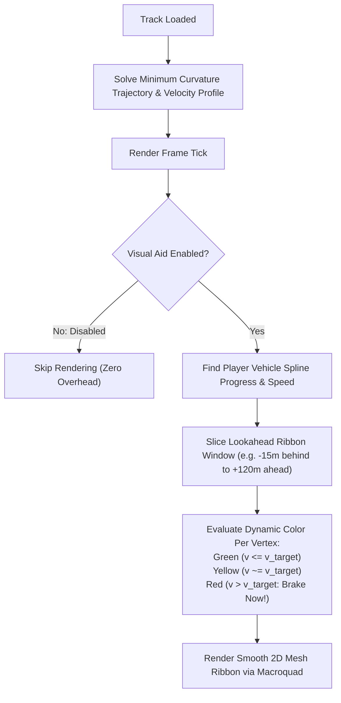

# Feature Spec: Mathematically Ideal Racing Line Visual Aid 🌟🏎️📐

A comprehensive visual driving aid and mathematical trajectory specification for **TDRace**, introducing a real-time, glanceable, and physically grounded **Mathematically Ideal Racing Line Visual Aid**. Built on constrained minimum-curvature spline optimization and two-pass forward-backward velocity profiling, this system projects an adaptive racing line and dynamic braking ribbon onto the circuit surface, helping drivers master apex clipping, braking thresholds, and corner-exit trajectories across all 6 motorsport disciplines.

---

## 🎯 Executive Summary & Feasibility Assessment

### 1.1 Problem Statement
In top-down high-speed racing ($100\text{--}250\,\text{km/h}$), learning unfamiliar circuits, identifying geometric turn-in points, clipping apexes, and gauging braking thresholds requires extensive trial and error. While [Spec 037](037_player_car_visibility_aids_and_locator_mechanisms.md) introduced car visibility aids and [Spec 085](085_bifurcation_pacenote_hud_driving_aids_and_decluttered_track_junctions.md) added junction pacenotes, the game lacks a continuous on-track trajectory aid. Furthermore, in [Spec 046](046_humanlike_bot_driving_with_tiered_mistakes_and_varied_lines.md), Decision D1 explicitly deferred computing an optimal racing line to a dedicated specification.

### 1.2 Feasibility Analysis
**Conclusion: Highly Feasible.** Computing and rendering an optimal racing line is a well-established discipline in motorsport engineering and game development (e.g. Forza, Gran Turismo, Assetto Corsa), and directly aligns with TDRace's architecture:

1. **Mathematical Feasibility (Convex Quadratic Program)**:
   - The circuit track ribbon is parameterized by continuous arc-length splines (`TrackSpline`, [Spec 071](071_centripetal_catmullrom_and_variable_density_track_splines.md)) with discrete centerline samples $\mathbf{c}_i$, left unit normals $\mathbf{N}_i$, and drivable half-widths $w_{L,i}, w_{R,i}$.
   - The trajectory path is parameterized by scalar lateral offsets $n_i$:
     $$\mathbf{r}_i = \mathbf{c}_i + n_i \mathbf{N}_i$$
   - Minimizing total squared curvature $\sum_i \|\mathbf{r}_{i+1} - 2\mathbf{r}_i + \mathbf{r}_{i-1}\|^2$ subject to box boundary constraints $-w_{R,i} + d_{\text{margin}} \le n_i \le w_{L,i} - d_{\text{margin}}$ is a **strictly convex quadratic program (QP)** with a single unique global optimum.
   - It converges in $<5\,\text{ms}$ using projected successive over-relaxation (SOR) or tridiagonal matrix solvers, and can be pre-computed at track bake time (`track_bake`, [Spec 042](042_jsononly_official_circuit_catalog_and_embedded_track_data.md)) or cached in memory upon circuit load with zero runtime per-frame overhead.

2. **Physics Feasibility (Velocity Profiling)**:
   - Given the geometric trajectory $\mathbf{r}(s)$ and local path curvature $\kappa(s)$, the maximum steady-state cornering velocity is bounded by tire grip:
     $$v_{\text{corner}}(s) = \sqrt{\frac{\mu(s) \cdot g}{\kappa(s)}}$$
   - A standard two-pass numerical integration (backward braking pass with deceleration $a_{\text{brake}}$, followed by forward acceleration pass with $a_{\text{accel}}$) computes the target velocity profile $v^*(s)$ across every point on the circuit.

3. **Rendering & Frame Budget Feasibility**:
   - Rendered using Macroquad 2D triangle strips in [`crates/race-ui`](../crates/race-ui) as part of the track surface pass.
   - Positioned above asphalt and runoff textures, but beneath vehicles, tire smoke, and HUD elements.
   - Requires $<0.15\,\text{ms}$ per frame with zero heap allocation during render ticks.

4. **Gameplay & Player Guidance Feasibility**:
   - The line dynamically adapts its coloration ahead of the player car based on the player's current speed $v_{\text{player}}$ compared to the target cornering speed $v^*(s)$:
     - **Vibrant Green**: Acceleration / Full Throttle zone ($v_{\text{player}} \le v^*(s)$).
     - **Amber / Yellow**: Lift / Coast / Turn-in zone ($v^*(s) < v_{\text{player}} \le v^*(s) + \Delta v_{\text{safe}}$).
     - **Bright Crimson Red**: Hard Braking zone ($v_{\text{player}} > v^*(s) + \Delta v_{\text{safe}}$).
   - If the player brakes early and achieves safe turn-in speed, the red braking ribbon dynamically cools back to green!

---

## 🧮 Mathematical Formulation

### 2.1 Geometric Optimal Path (Curvature Minimization)
For a track with $N$ discrete spline samples, we solve for the lateral displacement vector $\mathbf{n} = [n_0, n_1, \dots, n_{N-1}]^T$:

$$\min_{\mathbf{n}} \mathcal{J}(\mathbf{n}) = \sum_{i=0}^{N-1} \left\| \mathbf{r}_{i+1} - 2\mathbf{r}_i + \mathbf{r}_{i-1} \right\|^2 + \lambda \sum_{i=0}^{N-1} (n_i - n_{\text{target}, i})^2$$

where:
- $\mathbf{r}_i = \mathbf{c}_i + n_i \mathbf{N}_i$ is the 2D world position.
- Periodic boundary conditions apply for closed circuits: $n_N = n_0$, $n_{-1} = n_{N-1}$.
- $\lambda \ge 0$ is an optional regularization term centering the line on high-speed straights.
- Boundary box constraints enforce car clearance from curbs/walls:
  $$-w_{R, i} + d_{\text{margin}} \le n_i \le w_{L, i} - d_{\text{margin}}$$
  with $d_{\text{margin}} = \frac{1}{2} w_{\text{car}} + 0.35\,\text{m}$. If curbs exist and are driveable, the boundary expands smoothly into the curb outer edge.

### 2.2 Numerical Solver
The objective expands into quadratic form:
$$\mathcal{J}(\mathbf{n}) = \frac{1}{2} \mathbf{n}^T \mathbf{A} \mathbf{n} - \mathbf{b}^T \mathbf{n} + c$$
where $\mathbf{A}$ is a symmetric, positive-definite pentadiagonal cyclic matrix.
The system is solved via:
1. **Projected Gauss-Seidel / Successive Over-Relaxation (SOR)** with over-relaxation parameter $\omega \approx 1.25$.
2. Lateral clamping to boundary box constraints after each iteration:
   $$n_i^{(k+1)} = \text{clamp}\left( (1 - \omega) n_i^{(k)} + \omega \frac{b_i - \sum_{j \ne i} A_{ij} n_j}{A_{ii}}, -w_{R,i} + d_{\text{margin}}, w_{L,i} - d_{\text{margin}} \right)$$
3. Convergence reached when $\max_i |n_i^{(k+1)} - n_i^{(k)}| < 10^{-4}\,\text{m}$ (typically $\le 40$ iterations, $<3\,\text{ms}$).

### 2.3 Forward-Backward Velocity Profiling
Once optimal positions $\mathbf{r}_i$ are found:
1. **Local Curvature Calculation**:
   $$\kappa_i = \frac{2 \det(\mathbf{r}_i - \mathbf{r}_{i-1}, \mathbf{r}_{i+1} - \mathbf{r}_i)}{\|\mathbf{r}_i - \mathbf{r}_{i-1}\| \|\mathbf{r}_{i+1} - \mathbf{r}_i\| \|\mathbf{r}_{i+1} - \mathbf{r}_{i-1}\|}$$
2. **Kinematic Cornering Ceiling**:
   $$v_{\text{corner}, i} = \sqrt{\frac{\mu_i \cdot g \cdot (1 + \alpha_{\text{downforce}} \cdot \kappa_i^{-0.2})}{\max(\kappa_i, 10^{-4})}}$$
3. **Backward Deceleration Pass (Braking Threshold)**:
   For $i = N-1 \text{ down to } 0$:
   $$v_i = \min\left(v_i, \sqrt{v_{i+1}^2 + 2 \cdot a_{\text{brake}} \cdot \Delta s_i}\right)$$
4. **Forward Acceleration Pass (Traction Limit)**:
   For $i = 0 \text{ up to } N-1$:
   $$v_{i+1} = \min\left(v_{i+1}, \sqrt{v_i^2 + 2 \cdot a_{\text{accel}} \cdot \Delta s_i}\right)$$

---

## 🗺️ User Flow & Interface Design

### 3.1 In-Race Visual Presentation


1. **Surface Ribbon Geometry**:
   - Renders as a smooth 2D textured mesh strip ($0.75\,\text{m}$ width) along the optimal trajectory $\mathbf{r}(s)$.
   - Outer glow / soft edge fade to blend naturally into asphalt or dirt surfaces without harsh polygonal aliasing.
   - Segmented chevron / arrow hashes along the ribbon center indicating recommended driving orientation.

2. **Player-Adaptive Dynamic Braking Zones**:
   - Rather than static red stripes, the braking indicator reflects the driver's **instantaneous kinematic threat**:
     - Approaching a $70\,\text{km/h}$ hairpin at $180\,\text{km/h}$: The ribbon turns neon red starting at the exact required braking onset distance $d_{\text{brake}} = \frac{v^2 - v_{\text{target}}^2}{2 a_{\text{brake}}}$.
     - As the player applies brakes and slows down, the red zone recedes towards the corner entry and shifts to yellow/green.
     - If the player enters well below cornering speed, the entire corner turns reassuring green.

3. **Multi-Surface & Route Support**:
   - Adapts to surface friction $\mu$ across mixed surfaces (dirt, gravel, sand, asphalt).
   - In circuits with branching routes (Joker Laps, [Spec 081](081_rallycross_joker_lap_segments_for_classic_and_openstreetmap_circuits.md); Pit Lanes, [Spec 062](062_circuit_pit_lanes_and_interactive_pit_stop_procedures.md)), the visual aid follows the currently selected or active route layout.

### 3.2 Controls & Settings Integration

1. **Settings Menu Navigation**:
   - In `Settings > Gameplay > Visual Aids`:
     - **RACING LINE**: Dropdown option:
       - `Full (Line & Dynamic Braking)` (Default)
       - `Line Only (Constant Guidance)`
       - `Braking Only (Dynamic Zones)`
       - `Disabled`
     - **RACING LINE OPACITY**: Slider from `20%` to `100%` (Default: `70%`).

2. **In-Race Hotkey**:
   - Pressing <kbd>6</kbd> on keyboard cycles through racing line modes on the fly:
     `FULL` $\to$ `LINE ONLY` $\to$ `BRAKING ONLY` $\to$ `OFF` $\to$ `FULL`.
   - Displays a brief HUD toast notification matching [Spec 037](037_player_car_visibility_aids_and_locator_mechanisms.md) conventions:
     `VISUAL AID [6]: RACING LINE (FULL)`.

---

## ⚙️ Backend Models & API Endpoints

### 4.1 Trajectory Data Model (`arcade-race-core::track::optimal_line`)
In [`crates/arcade-race-core/src/track/`](../crates/arcade-race-core/src/track/):

```rust
/// Precomputed node along the mathematically ideal racing line.
#[derive(Debug, Clone, PartialEq, Serialize, Deserialize)]
pub struct OptimalLineNode {
    /// 2D coordinate along the optimal trajectory.
    pub point: Vec2,
    /// Tangent vector along the trajectory.
    pub tangent: Vec2,
    /// Lateral offset from track spline centerline in meters (+ = left, - = right).
    pub lateral_offset: f32,
    /// Cumulative arc length distance along the line (meters).
    pub distance: f32,
    /// Local trajectory curvature (1 / radius).
    pub curvature: f32,
    /// Baseline optimal target cornering speed in m/s.
    pub target_speed: f32,
}

/// Complete mathematically optimal trajectory for a circuit or layout.
#[derive(Debug, Clone, PartialEq, Serialize, Deserialize, Default)]
pub struct OptimalRacingLine {
    /// Solved nodes sampled along the track.
    pub nodes: Vec<OptimalLineNode>,
    /// Total trajectory length in meters.
    pub total_length: f32,
}

impl OptimalRacingLine {
    /// Solves the constrained minimum-curvature quadratic optimization problem for a track spline.
    pub fn compute_for_spline(spline: &TrackSpline, margin_m: f32) -> Self;

    /// Evaluates target speed and dynamic braking urgency at a given distance and approach velocity.
    pub fn evaluate_braking(&self, dist: f32, current_speed: f32) -> BrakingUrgency;
}
```

### 4.2 Configuration Model (`tdrace-app::config::PlayerHelpersConfig`)
In [`crates/tdrace-app/src/config.rs`](../crates/tdrace-app/src/config.rs) and [`crates/cabinet/src/state/settings.rs`](../crates/cabinet/src/state/settings.rs):

```rust
/// Racing line visual aid display mode.
#[derive(Debug, Clone, Copy, PartialEq, Eq, Serialize, Deserialize, Default)]
#[serde(rename_all = "snake_case")]
pub enum RacingLineMode {
    #[default]
    Full,
    LineOnly,
    BrakingOnly,
    Disabled,
}

// Added to PlayerHelpersConfig:
pub racing_line_mode: RacingLineMode,
pub racing_line_opacity: f32, // [0.20, 1.00], default 0.70
```

### 4.3 Rendering Pipeline (`race-ui::render::optimal_line`)
In [`crates/race-ui/src/render/`](../crates/race-ui/src/render/):
- `render_optimal_racing_line(spline, optimal_line, player_pos, player_speed, config)`:
  - Selects nodes within visible camera viewport plus lookahead window ($-15\,\text{m}$ to $+120\,\text{m}$).
  - Builds dynamic vertex buffer with smooth width extrusion ($0.75\,\text{m}$) and interpolated RGBA vertex colors.
  - Draws batched triangles in a single low-overhead draw call.

---

## 🛡️ Security & Role-Based Access Controls (RBAC)

### 1. Invariants & Determinism Guarantees

1. **Zero Physics Mutation (Read-Only Visual Aid)**:
   - The visual aid operates strictly as a read-only visual overlay. It consumes vehicle telemetry (`position`, `speed`) and track geometry, but has zero write authority over `wheelbase::Car`, `CarControls`, collision checks, or track surfaces.
   - Simulation state and race results remain bit-identical whether the visual aid is set to `Full`, `LineOnly`, or `Disabled`.
2. **Headless & Embedded Safety**:
   - `OptimalRacingLine` computation resides in `arcade-race-core` and uses only `glam` and `serde`. It contains zero graphical dependencies and compiles seamlessly for `wasm32-unknown-unknown` and headless benchmark harnesses.
3. **Leaderboard & Career Compliance**:
   - Player lap times, race victories, and career progress are legitimately earned with or without visual aids enabled. If competitive online time trials are introduced in the future, `PlayerProfile` telemetry recordings can flag assist states without corrupting local records.

---

## 🧪 Verification & Acceptance Criteria

### Automated Tests
- Command to run core mathematical trajectory tests:
  `cargo test -p arcade-race-core optimal_line`
- Command to run visual aid settings and config tests:
  `cargo test -p tdrace-app racing_line`
- Command to run rendering primitive tests:
  `cargo test -p race-ui optimal_line_render`

### Manual Acceptance Criteria (Pseudo-Gherkin)

- **Scenario: Minimum-curvature solver converges within track boundaries**
  - [x] **Given** an official circuit with hairpin turns, chicanes, and long straights
  - [x] **When** `OptimalRacingLine::compute_for_spline` is executed
  - [x] **Then** the solver converges in fewer than 60 iterations ($\le 5\,\text{ms}$)
  - [x] **And** every solved node position $\mathbf{r}_i$ satisfies $-w_{R,i} + d_{\text{margin}} \le n_i \le w_{L,i} - d_{\text{margin}}$
  - [x] **And** the total curvature $\int \kappa^2 ds$ of the optimal line is at least 15% lower than the track centerline.

- **Scenario: Dynamic braking zone turns red on high-speed approach and clears upon braking**
  - [x] **Given** a vehicle approaching a tight hairpin at top speed ($180\,\text{km/h}$)
  - [x] **When** the vehicle enters the calculated braking threshold zone
  - [x] **Then** the visual aid ribbon turns bright crimson red over the required braking distance
  - [x] **When** the driver applies full brakes and slows down to cornering speed ($70\,\text{km/h}$)
  - [x] **Then** the red braking zone recedes and shifts dynamically to green before the apex.

- **Scenario: In-race hotkey [6] cycles visual aid modes**
  - [x] **Given** an active race session with `racing_line_mode = Full`
  - [x] **When** the player presses the key <kbd>6</kbd>
  - [x] **Then** the mode toggles to `LineOnly`, and a HUD notification displays `VISUAL AID [6]: RACING LINE (LINE ONLY)`
  - [x] **When** pressed again, it toggles to `BrakingOnly`, then `Disabled`, then back to `Full`.

- **Scenario: Settings persistence across game sessions**
  - [x] **Given** the player navigates to `Settings > Gameplay > Visual Aids`
  - [x] **When** `RACING LINE` is set to `Line Only` and opacity is set to `0.50`
  - [x] **Then** the configuration is persisted to `config.toml` under `[player_helpers]`
  - [x] **And** restarts of the application retain `racing_line_mode = LineOnly` and `racing_line_opacity = 0.50`.

- **Scenario: Zero performance impact when disabled**
  - [x] **Given** `racing_line_mode` is set to `Disabled`
  - [x] **When** `render_optimal_racing_line` is called in the render loop
  - [x] **Then** zero draw calls and zero heap allocations occur for the racing line.

---

## 🔗 Traceability & Codebase Mapping

| File | Purpose & Impact |
| :--- | :--- |
| `crates/arcade-race-core/src/track/optimal_line.rs` | Core mathematical formulation: QP solver, curvature minimization, velocity profiling. |
| `crates/arcade-race-core/src/track/mod.rs` | Exports `OptimalRacingLine` and trajectory structs. |
| `crates/race-ui/src/render/optimal_line.rs` | 2D triangle mesh ribbon renderer with speed-adaptive dynamic color shading. |
| `crates/race-ui/src/render/mod.rs` | Integration into main track surface render pass. |
| `crates/cabinet/src/state/settings.rs` | Adds `RacingLineMode` and opacity controls to `Gameplay > Visual Aids` sub-tab. |
| `crates/tdrace-app/src/config.rs` | Extends `PlayerHelpersConfig` with persistence fields. |
| `crates/tdrace-app/src/game/mod.rs` | Handles key <kbd>6</kbd> hotkey cycling and in-race state propagation. |
| `crates/arcade-race-core/tests/optimal_line_tests.rs` | Unit tests verifying QP convergence, curvature reduction, and boundary compliance. |
| `crates/tdrace-app/tests/racing_line_tests.rs` | Integration tests verifying config serialization, hotkey toggle, and HUD toast events. |
