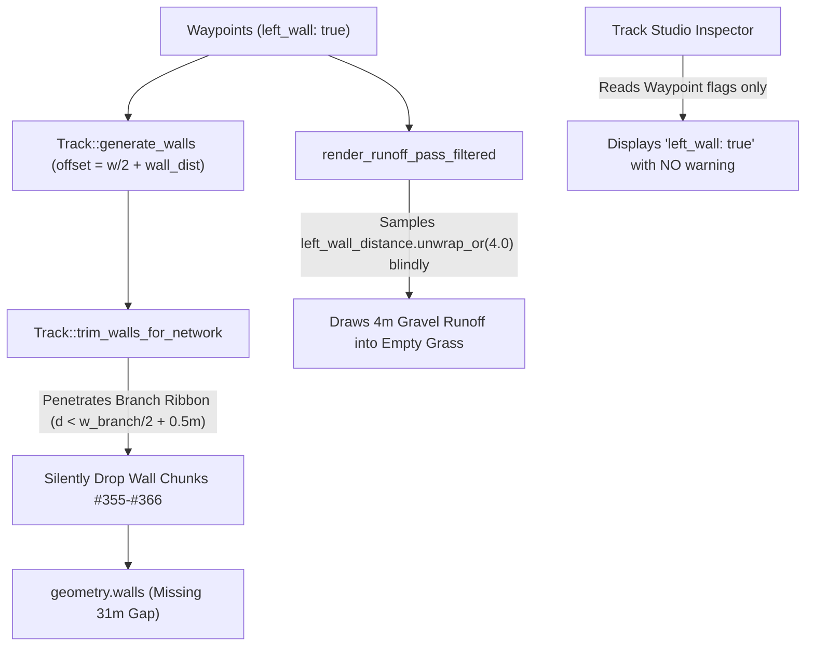
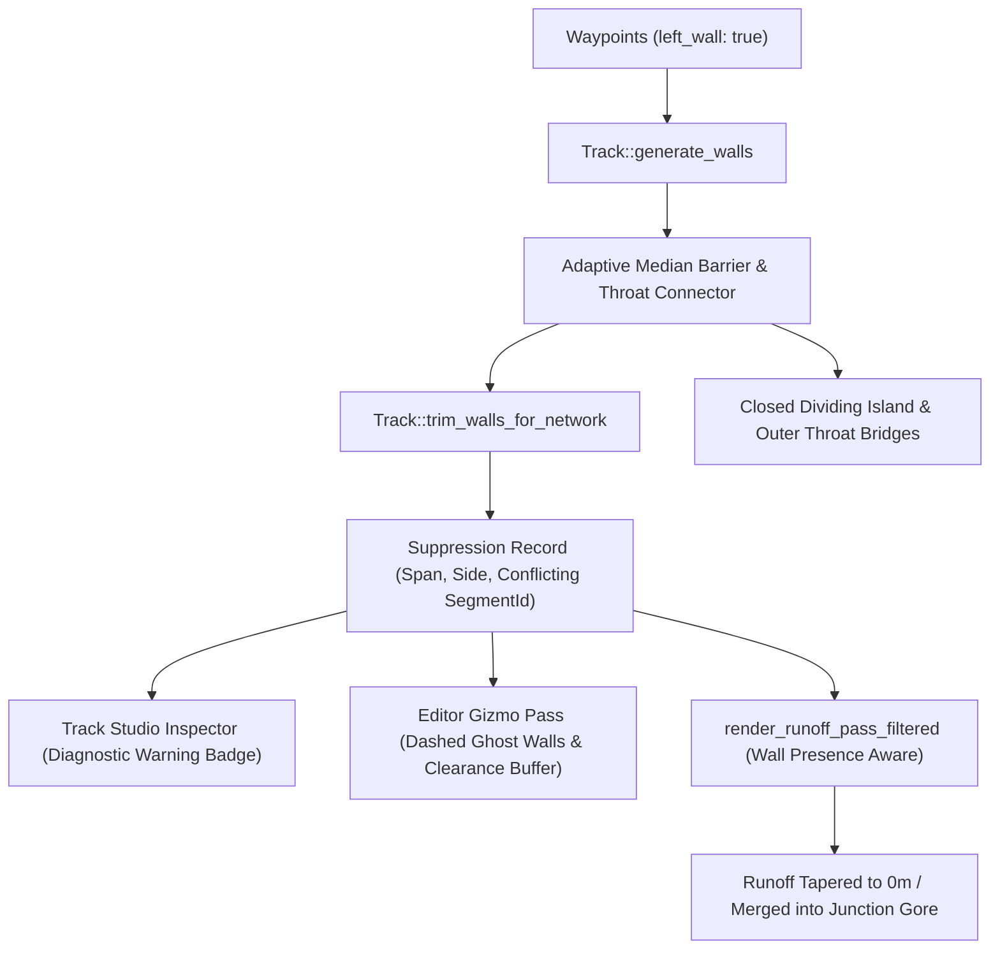

# Architecture Spec: Junction Throat Wall Diagnostics, Adaptive Median Barriers, and Runoff Consistency 🏗️

At split and merge junctions across track networks (such as the Joker Lap split in Kouvola RX and other rallycross circuits), track authors frequently encounter disappearing walls: waypoints have `left_wall: true` or `right_wall: true` configured, yet in the Track Studio and in-race view, the physical wall abruptly terminates, leaving a 10–40 m open gap.

This occurs because procedural track compilation (`trim_walls_for_network`) automatically prunes any wall segment that encroaches on an adjacent road's clearance corridor (`wall_clear_of_roads`). While this prevents solid physical walls from slicing across drivable roads, it introduces three major defects:
1. **Silent Pruning in Track Studio**: The authoring UI provides zero diagnostic feedback explaining why a wall configured on the waypoint was removed.
2. **Phantom Runoff Corridors in the Renderer**: The runoff terrain generator (`render_runoff_pass_filtered`) blindly projects a 4 m gravel shoulder assuming the wall exists, creating a dead-end gravel corridor terminating in open grass.
3. **Open Throat Wall Gaps in Bifurcations**: In the wedge between diverging roads (the gore area) and at the outer junction corner, no dividing barrier or throat connector bridge is synthesized, leaving an unprotected void (tracked in Bead `tdrace-74s5`).

This specification establishes an integrated architectural solution across Track Studio diagnostics, runoff shoulder rendering, and procedural bifurcation geometry.

---

## 🗺️ Current vs. Proposed System Architecture

### 1. Current Architecture

Currently, walls are generated strictly parallel to the track centerline at `offset = road_width/2 + wall_distance`. During network baking, `trim_walls_for_network` evaluates every 1 m piece against all road centerlines:

### 2. Proposed Architecture

The proposed architecture introduces:
1. **Wall Suppression Metadata**: Emitted during baking to feed editor diagnostics and the renderer.
2. **Runoff Tapering**: Tapers runoff width to $0\text{ m}$ where walls are pruned.
3. **Adaptive Median Barriers**: Dynamically centers barriers in expanding gore wedges when $G(t) \ge 2.2\text{ m}$.
4. **Outer Throat Funnel Bridges**: Connects severed wall ends across split/merge outer corners.

---

## 🗄️ Database & Storage Migration Plan

- **Zero-Downtime & JSON Track File Schema**:
  - No changes to track JSON schema (`tracks/*/*.json`). The existing `TrackWaypoint` fields (`left_wall`, `right_wall`, `left_wall_distance`, `right_wall_distance`) remain 100% backward-compatible.
  - `WallSuppressionRecord` structures are computed transiently in memory during `Track::rebuild_geometry` and stored in `TrackGeometry::wall_suppressions`, requiring no file serialization or schema migrations.
- **Track Catalog Re-bake**:
  - Re-baking catalog tracks automatically computes adaptive median barriers and closes outer throat gaps without altering track spline centerlines, waypoint indices, or lap timing benchmarks.

---

## 🔑 Security, Compliance, & IAM Roles

- **Memory Safety & Zero Allocation in Runtime Queries**:
  - The in-game collision queries against `geometry.walls` and `geometry.network_walls` continue using the optimized spatial cell grid (`WallGrid`), adding negligible memory overhead (< 2 KB per circuit for throat bridges).
- **Circuit Homologation & Rule Compliance**:
  - All procedural barriers generated by adaptive placement must maintain at least $w/2 + 0.3\text{ m}$ distance from all road centerlines, preventing physical barriers from intruding on sanctioned racing corridors.
  - Bot navigation lines and speed targets remain untouched because barriers are placed strictly outside the active asphalt/dirt ribbon.

---

## 🛡️ Disaster Recovery, Monitoring, & Fallbacks

- **Algorithmic Fallbacks**:
  - If the divergence angle between two roads exceeds $60^\circ$ or if road edges converge irregularly, adaptive median barrier generation is bypassed for that station, gracefully falling back to standard `wall_clear_of_roads` pruning and recording a `WallSuppressionRecord`.
  - If a throat bridge segment would intersect another segment's drivable surface, `wall_clear_of_roads` immediately drops the bridge, preventing track obstruction.
- **Diagnostic Telemetry & Studio Logging**:
  - `Track::rebuild_geometry` logs suppression metrics to the Track Studio log console (`"Track baked with N wall suppressions: [Segment X vs Segment Y]"`).
  - Validation checks in `track/validation.rs` flag unresolved open wall gaps greater than $0.5\text{ m}$ at junction throats as warnings (`WARN_JUNCTION_WALL_GAP`).

---

## 🧪 Verification & Acceptance Criteria

### Automated Tests

- **Editor Wall Suppression Diagnostic Test**:
  `cargo test --package tdrace-app --test track_editor_tests test_wall_suppression_diagnostics_on_road_conflict`
  - Validates that compiling a track where a wall intersects another road populates `track.geometry.wall_suppressions` with the correct `SegmentId`.
- **Runoff Shoulder Tapering Test**:
  `cargo test --package race-ui --test track_render_tests test_runoff_shoulder_tapers_where_wall_suppressed`
  - Validates that vertex generation for runoff tapers width to 0 m at suppressed wall boundaries instead of maintaining constant 4 m width.
- **Adaptive Median Barrier Generation Test**:
  `cargo test --package arcade-race-core --test track_geometry_tests test_adaptive_median_barrier_in_diverging_gore`
  - Validates that two diverging segments generate a median wall once clearance $G(t) \ge 2.2\text{ m}$ rather than dropping all wall segments.
- **Junction Throat Outer Wall Closure Test (Bead `tdrace-74s5`)**:
  `cargo test --package tdrace-app --test rally_tracks_tests test_rx_main_road_is_walled_up_to_the_joker`
  - Validates that outer corners at split and merge throats across all 23 RX circuits have no unclosed gap $> 0.5\text{ m}$.

### Manual Acceptance Criteria (Pseudo-Gherkin)

- **Scenario: Track Studio displays inline warning for suppressed walls**
  - [ ] **Given** a track network containing a split junction (e.g. Kouvola RX WP 25)
  - [ ] **When** the author opens Track Studio and selects the junction waypoint with `left_wall: true`
  - [ ] **Then** the Waypoint Inspector displays a warning badge indicating that the left wall was suppressed due to clearance conflict with the branch segment
  - [ ] **And** the 2D viewport draws a dashed ghost wireframe indicating where the wall was pruned

- **Scenario: Runoff shoulder tapers smoothly without phantom dead-ends**
  - [ ] **Given** a track where a wall is pruned at a junction throat
  - [ ] **When** rendering the track runoff pass in `race-ui`
  - [ ] **Then** the gravel runoff shoulder tapers smoothly to 0 m width at the junction edge
  - [ ] **And** no detached gravel polygon extends into open grass beyond the pruned wall boundary

- **Scenario: Adaptive median barrier closes the gore wedge**
  - [ ] **Given** a split junction where two roads diverge at an angle $< 60^\circ$
  - [ ] **When** track geometry is baked
  - [ ] **Then** an adaptive median barrier is placed along the gore wedge starting as soon as clearance $G(t) \ge 2.2\text{ m}$
  - [ ] **And** the barrier maintains at least $0.3\text{ m}$ clearance from both road edges

- **Scenario: Outer corner throat gap is bridged**
  - [ ] **Given** an RX split or merge throat where the main outer wall stops at the branch edge
  - [ ] **When** track geometry is baked
  - [ ] **Then** a connecting throat bridge links the main wall end to the branch outer wall end
  - [ ] **And** no car can slip through the outer throat corner into off-track voids

---

## 🔗 Traceability & Codebase Mapping

### Created/Modified Files

- `[ ]` `crates/arcade-race-core/src/track/mod.rs` $\to$ Adds `WallSuppressionRecord`, tracking in `trim_walls_for_network`, adaptive median barrier generation, and outer throat funnel bridges.
- `[ ]` `crates/arcade-race-core/src/track/network.rs` $\to$ Exposes clearance gap calculation $G(t)$ across diverging roads.
- `[ ]` `crates/race-ui/src/render/track.rs` $\to$ Updates `render_runoff_pass_filtered` to taper runoff width where walls are suppressed.
- `[ ]` `crates/tdrace-app/src/editor/panels.rs` $\to$ Renders `WallSuppressionRecord` warning badge and tooltip in Waypoint Inspector.
- `[ ]` `crates/tdrace-app/src/editor/tools.rs` $\to$ Renders dashed ghost wall wireframes and clearance exclusion buffer gizmos.
- `[ ]` `crates/tdrace-app/tests/track_editor_tests.rs` $\to$ Unit tests for editor diagnostic warnings and ghost gizmos.
- `[ ]` `crates/tdrace-app/tests/rally_tracks_tests.rs` $\to$ Integration tests verifying throat closure across all 23 RX circuits.
