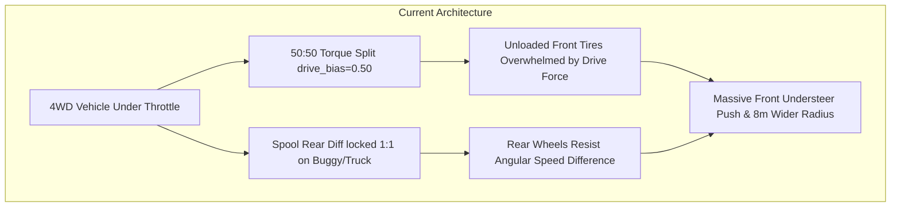
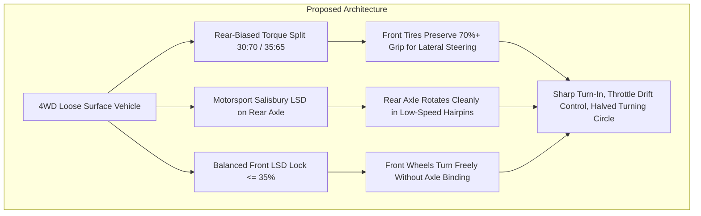

# Architecture Spec: 4WD Loose Surface Torque Split Differential Upgrades and Turn-In Dynamics ⚙️🏎️🛞

A comprehensive physics and vehicle configuration architecture specification that eliminates severe cornering push and sluggish turn-in on **four-wheel-drive (4WD) and all-wheel-drive (AWD)** vehicles across loose surfaces (dirt, gravel, clay, sand, and mud). Operating within the pure-Rust [`crates/wheelbase`](../crates/wheelbase) simulation engine and propagated through the vehicle catalogs of [`crates/tdrace-app`](../crates/tdrace-app), this specification unifies loose-surface torque distribution, replaces counterproductive locked spool differentials on 4WD buggies with Salisbury multi-plate limited-slip differentials, and tunes front differential locking thresholds to allow natural corner entry, throttle-induced rotation, and agile chicane direction reversals.

---

## 🗺️ Current vs. Proposed System Architecture

### 1. Current Architecture (50:50 Raw Lock & Spool Resistance)

In the current vehicle physics architecture:
1. **The Friction Ellipse Penalty of 50:50 Drive Bias**:
   When accelerating through a turn, weight shifts rearward, naturally decreasing normal load on the front axle ($F_{z,\text{front}}$) while increasing load on the rear axle ($F_{z,\text{rear}}$). Because non-rally 4WD vehicles default to `drive_bias = 0.50`, the unloaded front tires are forced to transmit $50\%$ of total engine tractive force while simultaneously generating lateral cornering force. Under the friction ellipse model, longitudinal force drastically shrinks available lateral grip, causing the front wheels to wash out into severe understeer ($+17.8^\circ$ slip angle discrepancy on dirt).
2. **The "Rally-Only" Gating in Catalog Finalization**:
   In [`crates/wheelbase/src/config.rs`](../crates/wheelbase/src/config.rs), [`CarConfig::with_rally_balance()`](../crates/wheelbase/src/config.rs) was created to fix this behavior on the classic Trailfire Turbo 4WD by capping front torque share at $30\%$ (`RALLY_FRONT_TORQUE_SHARE = 0.30`) and reducing rear tire grip to $0.92$ (`RALLY_REAR_GRIP_SCALE = 0.92`). However, [`crates/tdrace-app/src/catalog/mod.rs`](../crates/tdrace-app/src/catalog/mod.rs) only applies this fix if `self.category() == CarCategory::Rallycross`. As a result:
   - **Autocross Tier 3 (Buggy 1600, 265 BHP)**, **Tier 4 (Touring AX, 550 BHP)**, and **Tier 5 (SuperBuggy, 680 BHP)** remain trapped at a 50:50 split.
   - On tight circuits like Nova Paka AX, an 83% more powerful Tier 3 Buggy 1600 is actually **slower** on flying laps than a Tier 2 Cross Car (145 BHP RWD) because the buggy cannot rotate through hairpins.
3. **The Spool Rear Axle Inheritance**:
   [`CarConfig::super_buggy()`](../crates/wheelbase/src/config.rs) inherits from [`sand_rail()`](../crates/wheelbase/src/config.rs), which sets `rear_differential: DifferentialType::Spool` (100% mechanical lock). While appropriate for lightweight 2WD sand rails climbing dunes, a locked spool on a 4WD vehicle couples both rear wheels to turn at identical angular velocities, mechanically preventing the car from turning at low and mid speeds ($D_{\min} = 14.33\text{ m}$ vs $7.46\text{ m}$ with an LSD).
4. **Archetype Default Disconnect**:
   When instantiated directly via [`CarChoice`](../crates/tdrace-app/src/ui/menu.rs) (e.g. Quick Race, Custom Race, or Time Trial without a catalog model), constructors like `CarConfig::rally_car()`, `CarConfig::super_buggy()`, `CarConfig::touring_ax()`, and `CarConfig::trophy_truck()` do not include rear-biased torque distributions and default to `drive_bias = 0.50`.



---

### 2. Proposed Architecture (Unified Loose-Surface Drivetrain Calibration)



The proposed architecture establishes three foundational changes across wheelbase and application catalogs:

#### A. Unified Loose-Surface 4WD Balance (`with_loose_surface_4wd_balance`)
Generalize `CarConfig::with_rally_balance()` into `with_loose_surface_4wd_balance()`, retaining backward-compatible aliases:
- Front torque share capped at **30%** (`RALLY_FRONT_TORQUE_SHARE = 0.30`, giving a 30:70 front/rear split under acceleration).
- Rear axle tire grip scaled to **0.92** (`RALLY_REAR_GRIP_SCALE = 0.92`), providing the necessary yaw moment for throttle-steered rotation on dirt, gravel, clay, and sand.
- Applied in [`crates/tdrace-app/src/catalog/mod.rs`](../crates/tdrace-app/src/catalog/mod.rs) to **all** 4WD/AWD vehicles competing on loose surfaces:
  - `CarCategory::Rallycross` (T2 RX Lites, T3 RX Supercars, T4 World RX, T5 RX1e).
  - `CarCategory::Autocross` (T3 Buggy 1600, T4 Touring AX, T5 SuperBuggy).
  - `CarCategory::OffRoad` (T4 Trophy Truck AWD, Safari Expedition rigs).
  - Classic arcade 4WD vehicles (`classic_ax_brawler`, `classic_ax_talon`, `classic_offroad`).

#### B. Differential Archetype Modernization
1. **Buggy1600 & SuperBuggy**:
   Replace `DifferentialType::Spool` with a motorsport Salisbury limited-slip differential:
   ```rust
   cfg.rear_differential = DifferentialType::LimitedSlip {
       power_lock: 0.65,
       coast_lock: 0.40,
       preload_nm: 75.0,
   };
   cfg.front_differential = DifferentialType::LimitedSlip {
       power_lock: 0.30,
       coast_lock: 0.15,
       preload_nm: 35.0,
   };
   ```
2. **Touring AX**:
   Calibrate front differential to `DifferentialType::LimitedSlip { power_lock: 0.35, coast_lock: 0.20, preload_nm: 40.0 }` and rear differential to `LimitedSlip { power_lock: 0.70, coast_lock: 0.45, preload_nm: 80.0 }`.
3. **Extreme Off-Road Trophy Truck AWD**:
   Keep spool rear for pure rock crawling and desert whoops, but allow front differential to remain Open or mild LSD, with 35:65 torque split to allow turn-in under throttle.

#### C. Inherent Archetype Constructor Balance
Update the base constructors in [`crates/wheelbase/src/config.rs`](../crates/wheelbase/src/config.rs) (`rally_car()`, `rally_group_b()`, `rally_electric_rx()`, `super_buggy()`, `touring_ax()`) to call `.with_loose_surface_4wd_balance()` during initialization, guaranteeing that vehicles spawned directly from `CarChoice` without catalog models exhibit correct handling.

---

## 🏎️ Vehicle Drivetrain & Differential Target Calibration Matrix

| Modality / Category | Vehicle ID / Archetype | Drivetrain | Target Torque Split (F:R) | Front Differential | Rear Differential | Rear Grip Scale | Expected Low-Speed $D_{\min}$ |
| :--- | :--- | :---: | :---: | :--- | :--- | :---: | :---: |
| **Autocross T3** | Buggy 1600 (`super_buggy`) | 4WD | **30 : 70** | `LimitedSlip` (0.30/0.15, 35 Nm) | `LimitedSlip` (0.65/0.40, 75 Nm) | **0.92** | $\le 8.0\text{ m}$ (was 14.3 m) |
| **Autocross T4** | Touring AX (`touring_ax`) | 4WD | **30 : 70** | `LimitedSlip` (0.35/0.20, 40 Nm) | `LimitedSlip` (0.70/0.45, 80 Nm) | **0.92** | $\le 8.5\text{ m}$ |
| **Autocross T5** | SuperBuggy (`super_buggy`) | 4WD | **30 : 70** | `LimitedSlip` (0.30/0.15, 35 Nm) | `LimitedSlip` (0.65/0.40, 75 Nm) | **0.92** | $\le 8.0\text{ m}$ |
| **Rallycross T2** | Supercar Lites AWD (`rally_car`) | AWD | **30 : 70** | `LimitedSlip` (0.35/0.20, 40 Nm) | `LimitedSlip` (0.70/0.45, 80 Nm) | **0.92** | $\le 7.0\text{ m}$ |
| **Rallycross T3** | Continental RX Supercar (`rally_car`)| AWD | **30 : 70** | `LimitedSlip` (0.35/0.20, 40 Nm) | `LimitedSlip` (0.70/0.45, 80 Nm) | **0.92** | $\le 7.0\text{ m}$ |
| **Rallycross T4** | World RX Supercar 600 BHP | AWD | **30 : 70** | `LimitedSlip` (0.30/0.15, 35 Nm) | `LimitedSlip` (0.70/0.50, 85 Nm) | **0.92** | $\le 7.0\text{ m}$ |
| **Rallycross T5** | RX1e Electric Supercar (`electric_rx`)| AWD | **30 : 70** | `LimitedSlip` (0.30/0.15, 35 Nm) | `LimitedSlip` (0.70/0.50, 85 Nm) | **0.92** | $\le 7.0\text{ m}$ |
| **Extreme Off-Road**| Trophy Truck AWD (`trophy_truck`) | AWD | **35 : 65** | `Open` | `Spool` | **0.95** | $\le 10.5\text{ m}$ |
| **Classic Arcade** | Trailfire Turbo 4WD (`classic_rally`) | 4WD | **30 : 70** | `LimitedSlip` (0.40/0.25, 50 Nm) | `LimitedSlip` (0.70/0.50, 85 Nm) | **0.92** | $\le 6.8\text{ m}$ |
| **Classic Arcade** | Stonecairn Brawler (`classic_ax`) | AWD | **30 : 70** | `LimitedSlip` (0.35/0.20, 40 Nm) | `LimitedSlip` (0.70/0.45, 80 Nm) | **0.92** | $\le 8.5\text{ m}$ |

---

## 🗄️ Database & Storage Migration Plan

* **In-Memory Configuration & Wire Deserialization:** Drivetrain differentials and torque split biases operate as in-memory Rust structures (`DifferentialType`, `drive_bias`) within `crates/wheelbase::CarConfig`.
* **Zero Schema / Database Migration:** No persistent relational database or Firestore schema alterations are incurred. Vehicle configurations are loaded dynamically via `crates/tdrace-app::catalog`.
* **Zero-Downtime Wire Compatibility:** Deserialization defaults preserve backward compatibility with all historical tracks, replays, and network packets.

---

## 🔑 Security, Compliance, & IAM Roles

* **Deterministic Invariance:** All cross-axle torque calculations and drive bias ratios execute using deterministic IEEE 754 arithmetic with zero dynamic memory allocation on the simulation hot path (`step` loop).
* **OKF v0.2 Knowledge Graph Compliance:** Technical drivetrain parameters remain cleanly indexed under vehicle telemetry and showroom portals.
* **Zero IAM / Cloud Elevation:** Simulation physics runs locally on client/server hardware with zero cloud privilege or credentials requirements.
* **No Degradation of Straight-Line Launch:** A 30:70 torque split preserves 100% of maximum longitudinal traction during standing starts, as the rear axle carries 65–75% of dynamic vehicle weight under initial launch squat.

---

## 🛡️ Disaster Recovery, Monitoring, & Fallbacks

- **Safety Bounds Verification**:
  Ensure that `drive_bias` is clamped strictly within $[0.0, 1.0]$ and `rear_axle.grip_scale` within $[0.5, 1.5]$.
- **Regression Gates**:
  Verify with `turning_benchmark` that high-speed stability and aerodynamic downforce limits are unaffected.

---

## 🧪 Verification & Acceptance Criteria

### Automated Tests
- Command to run 4WD cornering and turning telemetry: `cargo run --bin turning_benchmark`
- Command to run keyboard input sweeper and chicane simulations: `cargo test --test keyboard_simulation_tests`
- Command to run headless time trial race harness on Autocross circuits: `cargo test --test autocross_circuits_tests`
- Command to verify full codebase compilation: `cargo test`

### Manual Acceptance Criteria (Pseudo-Gherkin)

- **Scenario: Autocross Tier 3 Buggy 1600 Low-Speed Turning Circle Halved**
  - [x] **Given** an Autocross Tier 3 vehicle (`autocross_petersen_buggy1600_t3`) initialized at $12\text{ km/h}$ on loose dirt
  - [x] **When** full steering lock ($1.0$) is applied for $2.0$ seconds with maintenance throttle
  - [x] **Then** the geometric turning circle diameter $D_{\min}$ must be $\le 8.0\text{ m}$ (down from $14.33\text{ m}$)
  - [x] **And** the rear wheels must differentiate in angular velocity without spool binding

- **Scenario: Autocross Tier 3 Eliminates Understeer Push in Sweeper Corners**
  - [x] **Given** an Autocross Tier 3 Buggy 1600 entering a dirt sweeper corner at $70\text{ km/h}$ under sustained full steering lock
  - [x] **When** the cornering maneuver is held for $3.0$ seconds under throttle
  - [x] **Then** the vehicle heading change must exceed $90.0^\circ$ (up from $79.9^\circ$)
  - [x] **And** the effective turning radius must be $\le 39.0\text{ m}$ (down from $46.02\text{ m}$)
  - [x] **And** the understeer slip delta ($\text{slip}_{\text{front}} - \text{slip}_{\text{rear}}$) must remain $\le 14.5^\circ$ (down from $17.87^\circ$)

- **Scenario: Autocross Tier 3 Flying Lap Superiority on Technical Dirt Tracks**
  - [x] **Given** a solo Time Trial session on `nova_paka_ax` with a Pro bot driver
  - [x] **When** comparing the best flying lap of Tier 3 Buggy 1600 (265 BHP) against Tier 2 Cross Car (145 BHP)
  - [x] **Then** the Tier 3 Buggy 1600 best flying lap time must be at least $1.5\text{ s}$ faster than the Tier 2 Cross Car ($< 47.25\text{ s}$)
  - [x] **And** the vehicle must record zero wall impacts and zero slow stalls

- **Scenario: S-Chicane Transient Direction Reversal Latency Under 135 ms**
  - [x] **Given** a 4WD vehicle navigating an S-chicane on dirt at $65\text{ km/h}$
  - [x] **When** steering snaps from full left to full right
  - [x] **Then** the yaw reversal latency must be $\le 135\text{ ms}$ (down from $166.7\text{ ms}$)
  - [x] **And** the outcome must be classified as `CrispTransition` with no sluggish delay

- **Scenario: CarChoice Direct Instantiation Parity**
  - [x] **Given** `CarChoice::SuperBuggy.config()` and `CarChoice::RallyCar.config()`
  - [x] **When** inspecting their default `drive_bias` and `rear_axle.grip_scale`
  - [x] **Then** `drive_bias` must equal $0.30$ and `rear_axle.grip_scale` must equal $0.92$
  - [x] **And** `CarChoice::SuperBuggy` rear differential must be `LimitedSlip` rather than `Spool`

---

## 🔗 Traceability & Codebase Mapping

### Created/Modified Files
- [x] `crates/wheelbase/src/config.rs` -> Updates `super_buggy()`, `touring_ax()`, and `rally_car()` constructors with LSD differentials and rear-biased torque split; generalizes `with_rally_balance()` into `with_loose_surface_4wd_balance()`.
- [x] `crates/tdrace-app/src/catalog/mod.rs` -> Updates `RealCarModel::to_car_config()` to apply loose-surface 4WD balance across Autocross, Extreme Off-Road, and Rallycross.
- [x] `crates/tdrace-app/src/module/classic.rs` -> Harmonizes `classic_ax_brawler` and `classic_ax_talon` 4WD configurations.
- [x] `specs/constitution/ROADMAP.md` -> Links Spec 113 under Section 3 (Vehicle Dynamics & Powertrain Architecture).

### Verification Assertions
- `crates/tdrace-app/tests/autocross_catalog_tests.rs` validates that all 4WD catalog vehicles derive compliant configurations.
- `reports/turning_capabilities_benchmark_report.md` updated with revised turning diameters and lateral G limits.
