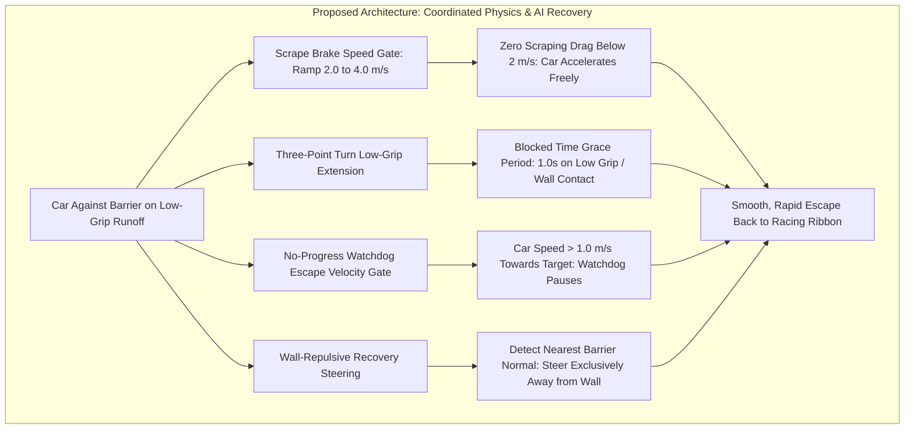

# Architecture Spec: Low-Grip Runoff Bot Recovery and Wall Scraping Resistance Calibration 🏎️🧱🛞

A comprehensive physics, collision resolution, and autonomous bot AI recovery specification resolving vehicle stall loops, scraping friction traps, and oscillatory rocking against course perimeter barriers on low-grip runoff terrain (grass, deep gravel, sand, and mud). Building upon the calibrated high-power 4WD vehicle dynamics and competition braking of [Spec 114](114_realworld_homologation_telemetry_calibration_for_autocross_and_rallycross_highpower_4wd_drivetrains_competition_braking_and_mechanical_grip.md) and operating across [`crates/arcade-race-core`](../crates/arcade-race-core) and [`crates/race-kit`](../crates/race-kit), this specification eliminates the low-speed wall-brake lock holding cars against curved barriers, tunes three-point turn leg durations for low-friction surfaces, introduces escape-velocity gating to the no-progress watchdog, and guarantees wall-repulsive recovery steering direction across repeated escape attempts.

---

## 🗺️ Current vs. Proposed System Architecture

### 1. Current Architecture (The Low-Grip Wall Pin Trap)

In the current simulation and AI driver architecture, bots that run wide off the racing line onto low-grip runoff surfaces (such as grass or deep gravel traps) and make contact with perimeter barriers frequently become permanently trapped in an oscillatory rocking or zero-velocity stall condition. This defect was observed empirically in `tdrace-bw6rb` on `kouvola_rx` (where 3 of 8 bots on `main` and 3 of 10 bots with Spec 106 chutes stall permanently against the outer tire wall in the joker detour) and on `le_mans_sarthe` (where GT bots entering deep gravel traps beside outer steel barriers stall indefinitely).

With [Spec 114](114_realworld_homologation_telemetry_calibration_for_autocross_and_rallycross_highpower_4wd_drivetrains_competition_braking_and_mechanical_grip.md) having calibrated 4WD torque distribution (45:55 / 42:58) and increased base tire compound grip ($\mu = 1.20$), cars deliver more forward drive force on loose surfaces once rolling. However, when stopped dead against a barrier, the interaction between barrier scraping physics and the recovery state machine still creates a fatal deadlock:

```mermaid
graph TD
    subgraph Current Failure Loop: The Low-Grip Wall Pin Trap
        A[Car Contacts Curved Barrier on Grass or Deep Gravel] --> B[Wall Scraping Brake: 22 m/s² * v_t/1.0]
        B --> C[Tractive Drive ~3.5 m/s² Balanced at v ~ 0.15 m/s]
        C --> D[Car Trapped in Zero-Speed Crawl Against Wall]
        D --> E[Bot Three-Point Turn Initiated]
        E --> F[Leg Ends as 'Blocked' after 0.75-0.9s: Speed < 0.4 m/s]
        F --> G[Rapid Forward-Reverse Rocking in Place]
        G --> H[No-Progress Watchdog Fires at 3.0s: gained < 5m]
        H --> I[turn_steer Inverts Steering on Even Attempts: side = -1.0]
        I --> J[Bot Steers Full Lock Directly Into Wall]
        J --> A
    end
```



#### A. Physics: Low-Speed Scraping Brake Resistance Overwhelming Drive Traction
In [`crates/arcade-race-core/src/collision/wall.rs`](../crates/arcade-race-core/src/collision/wall.rs), `resolve_car_wall_collision` calculates tangential contact braking impulse to simulate barrier rubbing friction:
$$\text{brake\_decel} = \text{wall.barrier\_type.scraping\_deceleration}()$$
$$\text{speed\_scale} = \left(\frac{v_{\text{tangent}}}{1.0}\right).\text{clamp}(0.0, 1.0)$$
$$\text{contact\_brake\_impulse} = m \cdot \text{brake\_decel} \cdot \Delta t_{\text{sub}} \cdot \text{speed\_scale}$$

For `BarrierType::TireWall`, $\text{brake\_decel} = 22.0\text{ m/s}^2$ ($2.2\text{ G}$). Because $\text{speed\_scale}$ scales linearly from $0.0\text{ m/s}$ to $1.0\text{ m/s}$, at a crawling speed of just $v_{\text{tangent}} = 0.2\text{ m/s}$, the scraping brake exerts:
$$a_{\text{brake}} = 22.0 \times 0.2 = 4.4\text{ m/s}^2$$

On grass ($\mu \approx 0.55$) or deep gravel ($\mu \approx 0.35$), available low-speed tractive drive acceleration is capped by the tire-surface friction limit:
$$a_{\text{drive}} \approx \mu \cdot g \approx 0.35 \times 9.81 \approx 3.43\text{ m/s}^2 \quad (\text{Deep Gravel})$$
$$a_{\text{drive}} \approx 0.55 \times 9.81 \approx 5.39\text{ m/s}^2 \quad (\text{Grass})$$

When resting against a wall that curves across the car's heading (such as the long right-hander of the Kouvola joker, $R \approx 29\text{ m}$ tightening to $R \approx 12\text{ m}$), the vehicle must scrape the barrier to move either forward or backward. Because $a_{\text{brake}}$ balances $a_{\text{drive}}$ at $v \approx 0.15–0.20\text{ m/s}$, the car is physically incapable of accelerating away from rest. Without walls, the exact same vehicle reaches $3.4\text{ m/s}$ in $2\text{ s}$ on grass.

#### B. AI: Premature Three-Point-Turn Leg Termination (`blocked_time`)
In [`crates/race-kit/src/ai/mod.rs`](../crates/race-kit/src/ai/mod.rs):
```rust
turn.blocked_time = if car_speed < STUCK_SPEED && turn.leg_time > 0.5 { turn.blocked_time + dt } else { 0.0 };
```
Where `STUCK_SPEED = 0.4 m/s`. A leg is declared complete (`leg_done`) if:
```rust
|| turn.blocked_time > 0.4
```
On low-grip surfaces or against barrier friction, a vehicle requires $1.0–1.5\text{ s}$ under full throttle just to overcome tire slip and establish forward or reverse momentum. Because the AI evaluates `blocked_time > 0.4` as soon as `leg_time > 0.5` ($0.9\text{ s}$ total), the bot prematurely declares the leg blocked, toggles `reversing: !turn.reversing`, resets speed to zero, and begins the opposing leg. This produces the characteristic high-frequency rocking in place with zero net displacement.

#### C. AI: No-Progress Watchdog Prematurely Aborting Escaping Vehicles
The no-progress watchdog in [`crates/race-kit/src/ai/mod.rs`](../crates/race-kit/src/ai/mod.rs) monitors track progress:
```rust
if !racing || (gained > 5.0 && gained < 0.5 * lap_len) || lateral < self.progress_lateral - 2.0 {
    self.no_progress_timer = 0.0;
} else if self.turn.is_none() {
    self.no_progress_timer += dt;
    if self.no_progress_timer > 3.0 {
        self.recovery_attempts += 1;
        self.turn = Some(ThreePointTurn::new(true, self.turn_steer(heading_error)));
    }
}
```
A car slowly creeping out of runoff along a barrier at $1.0–1.5\text{ m/s}$ travels $3.0–4.5\text{ meters}$ in $3.0\text{ s}$, which is less than the required $5.0\text{ m}$ threshold. At $t = 3.0\text{ s}$, while actively driving towards freedom, the watchdog abruptly intervenes, slams the vehicle into reverse, and restarts the three-point turn cycle.

#### D. AI: Alternating Steering Inverting Into Perimeter Barriers
When the watchdog triggers successive recovery attempts:
```rust
fn turn_steer(&self, heading_error: f32) -> f32 {
    let side = if self.recovery_attempts >= 2 && self.recovery_attempts.is_multiple_of(2) { -1.0 } else { 1.0 };
    -heading_error.signum() * side
}
```
On every even recovery attempt (`recovery_attempts = 2, 4, 6...`), `side` flips to `-1.0`. For a vehicle on the outside runoff against an outer barrier, this inverts the recovery steering command, commanding the bot to steer **full lock directly into the outer wall**. The vehicle pins its nose into the barrier, spins its wheels helplessly, and remains stalled permanently.

---

### 2. Proposed Architecture (Calibrated Scraping Physics & Wall-Repulsive Recovery)



The proposed architecture resolves these defects simultaneously across simulation physics and bot AI:

#### A. Barrier Scraping Deceleration Velocity Thresholds (`arcade-race-core`)
In [`crates/arcade-race-core/src/collision/wall.rs`](../crates/arcade-race-core/src/collision/wall.rs), replace zero-based scraping brake scaling with calibrated speed thresholds:
$$\text{SCRAPE\_BRAKE\_START\_MPS} = 2.0\text{ m/s}$$
$$\text{SCRAPE\_BRAKE\_FULL\_MPS} = 4.0\text{ m/s}$$
$$\text{speed\_scale} = \left(\frac{v_{\text{tangent}} - \text{SCRAPE\_BRAKE\_START\_MPS}}{\text{SCRAPE\_BRAKE\_FULL\_MPS} - \text{SCRAPE\_BRAKE\_START\_MPS}}\right).\text{clamp}(0.0, 1.0)$$

- **Below $2.0\text{ m/s}$ ($7.2\text{ km/h}$)**: Contact scraping drag is exactly **$0\text{ N}$**. Vehicles resting against curved walls have $100\%$ of engine drive torque available to overcome low-grip surface drag ($\mu = 0.35–0.55$) and accelerate smoothly away.
- **Between $2.0$ and $4.0\text{ m/s}$**: Scraping resistance ramps linearly, smoothly transitioning the physics without abrupt force discontinuities.
- **Above $4.0\text{ m/s}$**: Full material scraping deceleration ($\text{TireWall} = 22\text{ m/s}^2$, $\text{Steel} = 11.5\text{ m/s}^2$, $\text{Concrete} = 9.5\text{ m/s}^2$) applies, retaining high-speed crash penalties, barrier energy dissipation, and wall-riding deterrents.

#### B. Low-Grip Three-Point Turn Leg Extension (`race-kit`)
In [`crates/race-kit/src/ai/mod.rs`](../crates/race-kit/src/ai/mod.rs), differentiate leg blocked evaluation:
- On low-grip terrain ($\mu \le 0.60$) or when vehicle is within $1.2\text{ m}$ of a physical barrier, extend the initial grace period before accumulating `blocked_time` from $0.5\text{ s}$ to **$1.0\text{ s}$**.
- Require `blocked_time > 0.8\text{ s}` (or lack of positive velocity delta) before terminating the leg, allowing the drive wheels sufficient time to overcome static inertia and dig into loose gravel or grass.
- Preserve quick leg switching ($0.4\text{ s}$) on dry asphalt away from barriers to keep standard recovery responsive.

#### C. No-Progress Watchdog Escape Velocity Gating (`race-kit`)
Extend the watchdog timer logic in [`crates/race-kit/src/ai/mod.rs`](../crates/race-kit/src/ai/mod.rs):
- If `car_speed > 1.0\text{ m/s}` and the car is oriented toward the track center or recovery target ($\Delta \theta < 90^\circ$), suppress `no_progress_timer` accumulation. A vehicle steadily crawling out of runoff along a wall is making active progress and must not be interrupted.
- Gate this check to avoid suppressing watchdog intervention in packed launch chutes: ensure escape velocity gating requires positive displacement or low local bot density.

#### D. Barrier-Repulsive Recovery Steering (`race-kit`)
Replace blind alternating parity in `turn_steer`:
- Sample nearby barriers along the car's lateral perimeter:
  - If a barrier is detected within $2.0\text{ m}$ on the left, steer lock must be positive (turn right).
  - If a barrier is detected within $2.0\text{ m}$ on the right, steer lock must be negative (turn left).
- Parity alternation (`recovery_attempts.is_multiple_of(2)`) is strictly prohibited from commanding a steer angle towards a detected barrier. Steering away from physical obstacles takes absolute precedence over generic alternating search.

---

## 🛡️ Launch Chute Safety & Anti-Regression Invariant

An earlier exploratory attempt (`9e60b278`) caused a failure on `loheac_rx` launch chute start (bot 1 no-progress stall after 11.1 s) because naive wall-distance checks (`nose_clear_of_walls < 1.5 m`) misidentified the narrow walled launch chute as a wall pin.

To ensure absolute safety across all 43 launch chutes:
1. **Racing Progress Gate**: Wall-recovery heuristics are active only when `racing` is true (traveled $> 15\text{ m}$) or when the car is demonstrably off-route (`!proj.is_on_track`).
2. **Pack Density Awareness**: In launch chutes where multiple vehicles are confined within walled corridors, normal start-line acceleration and pack drafting take precedence over wall-pin escape behaviors.

---

## 🗄️ Database & Storage Migration Plan

* **In-Memory Physics & AI Controller State**: All barrier scraping velocity thresholds (`SCRAPE_BRAKE_START_MPS`, `SCRAPE_BRAKE_FULL_MPS`) and bot three-point turn state structures operate as compiled, in-memory Rust constants and structs within `crates/arcade-race-core` and `crates/race-kit`.
* **Zero Schema / Database Migration**: No persistent SQLite schemas (`tdrace_records.db`), JSON track formats, or car catalog configurations are modified.
* **Backward Wire & Replay Compatibility**: Fixed-step 60 Hz determinism is maintained; existing catalog circuits load without changes or data migrations.

---

## 🔑 Security, Compliance, & IAM Roles

* **Deterministic Invariance**: Wall collision impulse resolution and bot steering arbitration execute strictly deterministic floating-point calculations with zero dynamic allocations on the 60 Hz simulation hot path.
* **OKF v0.2 Knowledge Graph Compliance**: All architecture concepts, dependency linkages, and acceptance criteria adhere to the Open Knowledge Format standard.
* **Zero Cloud / IAM Elevation**: Physics simulation and AI bot decision engines run exclusively in local process memory with no network privileges or cloud identity requirements.

---

## 🛡️ Disaster Recovery, Monitoring, & Fallbacks

- **Safety Bounds Verification**:
  Ensure `speed_scale` is clamped strictly within $[0.0, 1.0]$ and scraping drag forces remain non-negative.
- **Circuit Sweep Regression Safeguard**:
  Prior to merge, execute the full 43-circuit launch chute sweep (`launch_chute_race_tests`), the GT endurance stall sweep on Le Mans Sarthe (`pit_lane_integration_tests`), and the classic bot suite (`classic_circuits_bot_tests`) to verify zero unintended regressions in crowded starts or open circuits.

---

## 🧪 Verification & Acceptance Criteria

### Automated Test Commands
- **Wall contact escape physics**:
  ```bash
  cargo test -p tdrace-app --test wall_contact_escape_tests
  ```
- **Kouvola RX 10-bot 3-lap full race**:
  ```bash
  cargo test -p tdrace-app --test launch_chute_race_tests test_every_bot_finishes_three_laps_on_kouvola -- --nocapture
  ```
- **43-circuit launch chute sweep**:
  ```bash
  cargo test --release -p tdrace-app --test launch_chute_race_tests test_bots_race_from_every_launch_chute -- --ignored
  ```
- **GT stall sweep (Le Mans Sarthe deep gravel)**:
  ```bash
  cargo test --release -p tdrace-app --test pit_lane_integration_tests -- --ignored
  ```
- **Classic circuits bot sweep**:
  ```bash
  cargo test -p tdrace-app --test classic_circuits_bot_tests
  ```

### Manual Acceptance Criteria (Pseudo-Gherkin)

#### Scenario: Car resting against curved tire wall on grass drives away forward
- [ ] **Given** a Rallycross car at rest on grass against the curved outer TireWall of `kouvola_rx` joker at pose `(48.7, 122.0)` with heading `-9°`
- [ ] **When** full forward throttle is applied with steering straight (`steer = 0.0`)
- [ ] **Then** the vehicle accelerates without locking and travels at least $6.0\text{ meters}$ away from the stall pose within $6.0\text{ seconds}$

#### Scenario: Car resting against curved tire wall on grass drives away in reverse
- [ ] **Given** a Rallycross car at rest on grass against the curved outer TireWall of `kouvola_rx` joker at pose `(48.7, 122.0)` with heading `-9°`
- [ ] **When** full reverse throttle is applied with steering straight (`steer = 0.0`)
- [ ] **Then** the vehicle accelerates without locking and travels at least $6.0\text{ meters}$ away from the stall pose within $6.0\text{ seconds}$

#### Scenario: Three-point turn on low-grip runoff does not rock in place
- [ ] **Given** an AI bot vehicle on low-grip grass or deep gravel beside a barrier with forward speed $< 0.4\text{ m/s}$
- [ ] **When** the bot initiates a three-point turn recovery leg
- [ ] **Then** the leg duration remains active for at least $1.2\text{ seconds}$ without premature direction toggling
- [ ] **And** the bot does not alternate forward and reverse gears in rapid $< 1.0\text{ s}$ cycles

#### Scenario: No-progress watchdog permits steady low-speed escape
- [ ] **Given** an AI bot vehicle off-track traveling at speed $> 1.0\text{ m/s}$ oriented towards the track ribbon
- [ ] **When** the bot sustains this escape trajectory for $3.5\text{ seconds}$ covering $4.0\text{ meters}$
- [ ] **Then** the no-progress watchdog does not abort the escape or force a three-point turn reversal
- [ ] **And** the bot successfully re-enters the active track surface

#### Scenario: Recovery steering always points away from adjacent barrier
- [ ] **Given** an AI bot resting on runoff with a physical wall barrier along its left side
- [ ] **When** the bot executes recovery attempt 2, 4, or any even-numbered attempt
- [ ] **Then** `turn_steer` commands positive (rightward) steering away from the wall
- [ ] **And** the bot never steers leftward directly into the barrier

#### Scenario: 10 RX bots complete 3 laps on Kouvola RX without stalls
- [ ] **Given** `kouvola_rx` configured with a 10-car Rallycross launch chute grid
- [ ] **When** a 3-lap race is simulated with 10 AI bot vehicles taking standard and joker routes
- [ ] **Then** all 10 bots complete 3 full laps (`laps_completed >= 3`)
- [ ] **And** zero bots become stalled permanently against the joker tire wall or junction boundaries

#### Scenario: All 43 launch chutes pass the global race sweep
- [ ] **Given** `kouvola_rx` is removed from `KNOWN_STALLS` in `launch_chute_race_tests.rs`
- [ ] **When** `test_bots_race_from_every_launch_chute` runs across all 43 Autocross, Rallycross, and Classic circuits
- [ ] **Then** all 43 circuits pass without timeouts, deadlocks, or chute regressions

---

## 🔗 Traceability & Codebase Mapping

### Created/Modified Files
- `[ ]` `crates/arcade-race-core/src/collision/wall.rs` -> Implement `SCRAPE_BRAKE_START_MPS` ($2.0\text{ m/s}$) and `SCRAPE_BRAKE_FULL_MPS` ($4.0\text{ m/s}$) speed-scaled scraping deceleration ramp.
- `[ ]` `crates/race-kit/src/ai/mod.rs` -> Low-grip three-point turn leg duration extension, watchdog escape speed gating, and wall-repulsive `turn_steer` direction resolution.
- `[ ]` `crates/tdrace-app/tests/launch_chute_race_tests.rs` -> Remove `kouvola_rx` from `KNOWN_STALLS` and un-ignore `test_every_bot_finishes_three_laps_on_kouvola`.
- `[ ]` `crates/tdrace-app/tests/wall_contact_escape_tests.rs` -> Regression test harness validating $\ge 6\text{ m}$ escape in $6\text{ s}$ forwards and in reverse against Kouvola joker tire wall.
- `[ ]` `specs/constitution/ROADMAP.md` -> Register Spec 115 under Phase 2 / Phase 4 milestones.
- `[ ]` `specs/index.md` -> Index Spec 115 in master OKF v0.2 table and dependency graph.
