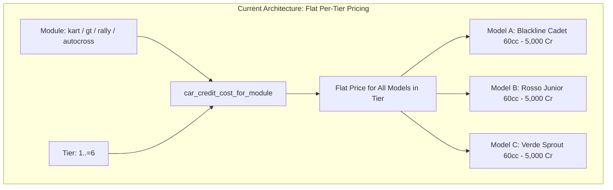
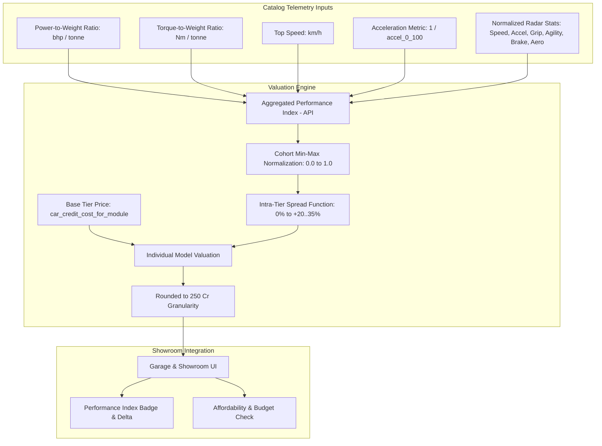

# Architecture Spec: Performance-Based Individual Vehicle Pricing and Dynamic Catalog Valuation 🏎️📊💰

A data-driven catalog valuation and vehicle economics architecture replacing flat per-tier vehicle costs with individualized pricing based on an **Aggregated Performance Index (API)**. Integrating vehicle engineering telemetry (horsepower, torque, kerb weight, top speed, 0–100 km/h acceleration) with aerodynamic and chassis handling ratings from the asset catalogue, this specification introduces intra-tier valuation spreads ($\pm 10\text{--}30\%$) across all motorsport disciplines while strictly anchoring the grassroots entry point (Tier 1 Karts) at 5,000 Cr to preserve the [Spec 060](060_classic_academy_and_grassroots_career_onboarding.md) Classic Academy onboarding progression.

---

## 🗺️ Current vs. Proposed System Architecture

### 1. Current Architecture (Flat Per-Tier Pricing)

Under the current economy defined in [Spec 053](053_dual_currency_economy_and_branching_career_progression_architecture.md) and calibrated in [Spec 060](060_classic_academy_and_grassroots_career_onboarding.md), vehicle acquisition costs are determined solely by the vehicle's broad motorsport discipline and numerical tier:

$$\text{Cost} = \text{car\_credit\_cost\_for\_module}(\text{module}, \text{tier})$$



#### Deficiencies of Current Architecture:
1. **Economic Incentive Collapse**: Within any tier, models that possess superior acceleration, higher top speed, or superior power-to-weight ratios cost the exact same number of credits as heavier, lower-spec competitors. Players have zero incentive to evaluate financial trade-offs.
2. **Homogenized Progression**: Upgrading within a discipline jumps abruptly between large tier blocks without micro-progression or tactical chassis acquisition based on circuit characteristics (e.g. buying a lighter, higher-grip chassis for tight circuits vs. a high-top-speed vehicle for power circuits).
3. **Flattens Engineering Detail**: Detailed physical attributes in `RealCarModel` (`bhp`, `torque_nm`, `weight_kg`, `top_speed_kmh`, `accel_0_100`, `stats`) are rendered economically invisible in the showroom.

---

### 2. Proposed Architecture (Performance-Based Dynamic Catalog Valuation)

The proposed architecture introduces a dual-layer pricing engine: a **Cohort Baseline** governed by discipline progression curves, modulated by an **Aggregated Performance Index (API)** computed deterministically from each car's physical specifications and radar attributes.



---

## 🧮 Mathematical Formulation of the Aggregated Performance Index (API)

### 1. Physical Component Formulations
For any vehicle model $c \in \text{RealCarModel}$:

1. **Power-to-Weight Ratio**:
   $$\text{P2W}(c) = \frac{\text{bhp}(c)}{\text{weight\_kg}(c)} \times 1000 \quad [\text{bhp/tonne}]$$

2. **Torque-to-Weight Ratio**:
   $$\text{T2W}(c) = \frac{\text{torque\_nm}(c)}{\text{weight\_kg}(c)} \times 1000 \quad [\text{Nm/tonne}]$$

3. **Acceleration Responsiveness**:
   $$A_{\text{resp}}(c) = \frac{10.0}{\max(\text{accel\_0\_100}(c), 1.0)}$$

4. **Top Speed Index**:
   $$V_{\text{index}}(c) = \text{top\_speed\_kmh}(c)$$

5. **Radar Stat Aggregate**:
   Given `stats: (Speed, Accel, Grip, Agility, Brake, Aero)` with components $s_1 \dots s_6 \in [0.0, 1.0]$:
   $$S_{\text{radar}}(c) = 0.20 \cdot s_{\text{speed}} + 0.25 \cdot s_{\text{accel}} + 0.25 \cdot s_{\text{grip}} + 0.15 \cdot s_{\text{agility}} + 0.10 \cdot s_{\text{brake}} + 0.05 \cdot s_{\text{aero}}$$

### 2. Intra-Cohort Normalization
Let $C(m, t)$ denote the set of all car models belonging to discipline module $m$ and performance tier $t$:
$$C(m, t) = \{ c \in \text{ALL\_CAR\_MODELS} \mid c.\text{module\_id} = m \land c.\text{tier} = t \}$$

For each metric $X \in \{\text{P2W}, T2W, A_{\text{resp}}, V_{\text{index}}, S_{\text{radar}}\}$, define normalized value $\widetilde{X}(c) \in [0.0, 1.0]$:
$$\widetilde{X}(c) = \begin{cases}
  \frac{X(c) - \min_{k \in C(m,t)} X(k)}{\max_{k \in C(m,t)} X(k) - \min_{k \in C(m,t)} X(k)} & \text{if } \max \ne \min \\
  0.5 & \text{if } \max = \min
\end{cases}$$

### 3. Composite Relative Index ($I_{\text{rel}}$)
$$I_{\text{rel}}(c) = 0.30 \cdot \widetilde{\text{P2W}}(c) + 0.10 \cdot \widetilde{T2W}(c) + 0.25 \cdot \widetilde{A}_{\text{resp}}(c) + 0.15 \cdot \widetilde{V}_{\text{index}}(c) + 0.20 \cdot \widetilde{S}_{\text{radar}}(c)$$

Because weights sum to $1.0$ and each $\widetilde{X} \in [0.0, 1.0]$, $I_{\text{rel}}(c) \in [0.0, 1.0]$. The vehicle with the lowest aggregate performance in the cohort evaluates to $I_{\text{rel}} = 0.0$, and the cohort leader evaluates to $I_{\text{rel}} = 1.0$.

### 4. Intra-Tier Valuation Spread
The credit cost of vehicle $c$ is computed from the baseline tier price $P_{\text{base}}(m, t)$:

$$P(c) = P_{\text{base}}(m, t) + \text{round}_{250}\left( P_{\text{base}}(m, t) \times \sigma(t) \times I_{\text{rel}}(c) \right)$$

where the tier spread coefficient $\sigma(t)$ scales with career maturity:
- **Tier 1 (Grassroots / Cadet)**: $\sigma(1) = 0.20$ ($0\%$ to $+20\%$ spread)
- **Tier 2 (Junior / Clubsport)**: $\sigma(2) = 0.25$ ($0\%$ to $+25\%$ spread)
- **Tier 3 (Senior / Pro-Am)**: $\sigma(3) = 0.30$ ($0\%$ to $+30\%$ spread)
- **Tier 4--6 (Championship / Formula / Supercar)**: $\sigma(t) = 0.35$ ($0\%$ to $+35\%$ spread)

$$\text{round}_{250}(x) = \left\lfloor \frac{x + 125}{250} \right\rfloor \times 250$$

---

## 🏎️ Concrete Pricing Calibration Across Modalities

### 1. Karting Modality Tier 1 (Grassroots Onboarding Baseline)
- Base Tier 1 Price: $P_{\text{base}}(\text{"kart"}, 1) = 5,000\text{ Cr}$
- Academy Graduation Purses: Bronze $5,500\text{ Cr}$, Silver $6,250\text{ Cr}$, Gold $7,000\text{ Cr}$
- **Valuation Table**:
  | Model ID | Model Name | Top Speed | 0-100 km/h | Radar Avg | $I_{\text{rel}}$ | Credit Price | Reserve from 7.0k Gold | Reserve from 5.5k Bronze |
  | :--- | :--- | :---: | :---: | :---: | :---: | :---: | :---: | :---: |
  | `kart_blackline_cadet_t1` | Blackline Cadet 60cc T1 | 85 km/h | 7.5 s | 0.588 | 0.00 | **5,000 Cr** | +2,000 Cr | +500 Cr |
  | `kart_rosso_junior_t1` | Rosso Kart Junior 60cc T1 | 85 km/h | 7.5 s | 0.588 | 0.00 | **5,000 Cr** | +2,000 Cr | +500 Cr |
  | `kart_verde_sprout_t1` | Verde Kart Sprout 60cc T1 | 86 km/h | 7.4 s | 0.601 | 1.00 | **6,000 Cr** | +1,000 Cr | (Requires Silver+) |

*Outcome*: The player graduating Classic Academy with bronze medals (5,500 Cr) can afford either the Blackline Cadet or Rosso Junior (leaving a 500 Cr buffer), while silver/gold graduates can also afford the premium Verde Sprout (6,000 Cr, leaving up to a 1,000 Cr reserve). In all cases, the player can only afford exactly one kart and cannot double-purchase.

### 2. GT Modality Tier 1 (Clubsport Customer Racing)
- Base Tier 1 Price: $P_{\text{base}}(\text{"gt"}, 1) = 45,000\text{ Cr}$, $\sigma(1) = 0.20$ (Spread: up to $+9,000\text{ Cr}$)
- **Valuation Table**:
  | Model ID | Model Name | BHP | Weight | Top Speed | 0-100 | $I_{\text{rel}}$ | Credit Price |
  | :--- | :--- | :---: | :---: | :---: | :---: | :---: | :---: |
  | `gt_bavaria_m4_gt4` | Bavaria M4 GT4 | 450 | 1380 kg | 280 km/h | 3.6 s | 0.00 | **45,000 Cr** |
  | `gt_stuttgart_gt4_clubsport` | Stuttgart GT4 Clubsport | 470 | 1370 kg | 285 km/h | 3.5 s | 0.42 | **48,750 Cr** |
  | `gt_weissach_718_gt4_rs` | Weissach 718 GT4 RS Clubsport | 500 | 1320 kg | 304 km/h | 3.4 s | 1.00 | **54,000 Cr** |

### 3. Autocross & Rallycross Modalities (Tiers 1--5)
Across Autocross (`autocross_*`) and Rallycross (`rx_*`), models with custom spaceframe chassis, titanium components, and high-displacement turbocharging receive authentic price premiums matching their real-world homologation tier.

---

## 🖥️ User Experience & Showroom Interface

In [`crates/tdrace-app/src/ui/garage.rs`](../crates/tdrace-app/src/ui/garage.rs):
1. **Dynamic Model Pricing**: The purchase button and vehicle card display `car_credit_cost_for_car(model.id, module, tier)`.
2. **Performance Index Pill**: Next to the vehicle name and tier badge, render an aggregated index pill:
   - `PERF INDEX: 74` (Normalized 0–100 scale within the overall game catalog).
3. **Valuation Badge**:
   - For cohort baseline vehicles ($I_{\text{rel}} \le 0.15$): `[VALUE STARTER]` (Green border).
   - For cohort top-tier vehicles ($I_{\text{rel}} \ge 0.85$): `[COMPETITION SPEC]` (Gold border).
4. **Affordability Indicators**:
   - If `credits >= car_price`: Button displays `BUY VEHICLE: <price> CR` in bright green.
   - If `credits < car_price`: Button displays `INSUFFICIENT FUNDS (<price> CR)` with red tint, disabled.

---

## 🛡️ Non-Functional Requirements & Performance Bounds

1. **Zero Runtime Allocations**: `car_credit_cost_for_car` must operate in $O(1)$ or $O(N_{\text{cohort}})$ where $N_{\text{cohort}} \le 12$, using compile-time constants or precomputed lookup tables without dynamic heap allocations during 60 FPS UI rendering loops.
2. **Deterministic Reproducibility**: Given the same `RealCarModel` definition, the calculated price must never drift across game launches, platforms, or profile migrations.
3. **Savegame Compatibility**: No database schema migration required. `active_profile.owned_cars` stores model ID strings (e.g. `"kart_rosso_junior_t1"`). Existing profiles preserve all vehicle unlocks and ownership state without alteration.

---

## 🗄️ Database & Storage Migration Plan

* **In-Memory Functional Evaluation**: Vehicle valuations are computed as pure functional derivations or precomputed lookup constants in `crates/tdrace-app/src/profile` and `crates/tdrace-app/src/catalog`.
* **Zero Database Schema Migration**: Player profiles store vehicle ownership as simple identifier lists (`owned_cars: Vec<String>`) in SQLite (`tdrace_records.db`). No table schemas, columns, or data migrations are required.
* **Backward Profile Compatibility**: Existing player profiles written before Spec 116 maintain their current credit balances and owned vehicles. Unlocked vehicles remain unlocked and pre-purchased cars remain owned.

---

## 🔑 Security, Compliance, & IAM Roles

* **Local Deterministic Invariance**: All pricing equations evaluate deterministically with zero network calls, cloud IAM dependencies, or dynamic allocation vulnerabilities on UI rendering frames.
* **Economy Integrity Safeguards**: Vehicle purchase transactions in `buy_car` validate atomic credit subtraction: the player's wallet is decremented by the exact evaluated `car_credit_cost_for_car`, preventing negative wallet states or credit duplication exploits.
* **OKF v0.2 Knowledge Graph Compliance**: Specification frontmatter and dependency links strictly comply with the Open Knowledge Format standard.

---

## 🛡️ Disaster Recovery, Monitoring, & Fallbacks

* **Grassroots Price Floor Invariant**: A hard programmatic assertion ensures that `car_credit_cost_for_car` for the cheapest Tier 1 Kart never exceeds 5,000 Cr, ensuring that any player completing the Classic Academy can afford an entry vehicle.
* **Catalog Telemetry Fallback**: If a vehicle model lacks complete physical telemetry (e.g. unranked or prototype chassis), the valuation engine falls back smoothly to the baseline tier price $P_{\text{base}}(m, t)$ without panic or undefined behavior.
* **Economic Unit Test Suite**: Comprehensive regression tests verify that all catalog models produce positive, non-zero prices that are strictly greater than zero and rounded to clean 250 Cr steps.

---

## 🧪 Verification & Acceptance Criteria

### Automated Test Commands
- **Vehicle Pricing Unit Tests**:
  ```bash
  cargo test -p tdrace-app --test career_onboarding_tests test_performance_based_pricing
  ```
- **Catalog Consistency and Valuation Monotonicity**:
  ```bash
  cargo test -p tdrace-app --test catalog_tests test_all_models_have_valid_performance_valuation
  ```
- **Profile Economy Integration**:
  ```bash
  cargo test -p tdrace-app --test profile_tests
  ```

### Manual Acceptance Criteria (Pseudo-Gherkin)

#### Scenario: Tier 1 Kart models have differentiated performance-based pricing
- [x] **Given** the three Tier 1 Kart models (`kart_blackline_cadet_t1`, `kart_rosso_junior_t1`, `kart_verde_sprout_t1`)
- [x] **When** `car_credit_cost_for_car` is evaluated for each model at Tier 1
- [x] **Then** the baseline model (`kart_blackline_cadet_t1`) evaluates to exactly 5,000 Cr
- [x] **And** the baseline model (`kart_rosso_junior_t1`) evaluates to exactly 5,000 Cr
- [x] **And** the higher-performing model (`kart_verde_sprout_t1`) evaluates to a premium price strictly greater than 5,000 Cr (e.g. 6,000 Cr)
- [x] **And** all prices are multiples of 250 Cr

#### Scenario: Academy graduate can purchase any Tier 1 kart with earned gold purse
- [x] **Given** a new player profile who graduated the Classic Academy with gold medals and has 7,000 Cr
- [x] **When** inspecting the garage showroom for Tier 1 Karting
- [x] **Then** all three Tier 1 karts are marked as affordable (`can_buy_car_for_profile == true`)
- [x] **And** purchasing the cheapest kart leaves a 2,000 Cr safety reserve
- [x] **And** purchasing the highest-spec kart leaves at least a 1,000 Cr safety reserve
- [x] **And** the profile cannot purchase a second kart with remaining credits

#### Scenario: Intra-tier pricing monotonically aligns with performance index
- [x] **Given** any two models $A$ and $B$ in the same discipline module and tier
- [x] **When** model $A$ has a strictly higher composite performance index $I_{\text{rel}}(A) > I_{\text{rel}}(B)$ by at least $0.15$
- [x] **Then** the credit purchase price of model $A$ is greater than or equal to the credit purchase price of model $B$
- [x] **And** model $A$ is never cheaper than model $B$

#### Scenario: Garage UI displays model-specific price and performance index
- [x] **Given** the player viewing the Garage Showroom screen
- [x] **When** navigating between different car models within the same tier
- [x] **Then** the purchase button and hero card update immediately to show each model's distinct credit price
- [x] **And** the performance index and stat radar reflect the selected model's specifications

---

## 🔗 Traceability & Codebase Mapping

### Created/Modified Files
- `[x]` `crates/tdrace-app/src/catalog/mod.rs` -> Implement `RealCarModel::performance_index(&self) -> f32` and precomputed cohort normalization.
- `[x]` `crates/tdrace-app/src/profile/mod.rs` -> Implement dynamic `car_credit_cost_for_car(car_id, module, tier) -> u64` with intra-tier spread.
- `[x]` `crates/tdrace-app/src/ui/garage.rs` -> Render individual model price, performance index badge, and affordability state.
- `[x]` `crates/tdrace-app/tests/career_onboarding_tests.rs` -> Unit and integration tests for intra-tier pricing, affordability gates, and Academy purse sufficiency.
- `[x]` `specs/constitution/ROADMAP.md` -> Register Spec 116 under Phase 5.
- `[x]` `specs/index.md` -> Index Spec 116 in master OKF v0.2 table and dependency graph.
