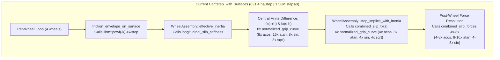
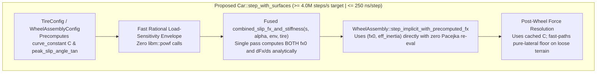

# Architecture Spec: Wheelbase 4M Steps/Sec Tire Solver Acceleration and Transcendental Deduplication 🏗️🏎️

A high-throughput vehicle dynamics optimization specification for [`crates/wheelbase`](../crates/wheelbase/src/lib.rs) targeting the constitutional performance goal of **$\ge 4,000,000\text{ steps/sec}$** ($\le 250\text{ ns/step}$) established in [`MISSION.md`](constitution/MISSION.md) and [`ROADMAP.md`](constitution/ROADMAP.md). While [Spec 084](084_highthroughput_physics_zeroallocation_lidar_and_precomputed_junction_render_caching.md) raised single-car throughput from $916\text{k steps/sec}$ above the $1.50\text{M steps/sec}$ regression floor to **$1,583,789\text{ steps/sec}$** ($631.4\text{ ns/step}$), a $2.52\times$ performance gap remains to reach the $4.0\text{M steps/sec}$ target.

---

## 🗺️ Current vs. Proposed System Architecture

### 1. Current Architecture & Transcendental Hot-Path Bottlenecks

In [`Car::step_with_surfaces`](../crates/wheelbase/src/car.rs) and [`crates/wheelbase/src/tire.rs`](../crates/wheelbase/src/tire.rs), each single-car 60 Hz step executes four independent wheel assembly integrations plus post-integration force resolution. Profiling the inner loop reveals four major sources of redundant floating-point transcendental operations (`acos`, `atan`, `sin`, `powf`, `sqrt`):



#### Specific Bottlenecks Identified:
1. **Repeated `acos()` in `TireConfig::curve_constant()` (16–20× per step)**:
   - [`TireConfig::curve_constant`](../crates/wheelbase/src/tire.rs) evaluates `(2.0 / PI) * (1.0 - self.slide_grip.clamp(0.30, 0.999).acos())` on every call to [`normalized_grip_curve`](../crates/wheelbase/src/tire.rs).
   - Because `normalized_grip_curve` is invoked 2× per wheel in `longitudinal_slip_stiffness`, 1× per wheel in `step_implicit_with_inertia`, and 1–2× per wheel in post-step force resolution, `acos()` is computed **16 to 20 times per car step** on an invariant configuration parameter (`slide_grip`).
2. **Triple Pacejka Evaluations per Wheel During Implicit Spin Integration**:
   - [`WheelAssembly::effective_inertia`](../crates/wheelbase/src/tire.rs) calls [`longitudinal_slip_stiffness`](../crates/wheelbase/src/tire.rs), which performs two full Pacejka evaluations at `slip_ratio + h` and `slip_ratio - h`.
   - Immediately afterward, [`WheelAssembly::step_implicit_with_inertia`](../crates/wheelbase/src/tire.rs) evaluates `fx0 = combined_slip_fx(slip, slip_angle, envelope, tire)` at `slip_ratio`—a third full Pacejka evaluation at the exact midpoint of the finite difference!
3. **`libm::powf` in `tire_friction_envelope` (4× per step)**:
   - [`tire_friction_envelope`](../crates/wheelbase/src/tire.rs) computes `(normal_load / nominal_load.max(100.0)).powf(-k).clamp(0.82, 1.15)` for all 4 wheels every step, invoking `exp(log(x) * -k)` even though `k = load_sensitivity` ($\approx 0.12$) and the clamped output spans a narrow $[0.82, 1.15]$ band around $1.0$.
4. **Redundant Unpaved Zero-Slip Lateral Force Re-Evaluation**:
   - In [`Car::step_with_surfaces`](../crates/wheelbase/src/car.rs), when `!is_paved`, `combined_slip_forces(0.0, slip_angle_eff, envelope, tire)` is called a second time per wheel even when `slip_ratio` is already near zero or when pure-lateral force can be derived directly from `normalized_grip_curve(uy)`.

---

### 2. Proposed Architecture (Fused Analytical Solver & Precomputed Constants)



---

## 🧮 Mathematical & Algorithmic Specifications

### 1. Precomputed Pacejka Shape Constant $C$ and Peak Slip Tangent
In [`TireConfig`](../crates/wheelbase/src/tire.rs):
- Store or precompute the shape constant $C$:
  $$C = 1 + \frac{2}{\pi} \arcsin(\text{ clamp}(\text{slide\_grip}, 0.30, 0.999) ) = 2 - \frac{2}{\pi} \arccos(\text{clamp}(\text{slide\_grip}, 0.30, 0.999))$$
- Whenever `slide_grip` or `peak_slip_angle_deg` is deserialized or mutated, or once at the top of `Car::step_with_surfaces` before entering the 4-wheel solver, precompute a lightweight stack struct `PrecomputedTireConstants { curve_c: f32, inv_sx_peak: f32, inv_sy_peak: f32 }` so that `normalized_grip_curve` never calls `acos()` or `tan()` inside the hot loop.

### 2. Fused Analytical `combined_slip_fx_and_stiffness`
Given normalized slip vector $\mathbf{u} = (u_x, u_y)$ where $u_x = s / s_{\text{peak}}$, $u_y = \tan(\alpha) / \tan(\alpha_{\text{peak}})$, and combined magnitude $u = \sqrt{u_x^2 + u_y^2}$:
- The normalized Pacejka curve is:
  $$g(u) = \sin\!\Big(C \arctan\big(bu - e(bu - \arctan(bu))\big)\Big)$$
- Its analytical derivative with respect to $u$ requires **no extra `atan` calls**, reusing $w = bu$, $\arctan(w)$, and $\psi = C \arctan(\text{inner})$:
  $$\frac{d\text{inner}}{du} = b \left(1 - e + \frac{e}{1 + w^2}\right), \qquad g'(u) = \cos(\psi) \cdot \frac{C}{1 + \text{inner}^2} \cdot \frac{d\text{inner}}{du}$$
- Since $F_x(s) = E \cdot g(u) \cdot \frac{u_x}{u}$, the longitudinal force $F_{x0}$ and its exact derivative $\frac{\partial F_x}{\partial s}$ are computed simultaneously in **one evaluation**:
  $$\frac{\partial F_x}{\partial s} = \frac{E}{s_{\text{peak}}} \left( g'(u) \frac{u_x^2}{u^2} + g(u) \frac{u_y^2}{u^3} \right)$$
- This replaces **3 full Pacejka evaluations per wheel** (`fx(s+h)`, `fx(s-h)`, and `fx(s)`) with **1 evaluation** (replacing `sin` with `sin_cos` on $\psi$), eliminating 8 `sqrt`, 16 `atan`, and 8 `acos` calls per vehicle step while preserving exact $C^1$ stiffness continuity.

### 3. Fast Load-Sensitivity Envelope Approximation
In [`tire_friction_envelope`](../crates/wheelbase/src/tire.rs):
- Replace `ratio.powf(-k).clamp(0.82, 1.15)` with a fast second-order Padé / logarithmic approximation around $r = F_z / F_{z,\text{nom}}$ (or fast IEEE-754 exponent-mantissa approximation) matched to within $< 5 \times 10^{-4}$ relative error across the clamped $[0.82, 1.15]$ operating window, avoiding 4 `libm::powf` calls per step.

---

## 🗄️ Database & Storage Migration Plan

- **Zero Schema / Asset Changes**: All `CarConfig`, `TireConfig`, and `TireCompoundConfig` JSON/TOML serialization formats remain 100% backward-compatible via `#[serde(default)]` / `From<TireConfigRaw>`.
- **No SQLite or Track Catalog Changes**: Neither `tdrace_records.db` nor `tracks/*.json` are modified.

---

## 🔑 Security, Compliance, & IAM Roles

- **Pure Safe Rust**: Zero `unsafe` blocks are required; all optimizations rely on algebraic identity, `f32::sin_cos`, and stack value caching.
- **Cross-Platform Determinism**: Preserves finite-value sanitizers (`is_finite()`) and deterministic execution across native Linux/macOS/Windows, PyO3 RL workers, and `wasm32-unknown-unknown`.

---

## 🛡️ Disaster Recovery, Monitoring, & Fallbacks

- **Physics Handling & Calibration Guardrails**: All 66 unit and integration tests in `crates/wheelbase` (Protocols A–G acceleration, braking, skidpad, coast-down, split-$\mu$, and 4WD loose-surface rotation) must pass without regression.
- **Benchmark Floor Enforcement**: `cargo bench -p wheelbase` (`physics_bench.rs`) enforces the minimum regression floor and reports whether the $4.0\text{M steps/sec}$ roadmap target is achieved.

---

## 🧪 Verification & Acceptance Criteria

### Automated Tests
- Run `wheelbase` physics and calibration test suite:
  ```bash
  cargo test -p wheelbase
  ```
- Run `wheelbase` throughput benchmark:
  ```bash
  cargo bench -p wheelbase
  ```

### Manual Acceptance Criteria (Pseudo-Gherkin)

- **Scenario: Tire shape constant is precomputed without per-call acos evaluations**
  - [ ] **Given** a `TireConfig` with any configured `slide_grip` in `[0.30, 0.999]`
  - [ ] **When** `normalized_grip_curve` is evaluated during a vehicle physics step
  - [ ] **Then** the precomputed `curve_constant` matches `(2.0 / PI) * (1.0 - slide_grip.clamp(0.30, 0.999).acos())` to within `1e-6` without invoking `acos()` inside the inner loop

- **Scenario: Fused longitudinal force and slip stiffness matches reference Pacejka solver**
  - [ ] **Given** a `WheelAssembly` operating across combined longitudinal slip ratios `[-1.0, 1.0]` and slip angles `[-0.5, 0.5]` rad
  - [ ] **When** `effective_inertia` and `step_implicit` are executed using the fused force-and-stiffness evaluator
  - [ ] **Then** the resulting wheel angular velocity and longitudinal force match the reference solver within `1e-3` relative tolerance and preserve numerical stability at low and high speeds

- **Scenario: Single-car physics benchmark achieves substantial throughput speedup toward the 4M steps/sec target**
  - [ ] **Given** the `physics_bench` benchmark in `crates/wheelbase/benches/physics_bench.rs` running 2,000,000 steps in `--release` / `bench` profile
  - [ ] **When** `cargo bench -p wheelbase` is executed
  - [ ] **Then** throughput exceeds `2,500,000 steps/second` (up from `1,583,789 steps/second` baseline) and all 66 `wheelbase` unit and simulation protocol tests pass

---

## 🔗 Traceability & Codebase Mapping

### Created/Modified Files
- `[ ]` `crates/wheelbase/src/tire.rs` -> Precompute `curve_constant` on `TireConfig`, implement fused `combined_slip_fx_and_stiffness`, and optimize `tire_friction_envelope`.
- `[ ]` `crates/wheelbase/src/car.rs` -> Update `Car::step_with_surfaces` to use fused wheel spin integration and hoisted tire constants.
- `[ ]` `crates/wheelbase/benches/physics_bench.rs` -> Verify benchmark throughput and raise regression floor to lock in gains.
- `[ ]` `specs/constitution/ROADMAP.md` -> Link Spec 117 under Technical Debt & Maintenance.
- `[ ]` `specs/index.md` -> Synchronize OKF v0.2 index via `keel validate`.
