# Architecture Spec: Chassis-Guided Wheel Surface Sampling, PyEngine RaceWorld Unification, and FastRasterizer Culling 🏗️🐍

A cross-layer simulation and RL environment architecture specification spanning [`arcade-race-core`](../crates/arcade-race-core/src/lib.rs), [`race-kit`](../crates/race-kit/src/lib.rs), and [`tdrace-py`](../crates/tdrace-py/src/lib.rs). This specification eliminates redundant spline projections in multi-car race simulation, resolves physics drift between the playable game (`RaceWorld::step`) and the Python/Gymnasium RL extension (`PyEngine`), removes per-step heap allocations and car clones in `PyEngine::build_agent_obs`, and accelerates the software RGB rasterizer (`FastRasterizer`).

---

## 🗺️ Current vs. Proposed System Architecture

### 1. Current Architecture & Bottlenecks

```mermaid
flowchart TD
    subgraph Current_RaceWorld ["Current RaceWorld::step (6 Spline Projections / Car / Tick)"]
        S1["car.sample_surfaces(track, hint)<br/>Calls sample_surface_near 4x (1 per wheel)"] --> S2["4x spline.project_point_continuity<br/>+ 4x net.sample_surface (unhinted branch scan)<br/>+ 4x sample_pit_lane_surface"]
        S2 --> S3["track.project_point_continuity (5th projection)<br/>for car.state.set_road(&proj)"]
        S3 --> S4["TrackProgressTracker::update (6th projection)<br/>after collisions"]
    end

    subgraph Current_PyEngine ["Current tdrace-py::PyEngine (Divergent Loop + 10 Projections / Tick)"]
        P1["step_single / step_multi:<br/>Calls sample_car_surfaces WITHOUT hint (4 global projections)"] --> P2["Calls car.step_with_surfaces<br/>OMITS set_road(banking/grade/elevation), step_ramps, scenery_obstacles!"]
        P2 --> P3["build_agent_obs:<br/>5th global project_point + 6x sample_at_distance binary searches<br/>+ 4 MORE unhinted wheel projections (sample_car_surfaces)<br/>+ clones Vec&lt;Car&gt; on heap for LIDAR!"]
        P3 --> P4["FastRasterizer::render:<br/>Transforms ALL track triangles & walls every frame;<br/>evaluates 6 multiplies/pixel in draw_screen_triangle"]
    end
```



#### Specific Deficiencies Identified:
1. **6× Spline Projections per Car per Tick in `RaceWorld::step`**:
   - In [`Track::sample_car_surfaces_with_hint`](../crates/arcade-race-core/src/track/mod.rs), all 4 wheels independently execute `project_point_continuity`, `net.sample_surface` (which calls unhinted `seg.project_point` across every branch segment), and `sample_pit_lane_surface`.
   - When the car is driving down the middle of the main track ribbon away from curbs, surface zones, pit lanes, and branch junctions, all 4 wheels are guaranteed to lie on `proj.base_surface`.
2. **Divergent & Incomplete Physics Step in `PyEngine` (`crates/tdrace-py/src/engine.rs`)**:
   - Unlike [`RaceSession::physics_step`](../crates/tdrace-app/src/game/mod.rs), which delegates to [`RaceWorld::step`](../crates/race-kit/src/world.rs), [`PyEngine::step_single`](../crates/tdrace-py/src/engine.rs) and [`PyEngine::step_multi`](../crates/tdrace-py/src/engine.rs) maintain a manual loop that:
     - Calls unhinted `sample_car_surfaces` instead of `sample_car_surfaces_with_hint`.
     - **Omits** `car.state.set_road(&proj)` (so RL agents never experience banking camber/gravity, longitudinal grade slope, or bridge elevation!).
     - **Omits** `step_ramps` (jump ramp launches/airtime) and `scenery_obstacles` (trees/grandstands/rocks).
3. **Redundant Projections, Curvature Binary Searches & Heap Clones in `PyEngine::build_agent_obs`**:
   - Re-projects `self.track.spline.project_point(car.state.position)` globally even though `self.trackers[agent_idx]` was just updated.
   - Calls `sample_at_distance` **6 times** per agent per step to approximate curvature at $+5\text{m}, +15\text{m}, +30\text{m}$, even though [`SamplePoint::curvature`](../crates/arcade-race-core/src/track/spline.rs) is already precomputed on every sample.
   - Calls `self.track.sample_car_surfaces(car)` a **second time** in the same step instead of reading the cached wheel surfaces from the physics step.
   - Allocates and deep-clones `opponents: Vec<Car>` on the heap on every call to `build_agent_obs` and `render_rgb`, even though [`LidarScanner::scan_into`](../crates/arcade-race-core/src/lidar/mod.rs) already skips `self` when `&self.cars` is passed directly (`(opp.position() - origin).length_squared() < 1e-4`).
4. **Unculled Full-Circuit Transform & Per-Pixel Multiply in `FastRasterizer`**:
   - [`FastRasterizer::render`](../crates/tdrace-py/src/rasterizer.rs) transforms every triangle in `track_triangles` and `sand_triangles` and every segment in `wall_segments` into screen space before bounds rejection, and recomputes edge functions `e01, e12, e20` from scratch via 6 multiplications per pixel inside [`draw_screen_triangle`](../crates/tdrace-py/src/rasterizer.rs).

---

### 2. Proposed Architecture

```mermaid
flowchart TD
    subgraph Unified_Step ["Chassis-Guided Surface Sampling & Unified Physics"]
        C1["Project Chassis Center Once:<br/>proj = track.project_point_continuity(pos, hint, 50.0)"] --> C2{"Interior Ribbon Fast-Path?<br/>|lat_offset| + R_car < width*0.5<br/>& no nearby AboveTrack/Branch/Pit"}
        C2 -->|Yes (~80% of steps)| C3["Return [proj.base_surface; 4] in O(1)<br/>Zero per-wheel spline projections!"]
        C2 -->|No (Near curb/junction/zone)| C4["Sample 4 wheels using local sample window<br/>from proj.progress_distance"]
        C3 & C4 --> C5["Apply set_road(&proj) + step_with_surfaces<br/>+ step_ramps + collisions + tracker update"]
    end

    subgraph Fast_PyEngine ["Zero-Copy PyEngine & FastRasterizer"]
        C5 --> O1["build_agent_obs:<br/>Reuses cached proj & wheel_surfaces;<br/>reads SamplePoint::curvature directly;<br/>passes &self.cars directly to LidarScanner::scan_into"]
        O1 --> R1["FastRasterizer::render:<br/>World-space Camera AABB frustum check<br/>+ incremental scanline edge stepping (e += dy)"]
    end
```

---

## ⚙️ Detailed Technical Specifications

### 1. Chassis-Guided 4-Wheel Surface Sampling (`arcade-race-core` & `race-kit`)
- Add [`Track::sample_car_surfaces_from_projection(&self, car: &Car, proj: &SplineProjection) -> [SurfaceType; 4]`](../crates/arcade-race-core/src/track/mod.rs):
  1. Compute the car's maximum wheel reach radius $R_{\text{wheel}}$ (precomputed or bounded by `half_length.hypot(half_width)` $\approx 2.6\text{m}$).
  2. **Interior Ribbon Fast-Path**: When all of the following hold:
     - `proj.distance_to_spline` is on the main spline (`proj.lateral_offset.abs() + R_wheel < proj.track_width * 0.5`)
     - The car AABB does not intersect any `SurfaceLayer::AboveTrack` zone AABB
     - The car is not within $R_{\text{wheel}}$ of a branch split/merge segment or pit lane corridor
     then all 4 wheels are guaranteed to lie on `proj.base_surface`, returning `[proj.base_surface; 4]` immediately with **zero additional spline projections**.
  3. **Edge / Junction Fallback**: Otherwise, sample each of the 4 wheel world positions using `proj.progress_distance` as a tight continuity hint (`window = 12.0m`).
- In [`RaceWorld::step`](../crates/race-kit/src/world.rs), compute `proj` once per vehicle before stepping dynamics, pass `&proj` to both `car.state.set_road(&proj)` and `sample_car_surfaces_from_projection`, and reuse the cached wheel surfaces in `self.last_surfaces[i]`.

### 2. `PyEngine` Physics Alignment & Observation Acceleration (`tdrace-py`)
- In [`PyEngine`](../crates/tdrace-py/src/engine.rs):
  - Store `last_projections: Vec<SplineProjection>` and `last_wheel_surfaces: Vec<[SurfaceType; 4]>` on `PyEngine`.
  - During `step_single` and `step_multi` (and `reset`):
    - Compute `proj = self.track.project_point_continuity(self.cars[i].state.position, self.trackers[i].progress_distance, 50.0)`.
    - Call `self.cars[i].state.set_road(&FieldRoadSample { elevation: proj.elevation, bank_angle_rad: proj.bank_angle_deg.to_radians(), grade_slope: proj.grade_slope, is_bridge: proj.is_bridge })` (matching `RaceWorld::step`).
    - Sample surfaces via `self.track.sample_car_surfaces_from_projection(&self.cars[i], &proj)` and cache in `self.last_wheel_surfaces[i]`.
    - Step jump ramps (`step_ramps`) and include `self.track.geometry.scenery_obstacles()` alongside `obstacles` in wall collision resolution.
  - In `build_agent_obs`:
    - Reuse `self.last_projections[agent_idx]` and `self.last_wheel_surfaces[agent_idx]` (eliminating 5 global spline projections per agent per step!).
    - Read `self.track.spline.sample_at_distance(s_curr + offset).curvature` directly (3 lookups instead of 6 lookups + cross-product finite differences).
    - Pass `&self.cars` directly to `scanner.scan_into(car, &self.track, &self.cars, &mut self.ray_hits_buffer[..num_rays])`, removing the `opponents: Vec<Car>` allocation and clone.

### 3. `FastRasterizer` World-Space Culling & Incremental Scanline Edge Stepping (`tdrace-py`)
- In [`FastRasterizer`](../crates/tdrace-py/src/rasterizer.rs):
  - Store precomputed world-space AABBs (`min: Vec2, max: Vec2`) for each static triangle (or group static track/sand triangles and wall segments into spatial chunks).
  - At the start of `FastRasterizer::render`, compute the world-space AABB of the camera viewport (`cam_pos ± half_view_radius` when `follow_car = true`). Skip `world_to_screen` vertex rotation and rasterization for any triangle/wall outside the camera world AABB.
  - In `draw_screen_triangle`, evaluate `e01_row`, `e12_row`, `e20_row` once at `(min_x + 0.5, min_y + 0.5)` and increment horizontally by `(dy01, dy12, dy20)` and vertically by `(-dx01, -dx12, -dx20)`.

---

## 🗄️ Database & Storage Migration Plan

- **Zero Schema Changes**: No changes to SQLite schemas, track JSON schemas, or RL observation vector dimensionality (`obs_dim` remains $26 + N_{\text{rays}} + (4 \text{ if multi-agent})$).

---

## 🔑 Security, Compliance, & IAM Roles

- **Safe Rust & PyO3 Memory Safety**: Eliminating temporary `Vec<Car>` clones reduces allocator pressure under Python multi-process / vectorized RL rollouts without introducing raw pointers or `unsafe` blocks.

---

## 🛡️ Disaster Recovery, Monitoring, & Fallbacks

- **Exact Surface Precedence Parity**: The interior ribbon fast-path triggers only when the car's bounding circle is strictly inside the road half-width and outside any `AboveTrack` surface zone, branch segment, or pit lane AABB; any boundary overlap falls back to per-wheel sampling.
- **RL Observation Continuity**: Existing trained RL policies and Gymnasium environment tests (`python/tests/`) continue to receive identical observation shapes and value ranges.

---

## 🧪 Verification & Acceptance Criteria

### Automated Tests
- Run `arcade-race-core` and `race-kit` tests:
  ```bash
  cargo test -p arcade-race-core -p race-kit
  ```
- Run `tdrace-py` Rust unit tests:
  ```bash
  cargo test -p tdrace-py
  ```

### Manual Acceptance Criteria (Pseudo-Gherkin)

- **Scenario: Chassis-guided surface sampling matches per-wheel sampling across track interiors, curbs, and surface zones**
  - [x] **Given** a `Car` positioned across 1,000 sampled poses on a circuit containing asphalt, apex curbs, off-track runoff, and `AboveTrack` surface zones
  - [x] **When** `sample_car_surfaces_from_projection` is compared against `sample_car_surfaces_with_hint`
  - [x] **Then** the returned `[SurfaceType; 4]` array is identical for 100% of on-ribbon and off-ribbon poses while avoiding per-wheel spline projections when the vehicle is strictly inside the main ribbon

- **Scenario: PyEngine physics step applies road banking, grade slope, and zero-copy LIDAR scanning**
  - [x] **Given** a `PyEngine` instance stepping an agent on a banked or sloped circuit segment with multiple opponents
  - [x] **When** `step_single` or `step_multi` is executed
  - [x] **Then** the vehicle's `CarState` receives the projected road banking, grade slope, and elevation matching `RaceWorld::step`, and `build_agent_obs` reuses cached wheel surfaces and scans `&self.cars` without cloning opponent `Car` structs

- **Scenario: FastRasterizer world-space culling and incremental scanline stepping preserve RGB output**
  - [x] **Given** a `FastRasterizer` rendering a $96 \times 96$ RGB observation in both `follow_car = true` and `follow_car = false` modes
  - [x] **When** `render` is executed with world-space AABB culling and incremental edge stepping
  - [x] **Then** the rendered RGB pixel buffer is visually identical to the baseline rasterizer while skipping off-screen track geometry

---

## 🔗 Traceability & Codebase Mapping

### Created/Modified Files
- `[x]` `crates/arcade-race-core/src/track/mod.rs` -> Add `sample_car_surfaces_from_projection` with interior-ribbon fast path and precomputed `AboveTrack` / branch bounds check.
- `[x]` `crates/race-kit/src/world.rs` -> Project vehicle chassis once per step in `RaceWorld::step` and feed `sample_car_surfaces_from_projection`.
- `[x]` `crates/tdrace-py/src/engine.rs` -> Align `PyEngine` step loop with `RaceWorld` road/ramp/scenery physics, cache step projections & wheel surfaces, read `SamplePoint::curvature`, and eliminate `Vec<Car>` clones.
- `[x]` `crates/tdrace-py/src/rasterizer.rs` -> Add world-space camera AABB culling and incremental scanline edge-function stepping.
- `[x]` `specs/constitution/ROADMAP.md` -> Link Spec 118 under Technical Debt & Maintenance.
- `[x]` `specs/index.md` -> Synchronize OKF v0.2 index via `keel validate`.
