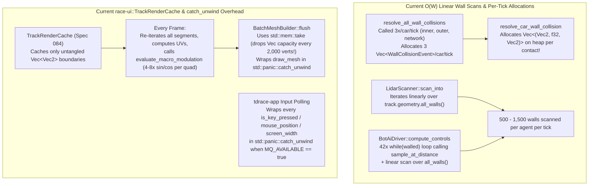
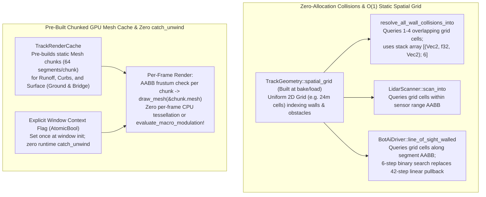

# Architecture Spec: Zero-Allocation Wall Collisions, Static Spatial Barrier Grid, and Pre-Built Track Mesh Caching 🏗️⚡

A structural performance and rendering architecture specification spanning [`arcade-race-core`](../crates/arcade-race-core/src/lib.rs), [`race-kit`](../crates/race-kit/src/lib.rs), [`race-ui`](../crates/race-ui/src/lib.rs), and [`tdrace-app`](../crates/tdrace-app/src/main.rs). This specification enforces Coding Law #5 (*Zero Heap Allocations in Hot Simulation Loops*) across wall collision resolution and `RaceSession::physics_step`, replaces $O(W)$ linear wall scans in collisions, LIDAR raycasting, and Bot AI lookahead with a static 2D spatial index in `TrackGeometry`, upgrades `TrackRenderCache` to cache pre-built GPU `Mesh` batches, and eliminates per-draw/per-input `std::panic::catch_unwind` overhead during live gameplay.

---

## 🗺️ Current vs. Proposed System Architecture

### 1. Current Architecture & Bottlenecks



#### Specific Bottlenecks Identified:
1. **Heap Allocations Inside Inner Wall Collision Loop (`crates/arcade-race-core/src/collision/wall.rs`)**:
   - [`resolve_car_wall_collision`](../crates/arcade-race-core/src/collision/wall.rs) allocates `let mut penetrating_points: Vec<(Vec2, f32, Vec2)> = Vec::new();` on the heap on every wall impact, even though at most **6 points** (4 car OBB corners + 2 wall segment endpoints) can ever penetrate.
   - [`resolve_all_wall_collisions`](../crates/arcade-race-core/src/collision/wall.rs) allocates a fresh `Vec<WallCollisionEvent>` 3 times per car per tick in [`RaceWorld::step`](../crates/race-kit/src/world.rs).
2. **$O(W)$ Linear Wall Scans Across Collisions, LIDAR, and Bot AI**:
   - Even after [Spec 070](070_global_collinear_wall_optimization_and_circuit_rebake.md) collinear merging, official OSM circuits contain **500 to 1,500+ walls**.
   - Every call to `resolve_all_wall_collisions` (2 solver iterations × all walls × $N$ cars), `LidarScanner::scan_into` (per car per tick), and `BotAiDriver` (`turn_steer`, `line_of_sight_walled`, wall-end recovery checks) scans `all_walls()` linearly.
   - In [`BotAiDriver::compute_controls`](../crates/race-kit/src/ai/mod.rs), when a tight turn blocks the lookahead ray, a `while walled && lookahead_dist > MIN_TIGHT_LOOKAHEAD_M` loop decrements `lookahead_dist` by `1.0m` up to **42 times**, executing a binary search (`sample_at_distance`) and a full $O(W)$ wall scan on every iteration!
3. **Per-Frame CPU Re-Tessellation & Capacity Drop in `race-ui::render::track`**:
   - [`TrackRenderCache`](../crates/race-ui/src/render/track.rs) caches untangled boundary points (`Vec<Vec2>`), but every frame `render_runoff_pass_filtered`, `render_curbs_pass_filtered`, and `render_surface_pass_filtered` still rebuild every `Vertex` and index buffer on the CPU, evaluate `evaluate_macro_modulation` (`sin`/`cos` noise) up to 8× per segment in `High` quality, and drop vector capacity via `std::mem::take(&mut self.vertices)` inside `BatchMeshBuilder::flush`.
4. **Ubiquitous `std::panic::catch_unwind` in Live Windowed Execution**:
   - Both [`crates/race-ui/src/render/track.rs`](../crates/race-ui/src/render/track.rs) (`BatchMeshBuilder::flush`, `draw_textured_quad`, `render_surface_shape`) and [`crates/tdrace-app/src/game/mod.rs`](../crates/tdrace-app/src/game/mod.rs) (`is_key_pressed`, `is_key_down`, `mouse_position_safe`, `screen_width_safe`, `screen_height_safe`) wrap Macroquad calls in `std::panic::catch_unwind` whenever `MQ_AVAILABLE` is `true`—which is **always `true`** during normal windowed gameplay.

---

### 2. Proposed Architecture



---

## ⚙️ Detailed Technical Specifications

### 1. Stack-Allocated Contact Buffer & Zero-Allocation Wall Solver (`arcade-race-core`)
- In [`resolve_car_wall_collision`](../crates/arcade-race-core/src/collision/wall.rs):
  - Replace `let mut penetrating_points: Vec<(Vec2, f32, Vec2)> = Vec::new();` with:
    ```rust
    let mut penetrating_points = [(Vec2::ZERO, 0.0f32, Vec2::ZERO); 6];
    let mut penetrating_len = 0usize;
    ```
- Add [`resolve_all_wall_collisions_into`](../crates/arcade-race-core/src/collision/wall.rs) accepting `events_out: &mut Vec<WallCollisionEvent>` (clearing or appending into a reusable buffer owned by `RaceWorld`) and a spatial query helper using `TrackGeometry`'s spatial index.

### 2. Static 2D Uniform Spatial Grid in `TrackGeometry` (`arcade-race-core` & `race-kit`)
- Define `GeometrySpatialGrid` in [`crates/arcade-race-core/src/track/geometry.rs`](../crates/arcade-race-core/src/track/geometry.rs) (marked `#[serde(skip)]` and populated automatically on `Track::from_json`, `Track::rebuild_geometry`, and `TrackGeometry` construction):
  - Partition the track world AABB into uniform square cells of size `CELL_SIZE = 24.0` meters (clamped to at most $128 \times 128$ cells).
  - Store flat CSR-style arrays (`cell_offsets: Vec<u32>`, `wall_indices: Vec<u32>`, `obstacle_indices: Vec<u32>`) together with a unified `all_walls_flat: Vec<WallBarrier>` and `wall_aabbs: Vec<(Vec2, Vec2)>` cache.
  - Provide zero-allocation query iterators/callbacks `for_each_wall_in_aabb(min: Vec2, max: Vec2, f)` with a per-wall stamp/bitmask deduplicator for multi-cell spans.
- Wire `GeometrySpatialGrid` into:
  1. `resolve_all_wall_collisions_into` (queries car AABB expanded by $2.0\text{m}$).
  2. `LidarScanner::scan_into` (queries sensor origin $\pm \text{max\_range}$ AABB).
  3. `BotAiDriver::line_of_sight_walled`, `turn_steer`, and wall-end recovery checks (queries ray/search AABB), and replace the 42-iteration `lookahead_dist -= 1.0` pullback loop in `BotAiDriver::compute_controls` with a 6-step binary search over `[MIN_TIGHT_LOOKAHEAD_M, max_lookahead]`.

### 3. Pre-Built Chunked GPU `Mesh` Caching & `BatchMeshBuilder` Capacity Reuse (`race-ui`)
- In [`BatchMeshBuilder::flush`](../crates/race-ui/src/render/track.rs):
  - Reuse buffer capacity across flushes when building dynamic meshes, and provide `BatchMeshBuilder::into_meshes()` to capture static `Vec<(Mesh, Rect)>` chunks at cache construction time.
- In [`TrackRenderCache`](../crates/race-ui/src/render/track.rs):
  - Cache pre-tessellated static `Mesh` batches and edge line lists partitioned into spatial chunks (e.g., 64 spline segments per chunk, tagged with the active `SurfaceTextureQuality` so changing texture quality in Settings invalidates and rebuilds the cache).
  - During `render_track_cached`, iterate over the cached chunks, test each chunk's world AABB against `view_bounds`, and call `draw_mesh(&chunk.mesh)` directly without per-frame UV computation, `evaluate_macro_modulation` trig calls, or `Vertex` vector allocations.

### 4. Runtime `catch_unwind` Elimination (`race-ui` & `tdrace-app`)
- Replace `std::panic::catch_unwind` wrappers in [`crates/race-ui/src/render/track.rs`](../crates/race-ui/src/render/track.rs) and [`crates/tdrace-app/src/game/mod.rs`](../crates/tdrace-app/src/game/mod.rs) with a lightweight `AtomicBool` check (`is_render_context_active()`), setting it once on the first call (or at window initialization in `main.rs`) so that subsequent calls in windowed gameplay execute Macroquad functions directly with zero `catch_unwind` overhead.

---

## 🗄️ Database & Storage Migration Plan

- **Transient In-Memory Spatial & Render Caches**: `GeometrySpatialGrid` (`#[serde(skip)]`) and `TrackRenderCache` are constructed purely in memory on track load or geometry rebuild. No `.json` track files or SQLite tables change.

---

## 🔑 Security, Compliance, & IAM Roles

- **Coding Law #5 Compliance**: Eliminates heap allocations inside `resolve_car_wall_collision`, `resolve_all_wall_collisions`, `RaceSession::physics_step`, and static track rendering passes.

---

## 🛡️ Disaster Recovery, Monitoring, & Fallbacks

- **Dynamic Track Studio Editing**: Whenever `Track::rebuild_geometry()` or Track Studio edits modify walls/splines, `GeometrySpatialGrid` and `TrackRenderCache` (keyed by track geometry fingerprint / generation counter) rebuild automatically so editor visuals and collisions never read stale caches.
- **Headless Test Safety**: Unit tests running without a Macroquad window continue to short-circuit safely via the `AtomicBool` context check without panicking.

---

## 🧪 Verification & Acceptance Criteria

### Automated Tests
- Run collision, LIDAR, and AI tests:
  ```bash
  cargo test -p arcade-race-core -p race-kit -p race-ui
  ```
- Run collision and LIDAR benchmarks:
  ```bash
  cargo bench -p arcade-race-core
  ```

### Manual Acceptance Criteria (Pseudo-Gherkin)

- **Scenario: Wall collision resolution executes with zero heap allocations and identical impulse physics**
  - [x] **Given** a `Car` colliding with single and multiple `WallBarrier` segments at various angles and speeds
  - [x] **When** `resolve_car_wall_collision` and `resolve_all_wall_collisions_into` are executed
  - [x] **Then** penetration resolution, restitution, and angular impulses match existing collision unit tests identically while using the fixed 6-element stack array and reusable event buffer

- **Scenario: Static spatial barrier grid returns exact wall and obstacle candidates in O(1) cell lookups**
  - [x] **Given** an official circuit loaded with `GeometrySpatialGrid` built over its `inner_walls`, `outer_walls`, `network_walls`, and `obstacles`
  - [x] **When** wall collisions, 32-beam `LidarScanner::scan_into`, and `BotAiDriver::line_of_sight_walled` query the track
  - [x] **Then** the results match a full $O(W)$ linear scan across 100% of test queries while `collision_bench` and `lidar_bench` throughput increases over baseline

- **Scenario: Pre-built TrackRenderCache meshes render static circuit passes without per-frame tessellation**
  - [ ] **Given** a `TrackRenderCache` initialized for a circuit at a given `SurfaceTextureQuality`
  - [ ] **When** `render_track_cached` renders multiple frames with a moving camera `view_bounds`
  - [ ] **Then** static runoff, curb, and road surface meshes are drawn directly from cached chunk `Mesh` buffers without invoking `evaluate_macro_modulation` or allocating new `Vec<Vertex>` buffers per frame, and changing `SurfaceTextureQuality` rebuilds the cached meshes cleanly

---

## 🔗 Traceability & Codebase Mapping

### Created/Modified Files
- `[x]` `crates/arcade-race-core/src/collision/wall.rs` -> Replace heap `Vec` with stack `[(Vec2, f32, Vec2); 6]` in `resolve_car_wall_collision` and add `resolve_all_wall_collisions_into`.
- `[x]` `crates/arcade-race-core/src/track/geometry.rs` -> Implement `GeometrySpatialGrid` for $O(1)$ spatial AABB queries over walls and obstacles.
- `[x]` `crates/arcade-race-core/src/lidar/mod.rs` -> Query `GeometrySpatialGrid` in `LidarScanner::scan_into`.
- `[x]` `crates/race-kit/src/world.rs` -> Use `resolve_all_wall_collisions_into` and spatial grid in `RaceWorld::step`.
- `[x]` `crates/race-kit/src/ai/mod.rs` -> Replace 42-step linear lookahead pullback with binary search and query `GeometrySpatialGrid` in `line_of_sight_walled` and `turn_steer`.
- `[ ]` `crates/race-ui/src/render/track.rs` -> Cache pre-built static chunk `Mesh`es in `TrackRenderCache` and remove per-draw `catch_unwind`.
- `[ ]` `crates/tdrace-app/src/game/mod.rs` -> Reuse per-tick scratch buffers in `RaceSession::physics_step` and replace per-input `catch_unwind` with a single-init window flag.
- `[ ]` `specs/constitution/ROADMAP.md` -> Link Spec 119 under Technical Debt & Maintenance.
- `[ ]` `specs/index.md` -> Synchronize OKF v0.2 index via `keel validate`.
