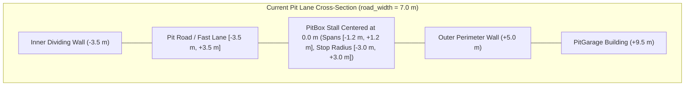
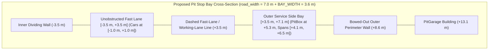

# Architecture Spec: Widened Pit Stop Side Bay, Outer Stall Placement, and Unobstructed Pit Fast Lane 🏗️

[Spec 101](101_parametric_pit_lane_kit_blocks_on_spline_circuits.md) introduced parametric `PitLaneLayout` kit blocks (`JunctionComponent`, free pit road, and `PitBoxRow`), and [Spec 077](077_procedural_gt_circuit_pit_lanes_from_openstreetmap_survey_data.md) extracted procedural pit lanes across the 18 GT circuits. However, `PitLaneLayout::compile` places every `PitBox` stall directly on the pit road centerline (`0.0 m` lateral offset), and the remaining free-form GT pit lanes place stalls at only `1.8 m` lateral offset inside a `7.0 m` road (`3.5 m` half-width). Because a painted stall box is `4.8 m × 2.4 m` (`±1.2 m` half-width) with a `3.0 m` circular service trigger (`PitBox::DEFAULT_STOP_RADIUS`) and cars driving down `PitLane.spline` occupy `[-1.0 m, +1.0 m]`, a car stopped in a stall physically blocks the pit lane and prevents other cars from driving through.

This specification amends Spec 101 (and updates the free-form GT pit lanes) by widening the pit stop area on the **outer (garage) side** into a dedicated **service side bay** (`BAY_WIDTH = 3.6 m`) with smooth entry and exit tapers, placing all `PitBox` stalls inside the outer service bay, shifting `PitGarage` buildings and the outer perimeter wall outward around the bay, and keeping the entire `PitLane.spline` corridor (`road_width`) as an unobstructed pass-through **fast lane**.

---

## 🔍 Context & Root Cause Analysis

1. **Centered Stalls in `PitLaneLayout::compile` (`crates/arcade-race-core/src/track/pit_kit.rs`)**:
   - Spec 101 Pillar IV states: *"Stall `i` sits at arc length `start_s + i · spacing` on the compiled pit lane, centred on the road and facing the lane direction."*
   - On all 5 converted GT circuits (`monza`, `nurburgring_gp`, `portimao_gp`, `red_bull_ring`, `suzuka`) and in Track Studio's Layout mode (`road_width = 6.0 m–7.0 m`), every `PitBox` sits at `0.0 m` lateral offset—dead center in the pit road.
2. **Insufficient Lateral Offset in Free-Form GT Pit Lanes (`scripts/osm_importer.py`)**:
   - On the 13 free-form GT circuits, `road_width = 7.0 m` (`half_width = 3.5 m`) and stalls sit at `1.8 m` lateral offset (`[+0.6 m, +3.0 m]` stall box footprint). A `2.0 m`-wide GT car driving along the `0.0 m` centerline (`[-1.0 m, +1.0 m]`) overlaps a stopped car in the stall by `0.4 m`, and the stall's `3.0 m` `stop_radius` (`[-1.2 m, +4.8 m]`) spans across the fast-lane centerline.
3. **Why Uniform Road Widening Fails Junction Guards**:
   - Uniformly doubling `road_width` from entry to exit breaks `JunctionShape::TurnOff` (`d0_max = half_main - road_width * 0.5 < 0` when `road_width > main_width`) and moves the inner pit edge toward the main track, tripping `PitKitError::RoadOverlapsTrack` (Guard 7) and colliding with the inner dividing pit wall.
   - Instead, keeping `PitLane.spline` as the pass-through **fast lane** of width `road_width` and expanding **only the outer (garage) boundary** along the stall row preserves all entry/exit junction geometry and inner dividing wall clearances while creating dedicated space for pit stops.

---

## 🎯 Proposed Solution & Architectural Pillars

### Pillar I: Pit Stop Side Bay Envelope (`PitLane` Outer Widening Profile)

In `crates/arcade-race-core/src/track/mod.rs` and `crates/arcade-race-core/src/track/pit_kit.rs`, the pit lane consists of:
1. **Fast Lane (Pass-Through Corridor)**: Centered on `PitLane.spline` with symmetric base half-width `half_w = road_width * 0.5` (`[-half_w, +half_w]`). Cars entering, passing through, or exiting the pit lane drive along `PitLane.spline` (`0.0 m` lateral offset).
2. **Outer Service Side Bay (Working Lane)**: Along the `pit_boxes` span on the outer (garage) side (`sigma = +1.0` for `Side::Left` / `+normal`, `sigma = -1.0` for `Side::Right` / `-normal`), the outer boundary widens by up to `BAY_WIDTH = 3.6 m`:
   - **Full-Width Bay Span**: From `s_bay_start = s_first - BAY_PAD_S` to `s_bay_end = s_last + BAY_PAD_S`, where `s_first` and `s_last` are the arc lengths of the first and last `PitBox` on `PitLane.spline` and `BAY_PAD_S = 4.0 m` (ensuring the `4.8 m`-long stall rectangle plus pull-in/pull-out margin sits inside the full-width bay).
   - **Smooth Entry & Exit Tapers**: Over `BAY_TAPER_LEN = 16.0 m` before `s_bay_start` (`[s_bay_start - 16.0, s_bay_start]`) and after `s_bay_end` (`[s_bay_end, s_bay_end + 16.0]`), the outer boundary offset transitions between `0.0 m` and `BAY_WIDTH` via cubic smoothstep $3t^2 - 2t^3$ (clamped safely to `[0.0, spline.total_length]`).
   - **Helper API on `PitLane`**:
     - `PitLane::bay_extension_at_s(&self, s: f32) -> (f32, f32)` returns `(left_extra, right_extra)` in meters at arc length `s` along `self.spline` (derived directly from projecting `self.pit_boxes` onto `self.spline`, requiring zero breaking JSON schema changes).
     - `PitLane::half_widths_at_s(&self, s: f32) -> (f32, f32)` returns `(half_w + left_extra, half_w + right_extra)`.
     - `PitLane::generate_boundaries(&self, sample_step: f32) -> (Vec<Vec2>, Vec<Vec2>)` generates the left and right drivable boundary polylines incorporating the smooth side-bay bulge.

### Pillar II: Outer Stall & Garage Placement (Amends Spec 101 Pillar IV)

1. **Stall Lateral Offset (`BAY_STALL_OFFSET = 1.8 m`)**:
   - Each `PitBox` stall center is placed in the middle of the `3.6 m` outer service bay, at lateral distance:
     $$d_{\text{stall}} = \sigma \cdot \left(\frac{\text{road\_width}}{2} + 1.8\,\text{m}\right)$$
     from `PitLane.spline` along `sample.normal`.
   - **Clearance Verification**:
     - For `road_width = 7.0 m` (`half_w = 3.5 m`): stall center is at `5.3 m` lateral offset; the painted `2.4 m`-wide stall spans `[+4.1 m, +6.5 m]`; the outer asphalt edge is at `+7.1 m` (`0.6 m` outer margin).
     - For `road_width = 6.0 m` (`half_w = 3.0 m`): stall center is at `4.8 m` lateral offset; the painted `2.4 m`-wide stall spans `[+3.6 m, +6.0 m]`; the outer asphalt edge is at `+6.6 m` (`0.6 m` outer margin).
     - In both cases, the inner edge of the stall (`+3.6 m` to `+4.1 m`) lies **`0.6 m` completely outside the fast-lane edge (`+3.0 m` to `+3.5 m`)**, giving a `2.0 m`-wide car centered at `0.0 m` in the fast lane (`[-1.0 m, +1.0 m]`) **`2.6 m–3.1 m` of clear lateral pass-through space**.
     - Furthermore, because $d_{\text{stall}} \ge 4.8\,\text{m} > 3.0\,\text{m}$ (`PitBox::DEFAULT_STOP_RADIUS`), a car driving along the fast-lane centerline (`0.0 m`) never intersects `PitBox::contains_point`, preventing false pit stop triggers when passing slow traffic.
2. **Garage Building Offset**:
   - In `PitLaneLayout::compile` (`crates/arcade-race-core/src/track/pit_kit.rs`), when `box_row.garages` is `true`, each `BuildingStyle::PitGarage` is shifted outward by `BAY_WIDTH` (`3.6 m`):
     $$d_{\text{garage}} = \frac{\text{road\_width}}{2} + \text{BAY\_WIDTH} + \text{OUTER\_WALL\_OFFSET} + \text{GARAGE\_WALL\_GAP} + \frac{\text{GARAGE\_DEPTH}}{2}$$
     so garages remain outside the bowed-out outer perimeter wall and never intrude into the service bay or wall strip.

### Pillar III: Perimeter Wall Contour, Trimming & Validation

1. **Outer Perimeter Wall Contour (`crates/arcade-race-core/src/track/pit_kit.rs`)**:
   - `pit_kit::perimeter_chain` offsets the outer perimeter wall at arc length `s` along `lane.spline` by:
     $$d_{\text{wall}}(s) = \frac{\text{road\_width}}{2} + \text{bay\_extra}(s) + \text{OUTER\_WALL\_OFFSET}$$
   - The outer wall smoothly bows out around the service bay (matching the `16.0 m` smoothstep entry/exit tapers) and stays between the service bay asphalt edge and the `PitGarage` buildings, maintaining 100% pit lane enclosure (`enclosure_holes == 0`).
2. **Wall Trimming & Bake Wall-Offset Estimation (`crates/arcade-race-core/src/track/mod.rs`, `crates/arcade-race-core/src/track/bake.rs`)**:
   - `Track::trim_walls_for_pit_lane` and `ERR_WALL_BLOCKS_PIT_LANE` check wall points against the asymmetric half-widths `[-half_w - right_extra(s), +half_w + left_extra(s)]` rather than only `[-half_w, +half_w]`.
   - `bake.rs` wall-offset estimation ignores walls within `pl.road_width * 0.5 + BAY_WIDTH + 2.0` of the pit spline so bowed-out pit perimeter walls do not skew the main track's default wall offset.
3. **Fast-Lane Clearance Validation (`crates/arcade-race-core/src/track/validation.rs`)**:
   - `validate_track` checks that every `PitBox` in `lane.pit_boxes` is laterally offset from `lane.spline` by at least `lane.road_width * 0.5 + 1.2 m` (so the `2.4 m`-wide stall box stays completely outside the fast lane); any stall encroaching into the fast lane emits `ERR_PIT_BOX_BLOCKS_FAST_LANE`.

### Pillar IV: Surface Sampling, Rendering & Bot Pit Bay Navigation

1. **Asymmetric Pit Surface Sampling (`crates/arcade-race-core/src/track/mod.rs`)**:
   - `Track::sample_pit_lane_surface` projects `pos` onto `pit_lane.spline`, computes signed lateral offset `lat = (pos - sample.point).dot(sample.normal)` and `(left_half, right_half) = pit_lane.half_widths_at_s(sample.distance)`, and returns `SurfaceType::Asphalt` (`on_track = true`) whenever `-right_half <= lat <= left_half`.
2. **Pit Ribbon & Fast-Lane Dividing Line Rendering (`crates/race-ui/src/render/track.rs`, `crates/tdrace-app/src/editor/render.rs`)**:
   - `TrackRenderCache` and Track Studio's editor preview use `pit_lane.generate_boundaries(sample_step)` so the rendered asphalt ribbon and white/yellow edge lines bulge smoothly around the outer pit stop bay.
   - Along the full-width bay span `[s_bay_start, s_bay_end]`, a dashed white lane-dividing line is rendered along the outer edge of the fast lane (`sigma * road_width * 0.5`) to visually separate the pass-through fast lane from the outer service bay.
3. **Bot Pull-In & Merge Navigation (`crates/race-kit/src/ai/mod.rs`)**:
   - A bot driving through the pit lane stays on the fast-lane centerline (`0.0 m`) until it is within `20.0 m` (`BAY_PULL_IN_DIST`) upstream of its assigned `PitBox` arc length `box_s`, at which point it smoothly blends its lateral target from the fast lane into `target_box.position` in the side bay and brakes to a stop inside `stop_radius`.
   - Once pit service completes (`completed_stop_this_visit = true`), the bot targets the fast-lane centerline (`sample_at_distance(current_s + lookahead).point`), merging smoothly out of the side bay back into the fast lane while other cars pass unobstructed along the fast lane.

---

## 🗺️ Current vs. Proposed System Architecture

### 1. Current Architecture
Stalls sit on the pit road centerline (`0.0 m` in `PitLaneLayout`, `1.8 m` in free-form), blocking the narrow `6.0 m–7.0 m` pit road so passing cars collide with stopped cars or trigger adjacent pit boxes:

### 2. Proposed Architecture
The fast lane (`[-3.5 m, +3.5 m]`) stays completely clear for through traffic, while the outer side bay (`[+3.5 m, +7.1 m]`) holds the `PitBox` stalls (`+5.3 m`), surrounded by the bowed-out outer perimeter wall and `PitGarage` row:

---

## 🗄️ Database & Storage Migration Plan

### 1. Circuit JSON Catalog (`tracks/gt/*.json`)
- **Zero-Schema-Breakage Design**: `PitLane` and `PitLaneLayout` require no new mandatory JSON fields. The side-bay envelope is computed deterministically from `pit_lane.road_width` and `pit_lane.pit_boxes` (which are baked at lateral offset `sigma * (road_width * 0.5 + 1.8)`).
- **18 GT Circuits Rebake**:
  - For the 5 `PitLaneLayout` GT circuits (`monza`, `nurburgring_gp`, `portimao_gp`, `red_bull_ring`, `suzuka`), `track_bake --rebuild` recompiles `pit_lane_layout` with the outer side bay stalls, shifted `PitGarage` buildings, and bowed-out outer perimeter walls.
  - For the 13 free-form GT circuits, a migration step updates their 6 `pit_boxes` lateral offsets to `sigma * (road_width * 0.5 + 1.8)` on the outer side of `pit_lane.spline`, and `track_bake --rebuild` regenerates their outer perimeter walls around the widened bay.
  - Running `track_bake tracks/gt/*.json --rebuild` twice in a row produces zero diff on the second run.

### 2. Rollback
- Revert the `tracks` submodule commit and restore `PitLaneLayout::compile` center-line box placement.

---

## 🔑 Security, Compliance, & IAM Roles

Not applicable. All track geometry compilation, validation, and rendering run locally and deterministically on first-party embedded/submodule JSON assets and user-authored Track Studio files.

---

## 🛡️ Disaster Recovery, Monitoring, & Fallbacks

- **Enclosure & Validation Guardrails**: Every re-baked GT circuit must pass `validate_track` with zero errors (including `ERR_WALL_BLOCKS_PIT_LANE`, `ERR_PIT_BOX_ON_TRACK`, `ERR_PIT_BOX_BLOCKS_FAST_LANE`, and `ERR_SCENERY_INSIDE_WALL`) and pass `enclosure_holes == 0`.
- **Legacy Fallback**: A `PitLane` with empty `pit_boxes` (no stalls) returns `(0.0, 0.0)` from `bay_extension_at_s`, preserving uniform `road_width` boundaries.

---

## 🧪 Verification & Acceptance Criteria

### Automated Tests
- `cargo test -p arcade-race-core --test pit_kit_tests`
- `cargo test -p tdrace-app --test pit_lane_integration_tests`
- `cargo test -p tdrace-app --test track_editor_tests`
- `cargo run --release -p tdrace-app --bin track_bake -- tracks/gt/*.json --rebuild`

### Manual Acceptance Criteria (Pseudo-Gherkin)

- **Scenario: Compiled layout places pit stalls in the outer service bay clear of the fast lane**
  - [x] **Given** a `PitLaneLayout` with `road_width = 7.0 m`, `box_row.count = 6`, and `garages = true`
  - [x] **When** `PitLaneLayout::compile` runs
  - [x] **Then** every `PitBox` center sits at lateral offset `5.3 m` (`road_width * 0.5 + 1.8 m`) on the outer side (`side`) of `PitLane.spline`
  - [x] **And** the inner edge of each `2.4 m`-wide stall box (`4.1 m`) is at least `0.6 m` outside the `3.5 m` fast-lane edge
  - [x] **And** each `PitGarage` building sits outside the widened bay and outer perimeter wall without triggering `ERR_SCENERY_INSIDE_WALL`

- **Scenario: Fast-lane pass-through traffic does not collide with a parked car or trigger pit stops**
  - [x] **Given** a GT circuit where Car A (`2.0 m` wide) is stopped at the center of Pit Stall 1 for pit service
  - [x] **When** Car B (`2.0 m` wide) drives down the `PitLane.spline` fast-lane centerline (`0.0 m` lateral offset) from entry to exit
  - [x] **Then** the lateral clearance between Car A's hull and Car B's hull is at least `2.5 m`
  - [x] **And** Car B never enters `PitBox::contains_point` (`stop_radius = 3.0 m`) of any stall while driving along the fast-lane centerline

- **Scenario: Pit lane surface sampling and visual boundaries include the tapered outer side bay**
  - [x] **Given** a circuit with a compiled or free-form `PitLane` containing 6 outer-bay stalls
  - [x] **When** `Track::sample_pit_lane_surface` is queried at every stall center and across `[road_width * 0.5, road_width * 0.5 + 3.6 m]` along the stall row
  - [x] **Then** it returns `SurfaceType::Asphalt` (`on_track = true`) across the entire outer service bay and tapers smoothly over `16.0 m` at both ends
  - [x] **And** `PitLane::generate_boundaries` produces an outer boundary polyline that bulges out by `3.6 m` across the stall row while the inner boundary stays at `road_width * 0.5`

- **Scenario: Outer perimeter wall encloses the widened side bay with zero wall intrusions or gaps**
  - [x] **Given** all 18 official GT circuits re-baked with outer-bay pit stalls
  - [x] **When** `validate_track` and `pit_kit::enclosure_holes` run on each circuit
  - [x] **Then** no circuit reports `ERR_WALL_BLOCKS_PIT_LANE`, `ERR_PIT_BOX_ON_TRACK`, `ERR_PIT_BOX_BLOCKS_FAST_LANE`, or `ERR_SCENERY_INSIDE_WALL`
  - [x] **And** every enclosed GT pit lane reports `0` enclosure holes

- **Scenario: Bots pull into the outer side bay for service and merge back into the fast lane**
  - [x] **Given** a race on a GT circuit (e.g., `monza`) with pit stops enabled and multiple GT bots entering the pit lane
  - [x] **When** a bot approaches its target stall, completes its pit stop, and exits while another bot drives past toward a downstream stall
  - [x] **Then** the servicing bot steers into the outer bay stall, stops within `stop_radius`, increments `pit_stops`, and merges back to the fast lane without blocking the passing bot

---

## 🔗 Traceability & Codebase Mapping

### Created/Modified Files
- `[x]` `crates/arcade-race-core/src/track/geometry.rs` -> Adds `BAY_WIDTH`, `BAY_STALL_OFFSET`, `BAY_PAD_S`, `BAY_TAPER_LEN`, `PitLane::bay_extension_at_s`, `PitLane::half_widths_at_s`, `PitLane::generate_boundaries`, and `PitLane::untangled_boundaries`.
- `[x]` `crates/arcade-race-core/src/track/mod.rs` -> Updates `Track::sample_pit_lane_surface`, `Track::trim_walls_for_pit_lane`, and `Track::generate_pit_lane_walls` for the widened outer side bay.
- `[x]` `crates/arcade-race-core/src/track/pit_kit.rs` -> Amends `PitLaneLayout::compile` to place stalls in the outer bay (`road_width * 0.5 + BAY_STALL_OFFSET`), shifts `PitGarage` buildings outward by `BAY_WIDTH`, and widens `perimeter_chain` around the side bay.
- `[x]` `crates/arcade-race-core/src/track/bake.rs` -> Updates pit wall offset exclusion zone to account for `BAY_WIDTH` and migrates free-form pit boxes into the outer service bay.
- `[x]` `crates/arcade-race-core/src/track/validation.rs` -> Updates `ERR_WALL_BLOCKS_PIT_LANE` to check asymmetric bay half-widths and adds `ERR_PIT_BOX_BLOCKS_FAST_LANE`.
- `[x]` `crates/race-ui/src/render/track.rs` -> Uses `pit_lane.untangled_boundaries` for the widened side-bay asphalt ribbon and renders the dashed fast-lane / service-bay dividing line.
- `[x]` `crates/tdrace-app/src/editor/tools.rs` -> Places default free-form pit boxes in the outer side bay and hit-tests the full side-bay width.
- `[x]` `crates/race-kit/src/ai/mod.rs` -> Smooths bot lateral pull-in from the fast lane into the outer side bay (`20.0 m` lookahead blend) and exit merge back to the fast lane.
- `[x]` `scripts/osm_importer.py` -> Updates free-form pit box lateral placement to `road_width * 0.5 + 1.8 m`.
- `[x]` `crates/arcade-race-core/tests/pit_kit_tests.rs` -> Adds unit tests for outer side-bay stall placement, bay boundary envelope, surface sampling, and fast-lane clearance.
- `[x]` `crates/tdrace-app/tests/pit_lane_integration_tests.rs` -> Adds integration tests verifying side-by-side fast-lane pass-through clearance past a parked stall car and outer-bay validation across all 18 GT circuits.
- `[x]` `tracks/gt/*.json` -> Re-baked 18 GT circuits with outer-bay pit stalls, garages, and bowed-out outer perimeter walls.

### Verification Assertions
- `crates/arcade-race-core/src/track/pit_kit.rs` references `specs/120_widened_pit_stop_side_bay_outer_stall_placement_and_unobstructed_pit_fast_lane.md` in its module header comments.
