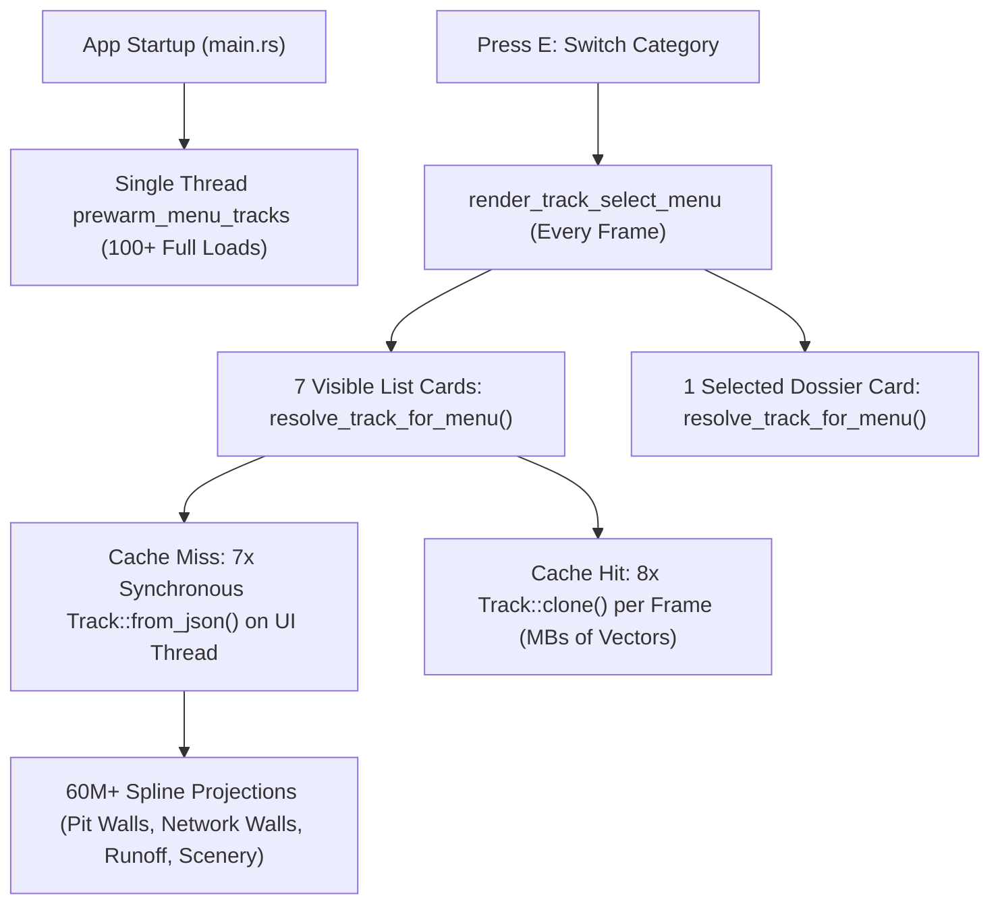
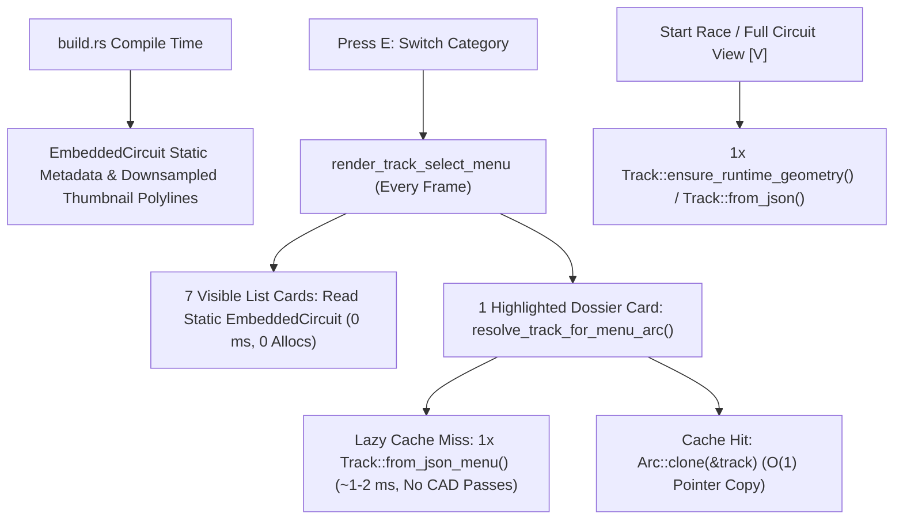

# Architecture Spec: Two-Stage Lazy Circuit Menu Loading and Compile-Time Card Metadata 🏗️

Switching circuit categories (`E` / `Q`) in the Circuit Selector (`GameState::Menu`) or browsing the Circuit Manager (`GameState::TrackManager`) currently blocks the main UI thread for up to several seconds when visiting complex modules such as Grand Touring (`Gt`), Rallycross (`Rally`), or Continental Autocross (`Autocross`).

This specification replaces eager background prewarming (`RaceSession::prewarm_menu_tracks`) and synchronous full-physics `Track::from_json` menu resolution with a **Two-Stage Lazy Loading & Compile-Time Card Metadata** architecture:
1. **Stage 0 — Compile-Time Card Metadata & Downsampled Thumbnails (`EmbeddedCircuit`)**: Official circuit list cards and `58×44` vector thumbnails render directly from static compile-time metadata in binary ROM with zero JSON decompression, parsing, or heap allocation.
2. **Stage 1 — On-Demand Lightweight Preview Deserialization (`Track::from_json_menu` + `Arc<Track>`)**: Only the **single highlighted circuit** is lazily deserialized on demand for the right-hand dossier preview, skipping all runtime wall/pit/network/runoff/scenery CAD passes and caching `Arc<Track>` in `MENU_TRACK_CACHE` to eliminate per-frame deep clones.
3. **Stage 2 — Lazy Runtime Geometry Compilation (`Track::ensure_runtime_geometry`)**: Expensive wall trimming, pit-lane wall generation, runoff surface projections, network branch wall synthesis, and scenery obstacle compilation execute only for the single circuit launched into a race or opened in `FULL CIRCUIT VIEW [V]`.

---

## 🔍 Context & Root Cause Analysis

1. **Sequential Background Prewarm vs. Synchronous 7-Card UI Fallback**:
   - At startup (`crates/tdrace-app/src/main.rs`), `RaceSession::prewarm_menu_tracks` spawns a single background thread (`menu-track-prewarm`) that sequentially loads all 100+ circuits across `MenuCategoryFilter::ALL` (`Classic` $\rightarrow$ `Kart` $\rightarrow$ `Autocross` $\rightarrow$ `Rally` $\rightarrow$ `Nascar` $\rightarrow$ `Gt` $\rightarrow$ `ExtremeOffroad` $\rightarrow$ `Custom`).
   - When the user presses `E` to switch to a module not yet reached by the background thread, `render_track_select_menu` calls `resolve_track_for_menu` for all **6–7 visible list cards** plus the selected dossier card, triggering 7 synchronous full `Track::from_json` loads on the main render thread.
2. **Redundant $O(N \times M)$ CAD Passes in `Track::from_json` (`crates/arcade-race-core/src/track/mod.rs`)**:
   - Even though official circuits in `tracks/<module>/*.json` are pre-baked by `track_bake` (up to `5.6 MB` of JSON with `4,300+` spline samples and `1,800+` walls on circuits like `suzuka` and `spa`), `Track::from_json` unconditionally re-executes:
     - `trim_walls_for_pit_lane()`, `generate_pit_lane_walls()`, and duplicate `recompute_pit_lane_junctions()` calls on all 18 GT circuits (~60M spline projections per circuit).
     - `apply_default_runoff_surfaces()` across all samples and pit lanes.
     - `trim_walls_for_network()`, `generate_network_walls()`, and `recompute_composite_splines()` across all 23 Rallycross and 17 Autocross circuits.
     - `recompute_scenery_obstacles()` across all trees, grandstands, rocks, and buildings.
   - None of these runtime-rebuilt fields are used by `render_track_select_menu` or `render_track_detailed_preview`.
3. **Per-Frame Full-Struct Cloning**:
   - `resolve_track_for_menu_with_dir` returns `Some(track.clone())` from `MENU_TRACK_CACHE`, deep-cloning megabytes of `SplineSample`, `WallBarrier`, `TrackNetwork`, and `Scenery` vectors up to **8 times per frame** at 60 FPS.

---

## 🗺️ Current vs. Proposed System Architecture

### 1. Current Architecture
Startup spawns a background thread that runs full CAD passes on all 100+ circuits sequentially; switching categories in the menu triggers synchronous full `Track::from_json` loads for all 7 visible list cards and deep-clones `Track` 8 times every frame:

### 2. Proposed Architecture
Startup performs zero background track loading; list cards render from compile-time `EmbeddedCircuit` metadata and downsampled thumbnail polylines; only the 1 highlighted circuit is lazily parsed via `Track::from_json_menu` into an `Arc<Track>` cache; full CAD geometry runs only on race launch or `FULL CIRCUIT VIEW [V]`:

---

## 🎯 Proposed Solution & Architectural Pillars

### Pillar I: Stage 0 — Compile-Time Card Metadata & Thumbnail Polylines (`crates/tdrace-core`)
In `crates/tdrace-core/build.rs` and `crates/tdrace-core/src/catalog.rs`, extend `EmbeddedCircuit` with static fields extracted at compile time from each `tracks/<module>/<id>.json`:
- `total_length_m: f32`: Default layout `total_lap_length` from `network` when present and $> 0.0$, otherwise `spline.total_length`.
- `surface_summary: &'static str`: Precomputed surface breakdown string matching `Track::surface_summary_string()` (e.g., `"100% Asphalt"` or `"65% Asphalt, 35% Dirt"`).
- `scale: &'static str`: Circuit scale badge (`"1:1"`, `"0.75:1"`, etc.).
- `is_inspired: bool`: Whether the circuit displays the `INSPIRED` badge.
- `default_surface: SurfaceType`: Off-track terrain surface used for thumbnail card tinting.
- `closed: bool`: Whether the main spline loop is closed.
- `bounds_min: [f32; 2]` and `bounds_max: [f32; 2]`: Precomputed 2D bounding box across the main spline and any joker/launch chute branch segments.
- `thumbnail_samples: &'static [([f32; 2], SurfaceType)]`: Main spline samples uniformly downsampled to at most `160` points for crisp `58×44` pixel vector thumbnail rendering.
- `thumbnail_branches: &'static [&'static [([f32; 2], SurfaceType)]]`: Joker detour and launch chute segments downsampled to at most `64` points per branch.

In `render_track_select_menu` (`crates/tdrace-app/src/ui/menu.rs`) and `render_track_manager_screen` (`crates/tdrace-app/src/ui/track_manager_ui.rs`), whenever a list card represents an official circuit (and is not overridden on disk in dev mode), the card renders its metrics, tags, and `58×44` vector thumbnail (`render_embedded_track_thumbnail`) directly from `EmbeddedCircuit` without touching `MENU_TRACK_CACHE` or deserializing JSON.

### Pillar II: Stage 1 — Lightweight Preview Deserialization (`Track::from_json_menu`) & `Arc<Track>` Cache
1. **`Track::from_json_menu` & `Track::load_from_file_menu` (`crates/arcade-race-core/src/track/mod.rs`)**:
   - Deserializes `Track` via `serde_json::from_str` and populates `spline.curves` only if empty.
   - Skips `trim_walls_for_pit_lane`, `generate_pit_lane_walls`, `recompute_pit_lane_junctions`, `apply_default_runoff_surfaces`, `trim_walls_for_network`, `generate_network_walls`, `recompute_composite_splines`, and `recompute_scenery_obstacles`.
   - Leaves `runtime_geometry_ready: false` (a `#[serde(skip)]` boolean on `Track`).
2. **`EmbeddedCircuit::load_menu` & `official::load_menu`**:
   - Decompresses the embedded DEFLATE payload (or reads the dev-mode git file) and deserializes via `Track::from_json_menu`.
3. **Zero-Clone `Arc<Track>` Menu Cache (`crates/tdrace-app/src/ui/menu.rs`)**:
   - Changes `MENU_TRACK_CACHE` from `HashMap<String, Track>` to `HashMap<String, Arc<Track>>`.
   - Adds `resolve_track_for_menu_arc` and `resolve_track_for_menu_arc_with_dir` returning `Option<Arc<Track>>`.
   - `render_track_select_menu` and `render_track_manager_screen` use `resolve_track_for_menu_arc` for the **1 currently selected circuit** to render the right-hand dossier and `render_track_detailed_preview`, eliminating all per-frame `Track::clone()` allocations.
4. **Removal of Startup Eager Prewarm (`crates/tdrace-app/src/main.rs`)**:
   - Removes `session.prewarm_menu_tracks()` from `main.rs` so startup performs zero background track loading.

### Pillar III: Stage 2 — On-Demand Runtime Geometry Compilation (`Track::ensure_runtime_geometry`)
1. **`Track::ensure_runtime_geometry(&mut self)` (`crates/arcade-race-core/src/track/mod.rs`)**:
   - Idempotently executes the full runtime geometry pipeline (pit lane spline/wall trimming/wall generation/junctions, `apply_default_runoff_surfaces`, network wall trimming/generation/composite splines, and `recompute_scenery_obstacles`) when `!self.runtime_geometry_ready`, then sets `self.runtime_geometry_ready = true`.
   - `Track::from_json` calls `Self::from_json_menu(json_str)` followed by `track.ensure_runtime_geometry()`.
2. **Full Circuit Viewer & Race Launch**:
   - `RaceSession::open_circuit_viewer` (`crates/tdrace-app/src/game/mod.rs`) calls `track.ensure_runtime_geometry()` before constructing `CircuitViewerState`, ensuring `FULL CIRCUIT VIEW [V]` displays complete walls, pit lanes, and scenery even when handed a track from the lightweight menu cache.
   - `TrackManager::load_track` and `official::load` continue calling full `Track::from_json` when launching a race or opening Track Studio.

---

## 🗄️ Database & Storage Migration Plan

- **Zero Disk/Schema Changes**: All `tracks/<module>/*.json` files and user custom track JSON files remain 100% unchanged on disk.
- **Compile-Time Codegen Only**: `crates/tdrace-core/build.rs` extracts static card metadata and downsampled thumbnail slices into `$OUT_DIR/official_catalog.rs` during `cargo build`.

---

## 🔑 Security, Compliance, & IAM Roles

Not applicable. All compile-time extraction and runtime lazy deserialization operate deterministically on local embedded/filesystem JSON assets.

---

## 🛡️ Disaster Recovery, Monitoring, & Fallbacks

- **Dev-Mode Disk Override Parity**: When `is_dev_mode()` is active and a developer has modified an official circuit JSON in `TDRACE_GIT_TRACKS_DIR` (or overwritten a preset in Track Studio), list cards and thumbnails transparently fall back to `resolve_track_for_menu_arc` so live disk edits appear immediately after `clear_menu_track_cache()`.
- **User Custom Circuits Fallback**: User-authored circuits (`!choice.is_official_preset()`) continue to resolve their list card thumbnail and metrics through `resolve_track_for_menu_arc_with_dir`.

---

## 🧪 Verification & Acceptance Criteria

### Automated Tests
- `cargo test -p arcade-race-core`
- `cargo test -p tdrace-core`
- `cargo test -p tdrace-app --test track_preview_tests`
- `cargo test -p tdrace-app --test official_catalog_tests`
- `cargo test -p tdrace-app --test menu_track_prewarm_tests`

### Manual Acceptance Criteria (Pseudo-Gherkin)

- **Scenario: Compile-time EmbeddedCircuit metadata matches full Track metrics**
  - [x] **Given** every official circuit embedded in `tdrace_core::catalog::circuits()`
  - [x] **When** its compile-time `total_length_m`, `surface_summary`, `scale`, `is_inspired`, `default_surface`, and non-empty `thumbnail_samples` are compared against `circuit.load_menu()`
  - [x] **Then** `total_length_m` matches within `0.5 m`, `surface_summary`, `scale`, `is_inspired`, and `default_surface` match identically, and `thumbnail_samples` contains between `2` and `160` valid points within `bounds_min..=bounds_max`

- **Scenario: Switching circuit categories in the menu does not load unselected list cards into MENU_TRACK_CACHE**
  - [x] **Given** an empty `MENU_TRACK_CACHE` (`clear_menu_track_cache()`) and normal mode (`!is_dev_mode()`)
  - [x] **When** the menu resolves card metadata and thumbnail geometry for all 7 visible list cards of a module (`Gt`, `Rally`, `Autocross`) and resolves only the 1 selected circuit via `resolve_track_for_menu_arc`
  - [x] **Then** `MENU_TRACK_CACHE` contains only the 1 selected circuit and switching categories + resolving the selected preview completes in under `25 ms`

- **Scenario: Lightweight menu deserialization skips heavy CAD passes while preserving preview fidelity**
  - [x] **Given** complex circuits with pit lanes and branching networks (e.g., `gt/suzuka`, `gt/spa`, `rally/holjes_rx`, `autocross/prerov_ax`)
  - [x] **When** loaded via `Track::from_json_menu` / `resolve_track_for_menu_arc`
  - [x] **Then** `compute_track_bounds`, `branch_roads`, `total_length_m`, `width_summary_string`, `surface_breakdown`, `checkpoints`, and `grid_positions` match the full `Track::from_json` load
  - [x] **And** calling `ensure_runtime_geometry()` upgrades the menu track to match the full `Track::from_json` geometry (including `network_walls`, `pit_lane_junctions`, and `scenery_obstacles`)

- **Scenario: Cached menu lookups return shared Arc<Track> without deep cloning**
  - [x] **Given** a circuit resolved via `resolve_track_for_menu_arc`
  - [x] **When** `resolve_track_for_menu_arc` is called again for the same circuit before `clear_menu_track_cache()`
  - [x] **Then** both calls return `Arc<Track>` pointers sharing the exact same heap allocation (`Arc::ptr_eq(&a, &b) == true`)

---

## 🔗 Traceability & Codebase Mapping

### Created/Modified Files
- `[x]` `crates/arcade-race-core/src/track/mod.rs` -> Adds `Track::from_json_menu`, `Track::load_from_file_menu`, `Track::ensure_runtime_geometry`, and `runtime_geometry_ready`.
- `[x]` `crates/tdrace-core/build.rs` -> Computes and embeds `total_length_m`, `surface_summary`, `scale`, `is_inspired`, `default_surface`, `closed`, `bounds_min`, `bounds_max`, `thumbnail_samples`, and `thumbnail_branches` at compile time.
- `[x]` `crates/tdrace-core/src/catalog.rs` -> Extends `EmbeddedCircuit` with compile-time card/thumbnail fields and adds `EmbeddedCircuit::load_menu`.
- `[x]` `crates/tdrace-app/src/tracks/official.rs` -> Adds `official::load_menu` and `official::embedded_for_menu` (respecting dev-mode disk overrides).
- `[x]` `crates/tdrace-app/src/ui/track_preview.rs` -> Adds `render_embedded_track_thumbnail` to render `58×44` vector thumbnails directly from static `EmbeddedCircuit` slices.
- `[x]` `crates/tdrace-app/src/ui/menu.rs` -> Stores `Arc<Track>` in `MENU_TRACK_CACHE`, adds `resolve_track_for_menu_arc` / `resolve_track_for_menu_arc_with_dir`, uses `Track::from_json_menu` for menu cache loads, and renders official list cards in `render_track_select_menu` directly from `EmbeddedCircuit` without loading `Track`s.
- `[x]` `crates/tdrace-app/src/ui/track_manager_ui.rs` -> Uses `EmbeddedCircuit` for official list card thumbnails/metrics and `resolve_track_for_menu_arc_with_dir` for the selected dossier card.
- `[x]` `crates/tdrace-app/src/game/mod.rs` -> Calls `track.ensure_runtime_geometry()` in `open_circuit_viewer`.
- `[x]` `crates/tdrace-app/src/main.rs` -> Removes eager `session.prewarm_menu_tracks()` startup call.
- `[x]` `crates/tdrace-app/tests/track_preview_tests.rs` -> Adds unit and integration tests for compile-time card metadata, lazy menu loading, `Arc::ptr_eq`, and `ensure_runtime_geometry`.
- `[x]` `crates/tdrace-app/tests/official_catalog_tests.rs` -> Verifies `resolve_track_for_menu_with_dir` parity with `ensure_runtime_geometry()`.

### Verification Assertions
- `crates/tdrace-core/src/catalog.rs` and `crates/tdrace-app/src/ui/menu.rs` reference `specs/121_two_stage_lazy_circuit_menu_loading_and_compile_time_card_metadata.md` in their comments.
