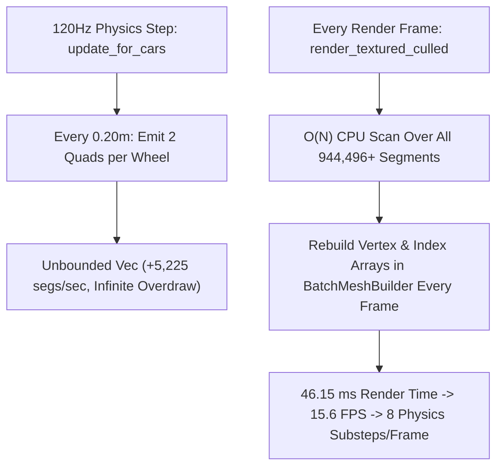
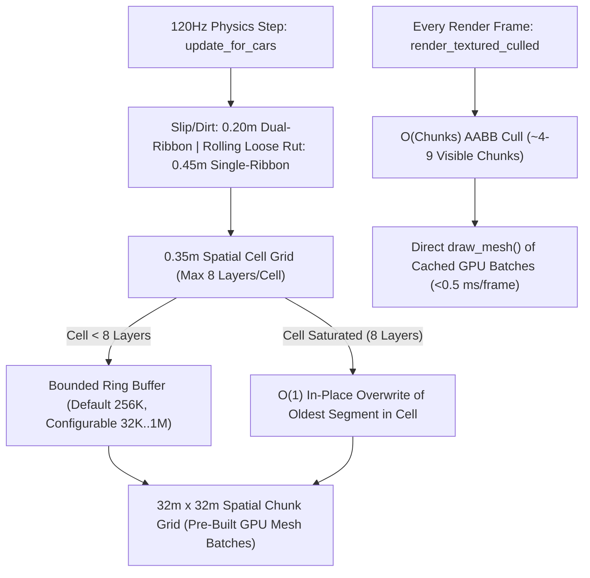

# Architecture Spec: Bounded Spatial-Chunked Skidmark Buffer Overdraw Suppression and Configurable Ring Capacity 🏗️

During multi-lap races—especially on circuits with loose surfaces (Dirt, Gravel, Sand, Mud, Grass) or heavy tire slip—frame rates progressively degrade from 60 FPS down to `<16 FPS` within 2–3 minutes of driving. Live telemetry captured with the new built-in runtime profiler (`--profile` / `F7`) proved that `SkidmarkBuffer` (`EffectsManager::new_persistent`) is solely responsible for the degradation:
- At `t = 112.9s` (~1.9 minutes), `SkidmarkBuffer` accumulated **`542,136` segments** (`~2,168,544` vertices), taking **`23.95 ms`/frame** (`70%` of total render time) and dropping frame rate to **`25.5 FPS`**.
- At `t = 189.9s` (~3.2 minutes), `SkidmarkBuffer` reached **`944,496` segments** (`~3,777,984` vertices, growing at **`+5,225` segments/sec**), taking **`46.15 ms`/frame** (`81%` of total render time), dropping frame rate to **`15.6 FPS`**, and forcing the 120 Hz fixed-step physics loop onto its **`8.0` substeps/frame** spiral-of-death ceiling.

This specification eliminates multi-lap skidmark performance degradation by combining three complementary mechanisms plus an in-game Display setting and runtime telemetry profiler:
1. **Mechanism 1 — Generous Configurable Ring Buffer Capacity (`256K` Default, `32K`–`1M` Range in Settings)**: Bounds `SkidmarkBuffer` with a default ring capacity of `262,144` (`256K`) segments and exposes a `SKIDMARK BUFFER CAP` slider in `ArcadeSettingsModal` (`DISPLAY` tab) and `DisplayConfig` (`config.toml`) configurable from `32K` (`32,768`) to `1M` (`1,048,576`) segments.
2. **Mechanism 2 — Coarse Rolling-Rut Stepping & Spatial Cell Overdraw Saturation**: Emits single-ribbon quads every `0.45 m` (instead of dual-ribbon quads every `0.20 m`) when wheels roll without slip on loose terrain, and tracks a `0.35 m × 0.35 m` spatial saturation grid (`MAX_SEGMENTS_PER_CELL = 8`) that overwrites the oldest segment in-place once a patch of track is already saturated with 8 overlapping layers.
3. **Mechanism 3 — `32 m × 32 m` Spatial Chunk Grid with Pre-Built GPU `Mesh` Batches**: Partitions skidmark geometry into `32 m × 32 m` spatial chunks (`SkidChunk`) with pre-built `macroquad::models::Mesh` batches and $O(1)$ `ChunkQuadRef` in-place vertex updates, replacing per-frame $O(N)$ segment scanning and CPU `Vertex` reconstruction with $O(\text{chunks})$ AABB culling and direct GPU mesh submission.

---

## 🔍 Context & Root Cause Analysis

1. **Unbounded `EffectsManager::new_persistent` Growth**:
   - `RaceSession` initializes `EffectsManager::new_persistent(1500)`, which constructs `SkidmarkBuffer::new(0)` (`max_capacity == 0`, never wrapping).
2. **5,200+ Segments/Sec Emission Rate & Redundant Overdraw**:
   - In `SkidmarkBuffer::update_for_cars` (`crates/race-ui/src/fx/skidmarks.rs`), every wheel on loose terrain (`surface.leaves_rolling_rut()`), or carrying dirt onto pavement (`dirt_contamination > 0.035`), or experiencing light slip (`skid_intensity > 0.025`), emits **2 `SkidSegment` quads** (`Ribbon A` + `Ribbon B`) every `0.20 m`.
   - Over consecutive laps, 8–12 cars stack 20–40 opaque quads on top of the exact same `0.35 m × 0.35 m` racing-line cells, adding hundreds of thousands of invisible overdrawn vertices.
3. **Per-Frame $O(N)$ Linear Scan & Dynamic Vertex Rebuild**:
   - Every frame, `SkidmarkBuffer::render_textured_culled` scans every segment in `self.segments` on the CPU (`is_quad_in_view`) and rebuilds `Vec<Vertex>` and `Vec<u16>` via `BatchMeshBuilder::push_quad` for all visible segments.

---

## 🗺️ Current vs. Proposed System Architecture

### 1. Current Architecture
Every wheel emits 2 quads every `0.20 m` into an unbounded flat `Vec<SkidSegment>`; every frame linearly scans all `944,496+` segments on the CPU and rebuilds `BatchMeshBuilder` vertex arrays from scratch:

### 2. Proposed Architecture
Rolling loose ruts use `0.45 m` single-quad steps; a `0.35 m` spatial cell grid caps overdraw at 8 layers per cell by overwriting in-place; a configurable ring buffer (`32K`–`1M`, default `256K`) bounds total memory; and `32 m × 32 m` spatial chunks store pre-built GPU `Mesh` batches updated in $O(1)$ via `ChunkQuadRef`:

---

## 🎯 Proposed Solution & Architectural Pillars

### Pillar I: Configurable Ring Buffer Capacity (`256K` Default, `32K`–`1M` Range) & Settings Integration
1. **Capacity Constants & Ring Buffer API (`crates/race-ui/src/fx/skidmarks.rs`)**:
   - Define `MIN_SKIDMARK_CAPACITY: usize = 32_768` (`32K`), `DEFAULT_SKIDMARK_CAPACITY: usize = 262_144` (`256K`), and `MAX_SKIDMARK_CAPACITY: usize = 1_048_576` (`1M`).
   - `SkidmarkBuffer::new_persistent()` initializes a persistent ring buffer with `max_capacity = DEFAULT_SKIDMARK_CAPACITY` (`262,144`) and `persistent = true`.
   - `SkidmarkBuffer::with_persistent_capacity(capacity: usize)` clamps `capacity` to `MIN_SKIDMARK_CAPACITY..=MAX_SKIDMARK_CAPACITY` with `persistent = true`.
   - `SkidmarkBuffer::set_max_capacity(&mut self, capacity: usize)` dynamically updates `max_capacity` (clamped to `MIN_SKIDMARK_CAPACITY..=MAX_SKIDMARK_CAPACITY` when persistent), truncating excess segments and rebuilding spatial chunks if lowered below current length.
2. **Display Configuration (`crates/tdrace-app/src/config.rs`)**:
   - Add `pub skidmark_buffer_cap: usize` to `DisplayConfig` (defaulting to `262_144` / `256K`) with `DisplayConfig::clamped_skidmark_buffer_cap(&self) -> usize` clamping to `32_768..=1_048_576`.
3. **Arcade Settings Modal UI (`crates/cabinet/src/state/settings.rs` & `crates/tdrace-app/src/game/mod.rs`)**:
   - Add `pub skidmark_cap_slider: SliderWidget` (`"SKIDMARK BUFFER CAP"`, range `32.0..=1024.0`, step `32.0`, default `256.0`, suffix `"K"`) to the `DISPLAY` tab (`active_tab == 2`, row `6`, increasing `nav.column_lengths[2]` from `7` to `8`).
   - Expose `modal.skidmark_buffer_cap() -> usize` and `modal.set_skidmark_buffer_cap(cap: usize)`, wire into `SettingsSnapshot`, `restore_defaults()`, `has_changes()`, `RaceSession::open_settings_modal`, and `RaceSession::close_settings_modal`.

### Pillar II: Rolling Loose-Rut Step Coarsening & Spatial Cell Overdraw Saturation (`crates/race-ui/src/fx/skidmarks.rs`)
1. **Rolling Loose-Surface Step Coarsening**:
   - When a wheel is rolling on loose terrain without active slip or pavement dirt transfer (`!has_slip && !is_transferring_dirt && is_rolling_loose`), require a minimum travel distance of `0.45 m` (instead of `0.20 m`) and emit a single full-width tire rut quad (`uv: 0.0..1.0`) rather than two sub-ribbons, cutting straight-line loose-surface segment emission by `4.5×`.
   - Active slip (`has_slip`) and pavement dirt transfer (`is_transferring_dirt`) retain the `0.20 m` step and dual-ribbon tread geometry so all hairpin and dual-tread visual characteristics remain unchanged.
2. **Spatial Cell Overdraw Saturation (`CELL_SIZE = 0.35 m`, `MAX_SEGMENTS_PER_CELL = 8`)**:
   - Maintain a `HashMap<(i32, i32), CellSlot>` in `SkidmarkBuffer` where each `0.35 m × 0.35 m` world cell tracks up to `8` segment indices (`indices: [u32; 8]`, `count: u8`, `write_pos: u8`).
   - While `cell.count < 8`, new segments append normally to `self.segments` (or wrap at `max_capacity`) and record their index in the cell.
   - Once `cell.count == 8`, subsequent segments landing in that same `0.35 m × 0.35 m` cell overwrite `seg_idx = cell.indices[cell.write_pos]` in-place in both `self.segments[seg_idx]` and the spatial chunk's cached `Mesh` vertices, preventing unbounded overdraw stacking on the racing line while keeping the freshest tire/rut marks visible.

### Pillar III: `32 m × 32 m` Spatial Chunk Mesh Cache & Built-in Runtime Profiler
1. **Spatial Chunk Mesh Cache (`crates/race-ui/src/fx/skidmarks.rs`)**:
   - Partition skidmark quads into `32 m × 32 m` spatial chunks (`HashMap<(i32, i32), SkidChunk>`).
   - Each `SkidChunk` tracks its tight world AABB `(min: Vec2, max: Vec2)` and owns pre-built `Vec<Mesh>` batches (up to `8,192` quads / `32,768` vertices per `Mesh`).
   - Every `seg_idx` in `self.segments` stores a `ChunkQuadRef { chunk_key: (i32, i32), mesh_idx: u16, vertex_offset: u16 }` so any in-place segment overwrite (from cell saturation or ring-buffer wrap) updates the 4 cached `Vertex` entries in $O(1)$ time without rebuilding the chunk.
   - `render_textured_culled(texture, view_bounds)` tests only `SkidChunk` AABBs against `view_bounds` ($O(\text{chunks})$) and calls `draw_mesh` directly on visible chunks' pre-built meshes with zero per-frame vertex allocation.
2. **Built-In Runtime Profiler (`crates/tdrace-app/src/dev_tools.rs`, `main.rs`, `Makefile`)**:
   - Provide `RuntimeProfiler` activated via `make dev profile`, `make dev PROFILE=1`, `--profile` / `-p`, `TDRACE_PROFILE=1`, or in-game hotkey `F7`, displaying a live on-screen HUD breakdown and 1 Hz `[PROFILE]` terminal telemetry log.

---

## 🗄️ Database & Storage Migration Plan

- **`config.toml` Compatibility**: `DisplayConfig::skidmark_buffer_cap` uses `#[serde(default)]` (defaulting to `262_144`), ensuring existing `config.toml` files without the field deserialize cleanly and round-trip with the clamped setting.

---

## 🔑 Security, Compliance, & IAM Roles

- **Input Bounds Clamping**: `DisplayConfig::clamped_skidmark_buffer_cap` and `SkidmarkBuffer::set_max_capacity` enforce hard bounds `[32_768, 1_048_576]` (`32K`–`1M`) on user-supplied `config.toml` values, preventing out-of-memory allocation from malformed configuration files.

---

## 🛡️ Disaster Recovery, Monitoring, & Fallbacks

- **Headless & Fallback Safety**: `SkidmarkBuffer::render_textured_culled` guards `draw_mesh` behind a window-context check (matching `BatchMeshBuilder::flush`) so headless physics/AI tests never panic when calling `render()` or `render_culled()`.
- **Live Telemetry Monitoring**: `RuntimeProfiler` (`--profile`, `TDRACE_PROFILE=1`, or `F7`) monitors `Skidmarks` render time, segment count, and process RSS in real time.

---

## 🔗 Traceability & Codebase Mapping

- **Modified Files**:
  - `crates/race-ui/src/fx/skidmarks.rs`: `MIN_SKIDMARK_CAPACITY`, `DEFAULT_SKIDMARK_CAPACITY`, `MAX_SKIDMARK_CAPACITY`, spatial cell saturation (`CellSlot`), `32 m × 32 m` chunked mesh cache (`SkidChunk`, `ChunkQuadRef`), and coarse rolling loose-rut stepping.
  - `crates/race-ui/src/fx/mod.rs`: `EffectsManager::new_persistent_with_capacity` and `EffectsManager::set_skidmark_capacity`.
  - `crates/tdrace-app/src/config.rs`: `DisplayConfig::skidmark_buffer_cap` and `DisplayConfig::clamped_skidmark_buffer_cap`.
  - `crates/cabinet/src/state/settings.rs`: `ArcadeSettingsModal::skidmark_cap_slider` on the `DISPLAY` tab, `SettingsSnapshot`, and accessor methods.
  - `crates/tdrace-app/src/game/mod.rs`: Wire `skidmark_buffer_cap` between `GameConfig`, `ArcadeSettingsModal`, and `EffectsManager`, plus `RuntimeProfiler` instrumentation.
  - `crates/tdrace-app/src/dev_tools.rs`, `crates/tdrace-app/src/main.rs`, `crates/tdrace-app/src/render/vehicle_assets.rs`, `Makefile`: Runtime profiler (`--profile`, `PROFILE=1`, `F7`).
  - `crates/tdrace-app/tests/fx_tests.rs`, `crates/tdrace-app/tests/config_tests.rs`, `crates/cabinet/tests/cabinet_integration_tests.rs`: Unit and integration tests covering all scenarios.

---

## 🧪 Verification & Acceptance Criteria

### Automated Test Plan
- **Unit & Integration Tests**:
  - `cargo test -p tdrace-app --test fx_tests`
  - `cargo test -p tdrace-app --test config_tests`
  - `cargo test -p cabinet --test cabinet_integration_tests`
  - `cargo test -p tdrace-app --lib dev_tools`

### Manual Acceptance Criteria (Pseudo-Gherkin)

- **Scenario: Configurable skidmark ring buffer cap defaults to 256K and clamps between 32K and 1M in Display Settings**
  - [x] **Given** a default `GameConfig` and `ArcadeSettingsModal`
  - [x] **When** inspecting `config.display.skidmark_buffer_cap` and the `SKIDMARK BUFFER CAP` slider on the `DISPLAY` tab
  - [x] **Then** the default capacity is `262,144` (`256K`), adjusting the slider or `config.toml` clamps values strictly within `32,768` (`32K`) to `1,048,576` (`1M`), and saving the modal updates `EffectsManager` immediately

- **Scenario: Spatial cell overdraw saturation and coarse rolling-rut stepping prevent unbounded segment explosion on repeated laps**
  - [x] **Given** a `SkidmarkBuffer::new_persistent()` and multiple vehicles driving repeated laps over the same track coordinates on loose and paved surfaces
  - [x] **When** wheels pass over the same `0.35 m × 0.35 m` cells more than 8 times
  - [x] **Then** each cell caps at 8 segments by overwriting its oldest segment in-place, rolling loose-surface ruts emit single-ribbon segments at `>= 0.45 m` steps, and fresh off-line marks continue to be preserved without dropping Lap 1 marks in unsaturated cells

- **Scenario: Spatial chunk mesh caching bounds culled skidmark rendering and ring-buffer wrap updates in O(1)**
  - [x] **Given** a `SkidmarkBuffer` populated with segments across multiple `32 m × 32 m` spatial chunks and a bounded ring capacity
  - [x] **When** new segments overwrite existing slots (via cell saturation or ring-buffer wrap) and `render_culled` is invoked for a camera viewport
  - [x] **Then** `SkidChunk` cached meshes update their quad vertices in $O(1)$ time, `buffer.count()` never exceeds `max_capacity()`, and viewport-culled rendering completes without rebuilding meshes for off-screen chunks

