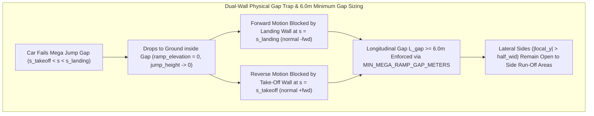

# Feature Spec: Mega Jump Dual-Wall Gap Trap and 6.0m Minimum Gap Sizing 🌟🏎️🧱

When a car approaches a `RampKind::MegaRamp` with insufficient take-off speed and fails to clear the central gap `(s_takeoff, s_landing)`, it drops onto the ground inside the chasm between the elevated take-off lip (`s = s_takeoff`) and the elevated landing ramp (`s = s_landing`). Both vertical faces—the back drop-off face of the take-off ramp (`s = s_takeoff`, normal `+fwd`) and the front face of the landing ramp (`s = s_landing`, normal `-fwd`)—act as physical `BarrierType::Concrete` walls spanning the ramp width `W`, trapping the car longitudinally inside the gap while leaving the lateral sides (`|local_y| > W / 2`) open to the adjacent run-off areas. This specification also enforces a minimum longitudinal gap length of `6.0 m` (`MIN_MEGA_RAMP_GAP_METERS = 6.0`) so vehicles fit inside the gap with room to maneuver laterally out through the open sides (governed by [Spec 125](125_bot_multi_point_lateral_k_turn_escape_from_mega_jump_gap_traps.md)).

---

## 🗺️ User Flow & Interface Design



### 1. Dual Vertical Wall Collisions (`s = s_takeoff` and `s = s_landing`)
In [`crates/arcade-race-core/src/track/geometry.rs`](../crates/arcade-race-core/src/track/geometry.rs) and [`crates/arcade-race-core/src/collision/wall.rs`](../crates/arcade-race-core/src/collision/wall.rs):
- **Landing Ramp Front Wall (`s = s_landing`)**:
  - `JumpRamp::mega_landing_wall_at_elevation(elevation)` constructs a `BarrierType::Concrete` `WallBarrier` across the ramp width at `x_landing_start = -half_len + s_landing * (2.0 * half_len)` with unit normal `-fwd` (pointing backward into the gap).
  - Any car inside the gap whose total elevation `dynamic_elevation() < h_landing - 0.10` collides with this wall rather than snapping onto the landing deck.
- **Take-Off Ramp Vertical Drop-Off Wall (`s = s_takeoff`)**:
  - `JumpRamp::mega_takeoff_wall_at_elevation(elevation)` constructs a `BarrierType::Concrete` `WallBarrier` across the ramp width at `x_takeoff_end = -half_len + s_takeoff * (2.0 * half_len)` with unit normal `+fwd` (pointing forward into the gap).
  - Any grounded car inside the gap reversing or bouncing backward into `s <= s_takeoff` (`dynamic_elevation() < h_takeoff - 0.10`) collides with the vertical drop-off wall and maintains `ramp_elevation = 0.0`, preventing it from phasing backward up the take-off lip.
- **Open Lateral Sides (`|local_y| > half_wid`)**:
  - Neither wall extends beyond `[-half_wid, +half_wid]`, leaving both lateral edges of the gap open to the track shoulder and side run-off areas.

### 2. Minimum `6.0 m` Gap Sizing (`MIN_MEGA_RAMP_GAP_METERS = 6.0`)
Across all motorsport categories in `tdrace`, vehicle OBB collision lengths (`2 * hull.half_length`) range from `2.15 m` (karts) and `4.40–4.85 m` (Rally / RX / GT) up to `5.50–5.65 m` (Monster Truck / Trophy Truck):
- **Minimum Physical Gap Length (`MIN_MEGA_RAMP_GAP_METERS = 6.0`)**:
  $$L_{\text{gap}} = (s_{\text{landing}} - s_{\text{takeoff}}) \cdot L_{\text{total}} \ge 6.0\text{ m}$$
- `JumpRamp::with_gap_length` and `JumpRamp::effective_gap_length` clamp `gap_length` to at least `MIN_MEGA_RAMP_GAP_METERS` (`6.0 m`), ensuring every `MegaRamp` gap can contain any car in the roster between the two vertical walls with longitudinal room to execute multi-point turns.

---

## ⚙️ Backend Models & API Endpoints

- **`crates/arcade-race-core/src/track/geometry.rs`**:
  - `pub const MIN_MEGA_RAMP_GAP_METERS: f32 = 6.0;` enforced in `JumpRamp::with_gap_length` and `JumpRamp::effective_gap_length`.
  - `JumpRamp::mega_takeoff_wall_at_elevation(&self, elevation: f32) -> Option<WallBarrier>` and `JumpRamp::mega_takeoff_wall(&self) -> Option<WallBarrier>`.
  - `JumpRamp::mega_landing_wall_at_elevation(&self, elevation: f32) -> Option<WallBarrier>` and `JumpRamp::mega_landing_wall(&self) -> Option<WallBarrier>`.
- **`crates/arcade-race-core/src/collision/wall.rs`**:
  - `resolve_mega_ramp_wall_collisions_into` enforces both `mega_landing_wall_at_elevation` (`s = s_landing`, normal `-fwd`) and `mega_takeoff_wall_at_elevation` (`s = s_takeoff`, normal `+fwd`).

---

## 🛡️ Security & Role-Based Access Controls (RBAC)

- **Zero Allocation on 60 Hz Physics Hot Path**: Wall collision checks construct stack-allocated `WallBarrier` values without heap allocation.
- **No Interference with Normal Airborne Jumps**: Cars clearing the gap airborne (`dynamic_elevation() >= h_landing - 0.10`) or climbing the take-off ramp normally (`s <= s_takeoff` with `ramp_elevation` tracking the ramp slope) never trigger gap wall collisions.

---

## 🧪 Verification & Acceptance Criteria

### Automated Tests
- Run core Mega Ramp gap trap & dual-wall collision tests:
  ```bash
  cargo test -p arcade-race-core --lib track::geometry::tests
  ```

### Manual Acceptance Criteria (Pseudo-Gherkin)

- **Scenario: Grounded car inside a Mega Jump gap is trapped between both vertical ramp walls**
  - [x] **Given** a `JumpRamp` of `RampKind::MegaRamp` and a vehicle that failed the jump and landed grounded inside the gap `(s_takeoff, s_landing)`
  - [x] **When** the vehicle drives forward into `s = s_landing` or reverses backward into `s = s_takeoff`
  - [x] **Then** it collides with a vertical `BarrierType::Concrete` wall at both ends (`normal = -fwd` at `s = s_landing` and `normal = +fwd` at `s = s_takeoff`) and remains at `ramp_elevation == 0.0` inside the gap
- **Scenario: Mega Jump enforces a 6.0m minimum longitudinal gap**
  - [x] **Given** a `JumpRamp` configured with `RampKind::MegaRamp`
  - [x] **When** `with_gap_length` or `effective_gap_length` is evaluated
  - [x] **Then** the effective gap length between `x_takeoff_end` and `x_landing_start` is at least `MIN_MEGA_RAMP_GAP_METERS` (`6.0 m`), fitting any vehicle hull length (`<= 5.65 m`) inside the gap

---

## 🔗 Traceability & Codebase Mapping

### Created/Modified Files
- `[x]` `crates/arcade-race-core/src/track/geometry.rs` -> Implements `MIN_MEGA_RAMP_GAP_METERS = 6.0`, `mega_takeoff_wall_at_elevation`, `mega_landing_wall_at_elevation`, grounded gap elevation lock, and unit tests.
- `[x]` `crates/arcade-race-core/src/collision/wall.rs` -> Enforces both the landing ramp front wall (`s = s_landing`) and the take-off ramp vertical drop-off wall (`s = s_takeoff`) in `resolve_mega_ramp_wall_collisions_into`.
- `[x]` `specs/constitution/ROADMAP.md` -> Links Spec 124 under Phase 6 milestones.
