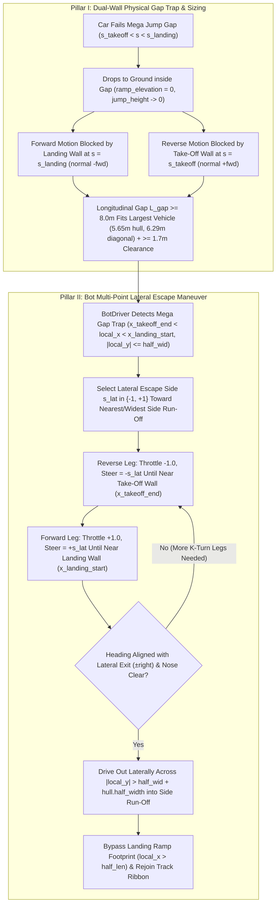

# Feature Spec: Mega Jump Gap Trap Sizing and Bot Multi-Point Lateral Escape Maneuvering 🌟🏎️🧱

When a car approaches a `RampKind::MegaRamp` with insufficient take-off speed and fails to clear the central gap `(s_takeoff, s_landing)`, it drops onto the ground inside the chasm between the elevated take-off lip (`s = s_takeoff`) and the elevated landing ramp (`s = s_landing`). Both vertical faces—the back drop-off face of the take-off ramp (`s = s_takeoff`, normal `+fwd`) and the front face of the landing ramp (`s = s_landing`, normal `-fwd`)—act as physical `BarrierType::Concrete` walls spanning the ramp width `W`, trapping the car longitudinally inside the gap while leaving the lateral sides (`|local_y| > W / 2`) open to the adjacent run-off areas. This specification standardizes Mega Jump gap sizing so that every vehicle in the roster fits inside the gap with longitudinal maneuvering clearance, and equips `BotDriver` in [`crates/race-kit/src/ai/mod.rs`](../crates/race-kit/src/ai/mod.rs) with a multi-point lateral K-turn recovery state machine that maneuvers back and forth while steering until the trapped bot exits laterally through one of the side run-off areas and bypasses the landing ramp back onto the circuit.

---

## 🗺️ User Flow & Interface Design



### 1. Pillar I: Dual-Wall Physical Gap Trap & Minimum Gap Sizing (`arcade-race-core`)

#### A. Dual Vertical Wall Collisions (`s = s_takeoff` and `s = s_landing`)
In [`crates/arcade-race-core/src/track/geometry.rs`](../crates/arcade-race-core/src/track/geometry.rs) and [`crates/arcade-race-core/src/collision/wall.rs`](../crates/arcade-race-core/src/collision/wall.rs):
- **Landing Ramp Front Wall (`s = s_landing`)**:
  - `JumpRamp::mega_landing_wall_at_elevation(elevation)` constructs a `BarrierType::Concrete` `WallBarrier` across the ramp width at `x_landing_start = -half_len + s_landing * (2.0 * half_len)` with unit normal `-fwd` (pointing backward into the gap).
  - Any car inside the gap whose total elevation `dynamic_elevation() < h_landing - 0.10` collides with this wall rather than snapping onto the landing deck.
- **Take-Off Ramp Vertical Drop-Off Wall (`s = s_takeoff`)**:
  - `JumpRamp::mega_takeoff_wall_at_elevation(elevation)` constructs a `BarrierType::Concrete` `WallBarrier` across the ramp width at `x_takeoff_end = -half_len + s_takeoff * (2.0 * half_len)` with unit normal `+fwd` (pointing forward into the gap).
  - Any grounded car inside the gap reversing or bouncing backward into `s <= s_takeoff` (`dynamic_elevation() < h_takeoff - 0.10`) collides with the vertical drop-off wall and maintains `ramp_elevation = 0.0`, preventing it from phasing backward up the take-off lip.
- **Open Lateral Sides (`|local_y| > half_wid`)**:
  - Neither wall extends beyond `[-half_wid, +half_wid]`, leaving both lateral edges of the gap open to the track shoulder and side run-off areas.

#### B. Minimum Gap Sizing for Full Vehicle Roster Compatibility
Across all motorsport categories in `tdrace`, vehicle OBB collision lengths (`2 * hull.half_length = cg_to_front + front_overhang + cg_to_rear + rear_overhang + 0.30 m`) and diagonal spans (`sqrt(L^2 + W^2)`) are bounded by:

| Vehicle Class | Representative Model | Hull Length ($L$) | Hull Width ($W$) | Diagonal ($\sqrt{L^2 + W^2}$) |
| :--- | :--- | :---: | :---: | :---: |
| Karting | `classic_kart` / `superkart` | $2.15\text{ m}$ | $1.45\text{ m}$ | $2.59\text{ m}$ |
| Rally / RX / GT | `rx_supercar` / `gt3_coupe` | $4.40\text{–}4.85\text{ m}$ | $2.05\text{–}2.15\text{ m}$ | $4.86\text{–}5.30\text{ m}$ |
| Stock Car | `nascar_cup` | $5.15\text{ m}$ | $2.15\text{ m}$ | $5.58\text{ m}$ |
| Extreme Off-Road | `trophy_truck` | $5.65\text{ m}$ | $2.55\text{ m}$ | $6.20\text{ m}$ |
| Extreme Off-Road | `monster_truck` | $5.50\text{ m}$ | $3.05\text{ m}$ | $6.29\text{ m}$ |

For any vehicle in the roster to fit inside the gap between `x_takeoff_end` and `x_landing_start` and rotate through its diagonal ($6.29\text{ m}$) with longitudinal room to shuttle back and forth (`>= 1.7 m` free space at the diagonal, `>= 2.35 m–3.60 m` longitudinal clearance when aligned with the track):
- **Minimum Physical Gap Length (`MIN_MEGA_RAMP_GAP_METERS`)**:
  $$L_{\text{gap}} = (s_{\text{landing}} - s_{\text{takeoff}}) \cdot L_{\text{total}} \ge 8.0\text{ m}$$
  where $s_{\text{takeoff}} = 0.35$, $s_{\text{landing}} = 0.65$, and $s_{\text{landing}} - s_{\text{takeoff}} = 0.30$.
- **Minimum Total `MegaRamp` Length (`MIN_MEGA_RAMP_LENGTH_METERS`)**:
  $$L_{\text{total}} \ge \frac{8.0\text{ m}}{0.30} \approx 26.67\text{ m} \quad (\text{or } s_{\text{takeoff}}, s_{\text{landing}} \text{ adjusted so } L_{\text{gap}} \ge 8.0\text{ m})$$
- **Take-Off Launch Calibration**:
  Ensure the vertical launch velocity impulse at $s = s_{\text{takeoff}}$ and the landing table slope enable vehicles hitting the take-off lip at standard racing speed ($\ge 75\%$ of approach straight speed) to clear the $\ge 8.0\text{ m}$ gap onto $s \ge s_{\text{landing}}$, while slow or compromised entries ($\le 50\%$ speed) fall into the gap trap.

---

### 2. Pillar II: Bot AI Multi-Point Lateral Escape Maneuvering (`race-kit`)

#### A. Why Standard `ThreePointTurn` Fails Inside a Mega Jump Gap Trap
In [`crates/race-kit/src/ai/mod.rs`](../crates/race-kit/src/ai/mod.rs), the existing `ThreePointTurn` recovery state machine fails when a bot is trapped in a Mega Jump gap for three structural reasons:
1. **Immediate Cancellation on Forward Leg**: The gap lies directly on the main road centerline (`proj.is_on_track == true`), and a car that dropped into the gap is facing forward along the spline (`heading_error.abs() < TURN_DONE_RAD`). As soon as `ThreePointTurn` switches to a forward leg (`!turn.reversing`), the check `if (!turn.reversing && (heading_error.abs() < TURN_DONE_RAD || proj.is_on_track))` immediately cancels `self.turn = None`, causing the bot to drive straight back into the landing wall at `s = s_landing`.
2. **Wrong Target Heading**: Standard recovery tries to align the car's heading with the forward spline target (`+fwd`), which points directly into the solid `mega_landing_wall`. Inside the gap trap, the only unobstructed exit is **perpendicular** to the ramp (`±right`, i.e. $\pm 90^\circ$ from `ramp.direction`).
3. **Blindness to Ramp Walls in `nose_on_wall`**: `nose_on_wall()` only queries `inner_walls`, `outer_walls`, and `network_walls`, ignoring `mega_takeoff_wall` (`x_takeoff_end`) and `mega_landing_wall` (`x_landing_start`).

#### B. Mega Gap Trap Detection (`detect_mega_gap_trap`)
At each AI update tick in `BotDriver::drive_body`:
- Query `geometry.jump_ramps` for any `JumpRamp` with `ramp.kind == RampKind::MegaRamp`.
- Project the car's position into the ramp's local frame `(local_x, local_y)`:
  - `x_takeoff_end = -half_len + 0.35 * ramp.length`
  - `x_landing_start = -half_len + 0.65 * ramp.length`
- The car is **in the gap trap** when:
  1. `car.jump_height() <= 0.15` and `car.dynamic_elevation() < ramp.height * 0.50` (grounded below the ramp decks),
  2. `local_x > x_takeoff_end - 0.5 && local_x < x_landing_start + 0.5` (longitudinally between the two vertical walls), and
  3. `local_y.abs() <= half_wid + car.hull().half_width + 0.35` (laterally still overlapping the ramp corridor between the walls).

#### C. Multi-Point Lateral K-Turn Escape State Machine (`MegaGapEscape`)
When `detect_mega_gap_trap` triggers (or while an active `MegaGapEscape` maneuver has not yet cleared the landing ramp):
1. **Escape Side Selection (`escape_side_sign: f32` in `{-1.0, +1.0}`)**:
   - Chosen once when entering `MegaGapEscape` by picking the lateral side (`-1.0` for negative `local_y` / left, `+1.0` for positive `local_y` / right) that is closer to the car's current `local_y` (or has wider clearance to the outer perimeter wall if one side is blocked by a nearby track barrier).
   - Defines the target lateral exit vector `exit_dir = right * escape_side_sign` (`90°` from `ramp.direction`).
2. **Phase 1 — Multi-Point Shuttling Inside the Gap (`|local_y| <= half_wid + hull.half_width + 0.25`)**:
   - Let `exit_heading_err = wrap_angle(exit_dir.to_angle() - car.heading())`.
   - If the car is already roughly aligned with `exit_dir` (`exit_heading_err.abs() < 0.35 rad` $\approx 20^\circ$) and its front bumper is clear of `x_landing_start` and `x_takeoff_end`, drive straight out (`throttle = 0.85`, `steer = (exit_heading_err * 1.8).clamp(-1.0, 1.0)`).
   - Otherwise, execute alternating K-turn legs bounded by the two vertical ramp walls:
     - **Reverse Leg (`reversing = true`)**:
       - `throttle = -1.0`, `brake = 0.0`, `steer = -escape_side_sign` (full lock away from the exit side while reversing rotates the car's nose *toward* `exit_dir`).
       - Switch to **Forward Leg** as soon as the rear/front bumper approaches within `0.45 m` of `x_takeoff_end` (or `x_landing_start` if flipped), or `leg_time > 1.8 s`, or `blocked_time > 0.35 s`.
     - **Forward Leg (`reversing = false`)**:
       - `throttle = 0.85`, `brake = 0.0`, `steer = +escape_side_sign` (full lock toward the exit side while driving forward continues rotating the car's nose *toward* `exit_dir` in the same rotational sense).
       - Switch to **Reverse Leg** as soon as the front/rear bumper approaches within `0.45 m` of `x_landing_start` (or `x_takeoff_end`), or `leg_time > 1.8 s`, or `blocked_time > 0.35 s`.
   - Every forward-reverse pair compounds yaw rotation in the same direction (`Δψ ≈ 25°–45°` per cycle) without getting pinned against either wall, until the car's nose points out the open side of the gap and drives across `|local_y| > half_wid + hull.half_width + 0.25` into the side run-off area.
3. **Phase 2 — Side Run-Off Bypass Around the Landing Ramp (`|local_y| > half_wid + hull.half_width + 0.25` and `local_x < half_len + hull.half_length`)**:
   - Once outside the gap laterally in the side run-off area, steer toward a virtual bypass waypoint located alongside the end of the landing ramp:
     $$\mathbf{P}_{\text{bypass}} = \mathbf{P}_{\text{ramp}} + \mathbf{fwd} \cdot (\text{half\_len} + 3.0\text{ m}) + \mathbf{right} \cdot \text{escape\_side\_sign} \cdot (\text{half\_wid} + \text{hull.half\_width} + 1.5\text{ m})$$
   - This prevents the bot from turning back toward the track ribbon prematurely and slamming into the side of the elevated landing ramp (`s_landing..1.0`).
4. **Phase 3 — Clean Rejoin (`local_x >= half_len + hull.half_length`)**:
   - Once longitudinal position `local_x` clears the end of the landing ramp (`s >= 1.0`), exit `MegaGapEscape`, reset `no_progress_timer = 0.0`, and resume normal spline racing.

---

## ⚙️ Backend Models & API Endpoints

- **`crates/arcade-race-core/src/track/geometry.rs`**:
  - `JumpRamp::mega_takeoff_wall_at_elevation(&self, elevation: f32) -> Option<WallBarrier>` and `JumpRamp::mega_takeoff_wall(&self) -> Option<WallBarrier>`.
  - `MIN_MEGA_RAMP_GAP_METERS: f32 = 8.0` and `JumpRamp` sizing helper/validation ensuring `MegaRamp` instances provide at least `8.0 m` of longitudinal gap between `x_takeoff_end` and `x_landing_start`.
- **`crates/arcade-race-core/src/collision/wall.rs`**:
  - `resolve_mega_ramp_wall_collisions_into` enforces both `mega_landing_wall_at_elevation` (`s = s_landing`, normal `-fwd`) and `mega_takeoff_wall_at_elevation` (`s = s_takeoff`, normal `+fwd`).
- **`crates/race-kit/src/ai/mod.rs`**:
  - Add `MegaGapEscape` state to `BotDriver` with gap-trap detection, multi-point K-turn wall-clearance switching, lateral run-off exit, and landing-ramp bypass waypoint steering.

---

## 🛡️ Security & Role-Based Access Controls (RBAC)

- **Zero Allocation on 60 Hz Physics & AI Hot Path**: `MegaGapEscape` is a fixed-size `Copy` struct stored inline on `BotDriver`; wall collision checks construct stack-allocated `WallBarrier` values without heap allocation.
- **No Interference with Normal Airborne Jumps**: Cars clearing the gap airborne (`dynamic_elevation() >= h_landing - 0.10`) or climbing the take-off ramp normally (`s <= s_takeoff` with `ramp_elevation` tracking the ramp slope) never trigger gap wall collisions or `MegaGapEscape`.

---

## 🧪 Verification & Acceptance Criteria

### Automated Tests
- Run core Mega Ramp gap trap & dual-wall collision tests:
  ```bash
  cargo test -p arcade-race-core --lib track::geometry::tests
  ```
- Run bot Mega Jump gap trap multi-point lateral escape tests:
  ```bash
  cargo test -p race-kit --lib ai::tests
  ```

### Manual Acceptance Criteria (Pseudo-Gherkin)

- **Scenario: Grounded car inside a Mega Jump gap is trapped between both vertical ramp walls**
  - [ ] **Given** a `JumpRamp` of `RampKind::MegaRamp` and a vehicle that failed the jump and landed grounded inside the gap `(s_takeoff, s_landing)`
  - [ ] **When** the vehicle drives forward into `s = s_landing` or reverses backward into `s = s_takeoff`
  - [ ] **Then** it collides with a vertical `BarrierType::Concrete` wall at both ends (`normal = -fwd` at `s = s_landing` and `normal = +fwd` at `s = s_takeoff`) and remains at `ramp_elevation == 0.0` inside the gap
- **Scenario: Mega Jump gap is large enough for any vehicle in the roster to fit and maneuver**
  - [ ] **Given** any `MegaRamp` track feature and the largest vehicles in the roster (`trophy_truck` at `5.65 m` length and `monster_truck` at `6.29 m` diagonal)
  - [ ] **When** the vehicle is positioned inside the gap `(x_takeoff_end, x_landing_start)` at any yaw angle
  - [ ] **Then** the physical gap length `x_landing_start - x_takeoff_end` is at least `8.0 m`, providing at least `1.7 m` of longitudinal maneuvering clearance beyond the largest vehicle diagonal
- **Scenario: Trapped bot executes a multi-point K-turn and exits laterally through the side run-off area**
  - [ ] **Given** an AI `BotDriver` controlling a car (including a standard Rallycross car and a long-wheelbase `trophy_truck`) that lands grounded inside a `MegaRamp` gap facing forward toward the landing wall
  - [ ] **When** the simulation steps forward under `BotDriver` control
  - [ ] **Then** the bot alternates between reverse (`steer = -escape_side_sign`) and forward (`steer = +escape_side_sign`) legs between the take-off and landing walls until its heading aligns with the lateral exit, drives out through the open side into the run-off area (`|local_y| > half_wid + hull.half_width`), bypasses the landing ramp footprint, and rejoins the track downstream of `s = 1.0` within `15.0 seconds`

---

## 🔗 Traceability & Codebase Mapping

### Created/Modified Files
- `[x]` `crates/arcade-race-core/src/track/geometry.rs` -> Implements `mega_takeoff_wall_at_elevation`, `mega_landing_wall_at_elevation`, grounded gap elevation lock, and Mega Ramp gap sizing constants/tests.
- `[x]` `crates/arcade-race-core/src/collision/wall.rs` -> Enforces both the landing ramp front wall (`s = s_landing`) and the take-off ramp vertical drop-off wall (`s = s_takeoff`) in `resolve_mega_ramp_wall_collisions_into`.
- `[ ]` `crates/race-kit/src/ai/mod.rs` -> Implements `MegaGapEscape` detection, multi-point K-turn back-and-forth steering inside the gap, and lateral run-off bypass around the landing ramp.
- `[ ]` `specs/constitution/ROADMAP.md` -> Links Spec 124 under Phase 6 / Phase 4 milestones.
