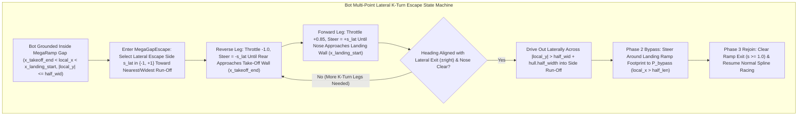

# Feature Spec: Bot Multi-Point Lateral K-Turn Escape from Mega Jump Gap Traps 🌟🤖🏎️

When an AI bot fails to clear a `RampKind::MegaRamp` gap and becomes trapped between the vertical take-off wall (`s = s_takeoff`, normal `+fwd`) and the vertical landing wall (`s = s_landing`, normal `-fwd`) established by [Spec 124](124_mega_jump_dual_wall_gap_trap_and_minimum_gap_sizing.md), standard forward-spline recovery fails because the bot is already on the track centerline (`proj.is_on_track == true`) and facing the spline direction (`heading_error ≈ 0`). This specification equips `BotDriver` in [`crates/race-kit/src/ai/mod.rs`](../crates/race-kit/src/ai/mod.rs) with a dedicated `MegaGapEscape` state machine that detects when a bot is trapped inside a Mega Jump gap (`>= 6.0 m`), executes a multi-point back-and-forth K-turn while steering between the two vertical ramp walls until its heading aligns with one of the open lateral sides (`±right`), exits into the side run-off area (`|local_y| > half_wid + hull.half_width`), and steers around the landing ramp footprint to rejoin the circuit downstream of `s = 1.0`.

---

## 🗺️ User Flow & Interface Design



### 1. Why Standard `ThreePointTurn` Fails Inside a Mega Jump Gap Trap
In [`crates/race-kit/src/ai/mod.rs`](../crates/race-kit/src/ai/mod.rs), the existing `ThreePointTurn` recovery state machine fails when a bot is trapped in a Mega Jump gap for three structural reasons:
1. **Immediate Cancellation on Forward Leg**: The gap lies directly on the main road centerline (`proj.is_on_track == true`), and a car that dropped into the gap is facing forward along the spline (`heading_error.abs() < TURN_DONE_RAD`). As soon as `ThreePointTurn` switches to a forward leg (`!turn.reversing`), the check `if (!turn.reversing && (heading_error.abs() < TURN_DONE_RAD || proj.is_on_track))` immediately cancels `self.turn = None`, causing the bot to drive straight back into the landing wall at `s = s_landing`.
2. **Wrong Target Heading**: Standard recovery tries to align the car's heading with the forward spline target (`+fwd`), which points directly into the solid `mega_landing_wall`. Inside the gap trap, the only unobstructed exit is **perpendicular** to the ramp (`±right`, i.e. $\pm 90^\circ$ from `ramp.direction`).
3. **Blindness to Ramp Walls in `nose_on_wall`**: `nose_on_wall()` only queries `inner_walls`, `outer_walls`, and `network_walls`, ignoring `mega_takeoff_wall` (`x_takeoff_end`) and `mega_landing_wall` (`x_landing_start`).

### 2. Mega Gap Trap Detection (`detect_mega_gap_trap`)
At each AI update tick in `BotDriver::drive_body`:
- Query `geometry.jump_ramps` for any `JumpRamp` with `ramp.kind == RampKind::MegaRamp`.
- Project the car's position into the ramp's local frame `(local_x, local_y)`:
  - `(s_takeoff, s_landing) = ramp.mega_segment_bounds()`
  - `x_takeoff_end = -half_len + s_takeoff * ramp.length()`
  - `x_landing_start = -half_len + s_landing * ramp.length()`
- The car is **in the gap trap** when:
  1. `car.jump_height() <= 0.15` and `car.dynamic_elevation() < ramp.height * 0.50` (grounded below the ramp decks),
  2. `local_x > x_takeoff_end - 0.5 && local_x < x_landing_start + 0.5` (longitudinally between the two vertical walls), and
  3. `local_y.abs() <= half_wid + car.hull().half_width + 0.35` (laterally still overlapping the ramp corridor between the walls).

### 3. Multi-Point Lateral K-Turn Escape State Machine (`MegaGapEscape`)
When `detect_mega_gap_trap` triggers (or while an active `MegaGapEscape` maneuver has not yet cleared the landing ramp):
1. **Escape Side Selection (`escape_side_sign: f32` in `{-1.0, +1.0}`)**:
   - Chosen once when entering `MegaGapEscape` by picking the lateral side (`-1.0` for negative `local_y` / left, `+1.0` for positive `local_y` / right) that is closer to the car's current `local_y` (or has wider clearance to the outer perimeter wall if one side is blocked by a nearby track barrier).
   - Defines the target lateral exit vector `exit_dir = right * escape_side_sign` (`90°` from `ramp.direction`).
2. **Phase 1 — Multi-Point Shuttling Inside the Gap (`|local_y| <= half_wid + hull.half_width + 0.25`)**:
   - Let `exit_heading_err = wrap_angle(exit_dir.to_angle() - car.heading())`.
   - If the car is already roughly aligned with `exit_dir` (`exit_heading_err.abs() < 0.35 rad` $\approx 20^\circ$) and its front bumper is clear of `x_landing_start` and `x_takeoff_end`, drive straight out (`throttle = 0.85`, `steer = (exit_heading_err * 1.8).clamp(-1.0, 1.0)`).
   - Otherwise, execute alternating K-turn legs bounded by the two vertical ramp walls (functioning even inside the tight `6.0 m` minimum gap):
     - **Reverse Leg (`reversing = true`)**:
       - `throttle = -1.0`, `brake = 0.0`, `steer = -escape_side_sign` (full lock away from the exit side while reversing rotates the car's nose *toward* `exit_dir`).
       - Switch to **Forward Leg** as soon as the rear/front bumper approaches within `0.35 m` of `x_takeoff_end` (or `x_landing_start` if flipped), or `leg_time > 1.8 s`, or `blocked_time > 0.35 s`.
     - **Forward Leg (`reversing = false`)**:
       - `throttle = 0.85`, `brake = 0.0`, `steer = +escape_side_sign` (full lock toward the exit side while driving forward continues rotating the car's nose *toward* `exit_dir` in the same rotational sense).
       - Switch to **Reverse Leg** as soon as the front/rear bumper approaches within `0.35 m` of `x_landing_start` (or `x_takeoff_end`), or `leg_time > 1.8 s`, or `blocked_time > 0.35 s`.
   - Every forward-reverse pair compounds yaw rotation in the same direction without getting pinned against either wall, until the car's nose points out the open side of the gap and drives across `|local_y| > half_wid + hull.half_width + 0.25` into the side run-off area.
3. **Phase 2 — Side Run-Off Bypass Around the Landing Ramp (`|local_y| > half_wid + hull.half_width + 0.25` and `local_x < half_len + hull.half_length`)**:
   - Once outside the gap laterally in the side run-off area, steer toward a virtual bypass waypoint located alongside the end of the landing ramp:
     $$\mathbf{P}_{\text{bypass}} = \mathbf{P}_{\text{ramp}} + \mathbf{fwd} \cdot (\text{half\_len} + 3.0\text{ m}) + \mathbf{right} \cdot \text{escape\_side\_sign} \cdot (\text{half\_wid} + \text{hull.half\_width} + 1.5\text{ m})$$
   - This prevents the bot from turning back toward the track ribbon prematurely and slamming into the side of the elevated landing ramp (`s_landing..1.0`).
4. **Phase 3 — Clean Rejoin (`local_x >= half_len + hull.half_length`)**:
   - Once longitudinal position `local_x` clears the end of the landing ramp (`s >= 1.0`), exit `MegaGapEscape`, reset `no_progress_timer = 0.0`, and resume normal spline racing.

---

## ⚙️ Backend Models & API Endpoints

- **`crates/race-kit/src/ai/mod.rs`**:
  - Define `MegaGapEscape` state struct (`ramp_id: usize`, `escape_side_sign: f32`, `reversing: bool`, `leg_time: f32`, `blocked_time: f32`, `total_time: f32`) stored as `Option<MegaGapEscape>` on `BotDriver`.
  - Add `detect_mega_gap_trap` and `step_mega_gap_escape` in `BotDriver::drive_body`, taking priority over standard `ThreePointTurn` and `no_progress_timer` resets while active.

---

## 🛡️ Security & Role-Based Access Controls (RBAC)

- **Zero Allocation on 60 Hz AI Hot Path**: `MegaGapEscape` is a fixed-size `Copy` struct stored inline on `BotDriver` with zero heap allocations.
- **Bounded Recovery Timeout**: If `total_time` in `MegaGapEscape` exceeds `20.0 s` (e.g. if another car is wedged inside the same gap), invert `escape_side_sign` to try exiting through the opposite lateral run-off side.

---

## 🧪 Verification & Acceptance Criteria

### Automated Tests
- Run bot Mega Jump gap trap multi-point lateral escape tests:
  ```bash
  cargo test -p race-kit --lib ai::tests
  ```

### Manual Acceptance Criteria (Pseudo-Gherkin)

- **Scenario: Trapped bot in a 6.0m Mega Jump gap executes a multi-point K-turn and exits laterally**
  - [ ] **Given** an AI `BotDriver` controlling a Rallycross or GT car that lands grounded inside a `6.0 m` `MegaRamp` gap facing forward toward the landing wall
  - [ ] **When** the simulation steps forward under `BotDriver` control
  - [ ] **Then** the bot enters `MegaGapEscape`, alternates between reverse (`steer = -escape_side_sign`) and forward (`steer = +escape_side_sign`) legs between the take-off and landing walls until its heading aligns with the lateral exit, drives out through the open side into the run-off area (`|local_y| > half_wid + hull.half_width`), and bypasses the landing ramp footprint to rejoin the track downstream of `s = 1.0`
- **Scenario: Long-wheelbase vehicle escapes a Mega Jump gap trap without stalling**
  - [ ] **Given** an AI `BotDriver` controlling a long-wheelbase vehicle (`trophy_truck`) trapped grounded inside a `MegaRamp` gap
  - [ ] **When** `BotDriver` executes `MegaGapEscape`
  - [ ] **Then** the bot completes multiple short back-and-forth K-turn legs within the available clearance, exits laterally into the side run-off area, and resumes forward lap progress within `18.0 seconds`

---

## 🔗 Traceability & Codebase Mapping

### Created/Modified Files
- `[ ]` `crates/race-kit/src/ai/mod.rs` -> Implements `MegaGapEscape` detection, multi-point K-turn back-and-forth steering inside the gap, lateral run-off exit, and landing-ramp bypass waypoint steering.
- `[ ]` `specs/constitution/ROADMAP.md` -> Links Spec 125 under Phase 6 milestones.
