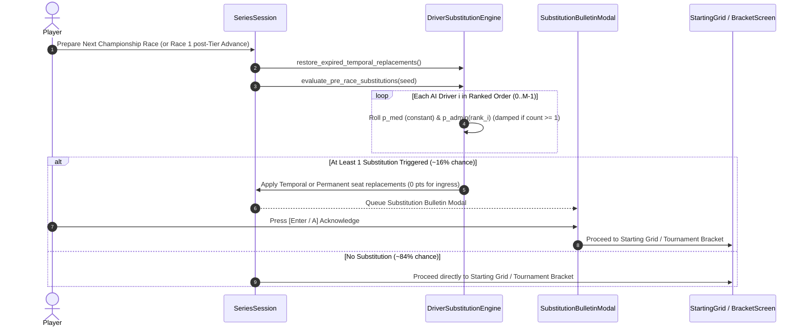

# Feature Spec: Dynamic Championship Rosters and Mid-Season Driver Substitutions 🏁🤖📋

## Executive Summary

Previously, championship series configuration files ([`series/**/*.toml`](../series/)) defined static lists of only 8 drivers, even when series required larger grids (such as 32-driver tournament sprint weekends in Autocross and Rallycross under [Spec 104](104_autocross_and_rallycross_tournament_sprint_weekend_format.md)). Missing drivers were filled at runtime with placeholder entries lacking car models (`car_model_id: None`) and generic `"<Last Name> Racing"` team names, causing tournament brackets to inconsistently display car models for some drivers while omitting them for others.

This specification modernizes championship roster generation and lifecycle management across all modalities:
1. **Roster Decoupling**: Series TOML files define championship rules, scoring, tracks, tier, and grid capacity—not hardcoded driver rosters.
2. **Dynamic Full-Grid Roster Generation**: When a championship starts (and no prior career roster is being carried over), the complete roster (e.g. 8, 16, 24, 32, or 64 drivers) is generated procedurally:
   - **Drivers**: Sampled from the global 72 `DriverCharacter` pool with uniform driving style distribution ($P(S_i) = 1/6$) as established in [Spec 024](024_crossmodule_ai_character_rosters_and_dynamic_tier_assignment.md).
   - **Tiers**: Assigned via discrete normal bell-curve distribution centered around the championship tier $\mu = T_{\text{series}}$ ([Spec 024](024_crossmodule_ai_character_rosters_and_dynamic_tier_assignment.md)).
   - **Cars**: Every driver is assigned an authentic car model matching the discipline and tier ([Spec 020](020_driver_favorite_cars_per_discipline_and_tier.md)), guaranteeing that 100% of drivers display their car model in tournament brackets and results.
   - **Teams**: Assigned to thematic constructor teams appropriate for the motorsport discipline.
   - **Human Player**: Preserves custom player name, selected vehicle, and team in Slot 0.
3. **Per-Race Roster Traversal Replacement Engine**:
   - Applied before every new championship race (including between rounds of a championship, and before Race 1 of a newly started championship after advancing career tier), **never mid-tournament** (heats, semifinals, and finals of a tournament weekend keep a 100% frozen roster).
   - Traverses the entire active AI roster and evaluates two distinct replacement channels for each driver:
     - **Medical / Personal Channel (Rank-Independent)**: Constant probability across all drivers regardless of standing rank.
     - **Administrative / Contract / Disciplinary Channel (Rank-Dependent)**: Lower probability for top-ranked drivers and progressively higher probability for lower-ranked drivers.
   - Calibrated so the probability of replacing a single driver before a race is moderate (~15%–17%), while the probability of replacing more than one driver in the same race transition is very low (< 1%), and top drivers have a significantly smaller overall replacement probability.
4. **Temporal (1-Race Stand-In) vs. Permanent Replacements**:
   - **Temporal Replacements (`OneRace`)**: Triggered by minor illnesses, family milestones, flight groundings, visa delays, 1-race suspensions, or conflicting endurance commitments. A reserve driver steps into the seat for **1 race only** starting with 0 points, after which the regular driver automatically returns to their seat for the following race with their prior championship points intact.
   - **Permanent Replacements (`Permanent`)**: Triggered by surgery, testing/karting injuries, contract terminations, or superlicense revocations. The departing driver is removed from the championship and returned to the global pool (eligible to re-enter later in the same or a different team), while the incoming driver takes over the seat starting with 0 points.
5. **Narrative Bulletin Modal**: Whenever one or more substitutions occur before a race, an in-game modal bulletin informs the player of the departing driver, incoming driver, team, car model, substitution duration (`1-RACE STAND-IN` vs `PERMANENT`), and the formatted reason from a pool of 12 narrative templates.

---

## 🗺️ User Flow & Interface Design

### 1. Championship Inception & Tier Advancement Flow
- **Brand-New Championship (No Prior Career Roster)**: Synthesizes the full grid of $N$ drivers with uniform style quotas, bell-curve tiers, constructor teams, and 100% valid `car_model_id` assignments.
- **New Championship After Advancing Career Tier**: Carries over the existing career roster (evolving skill tiers for the new tier), updates car models to homologated vehicles of the new tier, and runs the **pre-race substitution traversal** before Race 1 of the new championship.

### 2. Pre-Race Substitution Flow & Modal Bulletin
Before each new championship race (Round $R+1$, or Round 1 after tier advancement; never between heats/semifinals/finals of a tournament weekend):
1. **Restore Expiring Stand-Ins**: Any driver who was on a 1-race temporary leave in the previous race automatically reclaims their seat and prior points; the temporary stand-in returns to the available global pool.
2. **Roster Traversal**: The engine traverses all active AI drivers in standing order and rolls medical (rank-independent) and administrative (rank-weighted) replacement checks.
3. **Modal Presentation**: If one or more replacements occur, `GameState` displays the **Official Race Bulletin** modal before entering the Starting Grid or Tournament Bracket:
   - **Header**: `OFFICIAL RACE BULLETIN — DRIVER SUBSTITUTION`
   - **Badge**: `[TEMPORARY • 1-RACE STAND-IN]` (cyan) or `[PERMANENT SEAT CHANGE]` (amber/red)
   - **Driver & Seat Info**: Outgoing driver $\to$ Incoming replacement driver, Team Name, and Car Model.
   - **Press Dispatch**: Narrative explanation rendered from the 12-template pool.
   - **Controls**: `[Enter / Space / A] Acknowledge Bulletin` dismisses the modal and proceeds to the race/bracket.



---

## ⚙️ Backend Models & API Endpoints

### 1. Dynamic Full-Grid Roster Synthesis: `SeriesSession::generate_dynamic_roster`

```rust
impl SeriesSession {
    /// Generates a complete, balanced roster of `total_drivers` competitors:
    /// - Player in slot 0 (if present) with player's car and team.
    /// - Opponents drawn from global DriverCharacter pool with uniform driving style (P=1/6).
    /// - Tiers assigned via discrete normal bell-curve centered on `tier`.
    /// - Car models assigned to 100% of participants based on discipline, tier, and preferences.
    /// - Constructor teams assigned from thematic module team rosters (paired 2-car squads).
    pub fn generate_dynamic_roster(
        series_id: &str,
        module_id: &str,
        tier: u32,
        total_drivers: usize,
        player_entry: Option<SeriesStandingEntry>,
        seed: u64,
    ) -> Vec<SeriesStandingEntry>;
}
```

### 2. Per-Race Roster Traversal Probability Model

Let $M = N_{\text{ai}}$ be the number of AI drivers in the championship ($M = 7$ for standard 8-car cups, $M = 31$ for 32-car tournaments). Let $r_i \in \{0, 1, \dots, M-1\}$ be the driver's 0-indexed rank among AI drivers ($r_i = 0$ is the highest-ranked AI driver, $r_i = M-1$ is the lowest-ranked AI driver), and define normalized rank:

$$u_i = \begin{cases} \frac{r_i}{M - 1} & \text{if } M > 1 \\ 0.5 & \text{if } M = 1 \end{cases} \in [0, 1]$$

For each AI driver $i$ during the roster traversal:

1. **Rank-Independent Medical / Personal Probability ($p_{\text{med}}$)**:
   $$p_{\text{med}}(i) = \frac{\Lambda_{\text{med}}}{M}, \quad \Lambda_{\text{med}} = 0.06$$
   Identical for every AI driver on the grid regardless of championship standing.

2. **Rank-Dependent Administrative / Contract Probability ($p_{\text{admin}}$)**:
   $$p_{\text{admin}}(i) = \frac{\Lambda_{\text{admin}}}{M} \cdot \left(0.10 + 2.70 \cdot u_i^2\right), \quad \Lambda_{\text{admin}} = 0.12$$
   - At the top of the standings ($u_0 = 0$): $p_{\text{admin}}(0) = \frac{0.012}{M}$ (minimal administrative/contract risk).
   - At the bottom of the standings ($u_{M-1} = 1$): $p_{\text{admin}}(M-1) = \frac{0.336}{M}$ (28$\times$ higher administrative/contract risk than the leader).
   - Overall combined risk $p_{\text{total}}(i) = p_{\text{med}}(i) + p_{\text{admin}}(i)$ is $\frac{0.072}{M}$ for the top AI driver vs. $\frac{0.396}{M}$ for the last-place AI driver (**5.5$\times$ lower overall replacement probability for the top driver**).

3. **Multi-Replacement Damping ($\gamma$)**:
   - Let $k$ be the number of replacements already triggered during the current race's traversal.
   - Effective probabilities for subsequent drivers in the same traversal are scaled by $\gamma^k$ with $\gamma = 0.12$:
     $$p_{\text{eff}}(i) = \gamma^k \cdot p(i)$$
   - This yields:
     - $P(\text{at least 1 replacement}) \approx 16.2\%$ (moderate: roughly 1 in 6 races).
     - $P(\ge 2 \text{ replacements}) \approx 0.18\%$ (very low: less than 2 in 1,000 races).

### 3. Temporal vs. Permanent Replacement Mechanics

```rust
#[derive(Debug, Clone, Copy, PartialEq, Eq, Serialize, Deserialize)]
pub enum ReplacementDuration {
    /// Driver is replaced for a single championship race and returns for the next race.
    OneRace,
    /// Driver leaves the seat permanently for the championship and returns to the global pool.
    Permanent,
}

#[derive(Debug, Clone, PartialEq, Serialize, Deserialize)]
pub struct ActiveTemporalStandIn {
    /// The regular driver entry preserved with their accumulated points, wins, podiums, and car/team.
    pub original_entry: SeriesStandingEntry,
    /// ID of the temporary stand-in driver occupying the seat for the current round.
    pub stand_in_driver_id: String,
    /// Round index in which the stand-in was active.
    pub round_index: usize,
}
```

- **Ingress Rule (0 Points)**: Any driver entering a competition (whether as a 1-race stand-in or a permanent replacement) starts their stint in `standings` with `points = 0`, `wins = 0`, `podiums = 0`, `total_race_time = 0.0`, and `best_finish = usize::MAX`, while adopting the seat's `team_name` and `car_model_id`.
- **Temporal Return**: Before evaluating replacements for the next championship round, `restore_expired_temporal_replacements()` swaps the `original_entry` back into `standings` in place of `stand_in_driver_id`, restoring the regular driver's points and returning the stand-in to the global pool.
- **Pool Recycling**: Any driver not currently active in `standings` (and not currently shelved in `active_stand_ins`) is in the available global pool and can be drafted later into the same or any other team.

### 4. Pool of 12 Narrative Explanation Templates

#### Category A: Medical & Personal Reasons (Rank-Independent)
1. **Acute Food Poisoning (`OneRace`)**: `"{driver} contracted acute food poisoning following a mid-week team dinner and has been ruled medically unfit for this round."`
2. **Viral Flu & Fever (`OneRace`)**: `"{driver} was sidelined overnight with a high fever and seasonal influenza; team doctors have mandated a one-race recovery rest."`
3. **Family Milestone (`OneRace`)**: `"{driver} was granted one-race compassionate leave by {team} to return home for the birth of their first child."`
4. **Simulator Forearm Tendonitis (`OneRace`)**: `"{driver} experienced an acute forearm tendonitis flare-up during simulator prep and is resting for one round as a precaution."`
5. **Volcanic Ash Flight Grounding (`OneRace`)**: `"{driver} was stranded in international transit after volcanic ash clouds grounded all connecting flights to the circuit."`
6. **Emergency Appendectomy (`Permanent`)**: `"{driver} underwent emergency appendectomy surgery earlier this week and has been placed on extended season medical leave."`
7. **Shakedown Testing Concussion (`Permanent`)**: `"{driver} sustained a concussion and cervical strain during a private mid-season shakedown crash, ending their campaign early."`
8. **Cross-Training Karting Injury (`Permanent`)**: `"{driver} suffered fractured ribs in a high-G cross-training karting incident and has vacated the {team} seat for the season."`

#### Category B: Administrative, Logistics & Contract Reasons (Rank-Dependent)
9. **Consular Visa Delay (`OneRace`)**: `"{driver} encountered unexpected consular visa processing delays at border customs and missed mandatory pre-race sign-in."`
10. **Paddock Disciplinary Suspension (`OneRace`)**: `"{driver} received an internal one-race suspension from {team} following a heated post-race debrief altercation."`
11. **24-Hour Endurance Clash (`OneRace`)**: `"{driver} was excused for this round to fulfill a prior factory clause at the prestigious 24-Hour endurance classic."`
12. **Sponsor & Contract Dispute (`Permanent`)**: `"{driver} parted ways with {team} with immediate effect following an irreconcilable commercial and title-sponsor contract dispute."`
13. **FIA Superlicense Scrutineering Failure (`Permanent`)**: `"{driver} failed to complete mandatory FIA superlicense medical and administrative renewals in time for season scrutineering."`

*(13 templates total — 8 rank-independent medical/force-majeure, 5 rank-dependent administrative/contract).*

---

## 🛡️ Security & Role-Based Access Controls (RBAC)

1. **Deterministic Seeding**: Roster generation and per-race substitution traversals are seeded deterministically from championship metadata and round indices, ensuring reproducible behavior in tests and replays.
2. **Zero In-Race Overhead**: All roster synthesis, temporal stand-in restoration, and substitution traversals run strictly between races, preserving zero-allocation 60 Hz physics and rendering loops.
3. **Tournament Integrity**: Substitution checks are gated by `!champ.tournament_in_progress()`, guaranteeing that a 32-driver tournament weekend never mutates its roster between heats, semifinals, and finals.

---

## 🧪 Verification & Acceptance Criteria

### Automated Tests
- Command: `cargo test --test dynamic_roster_and_tier_tests --test tournament_bracket_ui_tests`

### Manual Acceptance Criteria (Pseudo-Gherkin)

- **Scenario: Full 32-driver tournament roster generated with 100% valid car models**
  - [x] **Given** an Autocross or Rallycross championship configured with `total_drivers = 32` and `tier = 1`
  - [x] **When** the championship session is initialized
  - [x] **Then** the standings contain exactly 32 driver entries
  - [x] **And** every single entry has `car_model_id.is_some()`
  - [x] **And** the driving styles of the 31 AI drivers follow a balanced uniform distribution across the 6 styles
  - [x] **And** the tournament bracket display shows a car model for all 32 cars

- **Scenario: Per-race roster traversal applies rank-independent medical and rank-dependent admin probabilities**
  - [x] **Given** an active championship roster of AI drivers ordered by standing rank
  - [x] **When** evaluating pre-race substitutions over many Monte Carlo trials
  - [x] **Then** the probability of at least one replacement per race is moderate (~14%–18%)
  - [x] **And** the probability of more than one replacement in a single race is very low (< 1%)
  - [x] **And** medical/personal replacements occur at equal rates regardless of driver rank
  - [x] **And** administrative/contract replacements occur significantly less often for top-ranked drivers than for bottom-ranked drivers, making top drivers less likely to be replaced overall

- **Scenario: Temporal 1-race replacement restores original driver after one race and replacement drivers start with 0 points**
  - [x] **Given** an AI driver with 25 championship points who is replaced by a `OneRace` stand-in before Round 2
  - [x] **When** Round 2 is initialized
  - [x] **Then** the incoming stand-in driver occupies the seat with 0 points, inheriting the team and car model
  - [x] **And** when advancing to Round 3, the original driver automatically returns to the seat with their 25 points restored
  - [x] **And** the stand-in driver returns to the available global pool

- **Scenario: Tier advancement triggers pre-race substitution check before Race 1 of the new championship**
  - [x] **Given** a player who advances to the next Career Tier and starts a new championship
  - [x] **When** preparing Race 1 of the new championship
  - [x] **Then** the pre-race substitution traversal is evaluated on the carried-over roster before Race 1 begins

---

## 🔗 Traceability & Codebase Mapping

### Created/Modified Files
- `crates/tdrace-app/src/series/format.rs`: Allow optional `[[drivers]]` in series TOML schema and synthesize full dynamic rosters at session creation.
- `crates/tdrace-app/src/series/substitution.rs`: Per-race substitution traversal engine, temporal stand-in state, and 13 narrative templates.
- `crates/tdrace-app/src/series/mod.rs`: Integrate `generate_dynamic_roster`, `active_stand_ins`, and `evaluate_pre_race_substitutions`.
- `crates/tdrace-app/src/ui/substitution_modal.rs`: In-game modal bulletin rendering for temporary and permanent driver substitutions.
- `crates/tdrace-app/src/game/mod.rs`: Trigger pre-race substitution checks before Race 1 (on tier advance / new championship) and on round transitions, and display the bulletin modal.
- `crates/tdrace-app/tests/dynamic_roster_and_tier_tests.rs`: Comprehensive unit and statistical tests for full-grid car assignment, rank probabilities, temporal restoration, and pool recycling.
