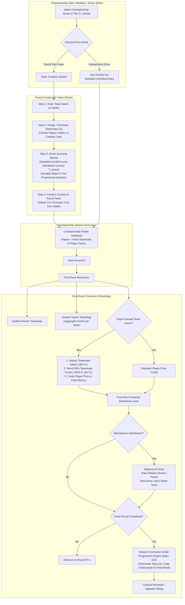

# Feature Spec: Team Standings, Constructor Points, and Player Team Ownership with Bot Hire 🏎️👥🏆

## Executive Summary

Currently, championship competitions in **TdRace** ([`SeriesSession`](../crates/tdrace-app/src/series/mod.rs)) track driver standings exclusively on an individual basis. While drivers carry a `team_name` string attribute, teams possess no independent points tally, standing entry, or constructor title. Furthermore, when driver substitutions occur mid-season ([Spec 126](126_dynamic_championship_rosters_and_mid_season_driver_substitutions.md)), there is no formal constructor entity preserving the points scored by departing drivers for the collective team effort.

In real-world motorsport across Formula 1, WRC, WEC, and Rallycross, the **Constructors' / Teams' Championship** is an equally prestigious battleground. Additionally, career progression lacks a deep managerial ownership dimension: players can purchase cars for their personal garage, but cannot operate their own racing outfit or field a multi-car team.

This specification introduces a comprehensive Team and Constructor system to TdRace:
1. **Team / Constructor Championship Standings**:
   - Teams accumulate constructor points aggregated from all assigned drivers across every round of a championship.
   - Dedicated Constructors' Standings view alongside the Drivers' Standings in the championship results and career hub screens.
2. **Mid-Season Team Points Continuity**:
   - When an AI driver is replaced mid-season (under Spec 126's substitution engine), the **team retains 100% of the points** accumulated by the departing driver.
   - The replacement driver enters the **exact same team** and takes the existing car seat, starting with 0 personal driver points while future points add directly to the team's constructor total.
3. **Player Team Creation & Scouting Pool (Every Tier)**:
   - At the beginning of any new championship series in every tier (from Tier 1 grassroots karts up to Tier 5/6 premier classes), the human player has the option to **Found a Custom Racing Team**.
   - Team creation requires **purchasing an eligible companion car** from player credits and **hiring a bot driver** from a scouted market of candidates drawn from the global 72 character pool ([Spec 024](024_crossmodule_ai_character_rosters_and_dynamic_tier_assignment.md)).
   - **Championship Tier Distribution Alignment**: In accordance with Spec 024's discrete normal bell-curve model, championships do not consist of a single uniform bot tier (e.g. a Tier 1 championship features a distribution of Tier 1 and Tier 2 drivers; Tier 2 features Tier 1, 2, and 3). The scouting market reflects this distribution, offering candidates across variable driving styles (Smooth, Aggressive, Tenacious, Calculating, Bold, Balanced) and performance tiers.
   - **Tier-Proportional Salaries**: Hired driver per-race wages ($W_{\text{race}}$) scale directly and proportionally with the candidate's performance tier (e.g. Tier 2 drivers command approximately double the salary of Tier 1 drivers).
4. **Integration with General Bot Progression Engine**:
   - The hired bot teammate is not static. Upon season completion, the hired driver is evaluated under the **general career bot progression mechanism** ([Spec 024 Section 5](024_crossmodule_ai_character_rosters_and_dynamic_tier_assignment.md#L237-L260)).
   - Their championship finish rank modulates their probabilities of stepping up a tier ($P_{\text{step}}$), leaping ahead ($P_{\text{leap}}$), or holding steady ($P_{\text{hold}}$). If the player renews their contract into the next season or career tier, the teammate competes with upgraded skills and an adjusted tier salary.
5. **Post-Race Wages & 50% Prize Revenue Sharing**:
   - The player pays the hired bot driver their per-race salary ($W_{\text{race}}$) deducted from the player's credit wallet after each completed race.
   - In return, if the hired teammate finishes in a prize-paying position, **50% of the bot's prize purse earnings** are remitted directly to the team owner (the human player) as owner dividends.
6. **Tactical Teammate Racecraft Motivation**:
   - Revenue sharing and constructor points give the human player a tangible incentive to cooperate with their teammate during races: defending against rivals, offering slipstream tows, and coordinating double-podium finishes.

---

## 🗺️ User Flow & Interface Design



### 1. Championship Entry: Found Team vs Independent Entry
When the player starts a new championship from the Career Hub or Modality Menu:
- A selection prompt appears:
  - `[ENTER AS INDEPENDENT DRIVER]`: Standard championship entry using the player's active car; player is assigned to an existing or fictional privateer team.
  - `[FOUND RACING TEAM]`: Launches the Team Creation Wizard. If the player lacks sufficient credits to purchase the cheapest eligible car in the tier, the option displays an informative badge: `INSUFFICIENT FUNDS (REQUIRES ~$X Cr)`.

### 2. Team Creation Wizard (Cabinet Modal Flow)
The wizard utilizes Cabinet's resolution-independent 1080p canvas and `NavGrid2D` gamepad navigation:
1. **Team Identity**:
   - Custom team name input with fallback presets (`"[Player Name] Racing"`, `"Apex Dynamics"`, `"Velocity Works"`, etc.).
   - Primary and secondary livery accent colors for teammate vehicle branding.
2. **Teammate Car Assignment**:
   - Displays eligible cars for the series discipline and tier.
   - If the player already owns an eligible spare vehicle in their fleet, they may assign it with $0\text{ Cr}$ additional cost.
   - Otherwise, the player purchases a new model directly from the vehicle catalog ([Spec 116](116_performance_based_individual_vehicle_pricing_and_dynamic_catalog_valuation.md)). The purchase cost is clearly shown with live wallet balance verification.
3. **Driver Scouting Market (Styles, Tiers, & Salaries)**:
   - The scouting system generates a balanced shortlist of **4 to 6 candidate drivers** drawn from the global 72 `DriverCharacter` pool ([Spec 024](024_crossmodule_ai_character_rosters_and_dynamic_tier_assignment.md)).
   - **Championship Tier Distribution**: Rather than restricting candidates strictly to the series tier $T_{\text{series}}$, candidates are sampled according to the discrete normal bell curve from Spec 024:
     - In a **Tier 1 (Rookie) championship**: Candidates include Tier 1 (Rookie) and Tier 2 (Amateur) drivers.
     - In a **Tier 2 (Amateur) championship**: Candidates include Tier 1, Tier 2, and Tier 3 drivers.
     - In higher tiers: Candidates span the adjacent tiers ($T_{\text{series}} \pm 1$).
   - **Variable Driving Styles**: The shortlist ensures variety across the 6 core driving styles:
     - *Smooth*: High precision and pace stability, excellent in technical sectors.
     - *Aggressive*: High overtaking frequency, attacks gaps, prone to defensive battles.
     - *Tenacious*: Supreme defensive positioning, difficult to overtake.
     - *Calculating*: Consistent lap execution, capitalizes on opponent mistakes.
     - *Bold*: Fearless in high-speed sweeps and loose surfaces, high-risk high-reward.
     - *Balanced*: All-round consistent performer.
   - **Tier-Proportional Salary Display**: Each candidate card clearly presents:
     - Driver portrait, alias, driving style badge, and performance tier badge.
     - Core stats (Speed, Aggression, Precision, Defense).
     - **Per-Race Salary ($W_{\text{race}}$)**: Proportional to the driver's tier. A Tier 2 driver in a Tier 1 championship commands a premium wage ($~750\text{ Cr/race}$ vs $~350\text{ Cr/race}$ for a Tier 1 driver).
   - **Managerial Decision**: Hiring a higher-tier driver guarantees higher competitiveness, constructor points, and lucrative 50% prize dividends, but entails greater financial risk per race.

### 3. Championship Standings Screen: Drivers vs Teams Tab
The championship standings screen ([`crates/tdrace-app/src/ui/`](../crates/tdrace-app/src/ui/)) gains an orthogonal Tab Bar:
- **`[DRIVERS' STANDINGS]`**: Displays individual driver rankings, points, wins, podiums, and assigned car model.
- **`[CONSTRUCTORS' / TEAMS' STANDINGS]`**:
  - Displays teams ranked by total points.
  - Columns: `POS`, `TEAM NAME`, `DRIVERS`, `WINS`, `PODIUMS`, `PTS`.
  - Player-owned team is highlighted with an **Electric Cyan (#00E5FF)** rim border and a `[PLAYER TEAM]` badge.
  - The drivers column lists all drivers who have scored for the team this season (e.g. `"Mario / A. Prost"` or `"Mario / A. Prost (R1-2) / L. Hamilton (R3-4)"`).

### 4. Post-Race Financial Receipt Card
On the post-race debrief screen ([`XpAwardReceipt`](../crates/tdrace-app/src/game/mod.rs)):
- If the player owns a team, an itemized **Constructor Ledger** is displayed:
  ```
  CONSTRUCTOR FINANCIAL LEDGER:
  -----------------------------------------------
  Player Finish Prize:                 +$5,000 Cr
  Clean Driving Bonus:                 +$1,000 Cr
  Teammate Prize Dividend (50%):       +$1,500 Cr  [P4 Finish by A. Prost]
  Teammate Post-Race Salary:             -$750 Cr  [Contract Wage (Tier 2)]
  -----------------------------------------------
  NET ROUND EARNINGS:                  +$6,750 Cr
  ```

### 5. In-Race Teammate Identification & HUD
- The teammate's floating nameplate renders a distinct team color badge and `[TEAM]` tag.
- The minimap renders the teammate blip with a distinct cyan accent ring.
- In-game radio / alert ticker periodically informs the player of their teammate's progress (e.g. `"TEAMMATE PROMOTED TO P3 - PODIUM DEFENSE ACTIVE"`).

### 6. Season Conclusion: General Bot Progression Engine (Spec 024)
At the end of the championship season:
- The hired bot teammate undergoes skill progression via the **general career bot progression mechanism** ([Spec 024 Section 5](024_crossmodule_ai_character_rosters_and_dynamic_tier_assignment.md#L237-L260)):
  - Their final season standing rank $r_i$ determines their progression probability:
    - **Standout Leap** ($P_{\text{leap}} = 0.10 + 0.05 \times d_i$): Driver jumps $+2$ tiers (or directly to top ranks).
    - **Step-Up Advancement** ($P_{\text{step}} = 0.65 + 0.05 \times d_i$): Driver advances $+1$ tier ($T \to T+1$).
    - **Hold Steady** ($P_{\text{hold}} = 0.25 - 0.10 \times d_i$): Driver stays at current tier.
- A **Team Debrief & Contract Renewal Dialog** is presented to the player:
  - *"Contract Review: [Teammate Name] completed the season in P2! Following their outstanding performance, they stepped up from Tier 1 (Rookie) to Tier 2 (Amateur)."*
  - *"Updated Terms: Skill stats increased; per-race salary revised from $350 Cr to $750 Cr."*
  - Options:
    - `[RENEW CONTRACT]`: Retains the upgraded teammate for future championships.
    - `[RELEASE TO POOL]`: Releases the driver back to the global roster and opens the scouting market for a new hire.

---

## ⚙️ Backend Models & API Endpoints

### 1. Data Structures in `crates/tdrace-app/src/series/`

```rust
use crate::ai::{DriverQuality, DriverStats, DriverTier, DrivingStyle};

/// Detailed record of a team / constructor in championship standings.
#[derive(Debug, Clone, PartialEq, Serialize, Deserialize)]
pub struct TeamStandingEntry {
    /// Unique identifier for the team (slugified name).
    pub team_id: String,
    /// Display name of the team / constructor.
    pub team_name: String,
    /// Cumulative constructor points accumulated across all drivers.
    pub points: u32,
    /// Total race wins achieved by drivers of this team.
    pub wins: u32,
    /// Total podiums (P1-P3) achieved by drivers of this team.
    pub podiums: u32,
    /// Best finish position achieved by any driver of this team.
    pub best_finish: usize,
    /// List of driver IDs who have competed for this team during the season.
    pub driver_ids: Vec<String>,
    /// Display summaries of drivers (e.g. "A. Senna", "N. Mansell").
    pub driver_names: Vec<String>,
    /// Whether this team is owned and managed by the human player.
    #[serde(default)]
    pub is_player_owned: bool,
    /// Primary livery color for team visual identification.
    #[serde(default)]
    pub primary_color: Option<[f32; 4]>,
}

impl TeamStandingEntry {
    pub fn new(team_name: impl Into<String>, is_player_owned: bool) -> Self {
        let name = team_name.into();
        let team_id = name.to_lowercase().replace(' ', "_");
        Self {
            team_id,
            team_name: name,
            points: 0,
            wins: 0,
            podiums: 0,
            best_finish: usize::MAX,
            driver_ids: Vec::new(),
            driver_names: Vec::new(),
            is_player_owned,
            primary_color: None,
        }
    }

    /// Appends driver points and results to the team constructor total.
    pub fn record_driver_result(&mut self, driver_id: &str, driver_name: &str, position: usize, points: u32) {
        if !self.driver_ids.iter().any(|id| id == driver_id) {
            self.driver_ids.push(driver_id.to_string());
            self.driver_names.push(driver_name.to_string());
        }
        self.points += points;
        if position == 1 {
            self.wins += 1;
        }
        if position <= 3 {
            self.podiums += 1;
        }
        if position < self.best_finish {
            self.best_finish = position;
        }
    }
}

/// Active contract terms and performance stats for a candidate or hired driver.
#[derive(Debug, Clone, PartialEq, Serialize, Deserialize)]
pub struct DriverHireQuote {
    pub character_id: String,
    pub character_name: String,
    pub style: DrivingStyle,
    pub tier: DriverTier,
    pub stats: DriverStats,
    /// Per-race wage paid after each completed round (Credits). Proportional to tier.
    pub per_race_salary: u64,
}

/// Configuration and telemetry of a player-owned racing team.
#[derive(Debug, Clone, PartialEq, Serialize, Deserialize)]
pub struct PlayerTeamConfig {
    pub team_name: String,
    /// Catalog car ID purchased/assigned for the bot companion.
    pub companion_car_id: String,
    /// Current contract terms of the hired bot teammate.
    pub contract: DriverHireQuote,
    /// Cumulative dividends earned by the player from teammate finishes (50% purse split).
    pub total_dividends_earned: u64,
    /// Cumulative salaries paid to the teammate.
    pub total_salaries_paid: u64,
}

/// Progression outcome for a bot driver at season conclusion (Spec 024).
#[derive(Debug, Clone, Copy, PartialEq, Eq)]
pub enum BotProgressionOutcome {
    StepUp(DriverTier),
    StandoutLeap(DriverTier),
    HoldSteady(DriverTier),
}
```

### 2. Upgrades to `SeriesSession`

```rust
pub struct SeriesSession {
    // ... existing fields (name, point_system, track_ids, standings, history) ...
    
    /// Official constructor / team standings table.
    #[serde(default)]
    pub team_standings: Vec<TeamStandingEntry>,
    
    /// Player team configuration if the player founded a constructor team.
    #[serde(default)]
    pub player_team: Option<PlayerTeamConfig>,
}

impl SeriesSession {
    /// Generates a scouting market of 4-6 candidates based on championship bell-curve tier distribution.
    pub fn generate_scout_pool(series_tier: u32, seed: u64) -> Vec<DriverHireQuote> {
        let mut rng = crate::ai::LcgRng::new(seed ^ 0x5C00_71E5);
        let mut pool = Vec::with_capacity(6);
        let styles = DrivingStyle::ALL;
        
        // Bell-curve distribution around series_tier (Spec 024 Section 4):
        // Tier 1 series samples [Tier 1, Tier 2]
        // Tier 2 series samples [Tier 1, Tier 2, Tier 3]
        // General: clamped to [max(1, series_tier - 1)..=min(5, series_tier + 1)]
        let min_tier = series_tier.saturating_sub(1).max(1) as u8;
        let max_tier = (series_tier + 1).min(5) as u8;

        for (i, &style) in styles.iter().enumerate() {
            // Cycle or sample tier with discrete normal weights
            let candidate_tier_val = if min_tier == max_tier {
                min_tier
            } else if rng.gen_range(0..100) < 70 {
                series_tier as u8
            } else if rng.gen_range(0..100) < 50 {
                min_tier
            } else {
                max_tier
            };
            let candidate_tier = DriverTier::from_u8(candidate_tier_val);
            
            // Draw a character matching the style from the global 72 pool
            let characters = crate::ai::DriverCharacter::all();
            let matching: Vec<_> = characters.iter().filter(|c| c.style == style).collect();
            if matching.is_empty() {
                continue;
            }
            let char_idx = (rng.gen_range(0..matching.len() as u32)) as usize;
            let character = matching[char_idx];
            
            let stats = character.resolve_stats(candidate_tier);
            let salary = Self::calculate_driver_salary(candidate_tier, stats.speed);
            
            pool.push(DriverHireQuote {
                character_id: character.id.to_string(),
                character_name: character.name.to_string(),
                style,
                tier: candidate_tier,
                stats,
                per_race_salary: salary,
            });
            if pool.len() >= 6 {
                break;
            }
        }
        pool
    }

    /// Calculates per-race driver salary proportional to performance tier and speed quality.
    pub fn calculate_driver_salary(tier: DriverTier, speed_stat: f32) -> u64 {
        let base_salary = match tier {
            DriverTier::Rookie => 350,      // Tier 1
            DriverTier::Amateur => 750,     // Tier 2 (~2.1x)
            DriverTier::Contender => 1_500, // Tier 3 (~4.3x)
            DriverTier::Pro => 3_200,       // Tier 4 (~9.1x)
            DriverTier::Legend => 6_500,    // Tier 5 (~18.6x)
        };
        let speed_factor = 0.85 + (speed_stat - 0.70) * 0.75;
        let raw = (base_salary as f32) * speed_factor;
        // Round to nearest 50 Credits
        (((raw / 50.0).round() as u64) * 50).max(250)
    }

    /// Evaluates season-end skill progression for a hired bot teammate (Spec 024 Section 5).
    pub fn evaluate_hired_bot_progression(
        current_tier: DriverTier,
        final_rank: usize,
        total_drivers: usize,
        seed: u64,
    ) -> BotProgressionOutcome {
        let mut rng = crate::ai::LcgRng::new(seed ^ 0xB07_D41);
        let n = total_drivers.max(2);
        let normalized_score = 1.0 - (final_rank as f32 / (n - 1) as f32);
        let delta = normalized_score - 0.5; // [-0.5, +0.5]
        
        let p_leap = 0.10 + 0.05 * delta;
        let p_hold = 0.25 - 0.10 * delta;
        let roll = rng.gen_range(0..10_000) as f32 / 10_000.0;
        
        let cur_val = current_tier.to_u8();
        if roll < p_leap {
            let next_val = (cur_val + 2).min(5);
            BotProgressionOutcome::StandoutLeap(DriverTier::from_u8(next_val))
        } else if roll < p_leap + p_hold {
            BotProgressionOutcome::HoldSteady(current_tier)
        } else {
            let next_val = (cur_val + 1).min(5);
            BotProgressionOutcome::StepUp(DriverTier::from_u8(next_val))
        }
    }

    /// Synchronizes team standings after completing a championship round.
    pub fn update_team_standings_after_round(&mut self, round_results: &[RoundDriverResult]) {
        for res in round_results {
            if let Some(team) = self.team_standings.iter_mut().find(|t| t.team_name == res.team_name) {
                team.record_driver_result(
                    &res.driver_id,
                    &res.driver_name,
                    res.finish_position,
                    res.points_awarded,
                );
            } else {
                let mut new_team = TeamStandingEntry::new(&res.team_name, false);
                new_team.record_driver_result(
                    &res.driver_id,
                    &res.driver_name,
                    res.finish_position,
                    res.points_awarded,
                );
                self.team_standings.push(new_team);
            }
        }
        self.team_standings.sort_by(|a, b| {
            b.points.cmp(&a.points)
                .then_with(|| b.wins.cmp(&a.wins))
                .then_with(|| b.podiums.cmp(&a.podiums))
                .then_with(|| a.best_finish.cmp(&b.best_finish))
        });
    }

    /// Handles mid-season driver substitution while preserving team points.
    pub fn replace_driver_in_seat(
        &mut self,
        seat_index: usize,
        new_driver_id: &str,
        new_driver_name: &str,
        new_style: Option<String>,
        new_tier: Option<u8>,
    ) {
        if seat_index >= self.standings.len() {
            return;
        }
        let old_team_name = self.standings[seat_index].team_name.clone();
        let car_model = self.standings[seat_index].car_model_id.clone();
        let race_number = self.standings[seat_index].race_number;

        let mut replacement = SeriesStandingEntry::new(new_driver_id, new_driver_name, &old_team_name);
        replacement.car_model_id = car_model;
        replacement.race_number = race_number;
        replacement = replacement.with_ai_style_and_tier(new_style, new_tier);

        self.standings[seat_index] = replacement;

        if let Some(team) = self.team_standings.iter_mut().find(|t| t.team_name == old_team_name) {
            if !team.driver_ids.iter().any(|id| id == new_driver_id) {
                team.driver_ids.push(new_driver_id.to_string());
                team.driver_names.push(new_driver_name.to_string());
            }
            // Note: team.points is NOT reset. All points scored by old driver remain intact!
        }
    }
}
```

---

## 💰 Economic Formulation & Balance of Wages

### 1. Tier-Proportional Driver Salary Model ($W_{\text{race}}$)
Driver salary is calibrated to scale proportionally across performance tiers, reflecting the increasing stakes, vehicle speeds, and prize purses:

| Driver Performance Tier | Base Salary ($W_{\text{base}}$) | Empirical Salary Range | Salary Multiplier vs T1 | Championship Round P1 Purse |
| :--- | :---: | :---: | :---: | :---: |
| **Tier 1 (Rookie)** | **$350\text{ Cr}$** | $300 - 500\text{ Cr}$ | **$1.0\times$** | $5,000\text{ Cr}$ |
| **Tier 2 (Amateur)** | **$750\text{ Cr}$** | $600 - 1,000\text{ Cr}$ | **$\approx 2.1\times$** | $10,000\text{ Cr}$ |
| **Tier 3 (Contender)** | **$1,500\text{ Cr}$** | $1,200 - 2,000\text{ Cr}$ | **$\approx 4.3\times$** | $20,000\text{ Cr}$ |
| **Tier 4 (Pro)** | **$3,200\text{ Cr}$** | $2,500 - 4,200\text{ Cr}$ | **$\approx 9.1\times$** | $40,000\text{ Cr}$ |
| **Tier 5 (Legend)** | **$6,500\text{ Cr}$** | $5,000 - 8,500\text{ Cr}$ | **$\approx 18.6\times$** | $80,000\text{ Cr}$ |

$$W_{\text{race}} = \text{round\_to\_50}\left( W_{\text{base}}(T) \times \left(0.85 + 0.75 \times (S_{\text{speed}} - 0.70)\right) \right)$$

### 2. Teammate Prize Dividend (50% Split)
When the hired bot driver finishes in position $P_{\text{pos}}$:
1. The gross prize purse $P_{\text{gross}}$ for the position is computed via [`ModuleCareerProgress::calculate_round_purse`](../crates/tdrace-app/src/profile/mod.rs).
2. The team owner dividend is:
   $$\text{Dividend} = \left\lfloor 0.50 \times P_{\text{gross}} \right\rfloor$$
3. The remaining $50\%$ is credited to the bot's career earnings.

#### Trade-Off Analysis: Tier 1 vs Tier 2 Teammate in a Tier 1 Championship
- **Option A: Hire Tier 1 Rookie ($W_{\text{race}} = 350\text{ Cr}$)**:
  - Lower financial overhead.
  - If teammate finishes P6 ($800\text{ Cr}$ purse):
    - Dividend: $+400\text{ Cr}$, Salary: $-350\text{ Cr} \implies$ **+$50 Cr profit**.
  - Break-even position: P6 or higher.
- **Option B: Hire Tier 2 Amateur Ringer ($W_{\text{race}} = 750\text{ Cr}$)**:
  - Higher pace and racecraft, frequently contends for top positions.
  - If teammate finishes P2 ($3,000\text{ Cr}$ purse):
    - Dividend: $+1,500\text{ Cr}$, Salary: $-750\text{ Cr} \implies$ **+$750 Cr profit**!
  - If teammate has an incident and finishes P8 ($400\text{ Cr}$ purse):
    - Dividend: $+200\text{ Cr}$, Salary: $-750\text{ Cr} \implies$ **-$550 Cr loss**.
- **Gameplay Depth**: The human player has a direct operational incentive to shepherd their teammate through traffic and defend their position to protect the team's balance sheet!

### 3. End-of-Season Constructor Podium Bonus
At the conclusion of the final round of the championship, if the player's team places on the Constructor Podium:
- **1st in Constructors**: $+150\%$ of Tier Championship Podium Bonus.
- **2nd in Constructors**: $+100\%$ of Tier Championship Podium Bonus.
- **3rd in Constructors**: $+50\%$ of Tier Championship Podium Bonus.

---

## 🤝 Cooperative Bot Racecraft Dynamics

To support the player's strategic investment, bot teammates possess cooperative awareness:
1. **Intra-Team Collision Avoidance**:
   - `BotAiDriver` detects when an adjacent vehicle belongs to the same team.
   - When running wheel-to-wheel with a teammate, the AI driver expands lateral safety margins by $+20\%$ to avoid reckless contact or team-damaging collisions.
2. **Cooperative Slipstreaming**:
   - On long straights, if the teammate is directly ahead or behind, the AI maintains a stable slipstream tow line rather than executing abrupt swerving maneuvers.
3. **Defensive Blocking of External Rivals**:
   - If the player is leading (P1) and the teammate is in P2, the teammate adopts an active defensive line against approaching non-team rivals (P3) to preserve a team 1-2 finish.

---

## 🛡️ Security & Role-Based Access Controls (RBAC)

1. **Credit Solvency & Minimum Wallet Floor**:
   - To found a team, `active_profile.credits >= car_price + initial_race_salary`.
   - Players cannot initiate team creation if credit balance is insufficient.
2. **Salary Safety Net**:
   - If the player's wallet balance after a disastrous race drops below the owed salary $W_{\text{race}}$, the game applies a safety net overdraft up to $1,000\text{ Cr}$ (consistent with `SAFETY_NET_CREDIT_LIMIT` in [`crates/tdrace-app/src/profile/repair.rs`](../crates/tdrace-app/src/profile/repair.rs)). If balance reaches 0, the teammate displays a warning dialogue: `"TEAM WAGES DEFERRED: RACE RESULTS MUST IMPROVE NEXT ROUND"`.
3. **Deterministic Constructor Calculation**:
   - Constructor standings are a pure projection of round driver results. Loading a saved session re-computes identical team totals without state drifting.

---

## 🧪 Verification & Acceptance Criteria

### Automated Tests
- Command: `cargo test --test team_standings_tests --test career_team_ownership_tests`

### Manual Acceptance Criteria (Pseudo-Gherkin)

- **Scenario: Teams accumulate points across multiple drivers in a championship round**
  - [x] **Given** a championship session with 4 constructor teams of 2 drivers each
  - [x] **When** Round 1 finishes with Team Apex drivers placing 1st (25 pts) and 4th (12 pts)
  - [x] **Then** Team Apex's entry in `team_standings` records exactly 37 points
  - [x] **And** Team Apex records 1 win and 1 podium in the team standings
  - [x] **And** the team standings table ranks Team Apex in 1st place

- **Scenario: Mid-season driver substitution preserves team points and retains seat assignment**
  - [x] **Given** an ongoing championship where Driver A of Team Apex has scored 35 points across Rounds 1 and 2
  - [x] **When** a mid-season driver substitution replaces Driver A with reserve Driver B for Round 3
  - [x] **Then** Driver B enters the championship standings starting with 0 personal driver points
  - [x] **And** Driver B is assigned to Team Apex and drives Team Apex's car
  - [x] **And** Team Apex's constructor points remain at 35 points prior to Round 3 starting
  - [x] **And** points scored by Driver B in Round 3 are added directly onto Team Apex's 35 constructor points

- **Scenario: Driver scouting market offers variable styles and tiers matching championship distribution**
  - [x] **Given** a player starting a Tier 1 Autocross championship and opening the driver scouting market
  - [x] **When** the candidate shortlist is generated
  - [x] **Then** between 4 and 6 candidate drivers are presented
  - [x] **And** the candidates include drivers possessing Tier 1 (Rookie) and Tier 2 (Amateur) skill tiers
  - [x] **And** the candidates display distinct driving styles across Smooth, Aggressive, Tenacious, Calculating, Bold, and Balanced
  - [x] **And** each candidate displays an itemized per-race salary proportional to their tier (e.g. ~$350 Cr for Tier 1 vs ~$750 Cr for Tier 2)

- **Scenario: Human player successfully founds a team by buying a car and hiring a bot driver**
  - [x] **Given** a player with 30,000 Credits starting a Tier 1 Autocross championship
  - [x] **When** the player selects "Found Racing Team", purchases a companion car costing 7,000 Credits, and hires a bot driver with a 400 Cr/race salary
  - [x] **Then** the player's credit wallet is deducted by exactly 7,000 Credits
  - [x] **And** the companion car is permanently unlocked and registered in the player profile fleet
  - [x] **And** the championship starting grid features the player and the hired bot teammate under the custom team name
  - [x] **And** the player-owned team appears in `team_standings` marked with `is_player_owned: true`

- **Scenario: Insufficient credits prevents team founding with informative messaging**
  - [x] **Given** a player with 2,000 Credits starting a Tier 2 GT championship where the cheapest car costs 15,000 Credits
  - [x] **When** the player views the championship entry options
  - [x] **Then** the "Found Racing Team" option is disabled or marked with an "INSUFFICIENT FUNDS" badge
  - [x] **And** the player can still enter the championship as an independent driver

- **Scenario: Post-race salary deduction and 50% teammate prize dividend remittance**
  - [x] **Given** an active player-owned team with a hired bot teammate whose per-race salary is 500 Credits
  - [x] **When** the round concludes and the bot teammate finishes in 2nd place earning a 3,000 Credit purse
  - [x] **Then** the player receives 1,500 Credits (50% of 3,000 Credits) as Teammate Prize Dividend
  - [x] **And** the player's wallet is deducted 500 Credits for the teammate's salary
  - [x] **And** the post-race financial receipt itemizes both the +1,500 Cr dividend and -500 Cr salary

- **Scenario: Hired bot teammate undergoes end-of-season skill progression based on championship rank**
  - [x] **Given** an active player team where the hired bot teammate of Tier 1 finishes the season in 2nd place overall (high championship rank)
  - [x] **When** the final championship round concludes and season rewards are finalized
  - [x] **Then** the bot teammate is evaluated by the Spec 024 skill progression engine with an 80% advancement probability
  - [x] **And** upon a successful roll, the bot advances from Tier 1 to Tier 2
  - [x] **And** a season debrief dialog notifies the player of their teammate's promotion and displays the revised Tier 2 salary

- **Scenario: Championship UI allows toggling between Drivers' and Constructors' Standings**
  - [x] **Given** a championship session with completed rounds
  - [x] **When** the player opens the Standings screen and presses `[Tab]` or gamepad shoulder buttons
  - [x] **Then** the view toggles smoothly between the Drivers' table and the Constructors' table
  - [x] **And** the player's team is visually highlighted with an Electric Cyan border and `[PLAYER TEAM]` badge

---

## 🔗 Traceability & Codebase Mapping

### Core Rust Engine Crates
- `crates/tdrace-app/src/series/mod.rs`: Add `TeamStandingEntry`, `PlayerTeamConfig`, `DriverHireQuote`, and constructor update methods to `SeriesSession`.
- `crates/tdrace-app/src/series/scout.rs`: Implement `generate_scout_pool` with bell-curve tier distribution and tier-proportional salary calculation.
- `crates/tdrace-app/src/series/progression.rs`: Implement `evaluate_hired_bot_progression` integrating Spec 024 formulas.
- `crates/tdrace-app/src/series/substitution.rs`: Integrate team points preservation during mid-season driver replacement.
- `crates/tdrace-app/src/profile/mod.rs`: Add companion car purchase logic and career team awards.
- `crates/tdrace-app/src/game/mod.rs`: Integrate post-race teammate salary deduction and 50% prize dividend remittance into race wrap-up.
- `crates/tdrace-app/src/ui/standings_ui.rs` or `crates/tdrace-app/src/ui/menu.rs`: Add Constructors' Standings tab and team founding modal wizard.
- `crates/race-kit/src/driver.rs`: Add cooperative teammate collision avoidance parameters to bot AI.
- `crates/tdrace-app/tests/team_standings_tests.rs`: Comprehensive test suite verifying constructor points, substitution retention, scouting pool generation, tier-proportional wages, 50% prize sharing, and bot progression.
