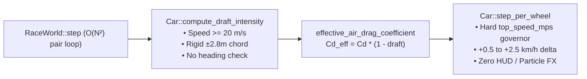
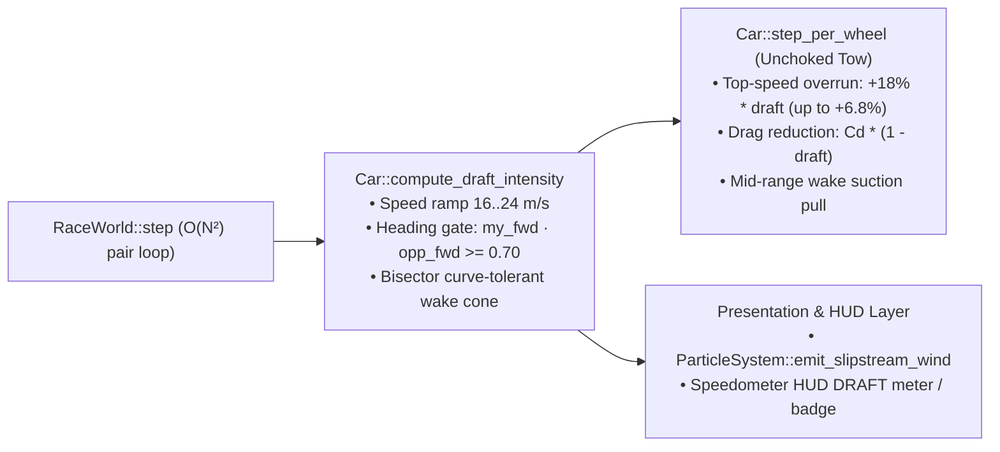

# Architecture Spec 129: Aerodynamic Slipstream Drafting Unchoking, Wake Alignment, and HUD Visual Feedback 🌬️🏎️💨

An architectural and gameplay physics upgrade for [`crates/wheelbase`](../crates/wheelbase), [`crates/race-ui`](../crates/race-ui), and [`crates/tdrace-app`](../crates/tdrace-app) that transforms the dormant `draft_intensity` drag-reduction calculation into a tangible, high-reward slipstream and slingshot overtaking mechanic across all racing disciplines, while providing clear visual and HUD telemetry feedback and serving as the physical foundation for [Spec 107](107_tactical_bot_racecraft_and_stylespecific_behaviour_tuning.md) tactical bot racecraft.

---

## 🔍 Context & Problem Statement

Although [`Car::compute_draft_intensity`](../crates/wheelbase/src/car.rs) and [`RaceWorld::step`](../crates/race-kit/src/world.rs) already compute a per-tick `draft_intensity` $\in [0.0, 0.38]$ and reduce `air_drag_coefficient` via [`Car::effective_air_drag_coefficient`](../crates/wheelbase/src/car.rs), the mechanic produces almost zero felt impact in actual races due to four compounding bottlenecks:

1. **Top-Speed Governor Choking (`engine_taper`)**:
   In [`Car::step_per_wheel`](../crates/wheelbase/src/car.rs), `engine_taper` linearly throttles engine drive force from $1.0$ down to $0.0$ between $0.90 \times \text{top\_speed\_mps}$ and $1.00 \times \text{top\_speed\_mps}$, where `top_speed_mps` is completely invariant to `draft_intensity`. Because quadratic air drag ($C_d v^2$) at top speed accounts for only $15\text{–}30\%$ of `max_engine_force` across the vehicle presets, a $38\%$ drag reduction shifts equilibrium speed inside the $10\%$ governor ramp by only **$0.5\text{ to }2.5\text{ km/h}$** and can never exceed `top_speed_mps`.
2. **Negligible Mid-Range Acceleration Tow**:
   In the $16\text{–}45\text{ m/s}$ ($58\text{–}162\text{ km/h}$) speed band typical of Classic, Karting, Autocross, Rallycross, and medium-length road-course straights, raw aerodynamic drag is small relative to tractive engine force ($< 6\%$ at $30\text{ m/s}$). Simply scaling $C_d$ yields $< 2\%$ extra acceleration, preventing trailing cars from closing a $10\text{–}20\text{ m}$ gap before the next braking zone.
3. **Direction-Blind Straight-Chord Wake Geometry**:
   [`Car::compute_draft_intensity`](../crates/wheelbase/src/car.rs) projects `(opp.position - my.position)` strictly onto `my_fwd` ($2.0\text{–}32.0\text{ m}$) and `my_right` ($\pm 2.8\text{ m}$) without checking whether the lead vehicle is travelling in the same direction (`my_fwd.dot(opp_fwd)`). Consequently:
   - A car on an adjacent opposite-direction hairpin switchback, or a spun/wrecked car facing sideways, falsely grants slipstream draft.
   - On high-speed banked ovals and sweeping turns, a lead car $20\text{ m}$ ahead along the curve drifts laterally outside the trailing car's rigid $\pm 2.8\text{ m}$ straight-line chord, dropping the draft mid-turn.
4. **Absence of Visual & HUD Feedback**:
   Neither the in-world renderer (`race-ui`) nor the racing HUD (`tdrace-app`) displays any visual cue when `draft_intensity > 0.0`, leaving players unable to perceive when they have locked onto an opponent's wake.

---

## 🗺️ Current vs. Proposed System Architecture

### 1. Current Architecture


### 2. Proposed Architecture


### 3. Detailed Physics & Presentation Specification

#### A. Heading-Gated, Curve-Tolerant Wake Cone (`crates/wheelbase/src/car.rs`)
Update [`Car::compute_draft_intensity`](../crates/wheelbase/src/car.rs):
1. **Speed Activation Ramp**:
   - Trailing car minimum speed lowered from $20.0\text{ m/s}$ to $16.0\text{ m/s}$ ($57.6\text{ km/h}$), with a smooth activation factor:
     $$s_{\text{self}} = \operatorname{clamp}\!\left(\frac{v_{\text{self}} - 16.0}{8.0},\, 0.0,\, 1.0\right)$$
   - Lead car minimum speed lowered from $15.0\text{ m/s}$ to $12.0\text{ m/s}$ ($43.2\text{ km/h}$).
2. **Heading Alignment Gate**:
   - Compute `heading_align = my_fwd.dot(opp_fwd)`.
   - Require `heading_align >= 0.70` ($\le 45.5^\circ$ heading divergence) so opposite-direction lanes, T-bone crossings, and spun cars never generate slipstream.
   - Scale draft smoothly by `heading_factor = ((heading_align - 0.70) / 0.25).clamp(0.0, 1.0)`.
3. **Curve-Tolerant Bisector Wake Frame**:
   - Define the shared wake tangent `wake_fwd = (my_fwd + opp_fwd).normalize_or_zero()` and normal `wake_right = Vec2::new(wake_fwd.y, -wake_fwd.x)`.
   - Project `to_opp = opp.state.position - my_pos` onto `wake_fwd` (`fwd_dist`) and `wake_right` (`lat_dist = to_opp.dot(wake_right).abs()`).
   - Expand the lateral wake half-width linearly with longitudinal distance (`lat_limit = 2.6 + 0.04 * fwd_dist`, spanning $2.68\text{ m}$ at $2\text{ m}$ to $3.88\text{ m}$ at $32\text{ m}$) so cars tracking the same curved racing line on ovals and fast sweepers remain locked in the tow.
   - Within $2.0\text{ m} < \text{fwd\_dist} < 32.0\text{ m}$ and $\text{lat\_dist} < \text{lat\_limit}$:
     $$\text{draft} = 0.38 \cdot s_{\text{self}} \cdot \text{heading\_factor} \cdot \left(1.0 - \frac{\text{fwd\_dist} - 2.0}{30.0}\right) \cdot \left(1.0 - \frac{\text{lat\_dist}}{\text{lat\_limit}}\right)$$
   - Preserve the rear push-draft term ($-10.0\text{ m} < \text{fwd\_dist} < -2.0\text{ m}$, $\text{lat\_dist} < 2.0\text{ m}$) gated by the same `s_self * heading_factor`.

#### B. Top-Speed Governor Unchoking & Mid-Range Wake Suction (`crates/wheelbase/src/car.rs`)
In [`Car::step_per_wheel`](../crates/wheelbase/src/car.rs):
1. **Draft Top-Speed Overrun**:
   - Scale the effective `top_speed` governor ceiling by `draft_overrun = 1.0 + 0.18 * self.state.draft_intensity.clamp(0.0, 0.50)`:
     $$\text{top\_speed} = \text{config.top\_speed\_mps} \cdot (0.60 + 0.40 \cdot \text{power\_ratio}) \cdot \text{draft\_overrun}$$
   - At maximum wake draft ($\text{draft\_intensity} = 0.38$), the governor ceiling increases by $+6.84\%$, enabling genuine slingshot terminal velocity gains ($+12\text{ to }+20\text{ km/h}$ on sports, GT, and stock cars; $+7\text{ to }+10\text{ km/h}$ on karts and buggies).
2. **Mid-Range Tractive Wake Suction**:
   - When driving forward under throttle (`!clamped_ctrl.reverse && clamped_ctrl.throttle > 0.0 && v_long > 16.0`), boost `total_drive_force` by a bounded wake suction factor $(1.0 + 0.18 \cdot \text{draft\_intensity})$ so trailing cars noticeably close gaps in the $60\text{–}180\text{ km/h}$ acceleration band on medium straights without altering corner-exit traction below $16\text{ m/s}$.

#### C. In-World Slipstream Wind Streaks (`crates/race-ui/src/fx/particles.rs` & `crates/tdrace-app/src/game/mod.rs`)
1. Add [`ParticleSystem::emit_slipstream_wind`](../crates/race-ui/src/fx/particles.rs) to emit short-lived, translucent cyan-white air-stream streaks (`is_spark: true`, `color_start: Color::new(0.75, 0.96, 1.0, alpha)`) along the front-left and front-right aero corners of a vehicle when `draft_intensity >= 0.12` and `speed >= 16.0`.
2. Invoke `emit_slipstream_wind` in [`RaceSession::physics_step`](../crates/tdrace-app/src/game/mod.rs) for active vehicles in the slipstream.

#### D. HUD Draft Indicator (`crates/tdrace-app/src/ui/hud.rs`)
1. In [`render_speedometer`](../crates/tdrace-app/src/ui/hud.rs), when `car.state.draft_intensity >= 0.08`, render a compact `DRAFT` telemetry bar (`MetricBar::stat("DRAFT", (car.state.draft_intensity / 0.38).clamp(0.0, 1.0), ...)` in `Palette::NEON_CYAN`) below the speedometer dial (stacked cleanly with the drift bar when both are active).

---

## 🗄️ Database & Storage Migration Plan

- **Zero Schema Changes**: `draft_intensity` is already a transient runtime field on `wheelbase::CarState`. No SQLite tables (`tdrace_records.db`), track JSON schemas, or series TOML files are modified.
- **Golden Determinism Hash Update**: Because [`Car::compute_draft_intensity`](../crates/wheelbase/src/car.rs) and [`Car::step_per_wheel`](../crates/wheelbase/src/car.rs) change multi-car drafting trajectories (while leaving single-car solo physics bit-identical when `draft_intensity == 0.0`), update any multi-car golden state hash in [`crates/arcade-race-core/tests/golden_sim.rs`](../crates/arcade-race-core/tests/golden_sim.rs) if affected.

---

## 🔑 Security, Compliance, & IAM Roles

- **Zero External Dependencies or Cloud Services**: All calculations execute locally in pure Rust with deterministic IEEE 754 `f32` arithmetic.
- **Zero-Allocation Hot Loop Invariant**: `compute_draft_intensity` and `step_per_wheel` allocate zero heap memory per tick.

---

## 🛡️ Disaster Recovery, Monitoring, & Fallbacks

- **Solo Time Trial & Single-Car Invariance**: When `draft_intensity == 0.0` (all solo runs, single-car tests, and clean-air driving), `draft_overrun == 1.0` and the wake suction multiplier is `1.0`, ensuring **bit-identical** physics trajectories and lap times for all existing solo vehicle benchmarks and Spec 083 solo tests.
- **Safety Clamping**: `draft_intensity` remains strictly clamped to $[0.0, 0.50]$ in [`Car::effective_air_drag_coefficient`](../crates/wheelbase/src/car.rs) and `step_per_wheel`.

---

## 🧪 Verification & Acceptance Criteria

### Automated Tests
```bash
cargo test -p wheelbase
cargo test -p tdrace-core --test vehicle_dynamics_realism_tests
cargo test -p arcade-race-core --test golden_sim
cargo test -p race-ui
```

### Manual Acceptance Criteria (Pseudo-Gherkin)

- **Scenario: Unchoked terminal speed gain in slipstream**
  - [x] **Given** two identical `CarConfig::sports_car()` vehicles running full throttle from rest to terminal equilibrium on flat Asphalt, one solo in clean air and one trailing $10\text{ m}$ behind a pace car running at the drafting speed
  - [x] **When** both vehicles reach steady-state terminal speed over $20\text{ s}$
  - [x] **Then** the drafting vehicle's top speed must exceed the solo vehicle's top speed by at least $8.0\text{ km/h}$ (up from $\sim 1.1\text{ km/h}$ under the choked governor).

- **Scenario: Mid-range straightaway gap closure**
  - [x] **Given** two identical `CarConfig::sports_car()` vehicles launched at $22.0\text{ m/s}$ ($79.2\text{ km/h}$) on a straightaway with the trailing car $14.0\text{ m}$ directly behind the lead car under full throttle
  - [x] **When** both vehicles step forward for $4.0\text{ s}$ ($240$ ticks)
  - [x] **Then** the longitudinal gap between the two vehicles must shrink by at least $1.5\text{ m}$.

- **Scenario: Opposite-direction and perpendicular vehicles do not trigger draft**
  - [x] **Given** a trailing car travelling at $40.0\text{ m/s}$ along $+X$ and an opponent car $12.0\text{ m}$ ahead at $(12.0, 0.0)$ travelling at $40.0\text{ m/s}$ in the opposite direction ($-X$) or perpendicular ($+Y$)
  - [x] **When** `compute_draft_intensity` is evaluated
  - [x] **Then** the returned `draft_intensity` must equal $0.0$.

- **Scenario: Curve-tolerant wake cone retains draft on sweeping turns**
  - [x] **Given** a trailing car at $(0.0, 0.0)$ with heading $0.0\text{ rad}$ and a lead car $18.0\text{ m}$ ahead along a sweeping turn at $(17.6, 3.1)$ with heading $+0.28\text{ rad}$ (both at $45.0\text{ m/s}$)
  - [x] **When** `compute_draft_intensity` is evaluated
  - [x] **Then** the returned `draft_intensity` must be $\ge 0.10$ (whereas the rigid $\pm 2.8\text{ m}$ chord returned $0.0$).

- **Scenario: Solo clean-air determinism invariance**
  - [x] **Given** any single vehicle with `draft_intensity == 0.0`
  - [x] **When** stepped across any surface and control sequence
  - [x] **Then** its state trajectory is bit-identical to the pre-Spec-129 solver.

---

## 🔗 Traceability & Codebase Mapping

### Created/Modified Files
- [x] `crates/wheelbase/src/car.rs` -> Upgrades `Car::compute_draft_intensity` (heading alignment gate, curve-tolerant bisector wake frame, $16\text{ m/s}$ ramp) and `Car::step_per_wheel` (top-speed governor draft overrun and mid-range wake suction pull).
- [x] `crates/tdrace-core/tests/vehicle_dynamics_realism_tests.rs` -> Adds unit and integration tests for unchoked terminal speed gain, mid-range gap closure, heading rejection, and curved-wake retention.
- [x] `crates/arcade-race-core/tests/golden_sim.rs` -> Updates multi-car golden simulation hash if changed by the updated wake cone.
- [x] `crates/race-ui/src/fx/particles.rs` -> Adds `ParticleSystem::emit_slipstream_wind` for translucent cyan-white aero wake streaks.
- [x] `crates/tdrace-app/src/game/mod.rs` -> Calls `emit_slipstream_wind` during `RaceSession::physics_step` when `draft_intensity >= 0.12`.
- [x] `crates/tdrace-app/src/ui/hud.rs` -> Renders live `DRAFT` telemetry bar under the speedometer cluster when `draft_intensity >= 0.08`.
- [x] `specs/107_tactical_bot_racecraft_and_stylespecific_behaviour_tuning.md` -> Adds Spec `129` to `depends_on` and references the unchoked wake model.
- [x] `specs/constitution/ROADMAP.md` -> Registers Spec `129` in Phase 6 (Next-Gen Vehicle Dynamics).

### Verification Assertions
- `crates/tdrace-core/tests/vehicle_dynamics_realism_tests.rs` verifies all 5 Pseudo-Gherkin scenarios deterministically.
