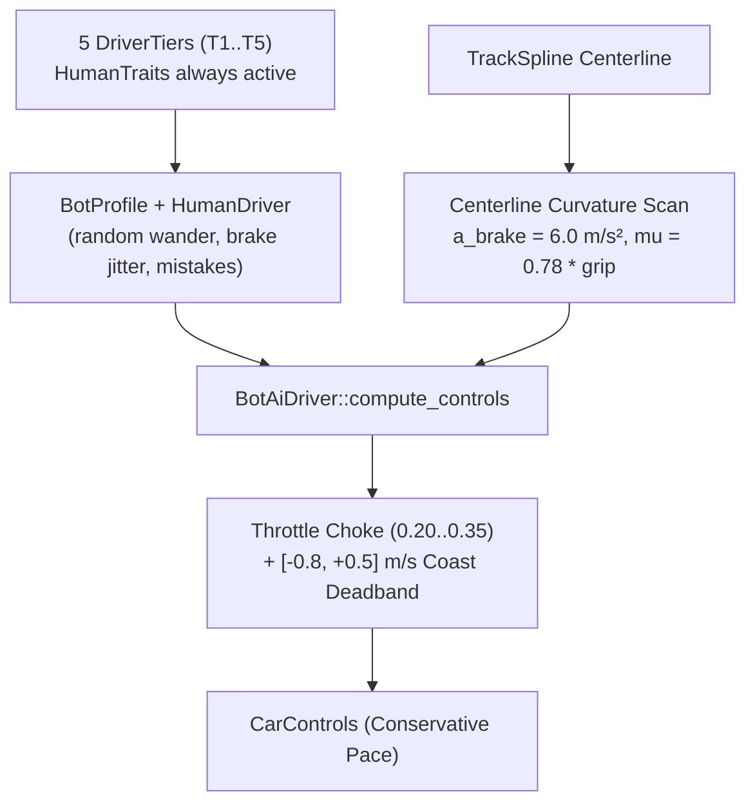
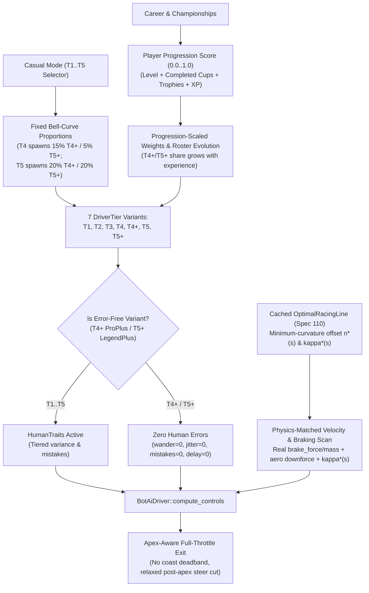

# Architecture Spec 131: Error-Free T4+ and T5+ Bot Tiers, Optimal Racing Line Trajectory Following, and Maximum-Pace Controller Unchoking 🏁⚡

Introduces two elite error-free bot variants — **`ProPlus` (`T4+`)** and **`LegendPlus` (`T5+`)** — with all simulated human mistakes, random line wandering, and per-corner jitter completely removed, while eliminating the structural pace bottlenecks in `race_kit::ai::BotAiDriver` so high-tier bots exploit the minimum-curvature [`OptimalRacingLine`](110_mathematically_ideal_racing_line_visual_aid.md), real vehicle braking deceleration, aerodynamic downforce, and immediate full-throttle corner exits.

In **Casual Racing Modes**, `T4+` and `T5+` appear as a fixed proportion of the opponent grid at higher difficulty settings (`T3`–`T5`). In **Career & Championship Modes**, the proportion of `T4+` and `T5+` bots dynamically increases along with player progression (career level, completed championships, podium trophies, cumulative XP, and post-season rival evolution) so that more experienced players encounter `T4+` and `T5+` contenders progressively more often.

---

## 🔍 Context & Root-Cause Diagnosis

Even after the 42-profile evolutionary calibration in [Spec 083](083_evorl_bot_driving_style_and_performance_optimization.md), `T5` (`DriverTier::Legend`) bots remain non-competitive against a skilled human player, and neither [Spec 107](107_tactical_bot_racecraft_and_stylespecific_behaviour_tuning.md) nor [Spec 108](108_datavalidated_driver_character_personality_offsets.md) addresses single-lap speed (both explicitly lock tier pace within $\pm 1\text{–}1.5\%$ of Spec 083).

Tracing `BotAiDriver::compute_controls` in [`crates/race-kit/src/ai/mod.rs`](../crates/race-kit/src/ai/mod.rs) and `HumanDriver` in [`crates/race-kit/src/ai/humanize.rs`](../crates/race-kit/src/ai/humanize.rs) reveals five structural ceilings holding bot pace far below the physical vehicle limit:

1. **Cornering Speed Planned From *Centerline* Curvature Instead of Racing-Line Curvature (`mod.rs:1705–1725`)**:
   - The forward braking scan evaluates `local_curvature` along the raw **track centerline spline** (`spline.sample_at_distance(scan_dist)` over a $6\text{ m}$ span).
   - A human driver following an outside–inside–outside racing line through a $90^\circ$ corner or chicane flattens the effective turn radius $R$ by $1.5\times\text{–}3\times$ (reducing curvature $\kappa$ by $35\%\text{–}65\%$). Because the bot computes $v_{\text{apex}} = \sqrt{\mu_{\text{eff}} \cdot g \cdot R_{\text{centerline}}}$, it brakes down for the tight centerline radius even when it has wide track room.
   - Meanwhile, [Spec 110](110_mathematically_ideal_racing_line_visual_aid.md) already implemented [`OptimalRacingLine`](../crates/arcade-race-core/src/track/optimal_line.rs) in `arcade-race-core` with solved minimum-curvature lateral offsets $n^*(s)$ and reduced curvature $\kappa^*(s)$, but **bots do not use it at all**.

2. **Conservative Braking Deceleration ($\sim 0.6g$) & Under-Estimated Cornering Grip (`mod.rs:55–59, 1698–1743`)**:
   - `BotAiDriver` assumes a hardcoded braking deceleration `a_brake = 6.0 * self.profile.brake_margin` ($\approx 5.8\text{–}6.8\text{ m/s}^2$), whereas cars in `wheelbase` decelerate at $10\text{–}14\text{ m/s}^2$ ($1.0\text{–}1.4g$). Bots therefore start braking **nearly twice as early** as a human on every straight.
   - `Car::planning_grip` scales `tire.grip * 0.78` and ignores speed-dependent aerodynamic downforce (`downforce_coeff`) and peak Pacejka lateral slip capacity.

3. **Severe Mid-Corner & Corner-Exit Throttle Choking + Coasting Deadband (`mod.rs:1861–1902`)**:
   - Whenever `steer_cmd.abs() > 0.20`, `throttle_limit` is clamped down to `0.35`, and when `heading_error.abs() > 0.45`, it is multiplied down to `0.20`.
   - Furthermore, when `speed_err` (`target_speed - car_speed`) lies in `[-0.8, +0.5] m/s`, the controller outputs **`(0.0, 0.0)` (zero throttle, zero brake)** and ramps throttle gradually over a $6.0\text{ m/s}$ error band. Bots coast through the apex and trickle out of turns while a human is already at $100\%$ throttle.

4. **Residual Human Mistakes & Variance at `T4` / `T5` (`humanize.rs:131–167`)**:
   - Even at `T4` (`consistency = 0.93`, `composure = 0.90`) and `T5` (`consistency = 0.9948`, `composure = 0.9804`), `HumanTraits` injects random line wander (`line_sigma_m >= 0.3 m`), brake-point jitter (`brake_shift_sigma_m >= 1.0 m`), corner-speed jitter, pass commit delay, and non-zero mistake rolls under pack pressure.

5. **Static Championship Tier Ceiling (`career.rs:159–166`, `series/mod.rs:488`)**:
   - `RosterEvolutionEngine::evolve_roster` caps `StandoutLeap` at `DriverTier::Legend` (`5`), and `SeriesSession::sync_initial_grid_slots` assigns a flat `self.tier` to added championship drivers, so veteran players never face an escalating proportion of error-free elite contenders as they progress through championships.

---

## 🗺️ Current vs. Proposed System Architecture

### 1. Current Architecture


### 2. Proposed Architecture


---

## 📐 Detailed Technical Design

### 1. `DriverTier` Variants (`T4+` and `T5+`)

Extend [`DriverTier`](../crates/race-kit/src/ai/mod.rs) with two error-free elite variants (`ProPlus` and `LegendPlus`) alongside the 5 base tiers:

| Variant | Progression Rank | `to_u8()` / `from_u8()` | Tag (`tag()`) | Short Name (`short_name()`) | Title (`title()`) | Serde / Config Key | Vehicle Tier (`car_tier_u8()`) | Human Errors (`HumanTraits`) |
| :--- | :---: | :---: | :---: | :--- | :--- | :--- | :---: | :---: |
| `Rookie` | `0` | `1` | `"T1"` | `"Rookie (T1)"` | `"Tier 1: Rookie"` | `"rookie"` | `1` | Active |
| `Amateur` | `1` | `2` | `"T2"` | `"Amateur (T2)"` | `"Tier 2: Amateur"` | `"amateur"` | `2` | Active |
| `Contender` | `2` | `3` | `"T3"` | `"Contender (T3)"` | `"Tier 3: Contender"` | `"contender"` | `3` | Active |
| `Pro` | `3` | `4` | `"T4"` | `"Pro (T4)"` | `"Tier 4: Pro"` | `"pro"` | `4` | Active |
| `ProPlus` | `4` | `6` | `"T4+"` | `"Pro+ (T4+)"` | `"Tier 4+: Pro+"` | `"pro_plus"` | `4` | **Removed (`0.0`)** |
| `Legend` | `5` | `5` | `"T5"` | `"Legend (T5)"` | `"Tier 5: Legend"` | `"legend"` | `5` | Active |
| `LegendPlus` | `6` | `7` | `"T5+"` | `"Legend+ (T5+)"` | `"Tier 5+: Legend+"` | `"legend_plus"` | `5` | **Removed (`0.0`)** |

#### Indexing, Serialization & Backwards Compatibility
- **`DriverTier::BASE_TIERS: [Self; 5]`**: `[Rookie, Amateur, Contender, Pro, Legend]` — used by UI difficulty selectors (`ArcadeSettingsModal` 0..=4 and casual difficulty cycling `T1..=T5`) so the user continues to select from the 5 canonical difficulty levels while `T4+` and `T5+` spawn as proportions of the bot grid.
- **`DriverTier::ALL: [Self; 7]`**: `[Rookie, Amateur, Contender, Pro, ProPlus, Legend, LegendPlus]` — ordered by pace progression across all 7 variants, used by `bell_curve_weights`, `sample_grid_tiers`, benchmark tables, and nameplate/grid badge rendering (`"T4+"`, `"T5+"`).
- **`from_u8(val)` / `to_u8(self)`**:
  - `1 -> Rookie`, `2 -> Amateur`, `3 -> Contender`, `4 -> Pro`, `5 -> Legend`, `6 -> ProPlus`, `7 -> LegendPlus`.
  - Keeping `1..=5` mapped to `Rookie..=Legend` preserves 100% compatibility with existing integer TOML configs, `SeriesStandingEntry::ai_tier: Option<u8>` in saved career profiles, and `bot_eval_worker`.
- **`car_tier_u8(self) -> u8`**: Returns `1, 2, 3, 4, 4, 5, 5` for `Rookie, Amateur, Contender, Pro, ProPlus, Legend, LegendPlus` so vehicle selection and career rival car lookups always resolve valid `1..=5` vehicle tiers.
- **String Parsing (`from_str_lossy` & `Deserialize`)**:
  - Recognizes `"t4+"`, `"4+"`, `"pro+"`, `"pro_plus"`, `"tier 4+"`, `"tier 4+: pro+"` $\to$ `DriverTier::ProPlus`.
  - Recognizes `"t5+"`, `"5+"`, `"legend+"`, `"legend_plus"`, `"tier 5+"`, `"tier 5+: legend+"` $\to$ `DriverTier::LegendPlus`.

---

### 2. Casual Mode vs. Championship Progression Proportions

#### A. Casual Racing Modes: Fixed Proportion of `T4+` and `T5+` Bots
In Casual Racing Modes, `DriverTier::bell_curve_weights(self) -> [u8; 7]` returns percentage weights over `DriverTier::ALL` (`[T1, T2, T3, T4, T4+, T5, T5+]`, summing to `100`):

| Selected Difficulty | `T1` | `T2` | `T3` | `T4` | **`T4+`** | `T5` | **`T5+`** | Total Error-Free (`T4+` + `T5+`) |
| :--- | :---: | :---: | :---: | :---: | :---: | :---: | :---: | :---: |
| `Rookie (T1)` | 55% | 35% | 10% | 0% | **0%** | 0% | **0%** | **0%** |
| `Amateur (T2)` | 20% | 50% | 25% | 5% | **0%** | 0% | **0%** | **0%** |
| `Contender (T3)` | 5% | 20% | 45% | 20% | **5%** | 5% | **0%** | **5%** |
| `Pro (T4)` | 0% | 5% | 20% | 45% | **15%** | 10% | **5%** | **20%** |
| `Legend (T5)` | 0% | 0% | 5% | 20% | **20%** | 35% | **20%** | **40%** |
| `ProPlus (T4+)` *(direct)* | 0% | 0% | 0% | 25% | **50%** | 15% | **10%** | **60%** |
| `LegendPlus (T5+)` *(direct)* | 0% | 0% | 0% | 0% | **25%** | 25% | **50%** | **75%** |

#### B. Career & Championship Modes: Experience-Scaled `T4+` and `T5+` Proportions
In Career and Championship modes, a player's accumulated progression dynamically increases the proportion of `T4+` and `T5+` rivals they face:

1. **Player Experience Score (`ModuleCareerProgress::elite_variant_progression_score(&self) -> f32` in `[0.0, 1.0]`)**:
   - Computed deterministically from `ModuleCareerProgress`:
     $$\text{score} = \text{clamp}\Big(0.12 \cdot (\text{level} - 1) + 0.06 \cdot N_{\text{completed\_cups}} + 0.14 \cdot N_{\text{gold}} + 0.10 \cdot N_{\text{silver}} + 0.06 \cdot N_{\text{bronze}} + \min\big(0.25,\ \tfrac{\text{lifetime\_xp}}{25000}\big),\ 0.0,\ 1.0\Big)$$
   - A brand-new player (`level = 1`, 0 cups, 0 XP) has `score = 0.0`.
   - A mid-career player advancing into Tier 3–4 has `score ≈ 0.35..0.60`.
   - A veteran player with multiple completed championships and podium trophies reaches `score ≈ 0.80..1.00`.

2. **Experience-Scaled Championship Grid Distribution (`DriverTier::championship_bell_curve_weights(championship_tier: u32, experience_score: f32) -> [u8; 7]`)**:
   - Linearly interpolates (`lerp` with rounding and exact sum-to-100 normalization) between a ** Rookie/Entrant distribution (`experience_score = 0.0`)** and a **Veteran Mastery distribution (`experience_score = 1.0`)** for each championship tier:
     - **Tier 1 Championship**: `0%` `T4+`/`T5+` at `score = 0.0` $\to$ `5% T4+` at `score = 1.0`.
     - **Tier 2 Championship**: `0%` `T4+`/`T5+` at `score = 0.0` $\to$ `10% T4+` at `score = 1.0`.
     - **Tier 3 Championship**: `5% T4+, 0% T5+` at `score = 0.0` $\to$ `25% T4+, 10% T5+` (`35%` error-free) at `score = 1.0`.
     - **Tier 4 Championship**: `15% T4+, 5% T5+` (`20%` error-free) at `score = 0.0` $\to$ `40% T4+, 20% T5+` (`60%` error-free) at `score = 1.0`.
     - **Tier 5+ Championship**: `20% T4+, 15% T5+` (`35%` error-free) at `score = 0.0` $\to$ `25% T4+, 55% T5+` (`80%` error-free) at `score = 1.0`.
   - Expose `DriverTier::sample_championship_grid_tiers(championship_tier: u32, experience_score: f32, n: usize, seed: u64) -> Vec<DriverTier>`.

3. **Career Roster Initialization, Evolution & Championship Sync (`career.rs`, `profile/mod.rs`, `series/mod.rs`)**:
   - **`RosterEvolutionEngine::evolve_roster_with_progression(current_roster, new_tier, experience_score, seed)`**:
     - When retained rivals roll `StepUp` or `StandoutLeap`, high-tier rivals can promote into **`ProPlus` (`T4+`)** and **`LegendPlus` (`T5+`)** with probability boosted by `experience_score`:
       - At `new_tier >= Contender (T3)`, a `StandoutLeap` from `T3`/`T4` or a `StepUp` by an existing `T4` rival promotes to `ProPlus (T4+)` when `roll < 0.35 + 0.50 * experience_score`.
       - At `new_tier >= Pro (T4)`, a `StandoutLeap` from `T4`/`T4+`/`T5` (or a `StepUp` by an existing `T4+`/`T5` rival at `Legend`) promotes to `LegendPlus (T5+)` when `roll < 0.30 + 0.55 * experience_score`.
     - Incoming churn replacements sample their tier via `DriverTier::sample_championship_grid_tiers(new_tier.car_tier_u8() as u32, experience_score, 1, seed)`.
   - **Post-Championship Rival Evolution**:
     - In `ModuleCareerProgress::record_championship_finish`, after updating championship completion and trophy counts, if `!self.career_rivals.is_empty()`, evolve the career rival tiers against `self.elite_variant_progression_score()` so that each completed championship season increases the proportion of `T4+` and `T5+` rivals even after the player has already reached Tier 5.
   - **`SeriesSession::sync_initial_grid_slots`**:
     - Instead of assigning a flat `Some(self.tier as u8)` to newly added grid drivers, sample their tiers from `DriverTier::sample_championship_grid_tiers(self.tier, self.progression_score, needed, seed)`.

---

### 3. Complete Removal of Simulated Human Errors in `T4+` and `T5+`

In [`crates/race-kit/src/ai/mod.rs`](../crates/race-kit/src/ai/mod.rs) and [`crates/race-kit/src/ai/humanize.rs`](../crates/race-kit/src/ai/humanize.rs):

1. **`DriverQuality::for_tier`**:
   - `DriverTier::ProPlus`:
     - `pace_limit: 1.05`, `brake_padding: -0.05`, `avoidance_padding: -0.5`, `consistency: 1.0`, `composure: 1.0`.
   - `DriverTier::LegendPlus`:
     - `pace_limit: 1.12`, `brake_padding: -0.10`, `avoidance_padding: -0.8`, `consistency: 1.0`, `composure: 1.0`.
2. **`DriverTier::is_error_free(self) -> bool`**:
   - Returns `matches!(self, Self::ProPlus | Self::LegendPlus)`.
3. **`HumanTraits::for_style_and_quality`**:
   - When `quality.tier.is_error_free()` is `true`:
     - `line_sigma_m: 0.0` (zero lateral wandering on straights and corners)
     - `line_choice_sigma: 0.0` (deterministic optimal corner entry/apex share every lap)
     - `brake_shift_sigma_m: 0.0` (zero random braking point error)
     - `corner_speed_sigma: 0.0` (zero random corner speed drop/overshoot)
     - `reaction_tau_s: 0.0`
     - `mistake_rate: 0.0`
     - `mistake_weights: [0.0; 5]` (zero `LateBrake`, `Overdrive`, `PowerStab`, `OverCorrect`, `Cautious`)
     - `pressure_gain: 0.0` (immune to mistake inflation when pressured by player or pack)
     - `max_pass_delay_s: 0.0` (instantaneous overtaking commitment)
     - `entry_share: 0.90`, `apex_share: 0.95`
     - `curb_cut_m`: enabled (`0.85 m` for `ProPlus`, `1.05 m` for `LegendPlus`) so error-free bots aggressively use inside apex curbs on sufficiently wide circuits without triggering random errors.

---

### 4. `OptimalRacingLine` Trajectory Following & Curvature Planning

Instead of computing cornering speeds from the tight **centerline** spline radius:

1. **Cached `OptimalRacingLine` in `BotAiDriver`**:
   - Add `cached_optimal_line: Option<OptimalRacingLine>` to `BotAiDriver`, computed lazily via `OptimalRacingLine::compute_for_spline(spline)` whenever the active spline (`track.spline`, composite branch layout, or launch chute entry spline) changes.
   - Because `OptimalRacingLine::compute_for_spline` runs once per layout change in $<3\text{ ms}$ and allocates nothing during subsequent per-tick steps, the hot simulation loop (`compute_controls`) retains **zero per-tick heap allocations**.
2. **Tier-Blended Optimal Racing Line Tracking**:
   - Define an optimal-line adherence weight `opt_blend(tier)`:
     - `Rookie`: `0.0` (pure `HumanDriver` wandering line)
     - `Amateur`: `0.25`
     - `Contender`: `0.50`
     - `Pro`: `0.75`
     - `ProPlus`: `1.00` (pure minimum-curvature optimal line)
     - `Legend`: `0.90` (optimal line + subtle style line variation)
     - `LegendPlus`: `1.00` (pure minimum-curvature optimal line + maximum apex curb cut)
   - At the lookahead target distance `target_dist`, sample the optimal line's lateral offset $n^*(s)$ and blend with `human_offset`.
3. **Braking & Corner Speed Scan Over Optimal-Line Curvature $\kappa^*(s)$**:
   - In the forward braking scan (`s_idx in 0..=num_scan_samples`), blend the centerline curvature $\kappa_{\text{center}}(s)$ with the solved minimum-curvature $\kappa_{\text{opt}}(s)$ from `cached_optimal_line` according to `opt_blend`:
     $$\kappa_{\text{eff}}(s) = (1 - w_{\text{opt}}) \kappa_{\text{center}}(s) + w_{\text{opt}} \kappa_{\text{opt}}(s)$$
   - Because $\kappa_{\text{opt}}(s)$ reflects the flattened outside–inside–outside trajectory across chicanes and corners, `T4+`, `T5`, and `T5+` carry realistically higher entry and mid-corner speeds without overshooting track boundaries.

---

### 5. Physics-Matched Braking Envelope, Downforce & Corner-Exit Unchoking

1. **Extend `BotVehicle` with Physical Braking & Downforce Queries**:
   - Add default methods to [`BotVehicle`](../crates/race-kit/src/ai/mod.rs):
     ```rust
     /// Nominal longitudinal braking deceleration capability on dry tarmac (m/s²).
     fn max_braking_decel_mps2(&self) -> f32 {
         8.5
     }
     /// Speed-dependent aerodynamic downforce grip multiplier at `speed_mps` (>= 1.0).
     fn downforce_grip_factor(&self, _speed_mps: f32) -> f32 {
         1.0
     }
     ```
   - Implement on `wheelbase::Car`:
     - `planning_grip(&self)`: raised from `0.78 * tire.grip` to `0.86 * tire.grip` as the base planning envelope.
     - `max_braking_decel_mps2(&self)`: derived from physical brake force and tire grip:
       $$a_{\text{brake,car}} = \text{clamp}\left(\min\left(\frac{F_{\text{brake,max}}}{m}, \mu_{\text{tire}} \cdot g \cdot 1.05\right),\ 7.5,\ 13.5\right)$$
     - `downforce_grip_factor(&self, speed_mps)`: accounts for `config.downforce_coeff * speed_mps^2 / (config.mass_kg * g)`.
2. **Threshold Braking Scaling**:
   - In `BotAiDriver::compute_controls`, compute base braking deceleration from `car.max_braking_decel_mps2() * (0.82 / self.profile.brake_margin.max(0.70))` so lower tiers with large `brake_margin` still brake early (~$6\text{–}7\text{ m/s}^2$), while `T4+` / `T5+` (`brake_margin <= 0.95`) brake near the true threshold deceleration ($9.5\text{–}12.5\text{ m/s}^2$).
3. **Eliminating the Coasting Deadband & Un-Choking Corner Exit**:
   - Narrow the longitudinal coast deadband from `[-0.8, +0.5] m/s` to `[-0.15, +0.05] m/s` for `T4+` / `T5+` (and `[-0.35, +0.15] m/s` for `T1..T5`), and sharpen the throttle ramp from `speed_err / 6.0` to `speed_err / 2.5` on `T4+` / `T5+`.
   - When the vehicle is at or past the corner apex (or when `car_speed < target_speed` and the car is rotating onto the straight with `car_fwd.dot(target_sample.tangent) > 0.85`), relax `steer_traction_limit` from a `0.35` floor up to `0.75..0.90` so bots power out of corners immediately instead of bogging down at $20\text{–}35\%$ throttle.
4. **Curvature-Adaptive Lookahead**:
   - Shorten on-road lookahead distance dynamically when approaching or inside high-curvature corners ($\kappa > 0.02\text{ m}^{-1}$) down to a `6.5..14.0 m` window so the bot does not chord-cut across the inside of tight hairpins before turn-in.

---

## 🗄️ Database & Storage Migration Plan

- **Zero SQLite Schema Changes**: `tdrace_records.db` stores career progress as JSON (`career_rivals` and `active_championship`).
- **Backwards-Compatible Profile & Config Serialization**:
  - `SeriesStandingEntry::ai_tier: Option<u8>` continues to store `1..=5` for `Rookie..=Legend` and uses `6` for `ProPlus` (`T4+`) and `7` for `LegendPlus` (`T5+`).
  - `CareerRivalEntry::tier` (`DriverTier`) deserializes all existing `"Rookie".."Legend"` values and adds `"ProPlus"` / `"LegendPlus"`.

---

## 🔑 Security, Compliance, & IAM Roles

- **Local Deterministic Execution Only**: All changes execute purely within `crates/race-kit`, `crates/cabinet`, and `crates/tdrace-app` with zero network I/O or external dependencies.

---

## 🛡️ Disaster Recovery, Monitoring, & Fallbacks

- **Zero Heap Allocations in Hot Loop**: `OptimalRacingLine` is computed once per track/layout change and cached inside `BotAiDriver::cached_optimal_line`. Per-tick evaluation (`compute_controls`) performs O(1) slice lookups with zero heap allocations.
- **Stability Guardrail**: Because higher entry speeds must not cause bots to spin or DNF, `T4+` and `T5+` are verified across official circuits to ensure zero DNFs, zero stuck bots ($>10\text{ s}$ no-progress), and faster mean lap times than `T4` and `T5`.

---

## 🧪 Verification & Acceptance Criteria

### Automated Tests
```bash
cargo test -p race-kit ai
cargo test -p tdrace-app --test config_tests
cargo test -p tdrace-app --test roster_race_setup_tests
cargo test -p tdrace-app --test career_roster_tests
cargo test -p tdrace-app --test bot_nameplates_tests
cargo test -p tdrace-app --test bot_humanlike_driving_tests
cargo test -p tdrace-app --release --test bot_tier_ladder_tests
```

### Manual Acceptance Criteria (Pseudo-Gherkin)

- **Scenario: T4+ and T5+ tiers eliminate all simulated human mistakes and random variance**
  - [x] **Given** `BotAiDriver` instances configured at `DriverTier::ProPlus` (`T4+`) and `DriverTier::LegendPlus` (`T5+`) across all 6 `DrivingStyle` variants
  - [x] **When** a 3-lap race is simulated on `classic/gt_coastal_grand_prix` and `kart/lonato` with pack traffic
  - [x] **Then** `driver.human.stats.total_mistakes()` is `0` and `driver.human.stats.mistakes_under_pressure` is `0` for every `T4+` and `T5+` bot
  - [x] **And** `HumanTraits` for `T4+` and `T5+` has `mistake_rate == 0.0`, `line_sigma_m == 0.0`, `brake_shift_sigma_m == 0.0`, `corner_speed_sigma == 0.0`, and `max_pass_delay_s == 0.0`.

- **Scenario: T4+ and T5+ bots achieve faster lap times than T4 and T5 without spinning or stalling**
  - [x] **Given** the `SAMPLE_TRACKS` benchmark suite (`gt_coastal_grand_prix`, `stock_tri_oval_speedway`, `gt_ridge_ring`, `kart_pine_grove`)
  - [x] **When** 3-lap races are run across `Pro` (`T4`), `ProPlus` (`T4+`), `Legend` (`T5`), and `LegendPlus` (`T5+`)
  - [x] **Then** `T4+` achieves a lower (faster) mean flying lap time than `T4` on every sample track
  - [x] **And** `T5+` achieves the fastest mean flying lap time of all tiers (`T5+ < T5` and `T5+ < T4+`) on every sample track with zero DNFs and `longest_no_progress_s < 10.0`.

- **Scenario: Casual racing modes spawn T4+ and T5+ as a fixed proportion of high-tier grids while championships increase their proportion along player progression**
  - [x] **Given** `DriverTier::sample_grid_tiers` in casual mode and `DriverTier::sample_championship_grid_tiers` / `RosterEvolutionEngine` in career and championship modes
  - [x] **When** a player races in casual mode at `Pro (T4)` or `Legend (T5)`, or progresses through career championships by advancing levels, completing championships, and earning trophies/XP
  - [x] **Then** casual grids at `T4` and `T5` contain a mixed proportion of `T4+` and `T5+` bots alongside standard tiers (e.g. `20%` error-free at `T4`, `40%` error-free at `T5`)
  - [x] **And** championship grids and evolved career rosters increase the proportion of `T4+` and `T5+` bots monotonically as `ModuleCareerProgress::elite_variant_progression_score()` rises from `0.0` (new player) to `1.0` (experienced veteran).

---

## 🔗 Traceability & Codebase Mapping

### Created/Modified Files
- `[x]` `crates/race-kit/src/ai/mod.rs` -> Add `ProPlus` (`T4+`) and `LegendPlus` (`T5+`) to `DriverTier`, `DriverQuality`, casual `bell_curve_weights`, progression-scaled `championship_bell_curve_weights` / `sample_championship_grid_tiers`, `OptimalRacingLine` caching and curvature blending, physical braking/downforce queries on `BotVehicle`, and corner-exit throttle un-choking.
- `[x]` `crates/race-kit/src/ai/humanize.rs` -> Zero out random variance and mistakes in `HumanTraits::for_style_and_quality` when `quality.tier.is_error_free()`, while preserving deterministic optimal apex curb cutting.
- `[x]` `crates/tdrace-app/src/ai/career.rs` -> Upgrade `RosterEvolutionEngine` so high-tier rivals promote into `ProPlus` (`T4+`) and `LegendPlus` (`T5+`) at rates that increase with player progression.
- `[x]` `crates/tdrace-app/src/profile/mod.rs` -> Add `elite_variant_progression_score()` to `ModuleCareerProgress` and evolve rival tiers upon both tier advancement and championship completion.
- `[x]` `crates/tdrace-app/src/series/mod.rs` -> Scale `T4+` / `T5+` proportions in `SeriesSession::sync_initial_grid_slots` and `trigger_roster_evolution` using championship progression score.
- `[x]` `crates/tdrace-app/src/game/mod.rs` -> Pass `elite_variant_progression_score()` when initializing/updating career championships and use `car_tier_u8()` where vehicle/career tiers `1..=5` are expected.
- `[x]` `crates/tdrace-app/src/ai/bot_harness.rs` -> Support `ProPlus` and `LegendPlus` in `parse_driver` and harness helpers.
- `[x]` `crates/tdrace-app/src/bin/bot_behaviour_benchmark.rs` -> Include `ProPlus` and `LegendPlus` in the benchmark tier table.
- `[x]` `crates/tdrace-app/tests/bot_tier_ladder_tests.rs` -> Verify `T4+` and `T5+` error-free execution and lap-time superiority over `T4` and `T5`.
- `[x]` `crates/tdrace-app/tests/career_roster_tests.rs` -> Verify that `T4+` and `T5+` proportions in championships and career rosters increase with player progression.

### Verification Assertions
- `crates/race-kit/src/ai/mod.rs` and `crates/tdrace-app/tests/bot_tier_ladder_tests.rs` reference `specs/131_error_free_t4_and_t5_bot_tiers_optimal_racing_line_trajectory_following_and_maximum_pace_controller_unchoking.md`.
