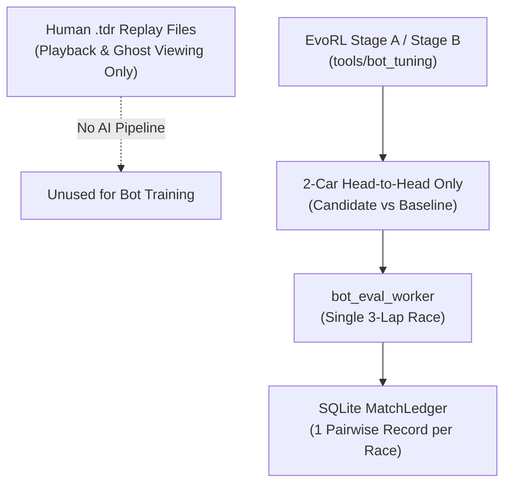
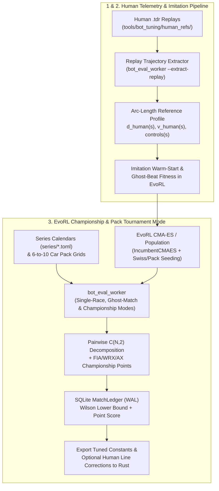

# Architecture Spec 132: EvoRL Human Driving Imitation, Telemetry Trajectory Extraction, and Multi-Car Championship Tuning 🧬🏎️🏆

Extends the offline **EvoRL** calibration architecture ([Spec 083](083_evorl_bot_driving_style_and_performance_optimization.md)) with three unified capabilities:
1. **Human `.tdr` Replay Trajectory & Speed-Profile Extraction**: Deterministically replays human `.tdr` recordings (`Replay` in `tdrace-app::replay`), projects the human vehicle trajectory and control inputs onto circuit arc-length $s \in [0, L]$, and exports a **Human Reference Profile** ($d_{\text{human}}(s), v_{\text{human}}(s), \text{steer}(s), \text{throttle}(s), \text{brake}(s)$) that bots can either track directly as a learned spline overlay or use as an evaluation target.
2. **EvoRL Human Imitation & Ghost-Beat Tuning**: Extends `bot_eval_worker` and `tools/bot_tuning` so EvoRL CMA-ES (`IncumbentCMAES`) can optimize bot controller genomes against recorded human `.tdr` reference laps — both via **Trajectory/Control Matching Loss** (imitation warm-start) and **Direct Ghost Head-to-Head** (evolving `T4+`/`T5+` profiles to match or beat human sector and lap times without spinning or wall contact).
3. **Multi-Car Pack & Championship Tournament Mode in EvoRL**: Upgrades `bot_eval_worker` and the EvoRL `BatchEvaluator` harness from 2-car pairwise races to **full 6-to-10 car pack heats and multi-round championship series** (FIA points matrices, World RX 6-car heat/semifinal/final brackets from [Spec 128](128_world_rx_superpole_6_car_2_2_2_grids_overall_heat_time_classification_and_three_stage_scoring.md), and FIA Autocross 10-car knockout formats from [Spec 130](130_fia_european_autocross_10_car_3_2_3_2_grids_timed_qualifying_practice_30_driver_knockout_format_two_phase_scoring_and_expanded_season_calendars.md)), decomposing multi-car finishing orders into $\binom{N}{2}$ pairwise `MatchLedger` records and normalized championship point scores.

All tuning tools run offline (locally or on the `blaze` compute node); baked parameters and reference tables ship as pure, zero-dependency Rust constants in `race-kit` and `arcade-race-core`.

---

## 🔍 Context & Motivation

1. **Geometric Optimal Lines Miss Surface & Dynamic Nuances**:
   - [Spec 110](110_mathematically_ideal_racing_line_visual_aid.md) and [Spec 131](131_error_free_t4_and_t5_bot_tiers_optimal_racing_line_trajectory_following_and_maximum_pace_controller_unchoking.md) equip `BotAiDriver` with the minimum-curvature [`OptimalRacingLine`](../crates/arcade-race-core/src/track/optimal_line.rs). While geometric minimum curvature is strong on homogeneous tarmac, skilled human drivers take different lines on mixed-surface rallycross transitions, banked turns, jump take-off ramps, and linkedhairpin complexes where weight transfer and pendulum sliding dominate.
   - TDRace already records deterministic 60/120 Hz `.tdr` replay files ([`crates/tdrace-app/src/replay/mod.rs`](../crates/tdrace-app/src/replay/mod.rs)), yet there is no pipeline to extract a human driver's spatial racing line and speed profile or use it to teach bots.
2. **Pairwise 2-Car Evaluation Ignores Pack Traffic & Tournament Formats**:
   - Spec 083 tunes `Stage A` and `Stage B` exclusively in 2-car head-to-head races. A candidate genome that is fast in clean air can get boxed in on a 6-car Rallycross staggered chute ([Spec 128](128_world_rx_superpole_6_car_2_2_2_grids_overall_heat_time_classification_and_three_stage_scoring.md)), punt opponents in a 10-car Autocross launch ([Spec 130](130_fia_european_autocross_10_car_3_2_3_2_grids_timed_qualifying_practice_30_driver_knockout_format_two_phase_scoring_and_expanded_season_calendars.md)), or fail to draft and defend in an 8-car GT/NASCAR pack.
3. **Sample Efficiency of Multi-Agent Tournament Evaluation**:
   - Running an $N$-car pack heat ($N \in [6, 10]$) yields $\binom{N}{2}$ pairwise comparisons from a single simulation rollout, increasing evolutionary signal for pack racecraft, overtake completion, and incident avoidance while directly optimizing championship points across multi-circuit calendars (`series/*.toml`).

---

## 🗺️ Current vs. Proposed System Architecture

### 1. Current Architecture


### 2. Proposed Architecture


---

## 📐 Detailed Technical Design

### 1. Human `.tdr` Replay Trajectory & Speed-Profile Extraction

#### A. Deterministic Replay Rollout & Arc-Length Projection
Add a replay analysis module in `crates/tdrace-app/src/ai/replay_extractor.rs` (invocable via `bot_eval_worker` and a CLI flag `--extract-replay <path.tdr>`):
1. **Full State Reconstruction**:
   - Load the `.tdr` `Replay` file (`Replay::load_from_file`), resolve the `Track` and `CarConfig` from `header.track_choice` and `header.car_choice`, and step the car deterministically through `header.frames` at `header.fixed_dt` (verifying periodic `ReplayKeyframe` alignment within $< 10^{-3}\text{ m}$).
2. **Best-Lap Selection & Uniform Arc-Length Resampling**:
   - Identify all completed flying laps (or the single cleanest fastest lap matching `header.best_lap_time`).
   - Project each physics tick $(x_t, y_t, \vec{v}_t, \theta_t, u_t)$ onto the circuit centerline spline (`TrackSpline::project_point`), recording:
     - Arc-length station $s \in [0, L)$ at uniform $\Delta s = 2.0\text{ m}$ intervals (`N = ceil(L / 2.0)` samples, matching `OptimalRacingLine` resolution).
     - Signed lateral offset from centerline $d_{\text{human}}(s) \in [-w_{\text{half}}, +w_{\text{half}}]$.
     - Effective path curvature $\kappa_{\text{human}}(s)$ computed from the human world-space trajectory $(x(s), y(s))$.
     - Tangential speed $v_{\text{human}}(s)$ (`m/s`), body sideslip angle $\beta_{\text{human}}(s)$, and control channels $(\text{steer}(s), \text{throttle}(s), \text{brake}(s), \text{handbrake}(s))$.
   - Output a strongly-typed `HumanReferenceLap` JSON structure:
     ```rust
     #[derive(Debug, Clone, Serialize, Deserialize)]
     pub struct HumanReferenceSample {
         pub arc_s: f32,
         pub lateral_offset_m: f32,
         pub curvature: f32,
         pub speed_mps: f32,
         pub sideslip_rad: f32,
         pub steer: f32,
         pub throttle: f32,
         pub brake: f32,
     }

     #[derive(Debug, Clone, Serialize, Deserialize)]
     pub struct HumanReferenceLap {
         pub circuit_id: String,
         pub car_id: String,
         pub lap_time_s: f32,
         pub sector_times_s: Vec<f32>,
         pub sample_step_m: f32,
         pub samples: Vec<HumanReferenceSample>,
     }
     ```

#### B. Human-vs-Bot Corner Diagnostic Diff (`bot_eval_worker` `human_diff` Request)
- When given a `HumanReferenceLap`, `bot_eval_worker` runs a solo `T4+` or `T5+` bot on the same `(circuit_id, car_id)` and computes per-sector and per-corner deltas:
  - `lap_time_delta_s = bot_best_lap - human_lap_time_s`
  - `line_rmse_m`: Root-mean-square lateral offset deviation $\sqrt{\frac{1}{N}\sum (d_{\text{bot}}(s_i) - d_{\text{human}}(s_i))^2}$
  - `speed_rmse_mps`: Root-mean-square speed deviation $\sqrt{\frac{1}{N}\sum (v_{\text{bot}}(s_i) - v_{\text{human}}(s_i))^2}$
  - `braking_point_delta_m`: Mean shift in brake initiation station across corners.

---

### 2. EvoRL Human Imitation Warm-Start & Ghost-Beat Optimization

#### A.Extended Genome Parameters for Trajectory & Cornering Fidelity
In addition to the 5 Stage A controller parameters (`lookahead_time`, `steering_kp`, `steering_kd`, `brake_margin`, `speed_mult`), expose optional advanced controller genes in `GenomeOverrides` (`bot_eval_worker.rs` and `BotProfile`):
| Parameter | Meaning | Search Box | Default |
| :--- | :--- | :--- | :--- |
| `opt_line_blend` | Adherence weight between centerline and `OptimalRacingLine` / reference line | `0.50 – 1.00` | Tier-default |
| `curb_cut_m` | Inside apex curb cut allowance on wide corners (`m`) | `0.00 – 1.25` | `0.85` (`T4+`) |
| `exit_throttle_floor` | Minimum post-apex traction throttle floor under steering lock | `0.35 – 0.92` | `0.78` (`T4+`) |
| `trail_brake_decay` | Brake bleed rate as steering angle builds into corner entry | `0.00 – 0.65` | `0.25` |

#### B. Dual Human-Guided EvoRL Modes (`tools/bot_tuning/human_imitation.py`)
1. **Phase 1 — Imitation Warm-Start (`mode = "imitation"`)**:
   - Evaluates candidate genomes in solo 3-lap time trials against one or more `HumanReferenceLap` files in `tools/bot_tuning/human_refs/`.
   - **Imitation Fitness Score**:
     $$\mathcal{F}_{\text{imit}} = -\left(w_{\text{time}} \cdot \frac{\max(0, T_{\text{bot}} - T_{\text{human}})}{T_{\text{human}}} + w_{\text{line}} \cdot \text{RMSE}_d + w_{\text{vel}} \cdot \text{RMSE}_v + w_{\text{disq}} \cdot \mathbb{I}_{\text{spin/wall}}\right)$$
   - Produces an imitation-fitted genome $g_{\text{human}}^*$ that replicates the human's corner entry speeds, apex clipping, and exit acceleration.
2. **Phase 2 — Ghost-Beat Head-to-Head (`mode = "ghost_beat"`)**:
   - Initializes `IncumbentCMAES` at $x_0 = g_{\text{human}}^*$ (or current `T4+`/`T5+` baseline) and scores each rollout as an EvoRL `MatchRecord` (`WIN` if $T_{\text{bot}} < T_{\text{human}}$ with 0 spins and $\le 1$ wall contact, `DRAW` if within $\pm 0.25\%$, `LOSS` otherwise, plus continuous relative speed gain `(T_human - T_bot) / T_human`).

---

### 3. Multi-Car Pack & Championship Mode in EvoRL

#### A. Championship & Multi-Agent Pack Protocol in `bot_eval_worker`
Extend `bot_eval_worker` (`crates/tdrace-app/src/bin/bot_eval_worker.rs`) to accept a `"mode": "championship"` (or multi-candidate `"pack"`) JSON request:
```json
{
  "mode": "championship",
  "series_format": "fia_points",
  "rounds": [
    {"circuit": "gt/spa_francorchamps", "car": "gt3_porsche_911", "laps": 3},
    {"circuit": "gt/monza", "car": "gt3_porsche_911", "laps": 3},
    {"circuit": "gt/brands_hatch", "car": "gt3_porsche_911", "laps": 3}
  ],
  "seed": 42,
  "entrants": [
    {"id": "cand_0", "style": "balanced", "tier": 4, "genome": {"lookahead_time": 0.34}},
    {"id": "cand_1", "style": "aggressive", "tier": 4, "genome": {"lookahead_time": 0.29}},
    {"id": "base_smooth", "style": "smooth", "tier": 4},
    {"id": "base_tenacious", "style": "tenacious", "tier": 4},
    {"id": "base_calculating", "style": "calculating", "tier": 4},
    {"id": "base_bold", "style": "bold", "tier": 4}
  ]
}
```
Supported `series_format` rulesets:
1. **`"fia_points"` (Standard Multi-Round Pack Series)**:
   - Runs an $N$-car grid ($N \in [4, 10]$) across the specified `rounds` calendar.
   - To eliminate starting-grid bias (Common Random Numbers parity), each round can optionally run a **reverse-grid heat pair** (Heat 1 in seeded order, Heat 2 in reversed grid order with the same physics seed).
   - Awards standard FIA points (`[25, 18, 15, 12, 10, 8, 6, 4, 2, 1]`) per race and aggregates total championship standings, wins, podiums, spins, wall contacts, and pack racecraft telemetry.
2. **`"world_rx"` (6-Car World RX Knockout Format — Spec 128)**:
   - Simulates 6-car 2-2-2 staggered launch chute heats, intermediate time classification, and a 6-car Final on Rallycross circuits.
3. **`"fia_autocross"` (10-Car FIA Autocross Format — Spec 130)**:
   - Simulates 10-car 3-2-3-2 launch chute heats and Final classification on Autocross circuits.

#### B. Pairwise $\binom{N}{2}$ Decomposition & Ledger Integration (`tools/bot_tuning/championship.py`)
In `tools/bot_tuning/championship.py` (building on [`tools/bot_tuning/run_campaign.py`](../tools/bot_tuning/run_campaign.py)):
- When an $N$-entrant pack race or multi-round championship completes, the harness records two complementary signals into EvoRL's `MatchLedger`:
  1. **All-Pairs Head-to-Head Decomposition**: For every pair of entrants $(i, j)$ in the heat/championship, emit a `MatchRecord` where `subject = entrant[i]`, `opponent = entrant[j]`:
     - `Outcome.WIN` if entrant $i$ scored strictly more championship points (or finished ahead with fewer disqualifying incidents) than entrant $j$.
     - `Outcome.DRAW` if tied on points and clean finish status.
     - `Outcome.LOSS` if behind or disqualified by excessive spins / stuck time ($> 10\text{ s}$).
  2. **Normalized Championship Points & Pack Telemetry**:
     - Store `points_share = entrant_points / max_possible_points` in `MatchRecord.score` and record pack metrics (`passes_made`, `passes_conceded`, `wall_contacts`, `spins`, `disqualified`) in `MatchRecord.metrics`.
- **Population Tournament Orchestration**:
  - Within each CMA-ES generation (e.g., population $P = 12$ or $16$), candidates are grouped into balanced heats of $4\text{–}8$ cars alongside fixed reference bots (`T4` / `T4+` across styles), rotated via Swiss or Latin-square heat assignment so every candidate faces equal grid slots and rival styles.

---

## 🗄️ Database & Storage Migration Plan

- **Zero Game Database Changes**: No changes to `tdrace_records.db` schemas or player profile tables.
- **Offline Tuning Artifacts**:
  - Human reference laps are stored as compact JSON/`.tdr` fixtures under `tools/bot_tuning/human_refs/`.
  - EvoRL campaign SQLite ledgers (`MatchLedger` in WAL mode) remain git-ignored under `tools/bot_tuning/runs/`.

---

## 🔑 Security, Compliance, & IAM Roles

- **Zero New Dependencies in Shipped Crates**: `wheelbase`, `arcade-race-core`, `race-kit`, and `tdrace-app` add zero external Cargo dependencies, strictly honoring `specs/constitution/TECH_STACK.md`.
- **Safe Worker Input Parsing**: `bot_eval_worker` validates all `.tdr` headers, clamps all genome parameters to safe physical bounds, and returns structured JSON `error` strings without panicking on malformed requests.

---

## 🛡️ Disaster Recovery, Monitoring, & Fallbacks

- **Backwards-Compatible Worker Protocol**: Existing `bot_eval_worker` single-race requests (without `"mode"`) execute the exact Spec 083 codepath with bit-identical `controls_hash` determinism.
- **Fallback When No Human Replay Exists**: If a circuit has no recorded `HumanReferenceLap`, `BotAiDriver` seamlessly uses the precomputed `OptimalRacingLine` ([Spec 110](110_mathematically_ideal_racing_line_visual_aid.md) / [Spec 131](131_error_free_t4_and_t5_bot_tiers_optimal_racing_line_trajectory_following_and_maximum_pace_controller_unchoking.md)).

---

## 🧪 Verification & Acceptance Criteria

### Automated Tests
```bash
cargo test -p tdrace-app --release --test replay_trajectory_extraction_tests
cargo test -p tdrace-app --release --test bot_eval_championship_tests
.venv/bin/pytest tests/python/test_bot_tuning_championship.py
```

### Manual Acceptance Criteria (Pseudo-Gherkin)

- **Scenario: Deterministic human replay trajectory and speed profile extraction**
  - [ ] **Given** a valid `.tdr` replay file recorded on an official circuit
  - [ ] **When** the replay trajectory extractor rolls out the replay and projects it onto the circuit spline
  - [ ] **Then** the reconstructed trajectory matches all recorded `ReplayKeyframe` positions within `0.01 m`
  - [ ] **And** it outputs a `HumanReferenceLap` with uniform arc-length samples containing lateral offset, curvature, speed, and control inputs.

- **Scenario: Human-vs-bot telemetry comparison and imitation fitness scoring**
  - [ ] **Given** a `HumanReferenceLap` and a `human_diff` request to `bot_eval_worker`
  - [ ] **When** `bot_eval_worker` evaluates a candidate bot genome on the same circuit and car
  - [ ] **Then** the worker returns `lap_time_delta_s`, `line_rmse_m`, `speed_rmse_mps`, and per-sector time deltas without error
  - [ ] **And** a genome tuned with imitation warm-start achieves a lower `line_rmse_m` and `speed_rmse_mps` against the reference trajectory than the untuned baseline.

- **Scenario: Multi-car championship mode in `bot_eval_worker` with reverse-grid parity**
  - [ ] **Given** a `"mode": "championship"` request with 6 entrants across a 3-round circuit calendar and `reverse_grid: true`
  - [ ] **When** `bot_eval_worker` executes the championship series
  - [ ] **Then** each round runs both the seeded grid order and the reversed grid order deterministically
  - [ ] **And** the response returns per-entrant total championship points, round finishes, mean flying laps, spins, and wall contacts.

- **Scenario: Pairwise decomposition of pack races into EvoRL `MatchLedger`**
  - [ ] **Given** an $N$-car championship pack evaluation in `tools/bot_tuning/championship.py`
  - [ ] **When** the results are committed to the EvoRL `MatchLedger`
  - [ ] **Then** all $\binom{N}{2}$ pairwise head-to-head `MatchRecord` entries are recorded with valid `WIN`/`DRAW`/`LOSS` outcomes and normalized championship point scores
  - [ ] **And** `ledger.fitness` computes a valid `wilson_lower` ranking across all candidate genomes.

---

## 🔗 Traceability & Codebase Mapping

### Created/Modified Files
- `[ ]` `crates/tdrace-app/src/ai/replay_extractor.rs` -> Reconstructs `.tdr` replays and extracts arc-length `HumanReferenceLap` profiles and bot-vs-human telemetry diffs.
- `[ ]` `crates/tdrace-app/src/bin/bot_eval_worker.rs` -> Adds `"extract_replay"`, `"human_diff"`, `"ghost_beat"`, and `"championship"` modes to the JSON-lines worker protocol.
- `[ ]` `tools/bot_tuning/human_imitation.py` -> Implements EvoRL imitation warm-start and ghost-beat CMA-ES optimization against `.tdr` reference laps.
- `[ ]` `tools/bot_tuning/championship.py` -> Implements multi-car pack heat scheduling, multi-round championship evaluation, and $\binom{N}{2}$ pairwise `MatchLedger` decomposition.
- `[ ]` `crates/tdrace-app/tests/replay_trajectory_extraction_tests.rs` -> Integration tests for `.tdr` extraction and `human_diff` evaluation.
- `[ ]` `crates/tdrace-app/tests/bot_eval_championship_tests.rs` -> Integration tests for multi-car championship evaluation in `bot_eval_worker`.

### Verification Assertions
- All new Rust modules and Python tuning scripts reference `specs/132_evorl_human_driving_imitation_telemetry_trajectory_extraction_and_multi_car_championship_tuning.md`.
