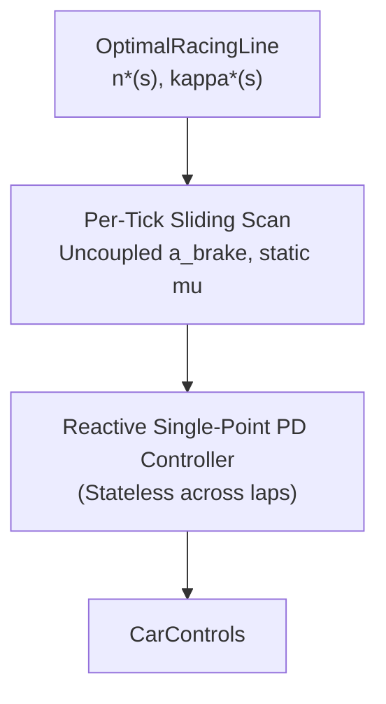

# Architecture Spec 133: Physics-Exact QSS Velocity Solver, Online Sector Grip Memory, and Short-Horizon Rollout Bot Controller 🧠🏎️⚡

Upgrades the deterministic in-game bot controller (`race_kit::ai::BotAiDriver` in [`crates/race-kit/src/ai/mod.rs`](../crates/race-kit/src/ai/mod.rs)) with three physics-driven, zero-EvoRL algorithmic enhancements that directly raise single-lap speed, surface adaptability, and obstacle/pack agility while preserving strict 60 Hz / 120 Hz fixed-timestep determinism and zero per-tick heap allocations:

1. **Forward-Backward Quasi-Steady-State (QSS) Friction-Circle Velocity Profile Solver**:
   Replaces the local heuristic braking scan with a precomputed arc-length velocity profile $v^*(s)$ solved via a 3-pass forward-backward solver along the [`OptimalRacingLine`](110_mathematically_ideal_racing_line_visual_aid.md), respecting the vehicle's combined lateral-longitudinal friction circle (GG diagram), aerodynamic downforce, surface friction $\mu(s)$, banking, and longitudinal grade.
2. **Online Per-Sector Adaptive Grip Memory (Intra-Race Learning)**:
   Equips `BotAiDriver` with a fixed-size stack array (`[f32; 32]`) mapping track arc-length sectors to learned grip multipliers. When a bot experiences excessive understeer, wheelspin, or an off-track excursion in sector $k$ on Lap $n$, it automatically trims its sector $k$ entry speed on Lap $n+1$; when a high-tier bot clears sector $k$ with spare lateral margin, it progressively nudges sector $k$ pace upward.
3. **Zero-Allocation Short-Horizon Rollout Planner (Discrete MPPI / MPC) for Elite Tiers & Hazards**:
   Leverages `wheelbase`'s 4M+ steps/sec throughput and `Clone`-able vehicle state to run a lightweight 5-candidate forward rollout ($H = 0.6\text{ s}$ horizon, sub-stepped at $\Delta t_{\text{roll}} = 1/30\text{ s}$ every 4 ticks) for `T4+`/`T5`/`T5+` bots when navigating complex corners, close pack traffic, or jump/runoff hazards.

---

## 🔍 Context & Motivation

1. **Pointwise Lookahead Scans Cannot Solve Linked Corners or Trail-Braking**:
   - Even with `OptimalRacingLine` curvature $\kappa^*(s)$ ([Spec 131](131_error_free_t4_and_t5_bot_tiers_optimal_racing_line_trajectory_following_and_maximum_pace_controller_unchoking.md)), `BotAiDriver` currently estimates target speed using a pointwise sliding lookahead loop (`s_idx in 0..=num_scan_samples`) with an uncoupled longitudinal deceleration rule $v_{\text{allow}} = \sqrt{v_{\text{corner}}^2 + 2 a_{\text{brake}} d}$.
   - In linked S-curves, decreasing-radius turns, or corners preceded by high-speed aero zones or gravel patches, a pointwise scan either brakes too late (because it assumes full longitudinal braking while the tires are already saturated laterally in the entry curve) or brakes too early.
   - In real motorsport engineering, optimal speed profiles are computed via a **Forward-Backward Quasi-Steady-State (QSS) GG-Diagram Solver**:
     1. *Apex Pass*: $v_{\text{lat}}(s) = \sqrt{\frac{\mu(s) \, g_{\text{eff}}(s, v)}{|\kappa^*(s)|}}$
     2. *Backward Braking Integration*: $v(s_i) \le \sqrt{v(s_{i+1})^2 + 2 \, a_{x,\text{brake}}(s_i, v, a_y) \, \Delta s}$
     3. *Forward Traction Integration*: $v(s_{i+1}) \le \sqrt{v(s_i)^2 + 2 \, a_{x,\text{accel}}(s_i, v, a_y) \, \Delta s}$
2. **Bots Repeat the Exact Same Surface/Corner Mistake Every Lap**:
   - Currently, `BotAiDriver` is stateless across laps with respect to corner grip. If an off-camber dirt transition or hairpin causes a bot to slide wide on Lap 1, it enters at the exact same speed on Laps 2 and 3. Human drivers immediately adapt their braking point on the next lap.
3. **Reactive PD Steering Struggles in Compound Hazards & Multi-Car Chicanes**:
   - A single-point lookahead PD controller only sees one target point at `target_dist`. By evaluating 5 short-horizon candidate control trajectories through the actual vehicle physics model (`BotVehicle::step_rollout_preview`), elite bots can foresee whether an aggressive inside pass or late brake will hold the road 0.6 seconds later.

---

## 🗺️ Current vs. Proposed System Architecture

### 1. Current Architecture


### 2. Proposed Architecture
```mermaid
flowchart TD
    OPT["OptimalRacingLine (Spec 110)<br/>+ Surface mu(s) & Banking/Grade"] --> QSS["3-Pass Forward-Backward QSS Solver<br/>(Cached VelocityProfile v*(s) & ax*(s))"]
    MEM["32-Sector Adaptive Grip Memory<br/>sector_grip_scale: [f32; 32]<br/>(Updates on slip/off-track/clean apex)"] --> QSS_MOD["Lap-Adapted Target Speed<br/>v_target(s) = v*(s) * sqrt(sector_grip[k])"]
    QSS --> QSS_MOD
    QSS_MOD --> BASE["Base Feedforward + PD Controller<br/>(u_nom = steer, throttle, brake)"]
    BASE --> GATE{"Elite Tier (T4+/T5/T5+)<br/>or High Threat / Hazard?"}
    GATE -->|No (T1..T4 Nominal)| CTRL["CarControls"]
    GATE -->|Yes (Every 4 ticks)| MPC["Zero-Alloc 5-Candidate Rollout Planner<br/>(H = 0.6 s, dt = 1/30 s)<br/>Selects min-cost safe trajectory"]
    MPC --> CTRL
```

---

## 📐 Detailed Technical Design

### 1. Forward-Backward QSS Friction-Circle Velocity Profile Solver

Create `crates/race-kit/src/ai/velocity_profile.rs` containing `SolvedVelocityProfile`:

```rust
#[derive(Debug, Clone)]
pub struct SolvedVelocityProfile {
    pub sample_step_m: f32,
    pub total_length_m: f32,
    pub is_closed: bool,
    /// Maximum feasible speed (m/s) at each arc-length station s_i.
    pub target_speed_mps: Vec<f32>,
    /// Feedforward longitudinal acceleration (m/s²; negative = braking) at each station s_i.
    pub longitudinal_accel_mps2: Vec<f32>,
}
```

#### A. 3-Pass Friction-Circle (GG-Diagram) Algorithm
Computed **once** when `BotAiDriver` caches `OptimalRacingLine` for a `(Track, BotVehicle)` pair (taking $< 0.4\text{ ms}$ for a $3\text{ km}$ track at $\Delta s = 2.0\text{ m}$):

1. **Pass 1 — Local Lateral Grip & Surface Envelope (`v_max_lat[i]`)**:
   - At each station $s_i$ along the optimal line world position $P^*(s_i)$:
     - Query the local road surface friction multiplier $\mu_{\text{surf}}(s_i)$ (`track.surface_at(P^*(s_i)).grip_multiplier()`), banking angle $\phi(s_i)$, and longitudinal grade $\theta_{\text{grade}}(s_i)$.
     - Compute effective lateral grip $\mu_{\text{lat}}(s_i) = \mu_{\text{car}} \cdot \mu_{\text{surf}}(s_i) + \tan \phi(s_i)$.
     - Solve the lateral equilibrium speed with aerodynamic downforce (`car.downforce_grip_factor(v)` via 2 fixed-point iterations):
       $$v_{\text{lat}}(s_i) = \min\left(v_{\text{top}},\ \sqrt{\frac{\mu_{\text{lat}}(s_i) \cdot g \cdot \text{df}(v)}{\max(|\kappa^*(s_i)|, 10^{-4})}}\right)$$
     - For jump ramps along $s_i$, cap $v_{\text{lat}}(s_i)$ to the safe landing speed envelope when a gap trap or sharp turn immediately follows the landing zone.

2. **Pass 2 — Backward Braking Integration (2 Circular Sweeps for Closed Loops)**:
   - Sweep backward from $i = N - 1$ down to $0$ (run twice with wrap-around for closed circuits so braking into Turn 1 across the start/finish line is seamless):
     - Compute lateral acceleration demand at $s_{i+1}$: $a_y = v[i+1]^2 \cdot |\kappa^*(s_{i+1})|$.
     - Compute available longitudinal deceleration on the **friction ellipse**:
       $$a_{y,\text{max}} = \mu_{\text{lat}}(s_i) \cdot g \cdot \text{df}(v[i+1]), \qquad \text{lat\_share} = \text{clamp}\left(\frac{a_y}{a_{y,\text{max}}}, 0.0, 0.92\right)$$
       $$a_{x,\text{brake}} = a_{\text{brake,max}} \cdot \mu_{\text{surf}}(s_i) \cdot \sqrt{1.0 - \text{lat\_share}^2} + g \sin\theta_{\text{grade}}(s_i)$$
     - Enforce backward kinematic feasibility:
       $$v[i] = \min\left(v[i],\ \sqrt{v[i+1]^2 + 2 \cdot \max(a_{x,\text{brake}}, 1.5) \cdot \Delta s}\right)$$

3. **Pass 3 — Forward Acceleration Integration (2 Circular Sweeps)**:
   - Sweep forward from $i = 0$ to $N - 1$:
     - Using the friction ellipse with longitudinal traction limit $a_{\text{accel,max}}(v)$, enforce:
       $$v[i+1] = \min\left(v[i+1],\ \sqrt{v[i]^2 + 2 \cdot \max(a_{x,\text{accel}}, 0.5) \cdot \Delta s}\right)$$
     - Record feedforward longitudinal acceleration $a_x^*(s_i) = \frac{v[i+1]^2 - v[i]^2}{2 \Delta s}$.

#### B. Feedforward Trail-Braking & Throttle Integration in `BotAiDriver`
- During `compute_controls`, `BotAiDriver` queries `SolvedVelocityProfile::sample(car_s)` in $O(1)$ time, scaling $v^*(s)$ by `profile.speed_factor` and the active sector grip memory multiplier.
- When $a_x^*(s)$ is negative (braking zone), `BotAiDriver` blends feedforward braking demand with velocity-error feedback, naturally producing smooth **trail-braking** as $|\kappa^*(s)|$ rises toward the apex and immediate throttle transition as $a_x^*(s)$ turns positive at the apex.

---

### 2. Online Per-Sector Adaptive Grip Memory

Add a zero-allocation fixed-size memory struct to `BotAiDriver`:

```rust
pub const NUM_GRIP_SECTORS: usize = 32;

#[derive(Debug, Clone, Copy)]
pub struct SectorGripMemory {
    /// Per-sector speed/grip multiplier in [0.82, 1.06], initialized to 1.0.
    pub sector_scale: [f32; NUM_GRIP_SECTORS],
    pub active_sector: usize,
    pub sector_had_offtrack: bool,
    pub sector_had_wall_hit: bool,
    pub sector_peak_slip_ratio: f32,
    pub sector_max_lat_err_m: f32,
}
```

#### Update Rules on Sector Boundary Crossing (`sector_idx = ((s / L) * 32.0) as usize % 32`):
When the bot advances from `prev_sector` to `new_sector`:
1. **Penalty on Excursion or Impact**:
   - If `sector_had_wall_hit` is `true`: multiply `sector_scale[prev_sector]` by `0.94` (clamped to `[0.82, 1.06]`).
   - Else if `sector_had_offtrack` is `true` or `sector_max_lat_err_m > half_width * 0.85`: multiply `sector_scale[prev_sector]` by `0.965`.
   - Also propagate `50%` of the trim to the *preceding* sector `(prev_sector + 31) % 32` when the excursion occurred in the first half of `prev_sector` (since entry overspeed originated in the braking zone just before the sector boundary).
2. **Confidence Push on Clean High-Margin Execution (`T3`..`T5+` only)**:
   - If `sector_had_offtrack == false`, `sector_had_wall_hit == false`, and `sector_max_lat_err_m < half_width * 0.45`:
   - Nudge `sector_scale[prev_sector]` upward by `+0.008` (up to `1.04` for `T4`/`T5` and `1.06` for `T4+`/`T5+`).
3. **Tier Gating**:
   - Learning rate scales with tier competence (`0.25` for `Rookie`, `0.50` for `Amateur`, `0.80` for `Contender`, `1.00` for `Pro`/`ProPlus`/`Legend`/`LegendPlus`).

---

### 3. Zero-Allocation Short-Horizon Rollout Planner (Discrete MPC)

Create `crates/race-kit/src/ai/rollout_mpc.rs`:

1. **Lightweight Kinematic-Tire Rollout Proxy (`RolloutState`)**:
   - Add a `Copy` stack-allocated `RolloutCarProxy` (position, velocity, angle, angular_velocity, front/rear axle slip stiffness, mass, wheelbase, grip, brake/engine force) initialized from `BotVehicle` in `race-kit`.
   - Stepping `RolloutCarProxy` for $18$ sub-steps ($\Delta t = 1/30\text{ s}$, horizon $H = 0.60\text{ s}$) requires zero heap allocations and executes in $< 1.5\ \mu\text{s}$.
2. **5 Candidate Action Perturbations Around the Nominal Controller $(u_{\text{steer}}^0, u_{\text{long}}^0)$**:
   - **Candidate 0 (Nominal)**: Follows the QSS + OptimalRacingLine + PD command $(u_{\text{steer}}^0, u_{\text{long}}^0)$.
   - **Candidate 1 (Inside Apex / Tighter Line)**: Biases lateral target offset $-1.5\text{ m}$ (or $+0.18$ steer into apex) with nominal speed.
   - **Candidate 2 (Outside / Wide Entry or Overtake Line)**: Biases lateral target offset $+1.5\text{ m}$ with nominal speed.
   - **Candidate 3 (Early Trail-Brake Safety)**: Applies $+0.30$ additional braking over the first $0.25\text{ s}$ while tracking the optimal line.
   - **Candidate 4 (Maximum Exit Attack)**: Applies $+0.25$ earlier throttle ramp and counter-steer stabilization.
3. **Rollout Cost Function**:
   Each candidate trajectory $\tau_k$ is scored over the $H = 0.60\text{ s}$ horizon:
   $$J(\tau_k) = -\Delta s(\tau_k) + w_{\text{line}} \cdot d_{\text{err}}(H)^2 + w_{\text{slip}} \cdot \max(0, |\beta_{\max}| - \beta_{\text{safe}})^2 + w_{\text{off}} \cdot \mathbb{I}_{\text{off-road}} + w_{\text{wall}} \cdot \mathbb{I}_{\text{wall/car collision}}$$
   - Nearby opponents within $22\text{ m}$ are projected forward along their constant-velocity + tangent vector over $[0, H]$ so candidates that would collide with a car ahead or alongside receive a high collision penalty $w_{\text{wall}}$.
   - **Tie-Breaking & Stability**: Candidate 0 (Nominal) receives a small hysteresis bonus ($\epsilon = 0.05\text{ m}$) so the bot only switches to Candidates 1–4 when they yield a clear progress or safety advantage, preventing control chatter.

---

## 🗄️ Database & Storage Migration Plan

- **Zero Database or Config Schema Changes**: All three systems operate purely in-memory inside `race-kit::ai::BotAiDriver`.

---

## 🔑 Security, Compliance, & IAM Roles

- **Zero External Dependencies**: Implemented strictly with `glam` and Rust `std` inside `crates/race-kit`, maintaining 100% `wasm32-unknown-unknown` compatibility and zero graphics/audio imports.

---

## 🛡️ Disaster Recovery, Monitoring, & Fallbacks

- **Strict Determinism**: All QSS passes, sector grip updates, and 5-candidate MPC rollouts are 100% deterministic functions of the vehicle and track state (`controls_hash` reproducible across runs).
- **Zero Per-Tick Heap Allocations**: `SolvedVelocityProfile` is allocated once on track load alongside `OptimalRacingLine`; `SectorGripMemory` and the 5-candidate MPC rollout buffers are fixed-size stack structs (`Copy`).

---

## 🧪 Verification & Acceptance Criteria

### Automated Tests
```bash
cargo test -p race-kit ai::velocity_profile
cargo test -p race-kit ai::rollout_mpc
cargo test -p tdrace-app --release --test bot_qss_and_mpc_tests
cargo test -p tdrace-app --release --test bot_tier_ladder_tests
```

### Manual Acceptance Criteria (Pseudo-Gherkin)

- **Scenario: Forward-backward QSS velocity profile respects the friction circle and surface grip**
  - [ ] **Given** a closed-loop circuit with mixed tarmac/gravel surfaces and varying corner radii
  - [ ] **When** `SolvedVelocityProfile::compute` runs for a `BotVehicle`
  - [ ] **Then** every station's target speed $v^*(s)$ satisfies the combined lateral-longitudinal friction circle bound
  - [ ] **And** braking initiation before a tight hairpin begins earlier on low-grip gravel than on high-grip tarmac.

- **Scenario: QSS velocity solver improves elite single-lap pace without increasing spin or off-track rates**
  - [ ] **Given** `T4+` and `T5+` bots racing 3-lap time trials across representative Classic, GT, Karting, Autocross, and Rallycross circuits
  - [ ] **When** the QSS velocity profile solver is enabled in `BotAiDriver`
  - [ ] **Then** mean flying lap times improve or hold parity compared to the heuristic scan with zero spins and zero DNFs
  - [ ] **And** the monotonic tier pace ladder (`T1 < T2 < T3 < T4 < T4+ < T5 < T5+`) continues to hold in `bot_tier_ladder_tests`.

- **Scenario: Online sector grip memory adapts after an off-track excursion or clean pass**
  - [ ] **Given** a `BotAiDriver` equipped with `SectorGripMemory`
  - [ ] **When** the bot experiences an off-track excursion or wall contact in sector $k$ on Lap 1
  - [ ] **Then** `sector_scale[k]` decreases for Lap 2 so the bot enters sector $k$ at a lower target speed
  - [ ] **And** when the bot completes sector $k$ cleanly within `45%` of track half-width, `sector_scale[k]` nudges upward within `[0.82, 1.06]`.

- **Scenario: Short-horizon 5-candidate rollout planner avoids obstacles and allocates nothing per tick**
  - [ ] **Given** a `T5+` bot approaching a slower or stationary opponent car blocking the optimal racing line in a corner entry zone
  - [ ] **When** the 5-candidate rollout planner evaluates the $0.60\text{ s}$ horizon
  - [ ] **Then** it selects an inside, outside, or early-brake candidate trajectory that avoids collision while maximizing arc-length progress
  - [ ] **And** executing `compute_controls` performs zero dynamic heap allocations per tick.

---

## 🔗 Traceability & Codebase Mapping

### Created/Modified Files
- `[ ]` `crates/race-kit/src/ai/velocity_profile.rs` -> Implements the 3-pass forward-backward QSS friction-circle velocity profile solver (`SolvedVelocityProfile`).
- `[ ]` `crates/race-kit/src/ai/rollout_mpc.rs` -> Implements `RolloutCarProxy` and the zero-allocation 5-candidate short-horizon rollout planner.
- `[ ]` `crates/race-kit/src/ai/mod.rs` -> Integrates `SolvedVelocityProfile`, `SectorGripMemory`, and `rollout_mpc` into `BotAiDriver::compute_controls`.
- `[ ]` `crates/tdrace-app/tests/bot_qss_and_mpc_tests.rs` -> Verifies QSS friction-circle bounds, sector grip adaptation across laps, MPC obstacle avoidance, and zero-allocation invariants.

### Verification Assertions
- `crates/race-kit/src/ai/velocity_profile.rs`, `crates/race-kit/src/ai/rollout_mpc.rs`, and `crates/race-kit/src/ai/mod.rs` reference `specs/133_physics_exact_qss_velocity_solver_online_sector_grip_memory_and_short_horizon_rollout_bot_controller.md`.
