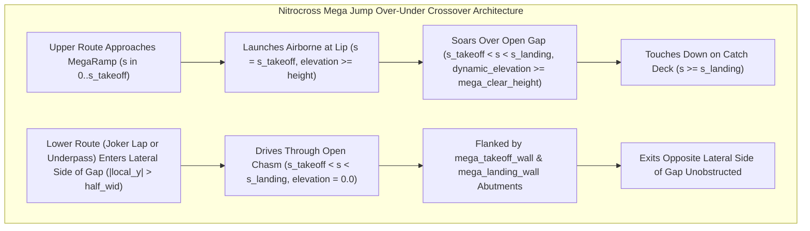

# Feature Spec: Nitrocross Circuit Pack and Mega Jump Over-Under Crossover Geometry 🌟🏁✈️

While FIA World Rallycross circuits (governed by FIA Appendix O) restrict jumps to self-contained dirt crests and tabletops along a single track corridor, North American **Nitrocross (Nitro RX)** courses—conceived by Travis Pastrana—are engineered around massive **70-to-130-foot gap jumps (`RampKind::MegaRamp`) that soar directly over an intersecting track lane or the Joker Lap detour**. Previously, `tdrace` included only a single Nitrocross venue (`erx_motor_park`) configured with standard planar ramps.

This specification introduces **5 new North American Nitrocross circuits** (`utah_umc_rx`, `wild_horse_pass_rx`, `glen_helen_rx`, `midamerica_outdoors_rx`, and `calgary_stampede_rx`), upgrades `erx_motor_park`, and establishes **Grade-Separated Mega Jump Over-Under Crossover Geometry** in `arcade-race-core` so that vehicles launching off a `RampKind::MegaRamp` fly airborne across the open gap directly above competitors driving along the intersecting Joker Lap (or main track underpass) below.

---

## 🗺️ User Flow & Interface Design



### 1. The 6-Circuit North American Nitrocross Roster (`tracks/rally/`)

Each circuit is calibrated at `1:1` scale with a 6-car Rallycross launch chute ([Spec 103](103_autocross_and_rallycross_launch_chutes_and_templated_track_components.md)), a branch-kit Joker Lap ([Spec 102](102_predefined_junction_components_for_road_splits_and_joker_loops.md)), a `RampKind::MegaRamp` crossover jump, and a secondary `RampKind::Ramp` kicker:

| # | Track Slug | Official Venue Name | Location | Primary Surface & Runoff | Signature Mega Jump Crossover Feature |
| :---: | :--- | :--- | :--- | :--- | :--- |
| 1 | **`utah_umc_rx`** | **Utah Motorsports Campus RX** | Grantsville, Utah, USA | `Dirt` / `Asphalt` (`DeepGravel` runoff) | **100+ ft Nitro Gap Jump** launching over the Joker Lap underpass lane, plus 30° banked "Talladega" asphalt turn (`way/38461281`). |
| 2 | **`erx_motor_park`** | **ERX Motor Park RX** | Elk River, Minnesota, USA | `Dirt` (`DeepGravel` runoff) | **70+ ft Stadium Tabletop Mega Jump** crossing over the clay bowl Joker detour, plus rolling rhythm whoops (`way/1023648273`). |
| 3 | **`wild_horse_pass_rx`** | **Wild Horse Pass Motorsports Park RX** | Chandler, Arizona, USA | `Dirt` / `Asphalt` (`PackedSand` runoff) | **Desert Over-Under Flyover Mega Jump** where the main straight leaps over the lower Joker switchback chute (`way/227645012`). |
| 4 | **`glen_helen_rx`** | **Glen Helen Raceway RX** | San Bernardino, California, USA | `Dirt` (`DeepGravel` runoff) | **Mt. St. Helens Elevation Drop & Step-Up Mega Jump** soaring across the canyon Joker loop (`way/134507638`). |
| 5 | **`midamerica_outdoors_rx`** | **MidAmerica Outdoors RX** | Jay, Oklahoma, USA | `Dirt` (`Grass` / `DeepGravel` runoff) | **Forested Red-Clay Tabletop Mega Jump** flying over the wooded Joker shortcut (`assets/osm/midamerica_outdoors_rx.osm`). |
| 6 | **`calgary_stampede_rx`** | **Calgary Stampede Park RX** | Calgary, Alberta, Canada | `PackedSnow` / `SheetIce` (`DeepSnow` runoff) | **"Nitrocross on Ice" Snow Kicker Mega Jump** launching studded-tire EVs over the icy Joker underpass (`way/35252855`). |

### 2. Grade-Separated Mega Jump Over-Under Crossover Geometry

To support a `RampKind::MegaRamp` crossing over a live track segment (the Joker Lap branch passing under the main track's `MegaRamp`, or the Joker Lap launching via a `MegaRamp` over the main track):

1. **Gap Corridor Sizing for Underpass Road**:
   - The `MegaRamp` is centered on the intersection `(x_cross, y_cross)` of the upper road and the lower road, oriented along the upper road's tangent `fwd`.
   - Its physical gap length $L_{\text{gap}} = (s_{\text{landing}} - s_{\text{takeoff}}) \cdot L_{\text{ramp}}$ is sized to span the full width of the lower road $W_{\text{lower}}$ plus lateral clearance margins:
     $$L_{\text{gap}} \ge W_{\text{lower}} + 2.0\text{ m} \quad (\text{typically } 14.0\text{ m} \le L_{\text{gap}} \le 18.0\text{ m},\; L_{\text{ramp}} \in [32.0\text{ m}, 44.0\text{ m}])$$
   - `mega_takeoff_wall` (at `s = s_takeoff`) and `mega_landing_wall` (at `s = s_landing`) sit outside the lower road's drivable edges, functioning both as the vertical bridge abutments for the upper jump ([Spec 124](124_mega_jump_dual_wall_gap_trap_and_minimum_gap_sizing.md)) and as the concrete side retaining walls flanking the lower underpass lane.
2. **Mutual Side-Wall Trimming at Mega Jump Underpasses**:
   - In [`crates/arcade-race-core/src/track/mod.rs`](../crates/arcade-race-core/src/track/mod.rs):
     - Main-track side walls (`inner_walls` and `outer_walls`) are automatically trimmed across the open gap `[s_takeoff, s_landing]` of any `MegaRamp` where the lower road passes laterally through the gap (`|local_y| > half_wid`), so cars on the lower road can drive straight through the chasm without hitting the upper road's side barriers.
     - Network branch walls (`geometry.network_walls`) along the lower road are trimmed across the upper road's corridor where they meet the `MegaRamp` footprint, connecting cleanly to the `mega_takeoff_wall` and `mega_landing_wall` abutments.
3. **Zero-Interference Physics & Validator Support**:
   - Grounded cars driving along the lower road inside `(s_takeoff, s_landing)` experience `surface_elevation_at == 0.0` and `surface_slope_angle_rad_at == 0.0`, and never trigger `try_trigger_jump_ramp` because their velocity vector is perpendicular to `ramp.direction` (`velocity.dot(ramp.direction) <= 3.5`).
   - Airborne cars launching off the upper road (`s = s_takeoff`, `is_airborne == true`, `elevation > 1.5 m`) pass above grounded cars on the lower road without car-to-car collision interference (vertical elevation separation $\Delta z \ge 1.5\text{ m}$).
   - Track validation (`validate_track` in [`crates/arcade-race-core/src/track/validation.rs`](../crates/arcade-race-core/src/track/validation.rs)) recognizes a `MegaRamp` gap crossover as a valid grade-separated over-under structure without emitting false-positive `ERR_WALL_CROSSES_TRACK` or `ERR_CROSSOVER_INSUFFICIENT_CLEARANCE` errors.

---

## ⚙️ Backend Models & API Endpoints

- **`crates/arcade-race-core/src/track/geometry.rs`**:
  - `JumpRamp::is_mega_gap_underpass_point(&self, point: Vec2, margin: f32) -> bool`: returns `true` when `self.kind == RampKind::MegaRamp` and `point` lies within the longitudinal gap `[x_takeoff_end + margin, x_landing_start - margin]`.
- **`crates/arcade-race-core/src/track/mod.rs`**:
  - `trim_main_walls_at_network_throats` and `generate_network_walls` respect `MegaRamp` gap underpasses so neither the upper road's side walls nor the lower road's side walls obstruct the crossing lane inside `[s_takeoff, s_landing]`.
- **`crates/arcade-race-core/src/track/validation.rs`**:
  - Permits network/main centerline crossovers that pass through the open gap `(s_takeoff, s_landing)` of a `RampKind::MegaRamp` whose gap width $L_{\text{gap}} \ge W_{\text{lower}}$.
- **`crates/tdrace-core/src/track/provenance.rs`**:
  - Adds verified OSM/geographic provenance metadata for `utah_umc_rx`, `wild_horse_pass_rx`, `glen_helen_rx`, `midamerica_outdoors_rx`, and `calgary_stampede_rx`.

---

## 🛡️ Security & Role-Based Access Controls (RBAC)

- **Zero Allocation on 60 Hz Physics Hot Path**: All `MegaRamp` underpass and elevation checks execute in $O(1)$ stack memory without heap allocations.
- **Backward Compatibility**: All 19 existing European/International World RX circuits and 20 Autocross circuits remain bit-for-bit compatible with existing validation rules.

---

## 🧪 Verification & Acceptance Criteria

### Automated Tests
- Run track geometry, validation, and Rallycross circuit test suites:
  ```bash
  cargo test -p arcade-race-core --lib track
  cargo test -p tdrace-app --test rally_tracks_tests
  ```

### Manual Acceptance Criteria (Pseudo-Gherkin)

- **Scenario: All 6 Nitrocross circuits load and pass track validation with zero errors**
  - [x] **Given** the official `rally` circuit catalog containing `utah_umc_rx`, `erx_motor_park`, `wild_horse_pass_rx`, `glen_helen_rx`, `midamerica_outdoors_rx`, and `calgary_stampede_rx`
  - [x] **When** `validate_track` is executed on each of the 6 circuits
  - [x] **Then** every circuit returns zero validation errors (`errors.is_empty()`), includes both `"main"` and `"joker"` layouts in `track.network`, includes a 6-car launch chute, and contains a `RampKind::MegaRamp` crossover jump

- **Scenario: Mega Jump over-under crossover allows simultaneous upper airborne flight and lower grounded traversal**
  - [x] **Given** a Nitrocross circuit where the upper route features a `RampKind::MegaRamp` whose gap `(s_takeoff, s_landing)` spans the intersecting lower route (Joker Lap or main underpass)
  - [x] **When** Car A traverses the upper route at launch speed (`>= 22 m/s`) while Car B traverses the lower route through the gap at ground level (`elevation == 0.0`)
  - [x] **Then** Car A launches airborne at `s = s_takeoff` (`is_airborne == true`, `dynamic_elevation() >= mega_clear_height()`), clears the crossing corridor above Car B, and lands on the catch deck at `s >= s_landing`, while Car B drives unobstructed through the open lateral sides of the gap between `mega_takeoff_wall` and `mega_landing_wall` without hitting any side wall or triggering a jump

- **Scenario: Calgary Stampede RX features authentic winter snow and ice surfaces**
  - [x] **Given** the `calgary_stampede_rx` circuit loaded from `tracks/rally/calgary_stampede_rx.json`
  - [x] **When** its default surface, surface zones, and runoff shoulders are inspected
  - [x] **Then** the circuit features `SurfaceType::PackedSnow` and `SurfaceType::SheetIce` racing sections with `SurfaceType::DeepSnow` runoff shoulders

---

## 🔗 Traceability & Codebase Mapping

### Created/Modified Files
- `[ ]` `tracks/rally/utah_umc_rx.json` -> New Utah Motorsports Campus RX circuit with 100+ ft `MegaRamp` crossover over the Joker Lap.
- `[ ]` `tracks/rally/wild_horse_pass_rx.json` -> New Wild Horse Pass Motorsports Park RX circuit with desert over-under `MegaRamp` crossover.
- `[ ]` `tracks/rally/glen_helen_rx.json` -> New Glen Helen Raceway RX circuit with elevation profile and step-up `MegaRamp` crossover.
- `[ ]` `tracks/rally/midamerica_outdoors_rx.json` -> New MidAmerica Outdoors RX circuit with forested red-clay `MegaRamp` crossover.
- `[ ]` `tracks/rally/calgary_stampede_rx.json` -> New Calgary Stampede Park RX ("Nitrocross on Ice") circuit with snow/ice surfaces and `MegaRamp` crossover.
- `[ ]` `tracks/rally/erx_motor_park.json` -> Upgraded with `RampKind::MegaRamp` over-under crossover geometry.
- `[ ]` `tracks/.track_order.json` -> Registers the 5 new Nitrocross circuit slugs in the `rally` catalog order.
- `[ ]` `crates/arcade-race-core/src/track/geometry.rs` -> Adds `MegaRamp` gap underpass helper and supports long-gap Nitrocross mega jumps.
- `[ ]` `crates/arcade-race-core/src/track/mod.rs` -> Trims main and branch side walls across `MegaRamp` underpass throats.
- `[ ]` `crates/arcade-race-core/src/track/validation.rs` -> Validates grade-separated `MegaRamp` gap crossovers.
- `[ ]` `crates/tdrace-core/src/track/provenance.rs` -> Registers provenance metadata for the 5 new Nitrocross circuits.
- `[ ]` `crates/tdrace-app/tests/rally_tracks_tests.rs` -> Adds automated validation and crossover trajectory tests for all 6 Nitrocross circuits.
- `[ ]` `specs/constitution/ROADMAP.md` -> Links Spec 134 under Phase 1 / Phase 6 milestones.

### Verification Assertions
- All 6 Nitrocross circuits in `tracks/rally/` reference their authentic venues and pass `rally_tracks_tests`.
