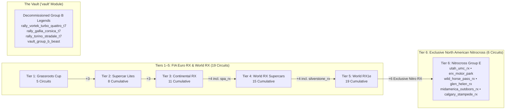

# Feature Spec: Rallycross Tier 6 Nitrocross Championship Isolation, World RX Tier 4-5 Realignment, and Tier 0 Group B Vault Archival 🏆🇺🇸🏛️

In [Spec 051](051_rallycross_6tier_career_progression_and_expanded_circuit_roster.md), the Rallycross (`"rallycross"`) career mode introduced a 6-tier progression alongside a standalone Tier 0 Group B Heritage Series. However, three structural issues remained:
1. **Diluted Tier 6 Identity**: Tier 6 (*Apex Group E Electric Trophy*, featuring 1,070 BHP FC1-X hyper-EVs) raced on 11 European FIA World RX circuits alongside `erx_motor_park`, diluting the high-flying stadium and gap-jump identity of North American **Nitrocross**.
2. **Stranded World RX Grand Prix Venues**: `spa_rx` (Circuit de Spa-Francorchamps RX) and `silverstone_rx` (Silverstone SpeedMachine RX) were locked until Tier 6 in the player profile progression, even though they are premier European FIA World RX venues referenced by the Tier 4 and Tier 5 World RX championships.
3. **Tier 0 Heritage Clutter**: The 3 1980s Group B rally monsters (`rally_vortek_turbo_quattro_t7`, `rally_gallia_corsica_t7`, `rally_torino_stradale_t7`, plus `group_b_beast`) and the `tier = 0` `rally_group_b_masters` championship sat outside the sanctioned 6-tier career ladder.

Building on the 6-circuit Nitrocross pack from [Spec 134](134_nitrocross_circuit_pack_and_mega_jump_over_under_crossover_geometry.md), this specification:
1. **Isolates Tier 6 into a 100% exclusive 6-round North American Nitrocross Championship** (`utah_umc_rx`, `erx_motor_park`, `wild_horse_pass_rx`, `glen_helen_rx`, `midamerica_outdoors_rx`, `calgary_stampede_rx`) with zero circuit overlap with Tiers 1–5.
2. **Realigns Tiers 1–5** across the 19 European/International FIA World RX & Euro RX circuits, moving `spa_rx` to unlock at **Tier 4** and `silverstone_rx` to unlock at **Tier 5**.
3. **Decommissions all Tier 0 / Group B vehicles into The Vault (`"vault"`)** per [Spec 057](057_vault_module_for_archived_and_deprecated_content.md) and retires `rally_group_b_masters` from active Rallycross career playlists.

---

## 🗺️ User Flow & Interface Design



### 1. Realigned 6-Tier Circuit Unlock Matrix (`25` Total Official Rallycross Circuits)

| Tier | Category / Championship | New Circuits Unlocked | Cumulative Total |
| :---: | :--- | :--- | :---: |
| **Tier 1** | **Rallycross Grassroots Cup** *(Junior FWD)* | • `holjes_rx` (Sweden)<br>• `lydden_hill` (UK)<br>• `mettet_rx` (Belgium)<br>• `dreux_rx` (France)<br>• `croft_rx` (UK) | **5** |
| **Tier 2** | **Supercar Lites Trophy** *(Spec AWD 310 BHP)* | • `lessay_rx` (France)<br>• `essay_rx` (France)<br>• `lavare_rx` (France) | **8** |
| **Tier 3** | **Continental RX Challenge** *(FIA Euro RX)* | • `kouvola_rx` (Finland)<br>• `montalegre_rx` (Portugal)<br>• `nyirad_rx` (Hungary) | **11** |
| **Tier 4** | **World Rallycross Supercar Trophy** *(600 BHP ICE)* | • `estering_rx` (Germany)<br>• `hell_rx` (Norway)<br>• `loheac_rx` (France)<br>• **`spa_rx`** *(Belgium — moved from Tier 6)* | **15** |
| **Tier 5** | **RX1e Electric Championship** *(680 BHP Twin-EV)* | • `riga_rx` (Latvia)<br>• `killarney_rx` (South Africa)<br>• `catalunya_rx` (Spain)<br>• **`silverstone_rx`** *(UK — moved from Tier 6)* | **19** |
| **Tier 6** | **Nitrocross Group E Championship** *(1,070 BHP Mega Jumps)* | • **`utah_umc_rx`** (Utah, USA)<br>• **`erx_motor_park`** (Minnesota, USA)<br>• **`wild_horse_pass_rx`** (Arizona, USA)<br>• **`glen_helen_rx`** (California, USA)<br>• **`midamerica_outdoors_rx`** (Oklahoma, USA)<br>• **`calgary_stampede_rx`** (Alberta, Canada) | **25** |

### 2. Realigned Championship Calendars (`series/rally/*.toml`)

1. **Tier 1 — `rally_grassroots_cup.toml` (5 Rounds)**:
   `lydden_hill`, `dreux_rx`, `croft_rx`, `mettet_rx`, `holjes_rx`.
2. **Tier 2 — `rally_supercar_lites_trophy.toml` (6 Rounds)**:
   `lessay_rx`, `essay_rx`, `lavare_rx`, `montalegre_rx`, `mettet_rx`, `holjes_rx`.
3. **Tier 3 — `rally_continental_rx_challenge.toml` (8 Rounds)**:
   `lavare_rx`, `lessay_rx`, `essay_rx`, `nyirad_rx`, `kouvola_rx`, `estering_rx`, `riga_rx`, `croft_rx`.
4. **Tier 4 — `rally_world_rallycross_supercars.toml` (10 Rounds)**:
   `catalunya_rx`, `spa_rx`, `silverstone_rx`, `hell_rx`, `loheac_rx`, `estering_rx`, `montalegre_rx`, `riga_rx`, `killarney_rx`, `holjes_rx`.
5. **Tier 5 — `rally_rx1e_electric_championship.toml` (10 Rounds)**:
   `catalunya_rx`, `spa_rx`, `silverstone_rx`, `nyirad_rx`, `kouvola_rx`, `hell_rx`, `loheac_rx`, `riga_rx`, `killarney_rx`, `holjes_rx`.
6. **Tier 6 — `rally_apex_group_e.toml` (6 Rounds — 100% Exclusive Nitrocross)**:
   - Round 1: `utah_umc_rx` (Utah Motorsports Campus RX)
   - Round 2: `erx_motor_park` (ERX Motor Park RX)
   - Round 3: `wild_horse_pass_rx` (Wild Horse Pass Motorsports Park RX)
   - Round 4: `glen_helen_rx` (Glen Helen Raceway RX)
   - Round 5: `midamerica_outdoors_rx` (MidAmerica Outdoors RX)
   - Round 6: `calgary_stampede_rx` (Calgary Stampede Park RX)
   - Zero European/World RX circuits appear in Tier 6, and zero Nitrocross circuits appear in Tiers 1–5.

### 3. Tier 0 / Group B Archival to The Vault (`"vault"`)

Following the Inbound Archival Protocol in [Spec 057](057_vault_module_for_archived_and_deprecated_content.md):
- **Catalog Reassignment (`crates/tdrace-app/src/catalog/mod.rs`)**:
  - `rally_vortek_turbo_quattro_t7` (*Vortek Turbo Quattro Legend T7*), `rally_gallia_corsica_t7` (*Gallia Corsica Turbo Legend T7*), and `rally_torino_stradale_t7` (*Torino Stradale S4 Legend T7*) update their `module_id` from `"rallycross"` to `"vault"`.
- **Module Vehicle Transfer (`crates/tdrace-app/src/module/rally.rs` $\to$ `crates/tdrace-app/src/module/vault.rs`)**:
  - Removes `group_b_beast` from `RallycrossGameModule::vehicles()` and transfers it to `VaultGameModule::vehicles()` as `vault_group_b_beast` alongside the Group B physics preset (`car_group_b()`).
- **Series & AI Driver Cleanup**:
  - Removes `rally_group_b_masters` from active Rallycross career series in `crates/tdrace-app/src/series/manager.rs` (archiving `series/rally/rally_group_b_masters.toml`).
  - Updates AI driver favorite car references in `crates/tdrace-app/src/ai/driver.rs` so Tier 3 Rallycross favorites reference active Tier 3 Euro RX cars rather than `rally_vortek_turbo_quattro_t7`.
  - Removes Tier `0 | 7` Group B pool mappings from `crates/tdrace-app/src/profile/mod.rs` for the active `"rallycross"` module, keeping Rallycross strictly a 6-tier modern discipline (18 active cars, 3 per tier).

---

## ⚙️ Backend Models & API Endpoints

- **`crates/tdrace-app/src/profile/mod.rs`**:
  - Updates `"rally" | "rallycross" | "rx"` level unlock branches so Level 4 unlocks `estering_rx`, `hell_rx`, `loheac_rx`, and `spa_rx` (15 cumulative); Level 5 unlocks `riga_rx`, `killarney_rx`, `catalunya_rx`, and `silverstone_rx` (19 cumulative); Level 6 unlocks `utah_umc_rx`, `erx_motor_park`, `wild_horse_pass_rx`, `glen_helen_rx`, `midamerica_outdoors_rx`, and `calgary_stampede_rx` (25 cumulative).
- **`crates/tdrace-app/src/module/vault.rs` & `crates/tdrace-app/src/catalog/mod.rs`**:
  - Houses the decommissioned Group B vehicles under `module_id: "vault"`.
- **`crates/tdrace-app/src/codex/mod.rs`**:
  - Updates `CodexCareerTierDetails` for Rallycross Tiers 4, 5, and 6 to reflect the new circuit unlock lists.
- **`series/rally/*.toml`**:
  - Updates round calendars for Tiers 3, 4, 5, and 6, and retires `rally_group_b_masters.toml` from active career series registration.

---

## 🛡️ Security & Role-Based Access Controls (RBAC)

- **Production Isolation of Vaulted Assets**: Decommissioned Group B cars remain accessible in Developer Mode (`TDRACE_DEV=1`) via The Vault module without appearing in standard Rallycross career progression or AI opponent grids.
- **Save-Profile Migration Safety**: Existing player profiles retain unlocked circuits and gracefully receive the updated Tier 4–6 circuit unlocks via `ensure_track`.

---

## 🧪 Verification & Acceptance Criteria

### Automated Tests
- Run profile unlock, module track unlock, vault module, and series validation tests:
  ```bash
  cargo test -p tdrace-app --test module_track_unlock_tests
  cargo test -p tdrace-app --test vault_module_tests
  cargo test -p tdrace-app --test series_tests
  cargo test -p tdrace-app --test profile_tests
  ```

### Manual Acceptance Criteria (Pseudo-Gherkin)

- **Scenario: Tier 6 championship exclusively features the 6 North American Nitrocross circuits**
  - [ ] **Given** the Tier 6 Rallycross championship (`rally_apex_group_e`)
  - [ ] **When** its rounds are inspected
  - [ ] **Then** it contains exactly 6 rounds (`utah_umc_rx`, `erx_motor_park`, `wild_horse_pass_rx`, `glen_helen_rx`, `midamerica_outdoors_rx`, and `calgary_stampede_rx`), and none of those 6 circuits appear in any Tier 1–5 championship

- **Scenario: Spa RX and Silverstone RX unlock in Tiers 4 and 5 and are raced in World RX championships**
  - [ ] **Given** a player advancing through the Rallycross career mode
  - [ ] **When** the player reaches Level 4 (Tier 4) and Level 5 (Tier 5)
  - [ ] **Then** Level 4 unlocks `estering_rx`, `hell_rx`, `loheac_rx`, and `spa_rx` (15 cumulative tracks), Level 5 unlocks `riga_rx`, `killarney_rx`, `catalunya_rx`, and `silverstone_rx` (19 cumulative tracks), and Level 6 unlocks all 6 Nitrocross circuits (25 cumulative tracks)

- **Scenario: Tier 0 Group B cars are moved to The Vault and removed from active Rallycross rosters**
  - [ ] **Given** the vehicle catalog and `RallycrossGameModule` vs `VaultGameModule`
  - [ ] **When** active `"rallycross"` vehicles and `"vault"` vehicles are queried
  - [ ] **Then** `rally_vortek_turbo_quattro_t7`, `rally_gallia_corsica_t7`, and `rally_torino_stradale_t7` have `module_id == "vault"`, `"rallycross"` contains exactly 18 career vehicles across Tiers 1–6 (3 per tier), and `VaultGameModule::vehicles()` includes the decommissioned Group B chassis

---

## 🔗 Traceability & Codebase Mapping

### Created/Modified Files
- `[ ]` `crates/tdrace-app/src/catalog/mod.rs` -> Reassigns `rally_vortek_turbo_quattro_t7`, `rally_gallia_corsica_t7`, and `rally_torino_stradale_t7` to `module_id: "vault"`.
- `[ ]` `crates/tdrace-app/src/module/rally.rs` -> Removes `group_b_beast` from active Rallycross vehicles and updates preset track lists.
- `[ ]` `crates/tdrace-app/src/module/vault.rs` -> Receives `vault_group_b_beast` and Group B physics configuration.
- `[ ]` `crates/tdrace-app/src/profile/mod.rs` -> Updates Rallycross Tier 4, 5, and 6 circuit unlock lists and removes Tier 0/7 Group B active Rallycross car pool entry.
- `[ ]` `crates/tdrace-app/src/codex/mod.rs` -> Updates Rallycross Tier 4, 5, and 6 `unlocked_tracks` metadata.
- `[ ]` `crates/tdrace-app/src/ai/driver.rs` -> Replaces `rally_vortek_turbo_quattro_t7` in Tier 3 driver favorites with active Tier 3 Euro RX cars.
- `[ ]` `crates/tdrace-app/src/series/manager.rs` -> Retires `rally_group_b_masters` from active Rallycross career series registration.
- `[ ]` `series/rally/rally_continental_rx_challenge.toml` -> Updates Tier 3 calendar to 8 Euro RX rounds.
- `[ ]` `series/rally/rally_world_rallycross_supercars.toml` -> Updates Tier 4 calendar to 10 World RX rounds including `spa_rx` and `silverstone_rx`.
- `[ ]` `series/rally/rally_rx1e_electric_championship.toml` -> Updates Tier 5 calendar to 10 World RX1e rounds including `spa_rx` and `silverstone_rx`.
- `[ ]` `series/rally/rally_apex_group_e.toml` -> Replaces European rounds with the 6 exclusive North American Nitrocross rounds.
- `[ ]` `crates/tdrace-app/tests/module_track_unlock_tests.rs` -> Verifies the 5 / 8 / 11 / 15 / 19 / 25 Rallycross unlock progression.
- `[ ]` `crates/tdrace-app/tests/vault_module_tests.rs` -> Verifies Group B vehicles in The Vault.
- `[ ]` `specs/constitution/ROADMAP.md` -> Links Spec 135 under Phase 1 milestones.

### Verification Assertions
- `crates/tdrace-app/src/module/vault.rs` and `crates/tdrace-app/src/profile/mod.rs` reference `specs/135` in their comments.
