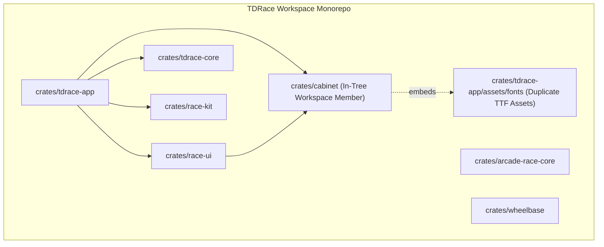
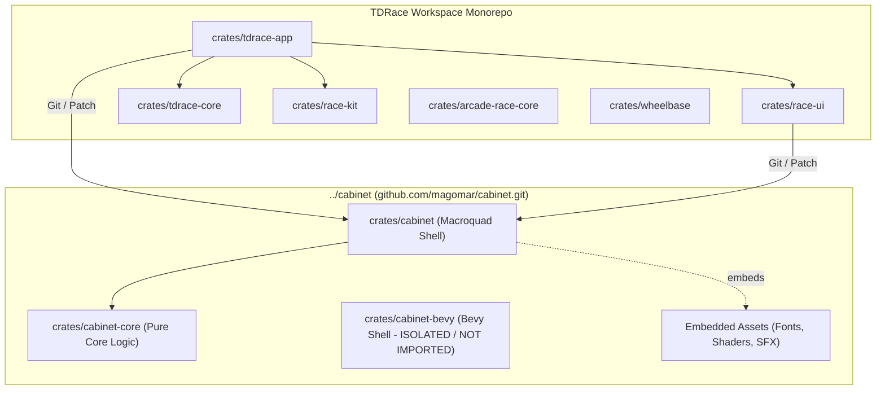

# Architecture Spec: Migrate to standalone cabinet repository 🏗️

A comprehensive technical architecture document specifying the migration of the `cabinet` arcade game shell dependency from the legacy in-tree workspace crate (`crates/cabinet`) to the standalone multi-engine `cabinet` repository located locally at `../cabinet` (hosted at `https://github.com/magomar/cabinet.git`).

---

## 🗺️ Current vs. Proposed System Architecture

### 1. Current Architecture
In the current setup, `crates/cabinet` lives as an in-tree workspace crate inside the `tdrace` repository. This introduces undesirable coupling:
- TrueType font assets (`Barlow-Medium.ttf`, `Barlow-SemiBold.ttf`, `Rajdhani-Bold.ttf`) are duplicated in both `crates/cabinet/assets/fonts/` and `crates/tdrace-app/assets/fonts/`.
- Platform enhancements to the reusable `cabinet` game shell require commits directly to `tdrace`, hindering reuse in sister game projects (e.g. `tdchariots`, `rallyraid-app`).
- The in-tree crate is tightly bound to `tdrace`'s workspace lifecycle rather than versioned independently.



### 2. Proposed Architecture
Under the proposed architecture, `tdrace` delegates all arcade shell, UI widget, audio mixer, modal navigation, and profile/settings management to the external `cabinet` repository (`magomar/cabinet`).
- The standalone repository separates concerns cleanly: `cabinet` (Macroquad shell in `crates/cabinet`) sits on top of engine-agnostic `cabinet-core` (`crates/cabinet-core`), with optional `cabinet-bevy` isolated in a separate crate.
- `tdrace` depends on `cabinet` via git (`https://github.com/magomar/cabinet.git`) with local workspace `[patch]` overrides pointing to `../cabinet/crates/cabinet` and `../cabinet/crates/cabinet-core`.
- Zero Bevy dependencies enter `tdrace` (`cargo tree -p cabinet` confirms absence of Bevy).
- `crates/cabinet` is entirely removed from the `tdrace` workspace.
- Duplicate font binaries in `crates/tdrace-app/assets/fonts/` are eliminated; fonts are embedded directly within the external `cabinet` crate.



---

## 🗄️ Database & Storage Migration Plan

### 1. Workspace Configuration (`Cargo.toml`)
- Remove `"crates/cabinet"` from root `Cargo.toml` `workspace.members`.
- Configure git repository resolution and local patch overrides:
  ```toml
  [patch."https://github.com/magomar/cabinet.git"]
  cabinet = { path = "../cabinet/crates/cabinet" }
  cabinet-core = { path = "../cabinet/crates/cabinet-core" }
  ```
- This configuration ensures:
  1. Local builds resolve immediately to sibling directory `../cabinet` for rapid iterative development.
  2. CI/CD or standalone checkouts clone from `https://github.com/magomar/cabinet.git` seamlessly.

### 2. Downstream Crate Dependencies
- Update `crates/race-ui/Cargo.toml`:
  ```toml
  cabinet = { git = "https://github.com/magomar/cabinet.git", default-features = false }
  ```
- Update `crates/tdrace-app/Cargo.toml`:
  ```toml
  cabinet = { git = "https://github.com/magomar/cabinet.git" }
  ```

### 3. Tree Cleanup & Asset Pruning
- Delete obsolete in-tree crate directory `crates/cabinet/`.
- Delete duplicate font assets in `crates/tdrace-app/assets/fonts/`:
  - `Barlow-Medium.ttf`
  - `Barlow-SemiBold.ttf`
  - `Rajdhani-Bold.ttf`
- Verify that `tdrace_app::ui::font::Fonts` continues to re-export `cabinet::ui::font::{Fonts, FONT_DISPLAY_BYTES, FONT_UI_BOLD_BYTES, FONT_UI_MEDIUM_BYTES}` directly from embedded slices in `cabinet`.
- Update any design mockups or asset paths referencing the deleted duplicate font files.
- **Database & Storage Impact**: No runtime SQLite or serialization schema migrations are required for this dependency restructuring; `cabinet::records` storage contracts remain backwards-compatible.

---

## 🔑 Security, Compliance, & IAM Roles

### 1. Zero Bevy Dependency Enforcement
- The standalone `cabinet` repository houses a `cabinet-bevy` crate for Bevy-based projects.
- `tdrace` uses `macroquad` exclusively as its 2D rendering foundation (per `specs/constitution/TECH_STACK.md`).
- Architectural boundary: `cargo tree -p cabinet` and `cargo tree -i bevy` must prove that neither `bevy`, `bevy_kira_audio`, nor any Bevy sub-crates are present in `tdrace`'s dependency graph.

### 2. Target Compilation Compatibility
- **Native Desktop (`x86_64-unknown-linux-gnu`)**: Full features enabled (`gamepad` via `gilrs`, `kira` audio mixer, `net` LAN multiplayer).
- **WebAssembly (`wasm32-unknown-unknown`)**: Audio (`kira`) and gamepad (`gilrs`) are conditionally compiled out; canvas rendering and `UiScaler` operate seamlessly without native system symbols.

### 3. Supply Chain Security & Dependency Integrity
- Dependency source pinned to official repository `https://github.com/magomar/cabinet.git` with verified local worktree patch.
- Zero external network calls required during local offline builds when using `[patch]`.

---

## 🛡️ Disaster Recovery, Monitoring, & Fallbacks

- **Git Rollback**: The migration is contained within a dedicated git branch (`feat/migrate-standalone-cabinet`). If upstream changes in `../cabinet` break API compatibility, the feature branch can be revised or reverted without affecting `main`.
- **Lockfile Integrity**: `Cargo.lock` records the exact git revision and local patch metadata. If the local checkout of `../cabinet` is absent in CI, Cargo falls back to fetching from GitHub.

---

## 🧪 Verification & Acceptance Criteria

### Automated Tests
- Dependency tree audit: `cargo tree -p cabinet` (must show zero `bevy` references).
- Workspace compilation: `cargo check --workspace`
- Rust test suite: `cargo test --workspace --exclude tdrace-py`
- WebAssembly build: `cargo build -p tdrace-app --target wasm32-unknown-unknown`
- Specification & Framework health: `keel validate`

### Manual Acceptance Criteria (Pseudo-Gherkin)

- **Scenario: Standalone cabinet dependency resolution and patch binding**
  - [x] **Given** root `Cargo.toml` configured with `[patch."https://github.com/magomar/cabinet.git"]` pointing to `../cabinet/crates/cabinet` and `../cabinet/crates/cabinet-core`
  - [x] **When** `cargo check --workspace` is executed
  - [x] **Then** Cargo resolves `cabinet` and `cabinet-core` to `../cabinet/crates/` without errors or missing symbol diagnostics

- **Scenario: Zero Bevy dependencies in crate dependency tree**
  - [x] **Given** the workspace depends on external `cabinet`
  - [x] **When** `cargo tree -p cabinet` is executed
  - [x] **Then** the dependency tree contains `cabinet-core`, `macroquad`, `glam`, `serde`, and optional `gilrs`/`kira`
  - [x] **And** no `bevy`, `bevy_*`, or related ECS dependencies appear in the tree

- **Scenario: Complete removal of legacy embedded cabinet and duplicate font assets**
  - [x] **Given** the migration changes applied
  - [x] **When** the file tree is checked
  - [x] **Then** the directory `crates/cabinet/` does not exist in the repository
  - [x] **And** `crates/tdrace-app/assets/fonts/` contains no redundant TrueType font files
  - [x] **And** `tdrace_app::ui::font::Fonts::load_embedded()` loads all fonts directly from `cabinet`'s embedded binary slices

- **Scenario: Clean native compilation and full test suite execution**
  - [x] **Given** the external `cabinet` dependency is active
  - [x] **When** `cargo test --workspace --exclude tdrace-py` is executed
  - [x] **Then** all unit, integration, UI, font, and physics tests pass with exit code 0

- **Scenario: Clean WebAssembly target compilation**
  - [x] **Given** target `wasm32-unknown-unknown` installed in the Rust toolchain
  - [x] **When** `cargo build -p tdrace-app --target wasm32-unknown-unknown` is executed
  - [x] **Then** compilation succeeds with exit code 0 and produces a valid WASM binary

---

## 🔗 Traceability & Codebase Mapping

### Created/Modified/Deleted Files
- `[x]` `Cargo.toml` -> Removes `crates/cabinet` from members; adds patch directives for standalone cabinet repo.
- `[x]` `crates/race-ui/Cargo.toml` -> Updates `cabinet` dependency to git repository.
- `[x]` `crates/tdrace-app/Cargo.toml` -> Updates `cabinet` dependency to git repository.
- `[x]` `crates/cabinet/` -> Entire legacy directory deleted.
- `[x]` `crates/tdrace-app/assets/fonts/` -> Obsolete duplicate font files deleted.
- `[x]` `specs/constitution/TECH_STACK.md` -> Updates cabinet entry to reflect external standalone multi-engine crate architecture.
- `[x]` `specs/constitution/ROADMAP.md` -> Records Spec 136 under living milestones.

### Verification Assertions
- `cargo tree -p cabinet` has zero matches for `bevy`.
- `cargo test --workspace --exclude tdrace-py` passes with 0 failures.
- `cargo build -p tdrace-app --target wasm32-unknown-unknown` succeeds.
