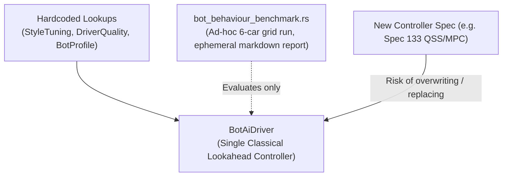
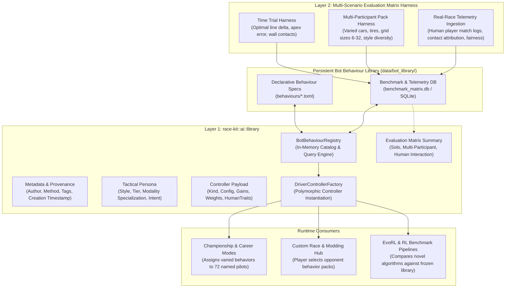

# Architecture Spec 137: Bot Behaviour Library, Provenance Registry, and Multi-Scenario Driving Performance Evaluation Matrix 📚🏎️🤖

Establishes a persistent, versioned **Bot Behaviour Library** and **Multi-Scenario Driving Performance Evaluation Matrix** for TDRace. Rather than destructively overwriting or replacing bot controllers when new algorithms (such as [Spec 133](../specs/133_physics_exact_qss_velocity_solver_online_sector_grip_memory_and_short_horizon_rollout_bot_controller.md)'s Quasi-Steady-State velocity solver and MPC rollout planner, [Spec 132](../specs/132_evorl_human_driving_imitation_telemetry_trajectory_extraction_and_multi_car_championship_tuning.md)'s human replay imitation, or [Spec 083](../specs/083_evorl_bot_driving_style_and_performance_optimization.md)'s EvoRL evolutionary sweeps) are developed, this architecture decouples behavioral storage from runtime execution.

It treats bot behaviors as first-class, immutable, and queryable assets containing complete creation provenance, intended driving style personas, controller payloads, and extensive driving performance telemetry from solo time trials, realistic multi-participant race simulations across varied modalities, car models, tire compounds, and driver diversity, as well as real-race human player interaction data.

---

## 🔍 Context & Motivation

1. **Avoid Destructive Algorithm Replacement**:
   - Currently, bot AI tuning in `race-kit` is hardcoded across static lookup tables (`StyleTuning::for_modality_and_style`, `DriverQuality::for_tier`, `BotProfile` in [`crates/race-kit/src/ai/mod.rs`](../crates/race-kit/src/ai/mod.rs)).
   - When a major controller upgrade is introduced (e.g. Spec 133's QSS friction-circle velocity solver and short-horizon MPC planner), the default instinct in monolithic game development is to modify or overwrite the existing controller.
   - However, **lap-time performance is not the only objective**. In game design and simulation research:
     - A controller with blistering time-trial pace may drive unrealistically aggressively or unnervingly close to human opponents.
     - A slower, slightly sub-optimal controller may exhibit much more believable racecraft, courteous overtaking etiquette, natural defensive lines, or authentic mistake profiles that feel engaging and fun when racing against human players.
     - Certain behaviors excel in specific operational niches (e.g., loose-surface dirt drifting in Autocross, pack drafting on NASCAR ovals, or navigating high-density 10-car launch chutes without pileups).
   - Preserving behaviors in a library ensures that earlier, well-characterized behaviors remain permanently available, reproducible, and selectable.

2. **Rich Creation Provenance**:
   - Bot behaviors are synthesized through diverse engineering methods: handcrafted heuristic feedback loops, evolutionary parameter optimization (EvoRL / CMA-ES), human telemetry imitation cloning, physics-exact quasi-steady-state solvers, or neural reinforcement learning policies.
   - Without a structured registry, the origins, training hyperparameters, git revisions, seeds, and intent of a tuned behavior are lost over time.

3. **Multi-Faceted Driving Performance Beyond Solo Hotlapping**:
   - Traditional benchmarks often evaluate bots exclusively in clean-air solo hotlaps.
   - Real motorsport competition introduces dynamic multi-agent interaction:
     - **Different car models**: Front-wheel-drive Supercar Lites vs. high-torque rear-drive Trans-Am vs. all-wheel-drive 600 BHP RX1e supercars.
     - **Tire compounds & degradation**: Slicks vs. grooved dirt tires vs. studded ice compounds, with thermal fade and tread wear.
     - **Pack density & starting grids**: 6-car World RX staggered chutes, 8-car Autocross chutes, 12-car GT grids, 24-to-32-driver tournament brackets.
     - **Driver diversity**: Grids populated by mixtures of styles (Aggressive, Smooth, Tenacious, Calculating, Bold, Balanced) and tiers (Rookie through Legend+).
   - Furthermore, telemetry from actual races against human drivers provides invaluable ground truth on contact rates, player perceived fairness, and believability that pure bot-vs-bot simulations cannot capture.

---

## 🗺️ Current vs. Proposed System Architecture

### 1. Current Architecture


### 2. Proposed Architecture


---

## 📐 Detailed Technical Design

### 1. Core Data Models (`crates/race-kit/src/ai/library/mod.rs`)

The `race-kit` crate defines decoupled, zero-allocation data structures for behavior representation, serialization, and querying:

```rust
use std::collections::HashSet;
use serde::{Deserialize, Serialize};
use crate::ai::{DriverTier, DrivingStyle, HumanTraits};

/// Unique identifier for a bot behavior asset.
#[derive(Debug, Clone, PartialEq, Eq, Hash, Serialize, Deserialize)]
pub struct BotBehaviourId(pub String);

/// Primary lifecycle status of a behavior entry.
#[derive(Debug, Clone, Copy, PartialEq, Eq, Hash, Serialize, Deserialize)]
#[serde(rename_all = "snake_case")]
pub enum BehaviourStatus {
    /// Active behavior approved for general game selection and career grids.
    Active,
    /// Candidate behavior undergoing simulation matrix evaluation or tuning.
    Candidate,
    /// Frozen golden standard used as a benchmark reference across versions.
    Baseline,
    /// Preserved historical behavior retained for compatibility or niche scenarios.
    Archived,
    /// Marked as obsolete or replaced for production use, but kept for evaluation.
    Deprecated,
}

/// Structured record of the engineering method(s) used to create this behavior.
#[derive(Debug, Clone, PartialEq, Serialize, Deserialize)]
#[serde(tag = "type", rename_all = "snake_case")]
pub enum CreationMethod {
    /// Handcrafted heuristic tuning of lookahead, PID gains, and braking margins.
    HandcraftedHeuristic {
        engineer: String,
        notes: String,
    },
    /// Evolutionary search (EvoRL / CMA-ES / Genetic Algorithm) over parameter spaces.
    EvolutionarySearch {
        pipeline: String,
        generation: u32,
        fitness_metric: String,
        best_fitness: f32,
        seed: u64,
        source_run_id: String,
    },
    /// Quasi-Steady-State friction-circle solver with short-horizon MPC rollouts (Spec 133).
    PhysicsExactQssMpc {
        solver_version: String,
        horizon_seconds: f32,
        rollout_candidates: usize,
        friction_circle_safety_margin: f32,
    },
    /// Behavior cloned or warm-started from human player telemetry replays (Spec 132).
    HumanImitationCloning {
        source_replay_path: String,
        driver_alias: String,
        trajectory_similarity_score: f32,
    },
    /// Deep Reinforcement Learning neural network policy (PPO / SAC / Gymnasium).
    ReinforcementLearningPolicy {
        framework: String,
        checkpoint_path: String,
        observation_space: String,
        action_space: String,
    },
    /// Multi-stage composite pipeline (e.g. EvoRL tuning applied on top of QSS solver).
    CompositeHybrid {
        primary_method: Box<CreationMethod>,
        secondary_stage: String,
        notes: String,
    },
}

/// Tactical philosophy, intended operational niche, and target difficulty tier.
#[derive(Debug, Clone, PartialEq, Serialize, Deserialize)]
pub struct DrivingPersona {
    /// Target tactical philosophy (Spec 023).
    pub style: DrivingStyle,
    /// Target experience and performance ladder tier (Spec 023 / Spec 131).
    pub tier: DriverTier,
    /// Intended motorsport module specialization (e.g. "classic", "karting", "rallycross", "universal").
    pub modality_specialization: String,
    /// High-level description of behavioral nuances (e.g. "Protects inside apex, avoids curb contact").
    pub tactical_notes: String,
}

/// Underlying runtime controller implementation family and configuration payload.
#[derive(Debug, Clone, PartialEq, Serialize, Deserialize)]
#[serde(tag = "controller_kind", rename_all = "snake_case")]
pub enum ControllerPayload {
    /// Classical single-point lookahead PD controller with heuristic braking scan.
    ClassicalLookahead {
        lookahead_time: f32,
        speed_factor: f32,
        steering_kp: f32,
        steering_kd: f32,
        brake_margin: f32,
        aggression: f32,
        avoidance_distance: f32,
        traits: HumanTraits,
    },
    /// Optimal racing line follower with unchoked corner exit (Spec 131).
    OptimalLineFollower {
        speed_factor: f32,
        steering_kp: f32,
        steering_kd: f32,
        brake_margin: f32,
        aggression: f32,
        avoidance_distance: f32,
        lookahead_distance_m: f32,
        traits: HumanTraits,
    },
    /// Physics-exact forward-backward QSS solver with online grip memory & MPC rollout (Spec 133).
    QssMpcRollout {
        speed_factor: f32,
        steering_kp: f32,
        steering_kd: f32,
        brake_margin: f32,
        aggression: f32,
        avoidance_distance: f32,
        horizon_s: f32,
        candidate_count: usize,
        cost_weights: MpcCostWeights,
        traits: HumanTraits,
    },
}

#[derive(Debug, Clone, Copy, PartialEq, Serialize, Deserialize)]
pub struct MpcCostWeights {
    pub progress_weight: f32,
    pub track_boundary_penalty: f32,
    pub vehicle_collision_penalty: f32,
    pub yaw_acceleration_penalty: f32,
}

/// The complete, self-documenting Bot Behaviour asset entity.
#[derive(Debug, Clone, PartialEq, Serialize, Deserialize)]
pub struct BotBehaviour {
    /// Unique behavioral identifier.
    pub id: BotBehaviourId,
    /// User-facing display title.
    pub name: String,
    /// Semantic version or revision string (e.g. "1.2.0").
    pub version: String,
    /// Lifecycle status.
    pub status: BehaviourStatus,
    /// Creation timestamp (ISO 8601 UTC).
    pub created_at: String,
    /// Author, engineer, or automated system that produced this behavior.
    pub author: String,
    /// Searchable categorical tags.
    pub tags: HashSet<String>,
    /// Summary narrative of behavioral traits, intended use cases, and known limitations.
    pub description: String,
    /// Structured creation provenance.
    pub provenance: CreationMethod,
    /// Behavioral persona and target driving style.
    pub persona: DrivingPersona,
    /// Executable controller configuration and weights.
    pub controller: ControllerPayload,
    /// Cached aggregate driving performance summary.
    pub performance_summary: Option<PerformanceSummaryMetrics>,
}
```

---

### 2. Multi-Scenario Driving Performance Evaluation Matrix

To satisfy the requirement that *"Performance is not all, and in some cases we might prefer bots that apparently are not so fast but they behave better against humans, or in very specific scenarios,"* the evaluation matrix decomposes driving behavior into three complementary dimensions:

```
                      Driving Performance Evaluation Matrix
                                      │
         ┌────────────────────────────┼────────────────────────────┐
         ▼                            ▼                            ▼
  Solo Time Trial              Multi-Participant            Real Race & Human
  Clean-Air Benchmarks         Pack Simulations             Player Interaction
  ────────────────────         ─────────────────            ──────────────────
  • Mean Flying Lap            • Finish Position Dist.      • Player Contact Rate
  • Delta to Ideal Line        • Car-to-Car Contacts/Lap    • Fault Attribution
  • Line Variance (sigma_lat)  • Clean Passes vs Divebombs  • Human Believability
  • Braking Spread (sigma_brk) • Traffic Jam Resistance     • Yield Fairness at Apex
  • Spin / Off-Track Rates     • Opponent Diversity Matrix  • Frustration Index
```

#### A. Solo Time Trial Benchmarks (`TimeTrialMetrics`)
Measures baseline driving execution, limit handling, and consistency in clean air:
- `fastest_lap_s`: Absolute fastest single lap time recorded.
- `mean_flying_lap_s`: Mean lap time across flying laps (excluding standing start).
- `pace_delta_to_optimal_pct`: Percentage delta relative to the theoretical physics limit computed from the optimal line and vehicle traction envelope.
- `lateral_spread_m`: Lateral standard deviation $\sigma_{\text{lat}}$ across laps at 200 fixed arc-length stations (spec 046).
- `brake_onset_spread_m`: Standard deviation $\sigma_{\text{brake}}$ of longitudinal braking trigger positions.
- `off_track_rate_per_lap`: Frequency of leaving the drivable road boundary per lap.
- `spin_rate_per_lap`: Frequency of vehicle heading deviating $> 90^\circ$ from the track tangent per lap.
- `wall_impact_rate_per_lap`: Number of discrete wall impact events per lap.

#### B. Multi-Participant Pack Simulation Matrix (`PackRaceMetrics`)
Measures racecraft, tactical agility, collision avoidance, and pack harmony across parametric race conditions replicating authentic motorsport:
1. **Modality & Surface Dimensions**:
   - High-downforce asphalt circuit (GT World Challenge).
   - Low-grip variable split-$\mu$ dirt/asphalt with jumps and Joker laps (Rallycross).
   - High-banked superspeedway drafting pack (NASCAR Stock Car).
   - Ultra-responsive, curb-hopping short course (KZ2 / OK-Junior Karting).
   - Loose-surface rutted sprint circuit with walled launch chutes (FIA Autocross).
2. **Vehicle & Powertrain Variation**:
   - Diverse vehicle dynamics: lightweight low-inertia karts vs. heavy high-power Trans-Am muscle cars vs. agile AWD buggies.
3. **Tire Compound & Degradation Variation**:
   - Grip levels: Competition super-soft (1.20 grip), standard street (1.00 grip), hard endurance (0.90 grip), wet/dirt grooved (0.80 grip).
   - Tire degradation states: Fresh cold tires ($0\%$ wear) vs. degraded heat-soaked tires ($60\%$ wear).
4. **Grid Size & Starting Configuration**:
   - 6-car staggered launch (World RX).
   - 8-car to 10-car packed launch chutes (Autocross / Rallycross).
   - 12-car rolling start pack (GT Challenge).
   - 24-car to 32-car endurance/tournament grid.
5. **Opponent Diversity Matrix**:
   - *Homogeneous Grid*: All opponents using identical balanced Pro bots.
   - *Uniform Style Mixture*: Grid containing equal proportions of all 6 styles (Aggressive, Smooth, Tenacious, Calculating, Bold, Balanced).
   - *Bell-Curve Tier Mixture*: Opponents sampled from Rookie through Legend+ to test overtaking through backmarker traffic and reacting to frontrunner pace.
6. **Recorded Multi-Participant Metrics**:
   - `mean_finish_position`: Average finishing position across $N$ simulated tournament heats.
   - `contacts_per_lap`: Average number of car-to-car collision events per lap.
   - `contact_impulse_severity`: Mean magnitude ($\text{N}\cdot\text{s}$) of contact impulses (separating harmless rub from destructive shunts).
   - `clean_passes_per_race`: Successful overtakes completed without physical contact.
   - `divebomb_incidents_per_race`: Overtakes initiated from $> 15\text{ m}$ back where lateral contact or corner blowout occurred.
   - `traffic_stall_time_s`: Total duration during a race where speed remained below $5\text{ m/s}$ due to pack bunching or pileups.
   - `pace_retention_in_pack_pct`: Ratio of mean lap time in pack traffic versus solo clean-air pace.

#### C. Real-World & Human Interaction Telemetry (`HumanInteractionMetrics`)
Logs empirical metrics captured from actual human players competing against the bot in Career, Custom Race, or LAN sessions:
- `player_contacts_per_race`: Direct contacts between the bot and the human player's vehicle.
- `fault_attribution_pct`: Percentage of bot-human collisions attributed to bot aggression (rear-ending the player or squeezing without leaving room) vs. player errors.
- `apex_courtesy_rating`: Rate at which the bot respects a human player who has achieved $\ge 50\%$ vehicle overlap at corner turn-in.
- `believability_turing_index`: Composite score derived from human post-race surveys or telemetry markers (presence of minor steering corrections, recovery pauses, and plausible reaction delays).
- `restart_frustration_correlation`: Statistical correlation between racing against this bot and the player selecting "Restart Race" immediately following an interaction.

---

### 3. File System Layout & Database Schema

#### A. File Hierarchy
```
data/
└── bot_library/
    ├── README.md                          # Documentation and schema guide
    ├── catalog.json                       # Master manifest of all registered behaviors
    ├── behaviours/                        # Declarative TOML behavior specifications
    │   ├── heuristic_classic_pro.toml
    │   ├── evorl_blaze_rx_aggressive_v4.toml
    │   ├── human_imitation_spa_gt3_v2.toml
    │   ├── qss_mpc_legend_calculating_v1.toml
    │   └── ...
    └── benchmark_matrix.db                # SQLite database for high-volume telemetry & scenario runs
```

#### B. Declarative TOML Example (`data/bot_library/behaviours/qss_mpc_legend_calculating_v1.toml`)
```toml
[metadata]
id = "qss_mpc_legend_calculating_v1"
name = "QSS Friction-Circle Calculating Legend"
version = "1.0.0"
status = "active"
created_at = "2026-10-22T19:00:00Z"
author = "spec_133_qss_agent"
tags = ["qss", "mpc", "friction_circle", "calculating", "high_grip", "pack_racing", "spec_133"]
description = "Calculates maximum corner entry speed via 3-pass quasi-steady-state friction-circle solver and uses 5-candidate short-horizon MPC rollouts for clean, low-contact pack racing."

[provenance]
type = "physics_exact_qss_mpc"
solver_version = "v1.0-friction-ellipse"
horizon_seconds = 0.60
rollout_candidates = 5
friction_circle_safety_margin = 0.96

[persona]
style = "calculating"
tier = "legend"
modality_specialization = "universal"
tactical_notes = "Patient on corner entry, excels at slipstreaming and setting up exit passes without divebombing."

[controller]
controller_kind = "qss_mpc_rollout"
speed_factor = 1.033
steering_kp = 2.40
steering_kd = 0.07
brake_margin = 0.98
aggression = 0.75
avoidance_distance = 6.5
horizon_s = 0.60
candidate_count = 5

[controller.cost_weights]
progress_weight = 1.0
track_boundary_penalty = 50.0
vehicle_collision_penalty = 100.0
yaw_acceleration_penalty = 5.0

[controller.traits]
mistake_probability = 0.005
line_variability = 0.02
reaction_delay_s = 0.05

[performance_summary]
best_flying_lap_s = 48.24
mean_flying_lap_s = 48.61
pace_delta_to_optimal_pct = 1.15
contacts_per_lap = 0.04
clean_pass_ratio = 0.94
human_believability_score = 0.92
```

#### C. Relational SQLite Schema (`data/bot_library/benchmark_matrix.db`)
When high-throughput simulation sweeps or real-race sessions occur, detailed run records are persisted to SQLite for SQL-based querying and comparison:

```sql
CREATE TABLE IF NOT EXISTS behaviours (
    id TEXT PRIMARY KEY,
    name TEXT NOT NULL,
    version TEXT NOT NULL,
    status TEXT NOT NULL,
    created_at TEXT NOT NULL,
    author TEXT NOT NULL,
    creation_method_type TEXT NOT NULL,
    driving_style TEXT NOT NULL,
    driver_tier TEXT NOT NULL,
    modality_specialization TEXT NOT NULL,
    controller_kind TEXT NOT NULL,
    raw_toml TEXT NOT NULL
);

CREATE TABLE IF NOT EXISTS time_trial_benchmarks (
    run_id TEXT PRIMARY KEY,
    behaviour_id TEXT NOT NULL REFERENCES behaviours(id),
    track_slug TEXT NOT NULL,
    car_model TEXT NOT NULL,
    tire_compound TEXT NOT NULL,
    surface_condition TEXT NOT NULL,
    laps_completed INTEGER NOT NULL,
    fastest_lap_s REAL NOT NULL,
    mean_flying_lap_s REAL NOT NULL,
    optimal_lap_delta_pct REAL NOT NULL,
    lateral_spread_m REAL NOT NULL,
    brake_onset_spread_m REAL NOT NULL,
    spin_count INTEGER NOT NULL,
    off_track_count INTEGER NOT NULL,
    wall_impact_count INTEGER NOT NULL,
    executed_at TEXT NOT NULL
);

CREATE TABLE IF NOT EXISTS pack_race_benchmarks (
    run_id TEXT PRIMARY KEY,
    behaviour_id TEXT NOT NULL REFERENCES behaviours(id),
    scenario_name TEXT NOT NULL,
    track_slug TEXT NOT NULL,
    car_model TEXT NOT NULL,
    grid_size INTEGER NOT NULL,
    grid_starting_pos INTEGER NOT NULL,
    finish_position INTEGER NOT NULL,
    opponent_diversity_profile TEXT NOT NULL,
    contacts_per_lap REAL NOT NULL,
    mean_contact_impulse REAL NOT NULL,
    clean_passes INTEGER NOT NULL,
    divebomb_passes INTEGER NOT NULL,
    traffic_stall_time_s REAL NOT NULL,
    dnf_occurred INTEGER NOT NULL,
    executed_at TEXT NOT NULL
);

CREATE TABLE IF NOT EXISTS human_interaction_telemetry (
    session_id TEXT PRIMARY KEY,
    behaviour_id TEXT NOT NULL REFERENCES behaviours(id),
    player_id TEXT NOT NULL,
    track_slug TEXT NOT NULL,
    car_model TEXT NOT NULL,
    player_contacts INTEGER NOT NULL,
    bot_fault_contacts INTEGER NOT NULL,
    player_fault_contacts INTEGER NOT NULL,
    courtesy_yield_count INTEGER NOT NULL,
    overtake_fairness_score REAL NOT NULL,
    player_restarted INTEGER NOT NULL,
    recorded_at TEXT NOT NULL
);

CREATE INDEX IF NOT EXISTS idx_tt_behaviour ON time_trial_benchmarks(behaviour_id, track_slug);
CREATE INDEX IF NOT EXISTS idx_pack_behaviour ON pack_race_benchmarks(behaviour_id, scenario_name);
CREATE INDEX IF NOT EXISTS idx_human_behaviour ON human_interaction_telemetry(behaviour_id);
```

---

### 4. Query & Selection Engine (`BotBehaviourRegistry`)

The registry in `race-kit` provides a strongly-typed query API allowing the game, career mode, tournament organizers, and RL researchers to locate behaviors matching multidimensional requirements:

```rust
pub struct BotQuery {
    pub style: Option<DrivingStyle>,
    pub tier: Option<DriverTier>,
    pub modality: Option<String>,
    pub min_status: Option<BehaviourStatus>,
    pub required_tags: Vec<String>,
    pub max_contacts_per_lap: Option<f32>,
    pub max_pace_delta_pct: Option<f32>,
    pub min_human_believability: Option<f32>,
}

impl BotBehaviourRegistry {
    /// Queries the registry for all active behaviors matching the given query filters.
    pub fn search(&self, query: &BotQuery) -> Vec<&BotBehaviour> {
        self.behaviours
            .values()
            .filter(|b| {
                if let Some(style) = query.style {
                    if b.persona.style != style { return false; }
                }
                if let Some(tier) = query.tier {
                    if b.persona.tier != tier { return false; }
                }
                if let Some(ref mod_spec) = query.modality {
                    if b.persona.modality_specialization != "universal" 
                        && &b.persona.modality_specialization != mod_spec {
                        return false;
                    }
                }
                if !query.required_tags.iter().all(|t| b.tags.contains(t)) {
                    return false;
                }
                if let Some(max_contacts) = query.max_contacts_per_lap {
                    if let Some(ref perf) = b.performance_summary {
                        if perf.contacts_per_lap > max_contacts { return false; }
                    }
                }
                true
            })
            .collect()
    }
}
```

---

### 5. Integration with Spec 133 and Controller Pipeline

When [Spec 133](../specs/133_physics_exact_qss_velocity_solver_online_sector_grip_memory_and_short_horizon_rollout_bot_controller.md) is implemented:
1. Spec 133 introduces `SolvedVelocityProfile`, `AdaptiveGripMemory`, and the 5-candidate short-horizon MPC rollout algorithm into `race-kit`.
2. Instead of replacing `BotProfile` or discarding classical lookahead PD controllers, Spec 133 will simply register its controller as a new variant: `ControllerPayload::QssMpcRollout`.
3. Pre-existing behaviors (`ClassicalLookahead`, `OptimalLineFollower` from Spec 131) remain registered as active behaviors in `data/bot_library/behaviours/`.
4. Automated evaluation runs compare the new QSS+MPC candidate against the baseline library across the standard evaluation matrix, updating the SQLite ledger.
5. In game modes (such as Career or Custom Championship), the roster generator can assign different behavior profiles to different named opponents:
   - Aggressive rivals can run high-pressure EvoRL-tuned controllers.
   - Tactical veterans can run QSS+MPC calculating controllers.
   - Novice drivers can run classical humanized controllers with realistic mistake traits.

---

## 🗄️ Database & Storage Migration Plan

1. **Phase 1 — Schema Scaffolding & Initial Seed**:
   - Create directory `data/bot_library/behaviours/`.
   - Seed baseline behavior TOML files representing the canonical 6 driving styles and 5 tiers currently in `crates/race-kit/src/ai/mod.rs`:
     - `canonical_smooth_pro.toml`
     - `canonical_aggressive_pro.toml`
     - `canonical_tenacious_pro.toml`
     - `canonical_calculating_pro.toml`
     - `canonical_bold_pro.toml`
     - `canonical_balanced_pro.toml`
     - Error-free `canonical_pro_plus.toml` and `canonical_legend_plus.toml` (Spec 131).
   - Generate initial SQLite tables in `data/bot_library/benchmark_matrix.db`.
2. **Phase 2 — Harness Calibration & Performance Backfill**:
   - Run the automated `bot_harness` suite to backfill time trial and pack race benchmark records for all initial seed behaviors.
3. **Phase 3 — Controller Factory Integration**:
   - Connect `DriverControllerFactory` to `RaceSession` and `RaceWorld`, allowing bot drivers to be instantiated directly by `BotBehaviourId`.
4. **Phase 4 — Spec 133 & Future Controller Ingestion**:
   - Upon implementation of Spec 133 (or EvoRL tuning runs from Spec 083 / 132), new behaviors are added as `.toml` files and tested through the matrix harness without modifying existing files.

---

## 🔑 Security, Compliance, & IAM Roles

1. **Bit-Identical 60 Hz / 120 Hz Determinism**:
   - All evaluation simulations within the multi-scenario harness must execute using fixed physics timesteps ($\Delta t = 1/120\text{ s}$) with pure pseudo-random number seeds (`LcgRng`).
   - Replaying a simulation scenario with identical inputs must produce bit-identical trajectory hashes (`controls_hash`).
2. **Zero In-Race Heap Allocation**:
   - Controller evaluation per physics tick must remain allocation-free. Controller parameters and state buffers (such as MPC candidate scratchpads or sector grip arrays) are allocated at initialization time.
3. **Graceful Asset Fallback**:
   - If a custom or modded behavior file fails validation or has missing parameters, the engine automatically logs a warning and falls back to `BotProfile::pro()` without crashing.
4. **Frozen Baselines**:
   - Behaviors marked with `status = "baseline"` are immutable; their parameters cannot be modified in place. Any tuning adjustments require issuing a new behavior ID with an incremented revision or timestamp.

---

## 🛡️ Disaster Recovery, Monitoring, & Fallbacks

- **Corrupted Behavior Files**:
  - Validated with strict Serde schemas and integrity checksums. Malformed TOML files are isolated to an `.error` quarantine directory.
- **Performance Drift Detection**:
  - Whenever physics or tire parameters in `wheelbase` change, the automated CI benchmark suite reruns the baseline library matrix. If lap times or contact rates diverge by $> 3\%$, a CI regression alert is raised.
- **Rollback Procedure**:
  - Because all behaviors are declarative versioned files, reverting an errant behavior is as simple as switching its status to `deprecated` or deleting its `.toml` entry from `data/bot_library/behaviours/`.

---

## 🧪 Verification & Acceptance Criteria

### Automated Tests
- Command to run library unit and serialization tests:
  ```bash
  cargo test -p race-kit --lib ai::library
  ```
- Command to run the multi-scenario benchmark harness integration test:
  ```bash
  cargo test -p tdrace-app --test bot_library_benchmark_tests
  ```
- Command to execute the benchmark matrix CLI:
  ```bash
  cargo run -p tdrace-app --bin bot_library_manager -- list
  cargo run -p tdrace-app --bin bot_library_manager -- benchmark --behaviour canonical_balanced_pro --scenario standard_pack_gt
  ```

### Manual Acceptance Criteria (Pseudo-Gherkin)

- **Scenario: Registering and retrieving a new behavior with complete creation provenance**
  - [x] **Given** a declarative TOML behavior file specifying `PhysicsExactQssMpc` provenance, calculating driving style, and Pro tier
  - [x] **When** the `BotBehaviourRegistry` scans and loads the `data/bot_library/behaviours/` directory
  - [x] **Then** the behavior is registered with status `Active`, complete provenance metadata, and is retrievable via its unique `BotBehaviourId`

- **Scenario: Preserving existing behaviors when a new controller is introduced**
  - [x] **Given** an existing registered baseline behavior `canonical_balanced_pro`
  - [x] **When** a new Spec 133 behavior `qss_mpc_legend_calculating_v1` is added to the library
  - [x] **Then** `canonical_balanced_pro` remains unchanged, bit-identical in control hash, and both behaviors are simultaneously selectable

- **Scenario: Multi-scenario simulation matrix evaluates varied cars, tires, and grid sizes**
  - [x] **Given** a registered bot behavior candidate
  - [x] **When** the automated benchmark matrix executes the multi-participant pack harness across 6-car RX grids, 8-car Autocross chutes, and 12-car GT grids with varied tire wear
  - [x] **Then** simulation results record finishing positions, car-to-car contact rates per lap, and clean pass ratios into `benchmark_matrix.db`

- **Scenario: Querying behaviors by non-pace criteria (safety and racecraft etiquette)**
  - [x] **Given** a query filtering for behaviors with `contacts_per_lap <= 0.05` and `style = DrivingStyle::Smooth`
  - [x] **When** `BotBehaviourRegistry::search` is invoked
  - [x] **Then** only behaviors satisfying both the tactical style and low-contact racecraft criteria are returned, regardless of raw lap time ranking

- **Scenario: Ingestion and logging of real-race human player telemetry**
  - [x] **Given** a human player completing a race against a library bot driver
  - [x] **When** the race session completes and emits telemetry events
  - [x] **Then** human interaction metrics (player contact count, bot fault attribution, and apex courtesy compliance) are logged to the telemetry database for that behavior

- **Scenario: Graceful fallback on corrupted behavior asset**
  - [x] **Given** a corrupted or syntactically invalid TOML file in `data/bot_library/behaviours/`
  - [x] **When** the engine initializes `BotBehaviourRegistry`
  - [x] **Then** a warning is logged, the invalid file is skipped without crashing, and fallback defaults are supplied to game sessions

---

## 🔗 Traceability & Codebase Mapping

### Created/Modified Files
- `[x]` `crates/race-kit/src/ai/library/mod.rs` -> Data structures, `BotBehaviour`, `CreationMethod`, `DrivingPersona`, `ControllerPayload`.
- `[x]` `crates/race-kit/src/ai/library/registry.rs` -> `BotBehaviourRegistry` catalog, search filters, and query engine.
- `[x]` `crates/race-kit/src/ai/library/factory.rs` -> `DriverControllerFactory` instantiating controllers for any `BotVehicle`.
- `[x]` `crates/race-kit/src/ai/mod.rs` -> Re-exports library modules and connects to existing `BotAiDriver`.
- `[x]` `crates/tdrace-app/src/ai/bot_harness.rs` -> Extended multi-scenario evaluation harness (time trial, pack simulation, diversity matrices).
- `[x]` `crates/tdrace-app/src/ai/library_storage.rs` -> TOML parser and SQLite persistence bridge (`benchmark_matrix.db`).
- `[x]` `crates/tdrace-app/src/bin/bot_library_manager.rs` -> CLI tool for listing, validating, benchmarking, and exporting library reports.
- `[x]` `data/bot_library/README.md` -> Master index and documentation of behaviors.
- `[x]` `data/bot_library/behaviours/*.toml` -> Declarative behavior specification files.
- `[x]` `crates/tdrace-app/tests/bot_library_benchmark_tests.rs` -> Integration tests verifying persistence, multi-scenario evaluation, and non-pace query filtering.

### Verification Assertions
- All public types in `crates/race-kit/src/ai/library/` reference `specs/137_bot_behaviour_library_provenance_registry_and_multi_scenario_driving_performance_evaluation_matrix.md` in module doc comments.
- Zero per-tick heap allocations during `compute_controls` across all library-instantiated controllers.
